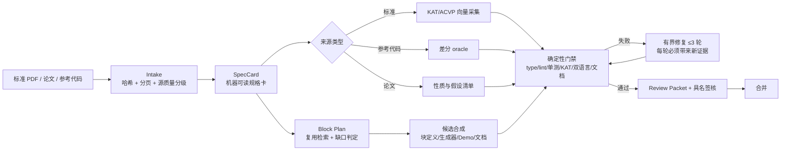
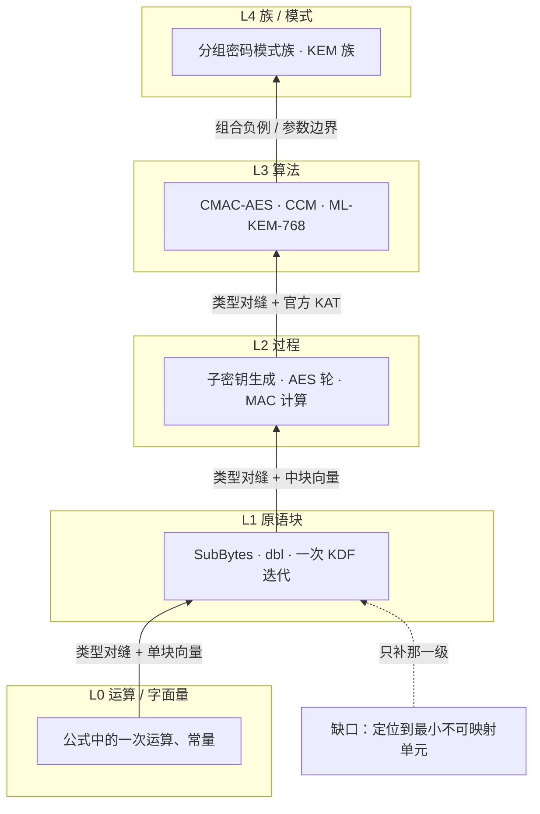
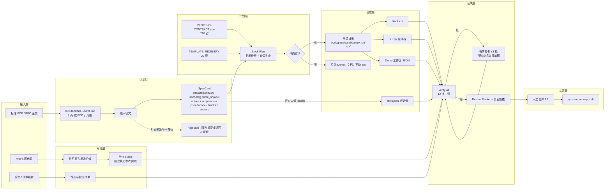
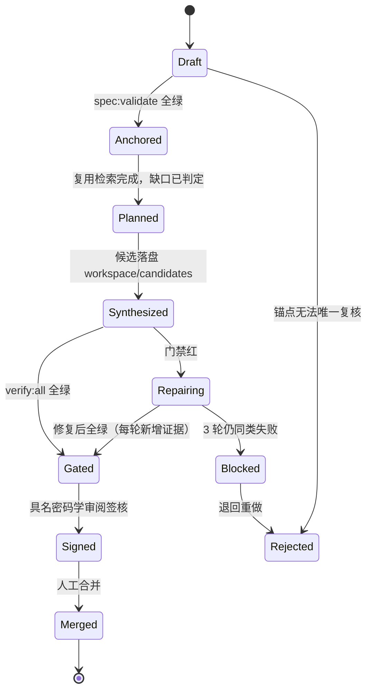
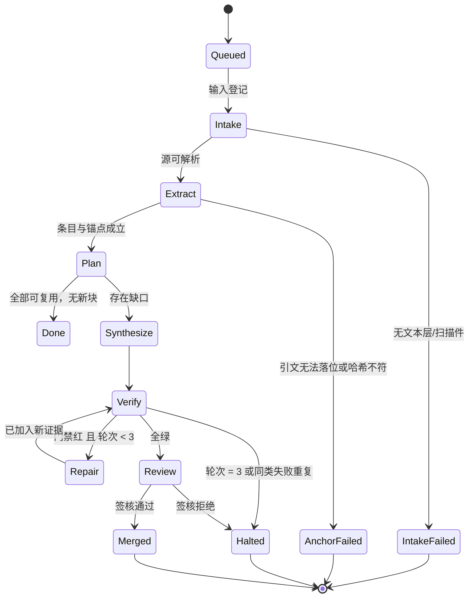

# AI Helper 调研：把文献、标准与参考代码转成 MCL Blockly 资产

**调研日期：** 2026-11-13
**范围：** 能否、以及怎样做一个「AI helper」，把标准（NIST FIPS/SP、GB/T、GM/T、RFC）、文献（论文/技术报告）与参考实现代码，转成 MetaCrypto Online IDE / metacrypt_server 的 Blockly 资产（积木定义、双语言生成器、Demo、文档条目）；MCL 文本不在范围（见下行任务边界）。本文是可行性调研与设计建议，**不是**已实现能力的声明，也**不是**对任何工具或模型的背书。
**证据等级：** [A] 论文自述的实测结果（只到检索摘要级）；[B] 官方文档/标准声明；[C] 二手转述或汇总页；[D] 本报告分析或本项目实测。
**环境限制：** 本机 `web_fetch` 对所有外部域名被 SSRF 策略拦截（域名解析到 `198.18.0.0/15` 的代理假 IP），外部来源只能读到检索摘要；凡涉及页码、表号、完整实验设置的结论，写论文前必须联网复核原文。
**任务边界（owner 2026-11-13 裁定）：** 本任务的交付物只到 **Blockly 侧资产**——块定义、JS/Python 双生成器、注册链、工具箱条目、Demo/KAT、标准文档条目。**MCL 相关全部出范围**：MCL 文本视图、Blockly→MCL 适配器、平台 MCL 生成器缺口（约 82/216 块无生成器）、MCL-Core 与 MCLProver 都不在本次范围内，「另说」。下文保留 MCL 现状描述只为解释为什么不能把它当验证目标，不代表要做它。

## 0. 一页结论

1. **能做，但正确的产品定义不是「一键转换」，而是「候选生成 + 确定性门禁裁决 + 人工签核」。** 现有仓库已经具备裁决所需的机器可读资产（220 个块的 I/O 契约、60 个可执行 Demo、229 个结构化标准条目、66 个标准制品哈希、`verify:all` 与 `ai-draft-gate.sh`），缺的是把它们串起来的中间表示与生成脚手架。
2. **三种「转换」的难度差一个量级，应分先后：** 「提取」（PDF → 结构化条目）最容易；「转写」（参考代码/已知算法 → 积木与生成器）有差分 oracle，次难；「综合」（只有规范文本 → 从零生成实现）最难，公开证据也最弱。先做前两种，第三种只在有官方向量的算法上做。
3. **最高杠杆的投入不是模型，而是 SpecCard（机器可读规格卡）与独立 oracle。** LLM 会写 AES，但不会自动知道「这个字节序是标准的还是它编的」；公开证据显示 LLM 生成的密码代码在「能编译」的样本里仍有 57.1% 存在密码误用[A]，而积木式程序生成里 F1/解析成功率 >0.93 的模型，语义完全正确的样本不足 18.9%[A]。表示层应让模型输出**扁平 IR**（块类型 + 字段 + 子槽），再由确定性代码组装成 workspace JSON，而不是直接生成整份 JSON。
4. **MCL 现在不是可执行的验证目标，也不在本任务范围内。** MCL-Core 是独立语言（36 册规格、`check`/`gen --target c`，窄子集）；平台的 MCL 生成器是「薄封装 + 伪代码」，216 个块里按类型名匹配有 82 个没有对应生成器、落到 `UNSUPPORTED_OP` 占位（该数字是名称匹配的下界估计），且没有覆盖率门禁。因此**不能**用「生成了 MCL 文本」代替 Blockly 资产的验收；MCL 文本视图、适配器与生成器缺口均不在本任务范围内。
5. **形态建议：离线开发期 CLI 先行**（`npm run spec:*`），不默认做应用内 LLM 功能；应用内形态需要单独的数据出境、提示注入与审计评审。`src/` 的语言层在本任务内，应用层属独立工作包（范围切分见 §4.9）。
6. **分期建议：** P0 做 SpecCard + 3 个已实现算法的回放（不生成代码）；P1 做脚手架与 Demo/测试生成；P2 做生成器体合成与有界修复环；P3 的 MCL 文本与论文输入**另立项目，不在本任务范围**。全部产出止于 Blockly 侧资产。
7. **公开系统里没有完全对标的对象（§3.5 增量检索）。** 按「离本项目哪一段最近」可分五族：标准→已验证实现（NSA Foundation + AdaCore SPARK、SymCrypt、CryptoProver）、论文→代码仓库（Paper2Code、DeepCode、DeepRepro）、积木/DSL + LLM（TutoriaLLM、blockly-ai-playground）、积木式密码教学（CryptoScratch、发表版 MetaCrypto Online）、规格驱动开发（Kiro Specs、Spec Kit）。**没有系统同时做「标准原文锚点 + 积木资产 + 双语言生成器 + KAT 门禁」**；最近邻是前两族。

8. **Blockly 本身就是一门语言，所以这件事的正确类比是「源到源翻译」而不是「内容生成」：拆解 = 解析，合成 = 带类型检查的逐级拼接。** 目标是 AST 语言（workspace JSON + `check` 标签 + 生成器语义），因此判据只能落在「语法上能否连接成合法程序」与「语义上两门语言是否算出官方向量」。缺了粒度阶梯（§1.1、§4.3.1），缺口就永远只能被描述成「请实现整个算法」。

## 1. 「MCL Blockly 系统」到底指什么

这个词在当前仓库至少对应三件不同的东西，混在一起会让方案失真：

| 对象 | 位置 | 现状（本次实测） | 能否执行/验证 |
|---|---|---|---|
| MetaCrypto Online IDE Blockly | `src/blocks/`、`src/generators/{javascript,python}/` | 220 个活动块；JS/Python 双生成器；`BLOCK-IO-CONTRACT.json` 机器可读；60 个 Demo 可用官方/性质向量执行 | **能**，是今天唯一可端到端验证的产物 |
| 平台 MCL 生成器 | `metacrypt_server/frontend/src/features/blockly/core/generators/mcl/` | 薄封装：每个块只发出 `SHA256_PAD(INPUT)` 一类 MCL 调用；216 个块中按名称匹配有 82 个无生成器，兜底 `UNSUPPORTED_OP(...)`；MCL→CUDA 编译器是实验模块，明确不在测评路径 | **不能**，MCL 输出既无端到端测试也无执行门禁 |
| MCL-Core | `../MetaCrypto-Language/` | 独立类型化 DSL；36 册规格 16815 行；`mcl check` / `mcl gen --target c`；`corpus/mlkem.mcl` 238 行，`check` 报 25 个函数 proved、181 条义务、13 条未证 + 14 个 TCB 成员 | **部分能**：只覆盖确定性纯函数、定长 Bytes/Bits、模整数、有界循环的窄子集；无 Blockly 适配器 |

**推论（owner 已裁定，2026-11-13）：** 交付物落在 **Blockly 块 + JS/Python 生成器 + Demo/KAT**，这一点已定；MCL 侧（文本视图、Blockly→MCL 适配器、`mcl check` 裁决路径）**整条出范围**，归入「另一个项目」。因此本报告后续凡出现 MCL 的内容，只作为「为什么不能用 MCL 代替 Blockly 验收」的反面依据，不作为交付项或验收口径。

### 1.1 换个视角：Blockly 本身是一门语言

上面的「三件东西」容易混，是因为没先把**目标语言**说清楚。Blockly 不是「一堆积木的 UI」，它具备一门语言该有的全部部件：

| 语言部件 | Blockly 里的对应物（本仓库实测） |
|---|---|
| 字面量与字段 | 块字段：文本输入、下拉、`data_value` 的数值/字符串 |
| 语法 | 块类型 + 输入槽（`input_statement`/`input_value`）+ 连接规则（`setCheck`、`setPreviousStatement`） |
| **程序表示** | **workspace JSON**（本质是 AST，另带 `id`/`x`/`y` 布局与 `extraState`）——不是文本 |
| 类型系统 | `check` 标签（`Bytes`/`Bits`/`Int`/`PubKey`…）加 `TYPE_CONVERSION_RULES` 的五种转换模式；现状是**弱标签**：只有部分块调用 `setCheck`，生成器不做类型检查，系数域与 NTT 域也未区分 |
| 抽象与库 | `procedures_defreturn`/`procedures_callreturn` 等价 λ 抽象与调用；29 个 `proc_*` 模板是预填好的库函数；220 个活动块是内建库 |
| 语义 | 生成器：JS/Python 各一套指称语义（每块映射为一段表达式/语句），`provideFunction_` 注入内嵌实现 |
| 执行 | 生成后的代码在浏览器沙箱/本地解释器里跑，输出与 KAT 比对 |

**这个视角换来三条可执行的结论：**

1. **「把标准转成 Blockly」是源到源翻译（source-to-source），不是内容生成。** 目标是一门 AST 语言，正确性判据只能是「翻译后语义等价」；因此必须同时有两套 oracle：语法层（能否连接成合法程序、类型是否对缝）与语义层（两门目标语言是否都算出官方向量）。
2. **拆解 = 解析（parse），合成 = 带类型检查的拼接（grafting）。** 见 §4.3.1 的粒度阶梯：原文的层次包含结构要原样保留到 Blockly 的 L0–L4。
3. **让模型直接吐 workspace JSON，等于让它同时产出 AST、布局与序列化细节**，噪声最大、出错最难定位——这正是 §4.4.1 当初改用扁平 IR 的原因（该推断已被 2026-11-14 的四轮对照实验证否，见 §4.4.1 末的「实测结论」）。

顺带解释一个反复出现的困惑：MCL 文本不是「另一种语法」，而是**同一程序的另一种渲染**。没有适配器与执行门禁时，渲染再漂亮也不构成语义证据——这也是它被划出范围的原因。

## 2. 现有资产与手工流水线解剖

### 2.1 已经就位的机器可读资产

| 资产 | 数量 | 权威来源（本次实跑） | 对 helper 的用途 |
|---|---:|---|---|
| 活动块类型与端口契约 | 220 | `docs/blocks/BLOCK-IO-CONTRACT.json`（键数 220） | 约束生成块的输入/输出/字段签名，禁止「发明接口」 |
| 标准/参考目录 | 40 | `node scripts/check-standard-metadata.mjs` → `entries=40 directories=40 artifacts=66` | 决定试点与去重 |
| 块签名重算门禁 | 每次 `verify:all` | 由真实 Blockly 块重算并与契约逐字节比对 | 生成后必须与契约一致，否则门禁红 |
| 结构化标准条目 | 229 | `node scripts/check-standard-inventory.mjs --check` → `structured=229` | SpecCard 的初始语料 |
| 条目锚点 | 222（181 行号 + 41 PDF 页） | 同上 → `standard_source_entries=222 line_anchors=181 pdf_page_anchors=41` | 锚点校验器的输入；也是 AI 最容易编造的部分 |
| 标准制品哈希 | 66 | `standards:check` → `artifacts=66` | 源快照防漂移 |
| Demo 可执行用例 | 59 | `demos/tests.json`（键数 59） | KAT oracle 的现成载体 |
| 过程模板身份 | 29 | `CONFORMANCE-INVENTORY.md` / `TEMPLATE_REGISTRY` | 高层算法的「可拼装」目标 |
| AI 草稿门禁 | 5 步 | `scripts/ai-draft-gate.sh` | 已明确「通过门禁 ≠ AI 建议正确」 |

### 2.2 一次「加一个算法」实际要动多少东西

用仓库里两次真实提交做基线（`git show --stat`）：

| 提交 | 文件数 | 新增行 | 覆盖内容 |
|---|---:|---:|---|
| `ccf8b91` CMAC（SP 800-38B） | 10 | 377 | 块定义、JS/Python 生成器、两处注册、工具箱 |
| `856637e` XTS（SP 800-38E） | 15 | 246 | 上述 + Demo JSON、`tests.json`、块文档、审计报告 |

把这几次提交与后续补齐（`3849d27` 内部算子）合起来，一个算法从「标准条目」到「可回归资产」通常要碰 **15–25 个文件、700–1200 行**，其中真正「算法逻辑」只占一部分，其余是：注册链、i18n、工具箱、Demo 工作区、测试期望、分类文档、覆盖矩阵、审计表、MCL 薄封装、metacrypt 镜像同步。**人工成本主要不在写算法，而在把同一事实写到十个地方并保持一致。**

### 2.3 文档侧的真实状态（决定 SpecCard 能不能立起来）

- 40 个目录、229 个条目、222 个有标准原文锚点，说明「条目—原文」的骨架已经存在，但**不是机器可读的**：状态字段是自由文本（`已实现`/`部分实现`/`仅参考`/长句说明混用），没有受控词表；条目与块/模板/Demo 的映射写在「项目映射」散文里。
- 39 个页面在「公式或伪代码」节自述是「面向用户的结构化摘要，不是标准原文的完整逐字摘录」，与 `STRUCTURED-ENTRY-SCHEMA.md` 要求的「完整规范单元」不一致；公式门禁只检查字段存在与代码块，不检查保真度。
- 这说明：**AI 不能把现有条目当作「忠实提取」的范本去模仿**；SpecCard 必须把「逐字/摘要」做成显式字段，并让锚点校验器决定能不能升级为证据。

## 3. 外部证据：哪些环节真的有把握

> 说明：以下均为检索摘要级证据，数字是各论文在**其自有基准**上的结果，不可跨论文相加，也不可直接外推到密码学教学代码。完整引用见 §9。

### 3.1 论文/代码 → 可运行实现

| 工作 | 做什么 | 公开结果 | 对本项目的含义 |
|---|---|---|---|
| Paper2Code / PaperCoder（arXiv 2504.17192，ICLR 2026） | 多 agent 三阶段（规划/分析/生成）把 ML 论文变成代码仓库 | PaperBench Code-Dev 上 45.14% vs 基线 16.4%[C] | 「论文→代码」可行但绝对水平低；适合做**候选**，不适合无人值守 |
| Spec2Code（ASE 2025） | 把 RFC 规范映射到函数级实现，判断函数「完全/部分/不」实现规范 | 在 Apache Httpd、Nginx、OpenSSL、BoringSSL 上相对三个基线最高提升 49%/66%/66%[A] | 「规范↔实现一致性映射」比「从零生成」更现实，也更适合做审计 |
| LLMs Unleashed（AAAI 2026） | 从 RFC 生成协议代码 | 二手转述称无状态协议 95% 编译+行为正确、TCP 90% 互操作；未见工时数字[C] | RFC 类文本的歧义是主要障碍，需人工消歧 |

### 3.2 积木/DSL 程序生成

| 工作 | 结论 | 对本项目的含义 |
|---|---|---|
| NL2Scratch（arXiv 2606.22061） | token-level F1 / 解析成功率 >0.93 的模型，语义完全正确的样本不足 18.9%；错误集中在动作、条件、数值参数等「操作槽位」 | **结构合法 ≠ 语义正确**；生成积木必须用 KAT/差分裁决，不能只看 JSON 能否加载 |
| ScratchEval（arXiv 2602.00757） | LLM 在积木语言上仍不可靠；「near-miss」补丁语法合法但语义错误，模型会幻觉块含义 | 约束解码只能保证可解析，不能保证块选对、参数对 |
| SIGCSE TS 2025 的 transpiler 路线（DOI 10.1145/3641554.3701910） | 商用 LLM 是文本的，处理 Scratch 的办法是「积木 ↔ 文本转译 + 提示工程」，而不是直接生成工作区 | 本项目更应走「LLM 产出中间表示 → 确定性代码组装 workspace」，而不是让模型直接写 JSON |
| ChatScratch / Scratch Copilot / TutoriaLLM | 学术与社区系统多定位为「建议 + 高亮 + 局部修改」，直接生成整份工作区的只有零评测 PoC；检索未发现 Blockly 官方 AI 插件（2026-11-13） | 「AI 直接吐 Blockly JSON」不是成熟路线；交互设计上应保留人工确认 |
| XGrammar / JSONSchemaBench / 约束解码研究 | 约束解码能消除结构性失败，但覆盖率随嵌套/递归下降；且会扭曲模型分布（Grammar-Aligned Decoding），格式限制在推理任务上可能降分（Let Me Speak Freely）[A] | 约束只用于**结构骨架**；算法决策（用哪些块、参数取值）不能交给约束器 |

### 3.3 标准/文档解析：先确定性、后模型

OmniDocBench（CVPR 2025，arXiv 2412.07626）是目前少数把文本编辑距离、表格 TEDS、公式 CDM 分开度量的公开基准。其英文页结果（摘要级转引）：MinerU 文本 Edit 0.061 / 公式 CDM 57.3 / 表 TEDS 78.6；Marker 0.080 / 17.6 / 67.6；Nougat 0.365 / 15.1 / 39.9。中文页整体再降一档：MinerU 文本 0.215 / 公式 42.9 / 表 62.1[A]。三条设计含义：

- **文本层已够用，公式与表格仍是最差环节**；参数表、S 盒、测试向量表必须回 PDF 目检，不能只信解析结果。
- **伪代码没有独立评测指标**（OmniDocBench 把 code block 并入 text 类），而密码学标准恰恰以伪代码+跨页算法为主体；跨页续接是最高风险、最低覆盖区。
- **没有找到针对 FIPS/SP、GB/T、RFC 的公开版式解析评测**（检索阴性结果，不等于不存在）；解析质量必须自建 20–30 页的小型评测集，覆盖 FIPS 197/203/204、SP 800-38A、RFC 8446/9001、GB/T 17964-2021。

本项目已经踩过的坑正好是负控样本：40 个标准目录里有 2 份无可靠文本层的扫描 PDF、7 个 C 级源；GB/T 17964 与 GM/T 0091 的文本层还有字体映射损坏。这些必须在 Intake 阶段被识别并降级为「人工逐页转录」，而不是让模型「猜」。

可借鉴的工程顺序：`pdftotext -layout` / Docling / MinerU 产出候选文本 → 确定性规则切章节与行号 → 模型只做「这段文本对应哪个条目/哪个参数」的映射 → 锚点校验器逐字复核。模型不直接决定行号。

规范级抽取的上限也有公开数字：Spec2Code 把 RFC 映射到函数级实现时，映射本身 P/R/F1 = 0.94/0.98/0.96，但其「实现是否符合规范」的自动不一致检测器标了 56 处、人工只确认 15 处（≈27%）[A]；PSMBench 从 RFC 抽协议状态机的状态 F1 ≤0.82、迁移图 F1 ≤0.38[A]；CrypFormBench 让 9 个 LLM 把密码方案转成形式化规格，最高只有 48.7/100[A]。**结论：抽取与映射可以做，但「自动判定符合性」不能做。**

### 3.4 验证闭环与密码学专用证据

| 证据 | 结论 | 对本项目的含义 |
|---|---|---|
| Self-Repair / Self-Debug / PGS 等 | 自修复收益 2–3%（Self-Debug）到 66%→71%（GPT-4，成本≈45 个独立样本）；性质反馈可到 +23.1–37.3%[A] | 修复环要有硬上限；收益来自**独立反馈**，不是「多反思几轮」 |
| FHE-CodeEval（EMNLP 2026 Findings） | CKKS 程序 one-shot Pass@1 7.8%，加入迭代执行反馈后 51.7%（Pass@5 13.0%→69.6%）[A] | **执行反馈是最大杠杆**；闭环必须落在可跑的向量上，不是模型自评 |
| LLM 生成测试的质量（TrickyBugs） | 复杂场景下「输入+oracle」precision 仅 6.3%[A] | **禁止让生成器自己写期望值**；测试期望只能来自官方向量/SpecCard |
| LLM 生成的密码学代码（240 样本，AES-256-GCM 等） | 56 个可编译样本中 32 个（57.1%，95% CI 44.2–69.4%）被规则分析器判为存在密码误用；含硬编码密钥、nonce 复用[A] | 密码场景的「能跑」与「安全」分离得比一般代码更彻底，必须有专门检查 |
| ACCA | 用符号执行评估 AI 生成的 security 代码，平均判对 65%，人工复核为 71%[A] | 自动化判定可作为筛查，但不能替代人工签核 |
| Clover / SpecGen | Clover 在 60 个教科书程序上 k=1 接受 45/60 正确样例并拒绝全部错误样例；SpecGen 385 个程序中 279 个生成「可被验证器接受」的规格[A] | 「可验证」≠「规格正确」；LLM 可产规格候选，签核在人 |
| HACL*/hacspec/hax/Jasmin | 证明的是「人写的模型 ↔ 人写的规格」；SAW 不支持 JS/Python，Dafny 只验证 Dafny 程序[B] | 本项目任何形式化只能证「生成器语义模型/模板模型」，不能证 emit 出的 JS/Python |
| ACVP/CAVP | 算法级 I/O 测试；不管熵源（SP 800-90B）、侧信道、API 误用、协议组合[B]；NIST 自己的组合覆盖研究也建议「差分测试 + 黄金模型」并用[B] | 官方向量是必要 oracle，不是充分 oracle；要补负例/边界向量与三方差分 |

### 3.5 同类系统对照：谁已经把哪一段做成了产品

> 2026-11-13 增量检索。以下只到仓库 README / 官方文档 / 论文摘要级；没有逐项复现，所以只用于判断「存在且定位如此」，不用于判断「质量如何」。

按「离本项目哪一段最近」分五族。

#### 3.5.1 标准 → 可验证实现（目标最近）

| 系统 | 输入 | 产出 | 关键事实 | 与本项目的关系 |
|---|---|---|---|---|
| **NSA Foundation + AdaCore SPARK**（2026-10） | NSA 发布的 Cryptol 算法规格库 | AES / SHA-256 / HMAC-SHA-256 的 SPARK 实现 + 机器检查证明（Platinum 级） | AdaCore 自述由 AI 生成规格与实现，人工只做风格性修改[B] | 目标最接近：都从标准侧规格出发、用证明/向量收口。差别：他们产出可证明的 Ada 代码，本项目产出教学积木与 JS/Python |
| **The Prover Is the Judge**（arXiv:2607.14340） | 自然语言需求 + 验证器 | bare-metal Ada/SPARK 组件 | 「验证器当裁判」的 agent 循环，KAT/互操作/人工复核兜底[A] | 与本仓库 `ai-draft-gate.sh` 同一纪律：AI 只产候选，裁决权在确定性工具 |
| **SymCrypt「from standards to code」**（Microsoft Research，2026-07） | 形式化规格 + 已有 Rust 实现 | 规格↔实现绑定验证 | 明确不重写生产代码、不生成要产品团队接手的代码[B] | 提供另一条路：Spec2Code 式的「映射」而非「生成」 |
| **CryptoProver / An AI Approach to Verified Production Cryptographic Libraries**（arXiv:2608.00965） | 人工给的 API 契约 + 可信域库 | 生产密码库的规格与证明 | AI 写规格与证明[A] | 说明「人给契约、AI 补证明」的分工可行 |
| **VeCoGen / OwlC** | 形式规格 / 协议规格 | 已验证 C 代码 / 安全保持的高性能库 | VeCoGen 用 LLM + 验证器循环[A]；OwlC 是自动化编译器[A] | 同为「规格→C」，不覆盖 JS/Python，也不覆盖积木 |
| **HACL\* / hacspec+hax / Jasmin / SAW** | F\* / Rust / Jasmin 规格 | C / Rust / 汇编 | SAW 支持 C/Java/Rust/Cryptol，不支持 JS/Python[B] | 只能证「人写模型 ↔ 人写规格」，证不了 emit 出的 JS/Python |
| **Galois cryptol-specs + SAW** | NIST / IETF 标准 | Cryptol 规格库 | 长期维护的公开规格仓库[B] | **可当第三方 oracle**（三方差分的一极） |

#### 3.5.2 论文/技术文档 → 代码仓库（第二个输入源最近）

| 系统 | 做法 | 公开结果 | 差距 |
|---|---|---|---|
| **Paper2Code / PaperCoder**（ICLR 2026） | 三阶段多 agent（规划 / 分析 / 生成） | PaperBench Code-Dev 45.14% vs 基线 16.4%[A]；摘要另称 PaperCoder 在 PaperBench 上 51.14%[A]（归属待核，见 §10） | 目标是复现论文实验结果，不是忠于规范文本 |
| **DeepCode（HKUDS）** | 从 Paper2Code 工作流起步，v2 演进为通用 agentic coding harness（TUI / 桌面 / CLI、Skills、Hooks、可在任意目录恢复） | 仓库自述「Paper2Code is where DeepCode started」[B]；约 16.8k stars[B] | 与 Paper2Code 同族且更工程化；没有标准原文锚点层，也没有资产门禁 |
| **DeepRepro**（arXiv:2608.26557） | 执行状态感知的子计划，面向演化中的仓库 | 人类专家子集 77.8，高于人类专家 72.4[A] | 仍是「复现论文仓库」，不产教学资产 |
| **Spec2Code / PSMBench / CrypFormBench / FHE-CodeEval** | 规范↔实现映射 / 协议状态机抽取 / 密码方案形式化 / 执行反馈修复 | 见 §3.1–§3.4 | 共同结论：抽取可行，「自动判定符合性」不可信 |

#### 3.5.3 积木/DSL + LLM（目标形态最近，能力不对）

| 系统 | 定位 | 差距 |
|---|---|---|
| **TutoriaLLM** | Blockly + LLM 教程助手（自托管） | 不产积木定义与生成器，无资产门禁 |
| **blockly-ai-playground** / **blockly-bot**（已归档） | 让 LLM 操作 Blockly 工作区的 PoC | 零评测，作者自己推荐改用 TutoriaLLM |
| **InstructPipe** | 自然语言 → 可视化管线 | 数据处理域，不是密码 |
| **NL2Scratch / ScratchEval** | 积木程序生成基准 | 「结构合法 ≠ 语义正确」：F1 > 0.93 的模型语义全对不足 18.9%[A] |
| **CryptoScratch** | Scratch 扩展，AES / RSA / SHA-256 视觉积木 | 教学扩展，无标准证据链与生成器门禁；与发表版 MetaCrypto Online 同形态 |
| **CrypTool 2** | 桌面节点连线式密码教学 | 非 block-based，Windows 桌面程序 |

#### 3.5.4 规格驱动开发（非密码，工程形态可借）

Kiro Specs（requirements / design / tasks 三段式）、GitHub Spec Kit、BMAD、OpenSpec、Tessl 都把「可评审、可版本化的 spec」当作源。工程直觉与本报告 §4 的 SpecCard 一致；差别是它们不解决「规格是否忠于标准」——那正是 SpecCard 要补的一段。

#### 3.5.5 向量资产（不是生成系统，但必须接）

ACVP/CAVP（算法级 I/O 一致性）、Wycheproof（含大量 invalid/边界向量，正好治「只测合法输入」）、CCTV（社区向量复用库）。

#### 3.5.6 结论

1. **没有完全对标的系统**：目标为「标准→可验证代码」的不产积木；目标为「积木」的不产可合并资产；目标为「文档→代码」的没有标准锚点层。
2. **最近邻两族**：AdaCore / NSA / 微软那条「证明线」（信任模型可借），Paper2Code / DeepCode 那条「仓库生成线」（工作流形状可借）。
3. **本项目的差异点恰好是难点**：把「标准原文锚点」与「双语言生成器 + KAT + 文档条目」串成一条可裁决的链。

#### 3.5.7 可直接借的四件东西

1. **第三方 oracle**：用 cryptol-specs / NSA Foundation 的规格做 CMAC/CCM/XTS 的第二极，做三方差分；只作 oracle，不作源码来源（许可证纪律见 §6）。
2. **「验证器当裁判」的门禁形态**：AI 每轮必须新增证据（新向量 / 新锚点 / 新性质），否则拒绝「已修好」的声明。
3. **Paper2Code / DeepCode 的三阶段骨架**：规划 → 分析 → 生成，输出换成扁平 IR。
4. **Wycheproof 的 invalid 向量**：给 SpecCard 的 `vectors` 增 `negative` 类目。

## 4. 设计建议：Evidence-first 的两段式流水线

### 4.1 总体架构



关键点是**两段式**：先把「标准说了什么」固化成 SpecCard 并校验锚点，再谈「代码怎么写」。把两段合成一次 LLM 调用，失败时无法判断是读错了标准还是写错了代码。

### 4.2 SpecCard：新增的中间表示

建议为每个算法/条目落一份 YAML（或 JSON），由 schema 校验，示例字段：

```yaml
schema: ciphercat.spec-card/v0
id: sp800-38b-cmac
kind: standard            # standard | reference | paper
standard: { name: NIST SP 800-38B, version: "38B", source_url: "...", artifacts: [{path: "...", sha256: "..."}] }
anchors:
  source_file: docs/standards/sp800-38b-cmac/00-Standard-Source.md
  source_sha256: "..."
  pdf_pages: [12, 13]
  quote: { exact: "K1 = dbl(L)", prefix: "对 128-bit 分组密码", suffix: "K2 = dbl(K1)", sha256: "..." }
  extractor: { name: pdftotext, version: "poppler 24.02", args: "-layout" }
  anchor_grade: A          # A=quote+页/坐标可复核；B=section 级；C=仅 PDF 页
entries:
  - key: cmac.subkeys
    type: 原语
    io: { inputs: [{name: K, type: Bytes, length: 16}], outputs: [{name: K1, type: Bytes, length: 16}] }
    params: { block_bits: 128, rb: "0x87" }
    pseudocode: { fidelity: verbatim, text: "..." }   # fidelity: verbatim | paraphrase
    continuation_of: null                              # 跨页续接时指向上一段
    normative_level: MUST                              # RFC 场景：MUST/SHOULD/MAY
    vectors: [{ source: "SP 800-38B 附录", id: "CMAC-AES128-1", inputs: {}, expected: "..." }]  # inputs 略
    blocks: { existing: [cmac_mac], planned: [] }
provenance:
  extracted_by: { kind: llm, model: "...", prompt_sha256: "..." }
  reviewed_by: { name: "...", at: "..." }
  checks: { anchor_match: true, table_sha256: "...", kat: pass }
```

三条硬规则：

1. **`fidelity` 必填**：`verbatim` 才允许进入证据层；`paraphrase` 只能作导航，不能当「原文」。
2. **锚点必须机器复核**：读 `00-Standard-Source.md` 的指定行，规范化空白后要求引文逐字出现；PDF 页用 `pdftotext -f/-l` 复核。校验不过就拒绝写入，不接受「模型说在这里」。
3. **`provenance` 不可省略**：谁（人/工具/模型+版本+prompt 哈希）在何时提取，谁签核。AI 输出永远是候选。

锚点字段的设计可直接借用现成规范：**W3C Web Annotation 的 TextQuoteSelector**（`exact` + `prefix` + `suffix`，对轻微改版有鲁棒性）、**BagIt（RFC 8493）** 的「算法写在文件名里、逐文件 checksum」清单、**PROV-O** 的 `wasQuotedFrom`（引用）/`wasRevisionOf`（修订）区分。这三件分别解决「引文能不能复核」「源快照有没有漂移」「这条是抄错还是标准改版」。锚点等级 `anchor_grade` 与项目既有规则一致：能唯一核对才写行号/坐标，否则停在 section 级并写明原因。

### 4.3 Block Plan：先复用，再新建

生成前先做检索：把 220 个块的类型名、tooltip、I/O 契约、生成器片段、模板与文档条目建成索引，给定 SpecCard 后输出：

- **复用清单**：已有块/模板能覆盖的步骤（例如「永不重写 AES」，模式块复用 `aesEncryptBlock`）；
- **缺口清单**：必须新增的块，附建议类型名、输入/输出类型、是否需要新类目；
- **组合草图**：Demo 工作区要长什么样（`procedures_defreturn` + 调用链）。

只有缺口清单非空才进入合成；否则只生成 Demo/文档，成本大幅下降。

#### 4.3.1 拆解与合成：粒度阶梯

三种输入有共同结构：**层次包含**。标准是「章 → 算法 → 步骤 → 公式/运算」，论文是「方法 → 模块 → 过程 → 式子」，代码是「模块 → 函数 → 语句 → 表达式」。Blockly 侧的粒度恰好一一对应，所以流水线不该「一次生成整个算法」，而应**逐级拆到能判定的最小单位，再从下往上拼**。

| 级别 | 标准里的单位 | 论文里的单位 | 代码里的单位 | Blockly 载体 | 该级的 oracle |
|---|---|---|---|---|---|
| L0 运算/字面量 | 公式里的一次运算、常量、S 盒项 | 一个式子 | 表达式 | 块字段 + 输入槽 + 原子块 | 逐值单测（如 `cmac_double` 的 Rb 分支） |
| L1 原语 | 一个 step（SubBytes、dbl、一次 KDF 迭代） | 一个操作 | 小函数/内联表达式 | 单个原子块（220 个） | 单块向量 + 负例（拒绝错长度密钥） |
| L2 过程 | 一个函数/图元（子密钥生成、AES 轮、MAC 计算） | 一个过程 | 一个函数 | `proc_*` 模板 / `procedures_defreturn` 片段 | 中块向量（RFC 4493 的 L→K1→K2）+ 双语言 |
| L3 算法 | 一个完整算法（CMAC、CCM、ML-KEM-768） | 一个方法实例 | 一个模块 | Demo 工作区（60 个） | 官方 KAT / 性质断言（`verify:demos`） |
| L4 族/模式 | 一族（分组密码模式、PQC KEM 族） | 一个方法族 | 一个包 | 模板库 + 复用检索 | 组合负例、参数边界、跨族一致性 |

两个方向必须同时存在，缺一条都会退化：

- **自顶向下拆解**：`SpecCard.entries` 逐级记录（key/type/io/pseudocode/blocks）。拆解的**终止条件**是「叶子能映射到已有块，或明确标为计划新增」；终止不了说明卡还没拆够，不该进合成。
- **自底向上合成**：每一步只拼已通过门禁的下级，拼缝靠类型检查而不是人工目检。

**拼缝处的六条规则（可机器判，不靠人看）：**

1. 出端口类型必须落在入端口 `check` 标签内；跨域（系数域/NTT 域）必须走专用转换块，不得隐式强转；
2. 只有 identity 与 annotation 两种转换模式允许值原样直通，其余三种必须显式块；
3. 作用域封闭：无自由变量、声明先于使用，procedure 定义先于调用注册（本项目已有的顺序不变量）；
4. 块定义依赖图与 procedure 调用图必须是 DAG；
5. 每级产物单入口单出口（一个返回值 / 一条语句链），否则上级无法把它当「一个块」用；
6. 每级都必须有自己的 oracle，上级不能替代下级：KAT 全绿不等于单块语义正确，反之亦然。

缺口判定因此从「缺什么块」变成**「哪一级、哪个最小单元无法映射」**——这才是可派工的工单，而不是「请实现 CMAC」。

**这条阶梯已经写进契约，不只是文字**：SpecCard 条目新增可选字段 `level`（`L0`–`L4`）与 `composes`（由哪些下级条目拼成）。`spec:validate` 强制四件事——声明 `composes` 必须声明 `level`、子级层级严格更低、引用必须在本卡内、引用图必须无环；并新增 4 条负控（缺失目标、自引用、层级不倒挂、成环）证明门禁会开火。首张卡已示范：`cmac_subkeys` 标 `L1`，`cmac_mac` 标 `L2` 并用 `composes` 声明它由前者拼成。



读法：**每级只对下一级负责**。L3 的 KAT 红了，先判断是 L2 的拼接错了还是 L2 本身错了；不允许跨级修复（直接改生成器让 KAT 变绿），那是把 oracle 当调试器用。

配套指标（P1 可自动统计）：**粒度覆盖率** = 能由现有块拼出的 L2 过程数 / SpecCard 声明的 L2 过程数。它比「块数量」更能说明表达力，也比「Demo 通过数」更能定位缺口。

### 4.4 合成：模板优先，LLM 只填空

| 产物 | 首选方式 | LLM 的角色 | 约束 |
|---|---|---|---|
| 块定义 `blocks.ts` | 模板（现有 220 块的模式） | 填 tooltip/helpUrl/颜色 | `setCheck` 类型、`BLOCK-IO-CONTRACT` 一致 |
| 生成器体 | 复用已验证内核（`provideFunction_` 字符串数组） | 仅在无现成内核时生成候选 | 不得引入新依赖；≤500 行/文件 |
| Demo 工作区 JSON | 程序化生成（块调用树 → JSON） | 不参与 ID/结构 | 必须能被 headless 加载 |
| `tests.json` 期望值 | **只来自官方向量/SpecCard** | **禁止生成或修改** | 与生成器写权限分离 |
| 文档条目 | 从 SpecCard 渲染 | 润色说明文字 | 锚点/公式不得改写 |
| ~~MCL 薄封装~~ | **不做（出范围）** | — | MCL 文本/适配器/生成器缺口均已划出本任务，见开篇任务边界 |

#### 4.4.1 LLM 的面是「扁平 IR」，真值仍是 Blockly JSON

直接让模型输出整份 workspace JSON 有三个硬问题：`id`/`x`/`y`/`extraState` 等噪声字段多、递归结构正是约束解码覆盖率下降的地方、出错后难以定位。更稳的形态是：

```json
{
  "entry": {"kind": "procedure", "name": "CMAC_Verify", "params": [{"name": "K", "type": "Bytes"}]},
  "body": [
    {"stmt": "assign", "target": "T", "expr": {"call": "cmac_mac", "args": [{"var": "K"}, {"var": "M"}]}},
    {"stmt": "return", "expr": {"var": "T"}}
  ]
}
```

- 模型只输出「块类型 + 字段 + 子槽引用」；`id`、坐标、`languageVersion`、`extraState` 由组装器补齐；
- 组装前用 `BLOCK-IO-CONTRACT.json` 做离线类型邻接检查（不启动 Blockly）；
- 组装后必须走 `src/utils/workspace/serialization.ts` 的既有加载路径（`exceedsJsonNesting` 嵌套上限、`migrateJsonState` 迁移、失败回滚），不得新开一条「直接塞 JSON」的旁路。

> **实测结论（2026-11-14，已修正本节假设）**：上面这条「LLM 的面应是扁平 IR」的推断，经四轮对照实验后被证否——在 35 / 218 / 241 / 1494 块四个规模上，IR 与 Blockly workspace JSON 两臂的产物**规范化后同构**，正确率差异恒为 0；IR 唯一稳定赢的是体积（紧凑口径字符少 22%–31%、token 少 27%–33%；第 4 轮实际写出少 37%–38%），而这个优势在实测中被「缩进排版」这一风格选择盖过（16 份产物缩进占 43%–91% 字节）。1494 块的单次生成在第 4 轮也做成了：两臂四席全部逐块精确，并经真实 Blockly 加载、生成代码与官方向量执行验证。因此扁平 IR 已从产品树移除，只保留在 `experiments/` 作为实验材料，契约校验改为直接递归 workspace JSON（`npm run contract:check`）。证据见 `experiments/ir-format-2026-11-14/`、`ir-large-2026-11-14/`、`ir-depth-2026-11-14/`、`ir-mlkem-2026-11-14/` 的 RESULTS.md。

契约本身已经够做约束（本次实测）：220 个块中 **192 个值块 / 28 个语句块**；输入类型计数为值输入 460、语句槽 254、其余 5；`check` 标签分布 Bytes 152、IntList 117、Number 87、String 26、SBox 2、Bits 1；88 个字段中 64 个带 `options`，可直接变成 IR 的 enum 约束。这意味着「块是否存在、字段是否合法、类型是否接得上」可以在模型之外被完全判定。

### 4.5 验证：KAT-first，三方差分，负例必测

顺序建议：

1. **先写 oracle**：从 SpecCard 生成 Demo + `tests.json`，期望值来自官方向量；跑一次（此时必然失败，因为实现还没有）。
2. **再写实现**：块 + 双生成器。
3. **跑 harness**：`npm run verify:all`（注意：当前 `verify:all` 不含 `type-check` 与 `test:unit`，建议 P0 补上）。
4. **修复环**：最多 3 轮，每轮必须新增一个此前没覆盖的失败用例；否则停止并交人。
5. **差分**：有参考实现时，用随机/边界输入对「生成的 JS/Python ↔ 参考实现」做差分；优先补 Wycheproof 风格负例（错误 tag、截断、非 canonical 编码）。
6. **三方差分**：生成的 JS ↔ Node WebCrypto/独立实现 ↔ Python 参考库，降低「两端同源」的共模错误。

### 4.6 证据阶梯（AI 产出的可信度标签）

| 级别 | 进入条件 | 可以声称 | 不能声称 |
|---|---|---|---|
| L0 候选 | LLM 输出，未跑门禁 | 「AI 草稿」 | 任何正确性 |
| L1 门禁通过 | 官方向量 + 双语言 + 类型/域 + 单测全绿，记录工具版本与产物 hash | 「通过本项目自动门禁」 | 「正确」「安全」 |
| L2 强化 | L1 + 性质测试 + 负例/边界 + 变异阈值 + 三方差分 | 「在所列向量与性质范围内未发现错误」 | 「已证明等价」 |
| L3 人工签核 | L2 + 具名密码学审阅者逐算法签核（hash/日期/范围） | 「经人工密码学审阅」 | 「形式化验证」 |
| L4 局部形式化 | 对列明性质给出 SMT/证明脚本 + 工具版本 + 被证边界 | 「性质 P 在边界 B 内已证明」 | 「整个实现等价于标准」 |

### 4.7 数据流：一份标准如何变成一组可裁决的 Blockly 资产

这一节回答「数据长什么样、由谁写、在哪里落盘、被谁读」。核心约束只有一条：**模型只写候选，事实只由脚本从源重算**。



#### 4.7.1 制品清单（谁写、谁读、被什么校验）

| 制品 | 落盘位置 | 写入者 | 读取者 | 校验 |
|---|---|---|---|---|
| 原文锚点 | `docs/standards/<id>/00-Standard-Source.md` 行号 + 逐字引文 | **仅提取流程**，模型不得改写 | 卡片 `anchors`、审核人 | 引文必须落在行范围内 |
| 规格卡 | `docs/standards/<id>/SPEC-CARD.json`（含两个派生字段：`artifacts[].sha256` 制品哈希、`anchors[].quote_sha256` 引文哈希） | 提取 + 人工补 | `spec:validate`、Block Plan | `scripts/spec-card.schema.json` |
| 端口契约 | `docs/blocks/BLOCK-IO-CONTRACT.json` | `verify-templates` 从真实块重算 | Block Plan、生成器 | 每次 `verify:all` 逐字节比对 |
| 候选块 / 生成器 | `workspace/candidates/<run-id>/`（**不进 `src/`**） | LLM 或模板 | 人工评审、门禁 | 类型/域、≤500 行、无新依赖 |
| Demo 工作区 | `demos/**/*.json` | 程序化生成 | `verify-demos.mjs` | 注册表键集合必须相等 |
| KAT 期望值 | `demos/tests.json` | **只从官方向量/SpecCard 派生** | `verify-demos.mjs` | 双语言执行 + 输出值比对 |
| 证据台账 | `demos/evidence.json` | 人工 | `verify-templates` | 类别受控、官方条必须带条款定位与参数集 |
| 端点矩阵 | `docs/demos/ENDPOINT-MATRIX.md` | `endpoint-matrix:write` | 审阅 | 逐字节重算 |
| 运行清单 | `spec-runs/<run-id>/manifest.json`（输入哈希、产出与共享文件路径、门禁命令与退出码） | 运行发起者；哈希必须从磁盘取 | `spec:runs`、审阅 | `scripts/spec-run.schema.json`；输入/产出哈希逐字节重算，门禁名必须真实存在 |
| 计数与导航 | `docs/standards/CONFORMANCE-INVENTORY.md`、`COVERAGE*.md`、`docs/build/*`、`src/generated/doc-titles.json` | 生成脚本 | 文档站 | 各自 check 门禁 |

#### 4.7.2 数据不变量（违反即拒绝，不做「尽量」）

1. **单向证据**：模型可写候选块、生成器、Demo 结构、文档措辞；**不可写** `00-Standard-Source.md`、`tests.json` 的 `expect`、`evidence.json` 的 `evidence` 字段、任何锚点行号。
2. **期望值必须有 locator**：`tests.json` 的每个 `expect` 都要能回溯到「哪个标准、哪一条、哪个用例」，否则只能登记为 `fixed-regression`（明文非官方向量）。
3. **计数只能生成**：对象数、Demo 数、证据类别数、端点矩阵、doc titles 一律由脚本写；手改即门禁红。本轮补一个 Demo 就要同步 12 个文件，正是这条不变量的成本证明。
4. **集合相等**：`demos/tests.json` 键集合 = `demos/**/*.json` 文件集合 = `demos/evidence.json` 键集合。
5. **单一归属**：一个 PDF 只在一个标准目录登记一次，其他位置只能链接。
6. **运行可复现**：每次 run 必须留下清单（见 4.7.3），否则结果不可审计、不可回滚。
7. **哈希只记一次**：同一字节只在卡片（`artifacts[].sha256`、`quote_sha256`）或运行清单（`inputs`/`outputs`）里记一次；共享登记文件只列路径，不存第二份哈希。

#### 4.7.3 运行清单：已落地

仓库原有门禁只证明「此刻的树是绿的」，不证明「这批候选由哪次运行、用哪个模型、读哪份输入产生」。该缺口已用 `spec-runs/<run-id>/manifest.json` 补上：契约 `scripts/spec-run.schema.json`，门禁 `npm run spec:runs`（已并入 `verify:all`），首份清单 `spec-runs/2026-11-13-cmac-extract/manifest.json` 记录 CMAC 那次运行。

与本节初版设计相比改了四处，前三条是被上一轮评审打回的，第四条是这一轮真踩到才改的：

| 初版写法 | 现在的契约 | 为什么改 |
|---|---|---|
| 清单与卡片各存一份同一字节的哈希 | 清单只哈希输入；产出与共享文件只列路径 | 同一字节存两处哈希必然漂移：加第 61 个 Demo 就会把全部历史清单拖红 |
| `gates[].log_sha256` | `gates[].cmd + exit + summary`（该命令自己打印的机器摘要行） | `.gitignore` 屏蔽 `*.log`，日志不入库则哈希无从复核，等于让清单自述一个无法验证的值 |
| `model: { provider: "offline", id: "none", version: "n/a" }` | 未调用模型就整段省略 `model`；`provider` 写占位值判红 | 「有没有用模型」是最该一眼看清的事实，不该被空壳字段稀释 |
| 产出也冻结哈希 | 产出一律只列路径；哈希只冻结输入 | 给卡片加 `level`/`composes` 后，清单里冻结的旧卡片哈希立刻变红——这不是发现了缺陷，而是把「正常修订」误判成「证据失效」，最后只能靠顺手改哈希绕过 |

示例（字段与真实清单一致）：

```json
{
  "run_id": "2026-11-13-cmac-extract",
  "created_at": "2026-11-13T16:28:04+08:00",
  "inputs": [{ "path": "docs/standards/sp800-38b-cmac/NIST.SP.800-38B.pdf", "sha256": "…", "role": "standard-source" }],
  "extractor": { "tool": "pdftotext -layout", "version": "未记录（…）" },
  "outputs": [{ "path": "docs/standards/sp800-38b-cmac/SPEC-CARD.json" }],
  "shared": [{ "path": "demos/tests.json" }],
  "gates": [{ "cmd": "npm run verify:all", "exit": 0, "summary": "DEMO_SUMMARY total=60 pass=60 fail=0" }],
  "decision": "gated"
}
```

门禁重算五件事：`run_id` 必须等于目录名；输入的 SHA-256 必须与磁盘一致（产出与共享文件只检查存在）；同一路径不得在 `inputs`/`outputs`/`shared` 里重复记账；`gates[].cmd` 必须指向 `package.json` 里真实存在的脚本；`decision` 与退出码自洽（`gated` 要求全 0，`halted`/`rejected` 要求至少一次非 0）。另跑 10 条负控自检。

它**不能**证明那条命令真的跑过——与 `demos/evidence.json` 同性质，只能保证清单内部自洽、引用的字节还在磁盘上。因此 `decision: gated` 只到 §4.6 的 L1，不等于 L3 签核。没有清单，就无法回答「这次候选是否在改过锚点之后重新生成」，而这正是 AI 流水线最容易被质疑的地方。

### 4.8 状态机：资产生命周期与运行生命周期

两套状态机必须分开：**资产**回答「这份产物能声称到哪一级」，**运行**回答「这次任务走到哪一步、为什么停」。混在一起会出现「运行成功但资产未签核」这类误读。

#### 4.8.1 资产状态机（每个块/生成器/Demo 独立）



| 状态 | 进入守卫（必须全部成立） | 允许的对外声称 |
|---|---|---|
| `Draft` | 卡片存在、字段通过 schema | 无（仅内部草稿） |
| `Anchored` | 制品哈希一致、引文落在行范围、`quote_sha256` 重算一致 | 「锚点已机器复核」 |
| `Planned` | 端口/字段与 `BLOCK-IO-CONTRACT.json` 对得上，复用优先已记录 | 「接口与现有契约相容」（尚未实现） |
| `Synthesized` | 候选可被 headless 加载、生成器可 emit、Demo 可执行 | 「候选可运行」 |
| `Gated` | `verify:all` 全绿（含双语言、KAT、类型/域、文档计数） | 「通过本项目自动门禁」（L1） |
| `Signed` | 具名审阅者 + 算法 + 日期 + 覆盖范围 | 「经人工审阅」（L3） |
| `Merged` | PR 合并、metacrypt 镜像同步成功 | 「已进入主线」 |
| `Rejected` / `Blocked` | 明确原因写入卡片 `open_questions` / 运行清单 | 只能声称「已知问题」 |

#### 4.8.2 运行状态机（一次 helper 任务）



| 转移 | 触发 | 守卫 | 写入的证据 |
|---|---|---|---|
| `Queued → Intake` | 收到源文件 | 路径在允许根内 | 输入哈希 |
| `Intake → Extract` | 文本层可提取 | `pdftotext` 产物非空 | 工具名+版本 |
| `Intake → IntakeFailed` | 无文本层 | — | 失败原因（进 `open_questions`） |
| `Extract → Plan` | 锚点全部成立 | `spec:validate` 绿 | 卡片 + 锚点 |
| `Extract → AnchorFailed` | 任一锚点无法落位 | — | 失败行号与候选原因 |
| `Plan → Done` | 无缺口 | 复用检索有记录 | 复用对照表 |
| `Plan → Synthesize` | 有缺口 | 缺口清单非空 | Block Plan |
| `Synthesize → Verify` | 候选落盘 | 候选在 `workspace/candidates` 内 | 产物哈希 |
| `Verify → Repair` | 门禁红 | 轮次 < 3 | 失败项与新增证据 |
| `Verify → Review` | 全绿 | 12 道门禁全部 exit 0 | 门禁日志哈希 |
| `Verify → Halted` | 3 轮仍红 / 同类失败 | — | 失败模式分类 |
| `Review → Merged` | 签核通过 | 审阅者具名 | 签核记录 |
| `Review → Halted` | 签核拒绝 | — | 拒绝理由 |

#### 4.8.3 两条纪律

- **运行可以重试，资产状态只能前进**：运行在第 3 轮失败即 `Halted`，但已 `Anchored` 的卡片不必重跑锚点校验（输入哈希未变即可复用），这是控制成本的关键。
- **停下来的原因必须落盘**：`Halted` 不是静默失败，必须写出「卡在哪一步、缺什么证据、下次从哪继续」；否则下一次运行会重复烧同样的 token。

### 4.9 范围切分：语言层与应用程序层（前端为什么是另一个 agent）

「交付只到 Blockly 资产」不等于「不碰 `src/`」。CMAC 那次提交动了 **10 个 `src/` 文件，全部在语言层，应用层 0 个**：

| 层 | 路径（实测） | CMAC 那次改动 |
|---|---|---|
| 语言层 · 块定义 | `src/blocks/<algo>/blocks.ts`、`src/blocks/<algo>/index.ts`、`src/blocks/index.ts` | 3 个文件 |
| 语言层 · 生成器 | `src/generators/{javascript,python}/<algo>/{blocks,index}.ts` + 两侧 `index.ts` | 6 个文件 |
| 语言层 · 工具箱 | `src/utils/toolbox-config.ts`（306 行） | 1 个文件 |
| 应用层 · 视图与组件 | `src/views/`（DocsView 968 行、ProjectList 352 行）、`src/components/`（CryptoFunctionPanel 328、BlocklyEditor 196、CodePreviewer 85） | **0** |
| 应用层 · 状态与持久化 | `src/composables/`（locale 824、useEditorProject 382、useProjectDB 99、generator 29） | **0** |

所以准确的说法是：**本任务覆盖 `src/` 的语言层，不覆盖应用层**。把应用层也纳入是一个独立工作包，不是「顺手」，因为四件事都不同：

| 维度 | Blockly 资产 agent（本任务） | 前端 agent（另立） |
|---|---|---|
| 判据 | 确定性 oracle：KAT、双语言输出、类型对缝 | 没有 KAT 能判 UI；只能靠真实浏览器 E2E、截图、交互断言 |
| 写面 | `src/blocks/`、`src/generators/`、`src/utils/toolbox-config.ts`、i18n 消息 | `src/views/`、`src/components/`、`src/composables/`、`src/router/` |
| 硬约束 | 块 I/O 契约、生成器不得引入新依赖、新增文件 ≤500 行 | ≤500 行/文件（**DocsView 现 968 行，动它必须先拆**）、lint 0 警告、中英文案齐备、文档中心分类不得显示裸目录名 |
| 风险面 | 语义错（KAT 能抓） | 提示注入、数据出境、CSP、审计日志（一旦做应用内 LLM） |

**接口契约（单向，谁读谁写要先定）：**

- 前端**只读** Blockly agent 的产物：`docs/standards/<id>/SPEC-CARD.json`（含 `level`/`composes`）、`spec-runs/<run-id>/manifest.json`、候选目录；
- 前端**不得**改写卡片、锚点、`demos/tests.json` 的 `expect`；
- Blockly agent **不得**改 `src/views`、`src/components`、`src/composables` 的交互代码——否则一次「补个块」会变成 UI 回归。

**启动条件（写进排期，而不是现在就开）：**

1. P1 真的产出并合并过至少 3 个候选块，前端才有真实数据可显示；
2. 先定「应用内是否调用模型」——这是数据出境与提示注入评审的前置问题，与 §4.7.3 的 `model` 字段同源；
3. 先把 DocsView 拆到 ≤500 行，否则任何文档中心改动都在违反仓库既有规则。

若将来要做，最小任务清单：候选审核面板（列出 run、卡片、缺口）、逐级 diff 预览（块定义 / 生成器 / Demo）、一键跑门禁并显示摘要行、失败时给出最小复现信息、以及 AI 产物的水印与签核状态（对应 §4.6 的 L0–L4）。

## 5. 分期与验收

| 阶段 | 范围 | 交付物 | 验收（可复跑） | 明确不做 |
|---|---|---|---|---|
| **P0（1–2 周）** | SpecCard v0 + 锚点校验器；扁平 IR 的「拆解—组装」往返（用 60 个 Demo 验证表达力）；回放 3 个**已实现**算法（CMAC/CCM/XTS） | `spec-card.schema.json`、`spec:validate`、`spec-run.schema.json`、`spec:runs`、IR schema + 组装器、3 份 SpecCard、对照表 | 负控必须红：错锚点/错哈希/扫描件；IR 往返后生成代码与原始一致；字段准确率对照现有文档统计 | 不生成新算法、不改文档 |
| **P1（2–4 周）** | 块脚手架 + Demo/`tests.json` 生成；补 2–3 个真实缺口 | `spec:plan`/`spec:scaffold`、候选目录、Review Packet | 候选能编译；Demo 可加载；`tests.json` 期望值 100% 来自 SpecCard；人工改动行数统计 | 不自动合并、不改 `00-Standard-Source.md` 证据页 |
| **P2（4–8 周）** | 生成器体合成 + 有界修复环；三方差分；负例向量 | 2 个算法从零到 L2；差分 harness | KAT 首轮通过率、≤3 轮后通过率、逃逸缺陷分类 | 不做形式化证明、不声称认证 |
| **P3（另立项目）** | MCL 文本（可表达子集）+ 论文输入 | 不在本任务范围 | — | 本任务的交付物止于 Blockly 侧资产；MCL 适配器、`mcl check` 对照、平台 MCL 生成器缺口均另立 |

> **实现进度（2026-11-13）**：P0 已落地第一个切片，只做证据层、不生成代码——`scripts/spec-card.schema.json`（卡片契约）、`scripts/check-spec-cards.mjs`（`npm run spec:validate`，重算制品哈希/引文锚点/块与类型引用，并跑 12 条负控自检）、`scripts/spec-run.schema.json` 与 `scripts/check-spec-runs.mjs`（`npm run spec:runs`，重算运行清单的输入/产出哈希与门禁自洽性，并跑 10 条负控自检）、首张卡 `docs/standards/sp800-38b-cmac/SPEC-CARD.json`（2 锚点 / 2 条目 / 1 制品哈希 / L1–L2 各一条并声明 `composes`）、使用说明 `docs/guides/SPEC-CARDS.md`、文档图门禁 `npm run docs:mermaid:check`（用 mermaid 依赖逐块解析 `docs/**/*.md`，并自带「已知非法片段必须失败」的负控）。相关门禁（含后来的 `spec:candidates` 与 `spec:anchors`，共四条）均已并入 `verify:all`。**P1 第一个切片**（2026-11-13）也已落地：`scripts/spec-plan.mjs`（`npm run spec:plan`，只读地把卡片缺口算成四类工作项）与 `scripts/spec-scaffold.mjs`（`npm run spec:scaffold`，4 条硬前提 + 5 条自检控制，候选只写 `spec-runs/candidates/`，该目录同时被 `.gitignore` 与 ESLint 排除）。**首张卡的证据已补齐**：`cmac_mac` 由 Demo 的 RFC 4493 §4 四条向量回归，`cmac_subkeys` 由同一工作区的 `CMAC_SUBKEYS` 过程执行同节 K1‖K2，并由 `demo-vector-crosscheck.test.ts` 用 `cryptography` 独立复算；两条的 `vectors.status` 现均为 `wired`。**三张卡已落地**（2026-11-13，同一快照 `spec-runs/2026-11-13-ccm-xts-extract`）：新增 `docs/standards/sp800-38c-ccm/SPEC-CARD.json`（6 锚点 / 6 条目）与 `docs/standards/sp800-38e-xts/SPEC-CARD.json`（3 锚点 / 2 条目），与 CMAC 首例一起由 `spec:validate` 复核为 3 卡 / 11 锚点 / 10 条目 / 0 错误；XTS 的标准文本不含算法本体（委托 IEEE 1619-2007），两条目按 `fidelity=paraphrase` 记录，并把「无本地算法原文」写进 limits/open_questions。`spec:plan` 现报 `cards=3 gaps=0`：六条原语（`ccm_b0`/`ccm_aad_len_prefix`/`ccm_counter_block`/`ccm_cbc_mac`/`ccm_ctr`/`xts_tweak_mul`）已由 `CCM-Encrypt.json` 与 `XTS-Encrypt.json` 新增的六个过程逐块执行（不新增工作区），无 Demo 直接引用的块由 94 降到 88。**三段验证的第一段已落地**（2026-11-13）：`scripts/verify-spec-candidates.mjs`（`npm run spec:candidates`，已并入 `verify:all`）逐候选重算形状、依据漂移、TypeScript 语法、契约一致性与双语言结构对齐，2 条正控 + 14 条负控；它不证明双语言**输出**等价，也不证明候选实现了算法（骨架仍是 TODO 时记 `parity=stub`、计 `pending`）。**锚点页签核也已落地**（2026-11-13）：`scripts/check-spec-anchors.mjs`（`npm run spec:anchors`）按提取稿的换页符回填 `pdf_pages`，再用 `pdftotext -layout` 逐页重抽取 PDF 核对引文确实在该页；三张卡 11 个锚点全部升为 `anchor_grade: A`（CMAC 物理第 12/13 页、CCM 15–20 页、XTS 9–11 页），1 条正控 + 10 条负控；它核对的是文本层，不替代人工目视版式，也不做语义签核。**CCM §6.2 与扁平 IR 已落地**（2026-11-13）：`ccm_decrypt` 按 §6.2 先 CTR 解出明文再对 (N, A, P) 重算标签并拒绝 INVALID（Clen ≤ Tlen 判无效），CCM 卡新增第 7 个锚点/条目，附录 C.1/C.2 与篡改标签、篡改 AAD、空载荷三类拒绝双语言通过；扁平 IR v0 曾以 `npm run ir:check` 并入 `verify:all`（60 份 Demo 的 2151 个块结构往返 0 错误、137 个类型、12 条负控全开火）。**该格式已于 2026-11-14 移除**：四轮对照实验证明它与 workspace JSON 在正确率上无差异、只省体积，且体积优势被缩进排版盖过；契约校验改为直接递归工作区 JSON 的 `npm run contract:check`（2151 个块中 1641 个走契约、510 个是原生块不查契约）。**Demo 回放对照表已落地**（2026-11-13）：`scripts/generate-spec-matrix.mjs`（`npm run spec:matrix`，已并入 `verify:all`）把三张卡的 11 条条目与 60 个登记工作区连起来——条目声明积木直接取自卡片、工作区拆解改为直接递归 workspace JSON、执行过程按「过程体块树里是否真的出现该积木」判定（不靠过程名相似）、卡片到冻结运行按运行清单 `outputs` 连接；产物 `docs/standards/SPEC-CARD-MATRIX.md` 由 `npm run spec:matrix:write` 写盘、默认模式逐字节比对，7 条负控全开火。它同时暴露 2 条差集（`cmac_double` 未被任何登记 Demo 使用；`cmac_subkeys` 条目没有同时含两块的工作区），如实写进差集表而不是抹平。**尚未完成**：双语言输出等价与卡片锚点向量在候选上的执行（两者都要求先把候选并入 `src/` 注册链）、锚点语义签核（三张卡 `provenance.review` 仍是 `draft`，无具名密码学审阅者）；因此本报告仍按设计建议口径引用，不构成已实现能力的声明。

KPI 只作为**待实测的假设**，不写进论文除非有数据：

- 锚点机器复核率 100%（校验不过即拒绝）；
- 脚手架首轮 `type-check`/`lint` 通过率 ≥70%；
- KAT 首轮 ≥50%，≤3 轮修复后 ≥90%（按算法族分层统计）；
- 单块人工改动行数相对 §2.2 基线下降 ≥50%；
- 逃逸到人工评审的缺陷类型分布（常量/端序/边界/接口）逐季复盘。

## 6. 风险登记

| 风险 | 触发场景 | 影响 | 缓解 |
|---|---|---|---|
| 常量/表幻觉 | S 盒、轮常量、模数被模型「补全」 | KAT 全红或更糟：向量恰好不覆盖 | 表值对 PDF 文本做逐项/哈希比对；每个表必须给锚点 |
| 锚点漂移/编造 | 行号随文档改动变化；模型编造「原文位置」 | 证据链失效 | 锚点校验器 + `standards:inventory` 门禁；禁止只写「见 §x」而不复核 |
| 规格歧义 | 论文/标准描述不完整、多个解读 | 生成「看起来对」的错误实现 | 歧义写入 SpecCard 的 `open_questions`，标缺项，不猜 |
| 许可证污染 | 直接复制参考实现（GPL/AGPL/未知） | 许可证风险；与项目 AGPL 不兼容的代码进入生成器 | 参考代码只作 oracle，不作源码来源；记录来源与许可证；提交前扫描 |
| 提示注入 | PDF/网页正文含「忽略以上指令」 | 工具被诱导写文件/泄密 | 文档内容一律当数据；抽取阶段不给工具权限；输出只进候选目录 |
| 测试被改写 | 模型同时写实现与期望值 | 门禁假绿 | 期望值只来自向量；生成器与测试写权限分离；Review Packet 标注来源 |
| 过度声称 | 把「门禁通过」写成「验证/认证」 | 论文与产品表述失真 | §4.6 证据阶梯 + 禁用词表；稿件只写实测 |
| MCL 误用 | 把 MCL 伪代码当可执行语义 | 覆盖率/正确性假象 | MCL 已划出本任务范围；将来若重启该方向，必须先补覆盖率门禁再谈执行 |
| 数据出境 | 应用内 LLM 上传标准 PDF/代码 | 合规与保密风险 | 默认离线 CLI；应用内形态单独评审、默认关闭 |

## 7. 明确「不能声称」的内容

1. 不能声称「一键把标准转成实现」——本文建议的是候选 + 门禁 + 签核。
2. 不能声称「AI 生成的代码通过了标准认证/CAVP/ACVP」——只有授权实验室的正式测试才可这样写。
2b. 不能声称「自动判定实现符合规范」——公开的自动不一致检测器精度约 27%（56 处报警仅 15 处为真），密码方案形式化规格生成的最高分也只有 48.7/100[A]。
3. 不能声称「门禁通过 = 实现正确/安全」——门禁只覆盖它实际检查的向量与性质。
4. 不能声称「MCL 已集成」或「AI 生成的 MCL 可执行」——MCL-Core 只有 `check`/`gen`，平台 MCL 生成器有 82 个块没有生成器。**且 MCL 已划出本任务范围**，所以这条同时是范围说明：本任务不会产出或声称任何 MCL 能力。
5. 不能声称「形式化验证了生成代码与标准等价」——现有工具链证的是模型/规格，不是 emit 出的 JS/Python。
6. 不能把本报告的 KPI 当成已达成指标；写论文前必须有实测数据。

## 8. 待 owner 裁定

| # | 问题 | 背景（白话） | 例子 | 推荐 |
|---|---|---|---|---|
| Q1 | 先做哪条输入链路？ | 标准有官方向量与完整结构；论文常缺向量；代码有 oracle 但许可证复杂 | 同样做 CMAC：标准链路能直接跑 KAT；论文链路只能做性质 | **标准 → 积木**（P0/P1），代码链路做 oracle，论文链路最后 |
| Q2 | 形态选离线 CLI 还是应用内功能？ | 应用内要上传 PDF/代码到模型，涉及数据出境与审计 | 离线：`npm run spec:extract -- <pdf>`；应用内：用户点「AI 转换」 | **离线 CLI 先行**，应用内另立评审 |
| Q3 | 自治到什么程度？ | 自动改仓库/提 PR 与「只产候选」风险不同 | 候选目录 + 人工合并 vs 直接改 `src/blocks` | **只产候选，人工合并**；门禁裁决，AI 不写证据 |
| Q4 | ~~MCL 是否作为一等目标？~~ **已裁定（2026-11-13）** | — | — | **MCL 整条出范围**（文本视图、适配器、生成器缺口、MCL-Core/Prover 均不做），交付止于 Blockly 侧 |
| Q5 | 是否先补 `verify:all`？ | 当前 `verify:all` 不含 `type-check` 与 `test:unit`，而 helper 依赖门禁裁决 | 生成器类型错但 KAT 恰好过 | **P0 补上**，否则 helper 的「门禁通过」口径不完整 |

## 9. 来源清单

> 级别：[A] 论文自述（摘要级）；[B] 官方文档/标准；[C] 二手/汇总；[D] 本项目实测或本报告分析。

- [A] Paper2Code / PaperCoder，arXiv:2504.17192 — https://arxiv.org/abs/2504.17192 （结果数字见 alphaXiv 摘要页：[C] https://www.alphaxiv.org/abs/2504.17192）
- [A] Spec2Code，ASE 2025 — https://conf.researchr.org/details/ase-2025/ase-2025-papers/198/SPEC2CODE-Mapping-Software-Specification-to-Function-Level-Code-Implementation
- [A] PSMBench（RFC→协议状态机），NeurIPS 2025 D&B — https://proceedings.neurips.cc/paper_files/paper/2025/file/521bd9583b3a39e92f662ee57e81e5ce-Paper-Datasets_and_Benchmarks_Track.pdf
- [A] CrypFormBench（密码方案→形式化规格），FSE 2026 — https://arxiv.org/abs/2606.25561
- [A] FHE-CodeEval，EMNLP 2026 Findings — https://aclanthology.org/2026.findings-emnlp.600.pdf
- [A] LLMs Unleashed: Generating Protocol Code from RFC Specifications，AAAI 2026 — https://ojs.aaai.org/index.php/AAAI/article/view/37048
- [A] NL2Scratch，arXiv:2606.22061 — https://arxiv.org/abs/2606.22061
- [A] ScratchEval，arXiv:2602.00757 — https://arxiv.org/abs/2602.00757
- [A] Evaluating GPT for K-12 Block-Based CS Using a Transpiler and Prompt Engineering，SIGCSE TS 2025，DOI 10.1145/3641554.3701910 — https://dl.acm.org/doi/10.1145/3641554.3701910
- [A] ChatScratch，CHI 2024，arXiv:2402.04975 — https://arxiv.org/abs/2402.04975
- [A] Scratch Copilot，IDC 2025，arXiv:2505.03867 — https://arxiv.org/abs/2505.03867
- [A] CSTutorBench（Blockly XML 作为 LLM 输入），arXiv:2607.05571 — https://arxiv.org/abs/2607.05571
- [B] Blockly 官方插件文档（无官方 AI 插件） — https://docs.blockly.com/guides/programming/plugin_overview
- [B] Blockly 连接检查（safety/type/drag） — https://docs.blockly.com/guides/create-custom-blocks/inputs/connection-checks/
- [B] MakeCode Blocks/Static Python → Static TypeScript — https://makecode.com/language
- [A] Grammar-Aligned Decoding，NeurIPS 2024 — https://proceedings.neurips.cc/paper_files/paper/2024/hash/2bdc2267c3d7d01523e2e17ac0a754f3-Abstract-Conference.html
- [A] Let Me Speak Freely?，EMNLP 2024 Industry — https://aclanthology.org/2024.emnlp-industry.91.pdf
- [A] XGrammar，MLSys 2025 — https://proceedings.mlsys.org/paper_files/paper/2025/file/5c20ca4b0b20b0bd2f1d839dc605e70f-Paper-Conference.pdf
- [A] JSONSchemaBench，arXiv:2501.10868 — https://arxiv.org/html/2501.10868
- [A] An Empirical Security Evaluation of LLM-Generated Cryptographic Rust Code，arXiv:2604.27001 — https://arxiv.org/html/2604.27001
- [A] ACCA，arXiv:2310.18834 — https://arxiv.org/html/2310.18834
- [A] Clover，arXiv:2310.17807 — https://arxiv.org/html/2310.17807
- [A] SpecGen，arXiv:2401.08807（ICSE 2025） — https://arxiv.org/abs/2401.08807
- [A] Is Self-Repair a Silver Bullet for Code Generation?，arXiv:2306.09896 — https://arxiv.org/abs/2306.09896
- [A] PGS: Use Property-Based Testing to Bridge LLM Code Generation and Validation，arXiv:2506.18315 — https://arxiv.org/abs/2506.18315
- [A] TrickyBugs / LLM-Powered Test Case Generation，arXiv:2404.10304 — https://arxiv.org/abs/2404.10304
- [A] OmniDocBench，arXiv:2412.07626 — https://arxiv.org/html/2412.07626
- [B] W3C Web Annotation Data Model（TextQuoteSelector） — https://www.w3.org/TR/annotation-model/
- [B] W3C PROV-O — https://www.w3.org/TR/prov-o/
- [B] RFC 8493 BagIt（§7.2 清单） — https://datatracker.ietf.org/doc/html/rfc8493
- [B] NIST ACVP 项目与协议 — https://pages.nist.gov/ACVP/ ；CAVP — https://csrc.nist.gov/projects/cryptographic-algorithm-validation-program/
- [B] NIST 组合覆盖与差分测试研究 — https://www.nist.gov/publications/knowledge-extraction-cryptographic-algorithm-validation-test-vectors-means
- [B] NIST SP 800-90B — https://csrc.nist.gov/pubs/sp/800/90/b/final
- [B] HACL* 仓库 — https://github.com/project-everest/hacl-star/ ；hax 手册 — https://hax.cryspen.com/manual/ ；SAW — https://tools.galois.com/saw
- [B] Project Wycheproof — https://github.com/c2sp/wycheproof
- [B] NIST SP 800-218 / 800-218A（SSDF 与生成式 AI 剖面） — https://csrc.nist.gov/pubs/sp/800/218/final ；https://csrc.nist.gov/pubs/sp/800/218/a/final
- [B] SLSA v1.0 — https://slsa.dev/spec/v1.0/levels
- [B] Galois cryptol-specs — https://github.com/GaloisInc/cryptol-specs ；SAW — https://tools.galois.com/saw ；AWS-LC verification — https://github.com/awslabs/aws-lc-verification
- [B] AdaCore：Foundational Cryptography in SPARK（含 NSA Foundation 规范库转述） — https://www.adacore.com/blog/foundational-cryptography-in-spark
- [A] The Prover Is the Judge: Verified Security Software from AI Coding Agents in Ada/SPARK，arXiv:2607.14340 — https://arxiv.org/html/2607.14340v1
- [A] An AI Approach to Verified Production Cryptographic Libraries，arXiv:2608.00965 — https://arxiv.org/html/2608.00965
- [B] CryptoProver — https://github.com/ChuyueSun/CryptoProver
- [A] VeCoGen，arXiv:2411.19275 — https://arxiv.org/html/2411.19275
- [A] OwlC: Compiling Security Protocols to Verified, Secure, High-Performance Libraries — https://www.contrib.andrew.cmu.edu/~bparno/papers/owlc.pdf
- [B] Microsoft Research：Verifying Rust cryptography in SymCrypt, from standards to code — https://www.microsoft.com/en-us/research/blog/verifying-rust-cryptography-in-symcrypt-from-standards-to-code/
- [B] DeepCode（HKUDS）仓库 — https://github.com/HKUDS/DeepCode ；Paper2Code 工作流文档 — https://github.com/HKUDS/DeepCode/blob/main/docs/paper2code.md
- [A] DeepCode: Open Agentic Coding，arXiv:2512.07921 — https://arxiv.org/html/2512.07921
- [A] DeepRepro: State-Aware Subplanning for Paper-to-Code Reproduction，arXiv:2608.26557 — https://arxiv.org/html/2608.26557
- [B] TutoriaLLM — https://github.com/TutoriaLLM/TutoriaLLM/ ；站点 — https://tutoriallm.com/en/
- [B] blockly-ai-playground — https://github.com/rozek/blockly-ai-playground/ ；blockly-bot（已归档） — https://github.com/yutakobayashidev/blockly-bot
- [A] InstructPipe，arXiv:2312.09672 — https://arxiv.org/html/2312.09672v3
- [A] CryptoScratch，arXiv:2302.11606 — https://arxiv.org/abs/2302.11606
- [B] Kiro Specs 文档 — https://kiro.dev/docs/specs/
- [B] C2SP CCTV — https://github.com/C2SP/CCTV/
- [D] 本项目实测：`standards:check`、`standards:inventory`、`BLOCK-IO-CONTRACT.json`、`demos/tests.json`、`git show --stat ccf8b91/856637e`、`mcl check corpus/mlkem.mcl`、MCL 生成器覆盖率脚本

## 10. 未能核实的说法

- 所有外部来源只到检索摘要级；页码、表号、完整实验设置、CI 区间细节均未核对。
- Paper2Code 的 45.14%/16.4% 来自二手摘要页，未见论文原表。
- Spec2Code 的 49%/66%/66% 是「相对基线的最高提升」，基准与指标定义未核对。
- LLM 生成密码学代码的 57.1% 来自论文摘要片段；样本构造、分析器规则未核对。
- Clover、SpecGen 的完整指标表未取得；「45/60」与「279/385」均为片段。
- OmniDocBench 的分数来自检索摘要/二手转述（未回论文原表核对，且不同版本口径会变）；写作引用前必须复核原文表格。
- 未找到针对「LLM 生成密码学教学代码」的公开定量研究；§3 的通用编程数据不能直接外推。
- §3.5 的同类系统判断只到 README / 官方文档 / 论文摘要级，未实装任何一个系统；「定位如此」可引用，「质量如何」不可引用。
- DeepCode 的自报 PaperBench 分数与 v2 评测口径未取得：摘要片段里的 51.14% 挂在 PaperCoder 名下，未核对归属；16.8k stars 是检索时点的仓库数字。
- AdaCore 的「无需直接人工干预」是厂商自述；SPARK Platinum 的证明规模、所用 NSA Foundation 规格版本与工具版本均未核对。
- SymCrypt 只取到博客摘要，未核对其形式化工具链、覆盖范围与「不生成代码」的具体边界。
- CryptoScratch 只确认摘要写了 AES / RSA / SHA-256，积木数量、算法粒度与执行方式未核对。
- Kiro / Spec Kit / BMAD / OpenSpec / Tessl 只取到官方文档与对比博客，未实装验证；部分描述属二手。
- Wycheproof 对新规范（如 ML-DSA）的覆盖情况未逐项核对。

## 附录 A：本次实测命令（可复跑）

```bash
# 标准目录/制品/条目/锚点
node scripts/check-standard-metadata.mjs        # entries=40 directories=40 artifacts=66
node scripts/check-standard-inventory.mjs --check
# structured=229 standard_source_entries=222 line_anchors=181 pdf_page_anchors=41

# 块 I/O 契约（220 个键）
node -e "const c=require('./docs/blocks/BLOCK-IO-CONTRACT.json');console.log(Object.keys(c).length)"

# 单块成本基线
git show --stat --oneline ccf8b91   # CMAC 10 files / 377 insertions
git show --stat --oneline 856637e   # XTS  15 files / 246 insertions

# MCL-Core 判定
cd ../MetaCrypto-Language && PYTHONPATH=src python3 -m mcl check corpus/mlkem.mcl

# MCL 生成器覆盖缺口（metacrypt 侧）
cd ../metacrypt_server/frontend/src/features/blockly/core
grep -rhoE "Blockly\.Blocks\['[a-zA-Z0-9_]+'\]" blocks | sed "s/Blockly.Blocks\['//;s/'\]//" | sort -u > tmp/research/meta.txt
{ grep -rhoE "^export function [a-zA-Z0-9_]+" generators/mcl | sed 's/export function //'; \
  grep -rhoE "forBlock\['[a-zA-Z0-9_]+'\]" generators/mcl | sed "s/forBlock\['//;s/'\]//"; } | sort -u > tmp/research/mcl.txt
# 本次结果：meta 216 / mcl 185 / 无生成器 82（落到 UNSUPPORTED_OP）
```

## 附录 B：与既有 AI 草稿门禁的关系

`scripts/ai-draft-gate.sh` 已经把「AI 产物必须过确定性检查」写死，并声明「通过门禁不代表 AI 建议正确」。本文的建议是给它补上**上游**：SpecCard 与锚点校验，让门禁不仅能判「代码是否可构建」，还能判「这份代码声称对应的标准段落是否真的存在、是否被正确引用」。两者合起来，才构成完整的「AI 候选 → 证据 → 门禁 → 签核」链路。
