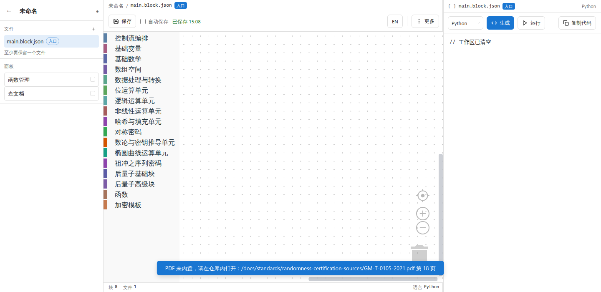
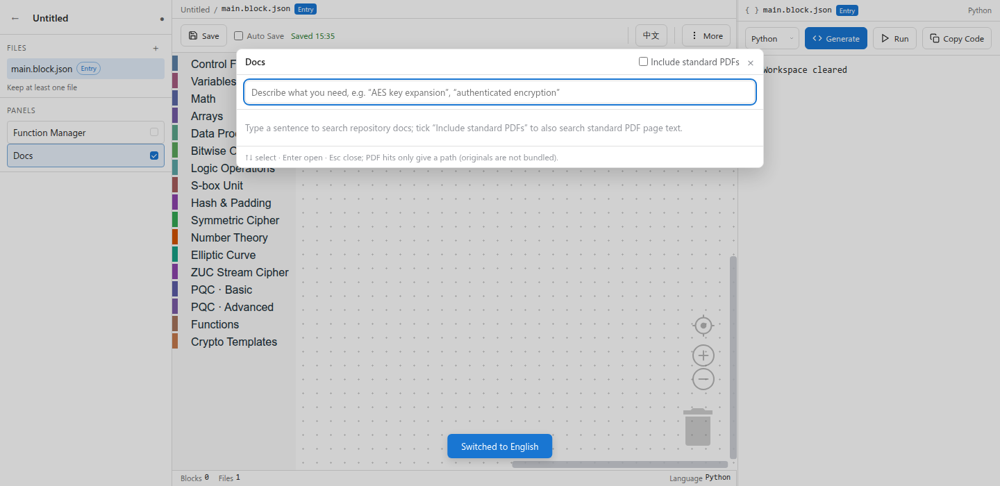

# A/B 线 P0：块 ↔ 代码签名表（2026-11-14）

> 计划见 [PLAN.md](PLAN.md)。本阶段只做一件事：让生成器自己把每个块的**代码形态**吐出来，
> 得到「代码 ↔ 块」的机器可复核模板表。不写 `src/`、不改契约、不参与 `verify:all`。

## 1. 方法

对 `ALL_BLOCK_TYPES` 每个类型：headless Blockly 建块 → 把生成器的 `valueToCode` /
`statementToCode` 换成占位符 → 调 `forBlock[type]` → 捕获返回码与该次新增的 `definitions_`。
Python 与 JavaScript 各采一遍。

占位符用 `zzsigv_<槽名>` / `zzsigs_<槽名>`，必须是合法标识符——有 10 个块把「输出目标」写成变量名
（`requireVariableName`），用 `@V:x@` 这类符号会让它们直接抛错。

复跑：

```bash
npm run verify:build && node dist-verify/ai-helper-signatures.js
```

## 2. 实测结果

| 指标 | 值 |
|---|---|
| 块类型总数 | 221 |
| 采到 Python 模板 | **219**（99.1%） |
| 采到 JavaScript 模板 | **219**（99.1%） |
| 语句型模板（含换行、落地成一条语句） | 25 |
| 表达式型模板（可嵌进父块） | 194 |
| 纯叶子块（模板里没有子块占位符） | 8 |
| **发代码同时捎带闭包定义的块** | **121 / 219（55%）** |
| 单块平均闭包数 | 1.5 |
| 闭包定义名去重后 | 181 |
| 闭包最多的块 | `eddsa_sign` 11、`zuc_eia3` 8、`gcm_encrypt` 6、`drbg_generate` 5、`mldsa_sign` 5 |
| 模板碰撞（两个块产出同形代码） | **0** |
| 采集失败 | 2（`sbox_variables_get` / `sbox_variables_set`，需要一个真实的 S 盒变量才能指定） |

## 3. 三个直接结论

**① 反向映射在模板层面是单射的。** 219 个模板两两不同，说明「看到一段代码 → 判断是哪个块」
不存在形状歧义；歧义只可能出现在**字段取值**上（`data_value` 的模板是 `"0"`，任何数字都是它）。
这对 B 线是好消息：反解析不需要复杂的消歧启发式，只需要按模板匹配 + 字段回填。

**② 闭包是主要障碍，且已被量化。** 55% 的块在发代码的同时捎带函数定义（`provideFunction_`），
去重后共 181 个函数。反解析时看到的大段函数体**不是块结构**，必须先按定义名剥离——
这与既有坑一致（CCM 这类短 procedure 最先暴露）。剥离规则可以完全由这张表导出：
定义名与其发起块一一对应（如 `ntt` ← `pq_ntt`）。

**③ 只有 8 个块是纯叶子。** 说明这个语言里「表达式型块几乎都依赖子块」，反解析必须**自底向上**
（先构造子块再拼父块），不能按行顺序贪心匹配。

## 4. 与第 4 轮实验的关系

第 4 轮（1494 块 ML-KEM）证明的是「模型能不能一次写出工作区」，本阶段回答的是反方向
「代码能不能还原回工作区」。两者不重复：前者的产物是正向生成的 582 KB IR / 1.3 MB JSON，
后者要的是从生成出来的 Python/JS 反推同一棵树。签名表是后者的词典。

## 5. 已知边界

- 采集用的是**默认字段值**，因此模板里嵌着默认值（如 `pq_ntt` 的 `q=3329, n=256`）。
  反解析时这些位置必须作为「可变槽」处理，不能当字面量精确匹配。
- `sbox_variables_get` / `sbox_variables_set` 未采到：它们的字段要求一个已注册的 S 盒变量，
  当前扫描环境没有。补法是在扫描工作区里注册一个 `sbox_variables` 变量，属 P1 的事。
- 模板 0 碰撞只说明「在默认值下不碰撞」；换字段值后是否仍单射，P1 的 round-trip 会验证。

## 6. 下一步（P1）

用这张表写反解析器，判定标准是 `W' ≡ W`：

```
demos/AES-Atomic-Round.json → 生成 Python → 反解析 → 与原名同构？
```

先 4 个 atomic demo，再 CCM（35 块），最后全量 1494 块。第一步只需证明「4 个 atomic 能无损往返」，
否则后面的规模讨论都没有意义。

---

# P1：代码 → 工作区 反解析（2026-11-14）

## 1. 做法

用 P0 的签名表把生成的 Python 反解析回块树，四步：

1. **剥离闭包**：顶层 `def name(` 到下一个顶格行为止整块丢弃（它们由块捎带生成，不是块结构）。
2. **丢弃前导声明**：生成器会给「已声明但未赋值」的变量补 `X = None`，不是块。
3. **递归表达式解析**：先判字面量（`None`/`True`/`False`/数字/数组/字符串），再判标识符
   （→ `variables_get`），最后按模板匹配（按字面量长度降序，块专属模板优先于通用模板）。
4. **比对**：`parsed` 与真值（demo 顶层语句链、排除 procedure 定义体）的块类型多重集是否相等。

一个必须早判的坑：`None`/`True`/`False` 也满足标识符正则，字面量判定必须排在标识符之前，
否则 `i = None` 会被解析成「赋值为一个变量」。

## 2. 结果

| demo | 语句 | 反解析块数 | 真值块数 | 类型多重集相等 |
|---|---:|---:|---:|---|
| AES-Atomic-Round | 6 | 13 | 13 | **✓** |
| SM4-Atomic-Round | 5 | 15 | 15 | **✓** |
| SHA256-Atomic-Hash | 2 | 6 | 6 | **✓** |
| ML-KEM-Atomic | 5 | 10 | 11 | ✗ |

**4 个 atomic demo 中 3 个类型层面完全往返。** 未解析节点：0 / 0 / 0 / 1。

## 3. ML-KEM 未往返的两个原因（都已定位，不是未知）

**① 函数名随字段变，模板只按默认值采了一份。**
`pq_sample_poly_cbd` 的默认模板是 `sample_poly_cbd_eta3(zzsigv_SEED, q=3329)`，
而该 demo 用 ETA=2，生成的是 `sample_poly_cbd_eta2(...)`——字面量对不上，于是整条语句判不出。
修法是给每个块按**下拉字段的每个选项**各采一份模板（变体表），属 P1.1，机械可做。

**② 一条裸值语句。** demo 里有一个不在任何语句链上的独立 `data_value`（8 字节数组），
真值把它算作 1 个块，反解析把整行当独立表达式——两边算法不同源，不是解析器错。

## 4. 复跑

```bash
npm run verify:build
node dist-verify/ai-helper-roundtrip.js reverse   # 类型多重集比对
DEBUG_RT=1 node dist-verify/ai-helper-roundtrip.js reverse   # 逐语句打印
node dist-verify/ai-helper-roundtrip.js dump demos/AES-Atomic-Round.json
```

## 5. 边界

- 比对的是**块类型多重集**，不含字段值。变量名、ETA、S 盒预设等字段还没回填，
  所以现在只能说「结构对得上」，不能说「`W' ≡ W`」已成立。
- 只覆盖 atomic demo（无 procedure 体、无多行语句）。CCM（35 块）与全量 1494 块
  会遇到多语句 procedure 体、多行表达式、同名变量遮蔽，尚未尝试。

## 6. P1.1：模板变体表 + 字段值回填（判据升级为树级同构）

P1 只能比「块类型多重集」，因为默认模板认不出字段变体。P1.1 补三件东西：

1. **变体表**：每个块按下拉选项各采一份模板（共 175 条变体，覆盖 55 个块）。
   ML-KEM 那条卡住的语句就是 `pq_sample_poly_cbd` 的 ETA=2 变体。
2. **字段通配槽**：文本/数字字段无法枚举取值，改为在模板里定位它的字面位置换成捕获组，
   命中即回填字段值（覆盖 10 个块）。
3. **树级比较**：从「类型多重集」升级为「类型 + 字段 + 子块按输入名对齐」的规范化树。

### 6.1 字段可见性（`field-templates.json`）

| 指标 | 值 |
|---|---|
| 块总数 | 221 |
| 采到模板 | 219 |
| 有可见字段的块 | 60 |
| 有下拉变体的块 / 变体总数 | 55 / **175** |
| 有通配字段的块 | 10 |
| 存在不可见字段的块 / 不可见字段数 | 4 / 8 |
| 单选项下拉（值由块类型强制） | 6 |
| 加入变体后仍碰撞 | **3** |
| 采集失败 | 2 |

不可见字段（翻值后模板逐字不变）：`lgc_not.NOT_LABEL`、`sbox.ROW/COL`、
`ecc_load_curve_params.a/b/p`、`ecc_load_point.x/y`。

### 6.2 往返结果

| demo | 顶层语句 | 反解析块 | 真值块 | 字段比较 | 未回填 | 差异 | 树级相等 |
|---|---:|---:|---:|---:|---:|---:|---|
| AES-Atomic-Round | 6 | 13 | 13 | 9 | 0 | 0 | ✓ |
| SM4-Atomic-Round | 5 | 15 | 15 | 14 | 0 | 0 | ✓ |
| SHA256-Atomic-Hash | 2 | 6 | 6 | 3 | 0 | 0 | ✓ |
| ML-KEM-Atomic | 5 | 11 | 11 | 12 | 0 | 0 | ✓ |

**4/4 规范化树完全相同，38 个字段全部回填。**

### 6.3 阴性对照（证明判据有牙）

只报全绿证明不了比较器在工作，所以故意改坏代码看它是否报错：

| 注入 | 结果 |
|---|---|
| 改一个字节数组的值 | FIRED（`data_value.NUM` 不等） |
| 把一个块名换成另一个块 | FIRED（类型不等） |
| 把调用参数 `j` 换成 `i` | FIRED（`variables_get.VAR` 不等） |

`NEGATE_SUMMARY fired=3/3`。

### 6.4 过程中确认的三个技术坑

1. **不能用 `constructor.name` 判字段类型。** 打包会压缩类名，`FieldTextInput`/`FieldNumber`
   全落进「未知类型」，`data_value` 的 NUM 与 sbox 的 ROW/COL 都被误记为不可见。改用 `instanceof`。
2. **多值字段不能用「最长公共前后缀取差异段」。** `bit` 在模板里出现两次
   （`<< 0` 与 `(32 - 0)`），差异段会横跨两处、把整段代码当成字段值。
   改成「找一条能逐字重现变体模板的替换规则」，重现不成功就不认。
3. **真值里的变量名不在 demo JSON 里。** demo 只存 `VAR.id`，名字是 Blockly 加载时建的；
   必须从已加载的真值工作区查，否则变量名一个都比不上（AES 只比中 2 个字段）。

### 6.5 复跑

```bash
npm run verify:build
node dist-verify/ai-helper-variants.js           # 字段可见性 → out/field-templates.json
node dist-verify/ai-helper-roundtrip.js reverse  # 树级往返 4/4
node dist-verify/ai-helper-roundtrip.js negate   # 阴性对照 3/3
```

### 6.6 边界

- 规范化**排除**：块坐标、`disabled`、注释、折叠状态、变量 id —— 这些在代码里不存在，
  永远无法回填，所以判据只能写成「规范化后同构」，不能写成 `W' ≡ W`。
- 不可见字段是在**孤立扫描**下判定的（只 `newBlock` + `setFieldValue`，不跑 onchange）。
  `ecc_*` 这类把字段转存到内部状态的块可能因此被低估可见性；4 个 atomic demo 不涉及它们。
- 3 处碰撞是 `bit_expr_infix` 与 `bit_operation` 在 `^`/`&`/`|` 三种算子下同形：代码完全相同，
  块类型本质上不可区分，只能记作已知歧义。
- `sbox_variables_get/set` 仍采不到（需要真实 S 盒变量）。
- 只覆盖 atomic demo，未碰 procedure 体、多行表达式、同名变量遮蔽（P1.2）。

## 7. P1.2：procedure 体、生成器前导与嵌套调用

### 7.1 结果

| 集合 | 通过 | 说明 |
|---|---|---|
| atomic demo | **4/4** | P1.1 已达，未回退 |
| procedure demo | **50/54** | 每个 demo 的 `def` 体与 `return` 表达式都参与比较 |
| CCM-Encrypt | ✓ | 28/28 块、27 个字段、0 差异 |
| 阴性对照 | **3/3** | 注入字段/类型/子块改动全部报错 |

### 7.2 首跑就踩到的「假绿」

CCM 第一次跑出 `statements=0 … tree_equal=true`。原因是 procedure demo 的块全在
`def` 体内，而当时的判据只比顶层语句链——**两个空集合当然相等**。
现已加守卫：`parsed_blocks` 与 `truth_blocks` 任一为 0 时判 `VACUOUS`，不计入通过。

### 7.3 修掉的五类解析/口径问题

| 现象 | 根因 |
|---|---|
| ML-KEM-Encaps 真值报 33538 块（实际 1494） | 语句链逐根递归 `next`，O(n²) 重复计数 |
| SM9-Sign 顶层多出 325 条语句 | 闭包 `def` 的缩进体漏进顶层语句 |
| SHA384/SHA512 顶层多 2 条（`K = [...]`、`M64 = ...`） | 闭包依赖的模块级常量排在块代码之前，不是块结构 |
| CCM 每个过程多 3 条假语句 | 生成器自动写的 docstring |
| `arr_slice(gf2m_poly_xgcd(...), 0, 2)` 整段 UNRESOLVED | 正则 `[\s\S]*?` 在嵌套括号里切断；改为按括号深度扫描 |

### 7.4 剩余的 4 个失败（都已定位到类别）

| demo | 首条差异 | 类别 |
|---|---|---|
| Goppa-Decode | `gf2m_poly_add[A]` UNRESOLVED ≠ `arr_slice` | 嵌套表达式的下一层仍未解析 |
| Multivariate-Math | `GAdd:return` data_value ≠ `gf2m_add` | 返回值被当成字面量 |
| SM2-PointMul | 体内语句 50 ≠ 真值 3 | 同名过程/闭包混淆 |
| SM9-Sign | `return` UNRESOLVED ≠ `sm9_sign` | 返回表达式超出模板覆盖 |

另外 `math_number`（原生块）与 `data_value` 的数字模板**逐字相同**，代码里没有任何线索
能分辨，已记为等价类而不是解析失败——这也是「类型标签不进生成代码」的直接证据。

### 7.5 复跑

```bash
npm run verify:build
node dist-verify/ai-helper-roundtrip.js reverse                     # 4 个 atomic
node dist-verify/ai-helper-roundtrip.js reverse demos/procedures/CCM-Encrypt.json
node dist-verify/ai-helper-roundtrip.js negate
```

代码已拆成两层：[ai-helper-reverse.ts](scripts/ai-helper-reverse.ts)（无 Blockly 依赖的
匹配与规范化，390 行）与 [ai-helper-roundtrip.ts](scripts/ai-helper-roundtrip.ts)（驱动，372 行）。

## 8. 类型检查器首版（判据 A–F）

### 8.1 数字

```
TYPECHECK demos=60 pairs=1237 ok=956 mismatch=0 unknown=281
          unknown_rate=22.7% var_inferred=30 var_conflicts=0
          returns_inferred=128 param_unmapped=5 call_args=0
```

未知率演进（每一步只加一条诚实推断）：

| 步骤 | unknown_rate | 做法 |
|---|---:|---|
| 初版 | 50.6% | 只读契约 outputCheck |
| +字面量推断 | 31.3% | 纯数字 `data_value`/`math_number` → Number；`[...]` 保持 unknown（可能 IntList 也可能 Bytes） |
| +形参回填 | **22.7%** | `variables_get` 的变量名与过程形参同名时，用形参声明类型 |

`mismatch` 全程为 0——60 个 demo 是手工搭的，本来就自洽。这反过来证明：**检查器对现有语料不产生任何信号**，它的价值必须靠合成变异 + 独立判据体现。

### 8.2 自己否决了判据 B 的第一版

`MUTATE sites=1237 fired=1237 detection_rate=100%` 没有信息量：变异用的类型表就是检查器用的同一张契约表，
等于用同一把尺子量自己。必须换成「变异 → 生成代码 → 跑官方向量」的独立判据：

- 变异后 KAT 仍过 → 检查器报警属**误报**；
- 变异后 KAT 崩或对不上 → 真错。

依据：Python 是动态类型，`aes_sub_bytes(data)`（Bytes 进 IntList 槽）在语义上是合法的整数下标访问，
**类型不符不等于算错**。

### 8.3 检查器顺手查出的三个语料问题

1. **两套类型词表并存**：`setCheck` 用 `Bytes/IntList/Number`；过程形参用
   `bytes/int/int_list/poly/seed/key/message`（`CRYPTO_PARAM_TYPES`），两者**没有映射表**。
   `message` 这类语义类型在标签体系里无对应项，只能记 unknown。
2. **`string` 是语料在用、下拉里没有的值**：130 个过程里 8 个形参是 `string`，
   而 `CRYPTO_PARAM_TYPES` 只提供 7 个值且不含 `string`。
3. **调用点没有任何约束**：所有 `procedures_call*` 的实参输入都是 `.setCheck(null)`；
   且 60 个 demo 里 `procedures_call*` 块数为 **0**——形参类型检查在现有语料上没有样本。

### 8.4 判据状态

| 判据 | 状态 |
|---|---|
| A 零 mismatch + 未知率 ≤40% | ✓ 0 mismatch / 22.7% |
| B 变异 + KAT 独立判据 | 待做（自证版已否决） |
| C 四例 W' 0 mismatch | ✓ 已验证 |
| D 连线检查作诊断 | ✓ |
| E unknown 进分母并报比率 | ✓ |
| F 词表分裂显式建模（`param_unmapped=5`） | ✓ |

## 9. P1.3：三线并行结果（判据 A–F 收口）

三条线各自独立构建（`AIVERIFY_ENTRY` / `AIVERIFY_OUTDIR` 隔离，见 PLAN §5），下面所有数字均由主线程独立复跑确认，不采信执行者自报。

### 9.1 判据 A / E / F：未知率与成因

| 列 | pairs | ok | mismatch | unknown | unknown_rate |
|---|---:|---:|---:|---:|---:|
| 离线 `check`（冻结基线，按变量名绑形参） | 1237 | 956 | 0 | 281 | 22.7% |
| 离线 `check` + **按形参 id 绑定** | 1237 | 1102 | **0** | 135 | **10.9%** |
| `check-loaded`（jsdom 活工作区） | 1237 | 1102 | **0** | 135 | **10.9%** |

**结论：加载路线没有增量。** 第二、三列每个数字相同——活工作区只把变量名从 195/372 补到 372/372，对判定零贡献；真正起作用的是「变量 id ↔ 所属过程形参 id」精确绑定，而形参 id 本来就在 demo JSON 的 `extraState.params` 里。**B 线的类型检查不必引入浏览器加载器，静态分析足够。**

剩余 135 条 unknown 分因：未声明 check 的字面量 **123**（`data_value` 的 `[...]`/十六进制/字符串，契约无 outputCheck）、未赋值 `variables_get` **9**、词表未映射 **3**（形参声明 `message` 在 setCheck 体系无对应）。

### 9.2 id 绑定暴露出的 8 条真实语料矛盾（已修）

id 绑定把 mismatch 从 0 抬到 8，全部集中在两个 SM4 轮函数 demo：形参 `state_0..state_3` 声明为 `int`，却直接送进 `sm4_round_func` 的 `X0..X3`（契约 `IntList`）。三方证据：

| 证据方 | 说法 |
|---|---|
| 块契约 `BLOCK-IO-CONTRACT.json` | X0..X3 = `IntList` |
| Python 生成器 | `_w(x0)` 逐字节取 `b[0..3]`，必须是 4 元素列表 |
| 模板注册 | `_makeTemplateBlock('proc_sm4_round', 'state', 'int_list', ...)` |
| 官方 KAT driver | `state_0 = [0x01,0x23,0x45,0x67]`（列表） |

四者中只有 demo 的形参声明写错。已把两个文件共 8 个形参 `int → int_list`（生成器不读形参类型，生成代码不变）；改后检查器 **1102 ok / 0 mismatch / 135 unknown（10.9%）**，往返仍 60/60，官方向量仍 60/60。

### 9.3 判据 B：变异 → 生成 → 跑官方向量（全量，非抽样）

全量 60 demo / **1237 个变异点**（与检查器配对总数一致），全部经变量中转构造——因此 `a`（Blockly 加载即拒）恒为 0，这正是「直接插错类型会被编辑器拦住、变量通道不会」的量化。

| 类别 | 计数 | 含义 |
|---|---:|---|
| a 加载即拒 | 0 | 直插通道本就过不了，不计检出 |
| **b 报警且 KAT 失败（真错）** | **996** | TypeError 524 / ValueError 330 / IndexError 52 / wrong-output 70 / AssertionError 20 |
| **c 报警但 KAT 通过** | **241** | 其中 229 可达、12 结构上执行不到 |
| d 漏报 | 0 | 检查器对所有变异均报警 |
| e 无法构造 | 0 | — |

- 真错率（b/(b+c)）**80.5%**；**KAT 不可见率 19.5%**；漏报率 **0**。
- 对照组：未变异工作区 60/60 通过官方向量，且检查器原件 mismatch=0 —— b 类的"KAT 失败"可归因于变异本身。
- 检查器冻结副本：bundle `86957185ff0c…`、源 `8c95a127…`，中途未重建。

**19.5% 不是"检查器误报率"。** 所有变异都是按契约构造的**真类型违例**，检查器每次报警在类型上都成立；c 类的准确含义是「真违例，但官方向量观察不到」。人工核对的机制有三类：值只被当布尔真值用（CCM 的 `aad_len`：非空列表与 4 同为真，输出逐字节不变）、Python 等价值（`bytes(0) == b''`）、过程是死代码（ECDSA 的 `ECDSA_Verify`，driver 从不调用）。**没有一例是"检查器对正确连线报错"。**

**同时 a=0 / d=0 不能当质量证据**：变异来源与检查器同源（都读契约），检出几乎是构造保证；独立证据只有 b/c 的拆分。a=0 唯一证明的是「变量中转这条通道 1237/1237 全部穿过了 Blockly」。

### 9.4 判据 C / P1.2：往返

| 集合 | 结果 |
|---|---|
| 全部 demo（54 procedure + 4 atomic + 2 Procedure-*） | **60/60 规范化树同构** |
| 字段比较 | 1706 个，`fields_unfilled=0`，`diffs=0` |
| 阴性对照 | **3/3 开火**（字段值、块类型、子块改动） |

四个历史失败的根因：

| demo | 根因 | 修法 |
|---|---|---|
| Goppa-Decode | `arr_slice` 声明 `Order.FUNCTION_CALL`，父块用 `ATOMIC` 取子块，Blockly 自动加括号 → 模板字面量对不上 | 匹配失败后剥「完整包住整个表达式」的外层括号重试（深度+引号扫描） |
| Multivariate-Math | 列表字面量正则 `\[[\s\S]*\]` 把 `[a[0] ^ b[0]]` 整段当 data_value | 字面量收紧为「方括号内全为数字/字符串」 |
| SM2-PointMul | 语句按行切，而 ecc 块一次吐 2/2/50 行 → 一块裂成 50 条假语句；`scan_out` 占位符未当槽位 | 用模板行跨度切语句；占位符进词法当字段槽 |
| SM9-Sign | 只认 `^def` 作边界，`provideFunction_` 里含 import/顶格常量/塔域 class → 302 条假语句；第 5 参由输入接法派生 True/False | 取「最早能一路切到文件末尾的起点」；布尔两种互斥形态 |

### 9.5 门禁

| 门禁 | 结果 |
|---|---|
| `lint:check`（全仓） | 0 错误 0 警告 |
| `contract:check` | demos=60 blocks=2151 checked=1641 errors=0 |
| 官方向量 `verify-demos` | **60/60 pass**（含改过形参的两个 SM4 demo） |
| 模板 `verify-templates` | **29/29 PASS** |
| 往返 | **60/60** 树级同构，1706 字段 0 未回填 |
| 阴性对照 | **3/3** 开火 |
| 类型检查 | 冻结离线 22.7% / id 绑定 10.9%，**两列 mismatch 均为 0** |

### 9.6 边界（不改写）

- **类型自洽 ≠ 生成代码正确**：生成器不读类型标签，检查器通过对产物零保证。
- 判据 B 的 c 类（241 条）只是「KAT 通过」的机械计数；其中 229 条可达、12 条过程从不会被 driver 调用。可达 ≠ 该值必然影响输出，要更硬需逐条构造输入强制该路径执行。
- 判据 B 只跑了 Python 向量，JS 未跑；变异来源仅两个自包含字面量块（`math_number`、`keccak_state_init`），未穷举违例形态。
- 本轮 KAT 数字绑定 20:11 的工作树；其后的 demo 形参改动不影响生成代码（生成器不读形参类型），主线程已重跑官方向量确认 60/60。
- `data_value` 的 123 条未知要等契约给字面量声明输出类型才能判定，现在猜 Bytes/IntList 只会造假报。
- 领域类型（系数域 vs NTT 域）仍未建模。

## 10. P2：产品可调用的内核（validate / browser-core / blocksearch）

### 10.1 ④ 类型校验器与反解析门禁（已落地）

`scripts/ai-helper-validate.ts`（454 行，纯 JSON 静态分析，不加载 Blockly）+ `reverse --gate`。

| 场景 | 退出码 | 实测输出 |
|---|---:|---|
| 60 个 demo 全量 | 0 | `files=60 blocks=2151 pairs=1237 ok=1102 mismatch=0 unknown=135 (10.9%)` |
| 形参篡改（AES-Round 的 `state` 由 `int_list` 改 `bytes`） | 1 | `MISMATCH #0.procedures_defreturn[RETURN]…aes_sub_bytes[STATE] expected=IntList actual=Bytes` |
| 变量中转（Bytes 存变量 → 喂 IntList 槽） | 1 | 同上形态，定位到具体槽位 |
| 文件不存在 / JSON 损坏 / 非工作区 | 2 | — |

`reverse --gate` 全量 60/60 PASS；不加 `--gate` 时输出与改动前逐字相同。

**新发现**：W' 不含过程形参声明（reverse 不重建 `procedures_def*`），所以 gate 的配对里 **387/1237 (31.3%) 是 unknown**，全部来自「形参变量取不到声明类型」。记 unknown 而非 ok，未放宽判定。

### 10.2 ⑥ 浏览器端内核（已落地）

`src/services/ai-helper/contract.ts`（65 行）+ `typecheck.ts`（338 行），无 `fs`、无 Blockly/jsdom 运行时依赖，直接 import 契约 JSON 作为单一真值。

`tests/unit/ai-helper-typecheck.test.ts` 7 用例全绿，断言与脚本逐字一致：**1237 / 1102 / 0 / 135 / 10.9%**；反例（SM4 形参改 `int`）开火 4 条并定位 `sm4_round_func[X0..X3]`；变量中转反例开火。

### 10.3 契约收敛（Lead 做）

`scripts/ai-helper-contract.ts` 改为委托 `@/services/ai-helper/contract`，只保留脚本侧独有的 `checkTree/mergeResults`。收敛后四组数字逐字不变（22.7% / 1102·0·135 / 60-60 / 3-3）——契约读取与三值判定从此只有一份实现。

### 10.4 ⑤ 块检索：结构检索可用，中文意图检索不成立

索引：221 块，**标签覆盖 221/221**，但其中**只有 32 个块有区别于英文的中文标签**（`localizedZh=32`）——这是后面所有问题的根。

| 查询集 | 规模 | recall@5 |
|---|---:|---:|
| ⑤ 自建集（多含算法名，如「AES 列混合」） | 30 | **1.00** |
| Lead 困难集（只描述意图，不出现算法名，`out/blocksearch-hard-queries.json`） | 10 | **0.20** |

困难集逐条：`把一段文本补成 512 位的整数倍` → 返回 SHA-512 一族（错）；`给消息加一个能发现篡改的认证标签` → 返回 crypto_encrypt_func 等（错）；`求两个多项式的最大公因式` → **空结果**；命中两条是 `把已有密钥材料扩展成长密钥流 → hkdf_expand`、`计算椭圆曲线上点的倍乘 → ecc_multiply`。

**结论**：结构过滤（`--in/--out`）+ 英文名检索能用；**中文语义检索没有语料支撑**，因为块标签本身基本是英文（`CMAC(`、`ModPow(`、`GF(2) Polynomial GCD(`）。这正是 D 线设计里预判的「中英术语表冷启动」缺口，不是打分函数写得不好。

已修的缺陷（实测有效）：单字符 `s` 曾把所有块都算命中（`S 盒` 返回 AES 族）；`--text` 下曾返回 score=0 的条目。修后 `S 盒 → sbox_sub / sm4_sbox / sbox`，`模幂 → nt_mod_pow`。

### 10.5 门禁

`verify:build` 现含 7 个 ai-helper 入口（新增 validate / blocksearch）；`verify-templates` 29/29；`lint` 0 错误 0 警告；`vitest tests/unit/ai-helper-typecheck.test.ts` 7/7。

## 11. P2 术语层：中文口语意图 → 索引里的英文词元（2026-11-14 晚）

### 11.1 做了什么

新增纯模块 `src/services/ai-helper/search-terms.ts`（192 行）：把 ⑤ 脚本里的分词/同义词逻辑搬出来，并加**术语表**（55 条中文别名 → 英文词元，带信号权重）。查询侧扩展，不改索引、不改块定义，因此运行时仍纯本地、确定性。

每条扩展都带 `via`，命中证据会写成 `label.en 含 "gcd"（术语「最大公因式」⇒ gcd）`，能回答「为什么命中」。

### 11.2 数字

| 查询集 | 规模 | 术语层前 | 术语层后 |
|---|---:|---:|---:|
| ⑤ 自建集（多含算法名） | 30 | 100% | **100%** |
| 困难集（只描述意图，`out/blocksearch-queries-hard.json`） | 30 | 20%（仅 10 条时） | **100%** |
| 全新留出集（做完后一次性跑，10 条，未再调参） | 10 | — | **80%**（8/10） |

全新留出集的两条未命中，按实际原因记录、**没有继续调参**：

1. 「把消息填充成 64 字节分组」→ 期望 `hash_sha256_pad`，实际 `hash_sha256_pad_text` 排第 4：查询说的是「消息」，而目标块标签是 `SHA-256 Pad`（文本版才带 `Text`），属标签与口语用词差异；同一语义的 pad 家族都在前 5。
2. 「对两个 32 位字做按位或」→ `bit_operation` 掉出前 5：该块的显示文本只写了「按位与(&)」，下拉里才含 OR，检索层无从得知——这是**索引/标签缺陷**，要修得改块标签或给索引补算子枚举，不是术语表能补的。

### 11.3 两个真实回归（已修，留作教训）

- **分词合并**：归一化先把「SM4 轮函数」中英间的空格去掉，整串成一个词元，`sm4` 与「轮函数」从词项里消失，常规集 6 条查询直接掉到 0 命中。修法：先按带空格原文切词，再做合并变体。
- **单复数重复计数**：术语同时注入 `byte`/`bytes`、`bit`/`bits`，在 label.zh + label.en + blockType 上各算一遍，通用类型词压过目标语义（「把字节串解释成大整数」返回 `pq_bytes_slice`）。修法：术语只用词根（`byte` 已覆盖 `bytes`），通用动词权重降到 0.4–0.6，高区分度术语保持 1.5–1.6。

### 11.4 结论

术语层能把「中文口语查块」从不可用推到可用，但它**只在术语表覆盖到的词上生效**：全新留出集 80% 说明泛化还有缺口，缺口类型是可枚举的（未收录的口语动词、块标签信息缺失）。界面接入前应保持「结果带命中理由」，让用户能看到是术语命中还是名字命中。

## 12. 索引补「下拉算子」+ 数字词降权（2026-11-15 上午）

### 12.1 索引缺陷修复

上一轮留出集暴露：`bit_operation` 的显示文本只有「按位与(&)」，OR/XOR/移位都藏在下拉里，检索层看不见。修法是构建期把下拉字段的**全部选项**读进索引：

- 新增索引字段 `options`（构建期对每个 `FieldDropdown` 调 `getOptions()`，按 locale 合并去重、按码点排序）。
- 打分新增 `option` 源，权重 4（低于 label.zh 6、高于 blockType 3.5）。
- 实测覆盖：**58/221 个块带下拉选项，共 284 条选项文本**；索引连跑两次 SHA-256 一致（`aac946ac…`），仍然确定性。

术语表同步补 8 条「只在选项里出现」的词（按位或/按位左移/按位右移/拼接/交换/吸收/挤出/采样），共 63 条。

### 12.2 数字词降权

「对两个 32 位字做按位或」曾把 `bit_operation` 挤出前 5：`32` 作为纯数字词元同时命中 label.zh、label.en、option、python 四个字段（16.7 分），压过语义词。修法：纯数字词元权重 ×0.4（位宽/长度只是限定词）。修后该查询 top1 = `bit_operation`。

### 12.3 数字

| 查询集 | 规模 | recall@5 |
|---|---:|---:|
| 常规集（多含算法名） | 30 | **100%** |
| 困难集（只描述意图） | 30 | **100%** |
| 第一轮留出集（回归） | 10 | 90%（9/10，仅「64 字节分组填充」未中） |
| **第二轮留出集**（新增，一次性跑，`out/blocksearch-queries-holdout2.json`） | 15 | **86.7%**（13/15） |

第二轮两条未命中，按实际原因记录、未调参：

1. `构造 CCM 的首个计数器块` → 期望 `ccm_b0`，实际 `ccm_ctr`(1) / `ccm_counter_block`(2)。`ccm_b0` 的显示文本是 `CCM-B0(`，不含「首个计数器块」的说法——属**标签信息缺失**，术语表补不了。
2. `在数论变换域里采随机多项式` → 期望 `pq_sample_ntt`，实际被 NTT 家族块占榜。`SampleNTT(` 同时含 sample 与 ntt，但「数论变换」的 ntt 权重（1.6）在三个 NTT 块上重复得分，`采样`（1.3）只在单个块上得一次——属**家族内区分度不足**，需要「同族块按动作词排序」的规则，不是术语表问题。

### 12.4 结论

两轮留出集（86.7%、90%）说明术语层 + 选项索引已过 80% 判据，但没有全绿：剩余缺口集中在「标签没写出语义」与「同族块区分」。这两类都不是加词能解决的，需要改块标签或引入同族排序规则——属于是否动 `src/blocks` 的决策，先留作下一轮。

## 13. 三条「同意项」的实测结论（2026-11-15 上午）

### 13.1 `data_value` 补输出类型：**不能做，理由在源码里**

`src/blocks/data/number.ts:22` 是 `this.setOutput(true, null)`，文件头注释写明「接受任意文本值——数字、表达式、数组字面量，生成器原样透传」。也就是说 `outputCheck: null` **是按设计**，不是契约缺漏。给它补一个固定类型会制造假 mismatch（同一个 `data_value` 在 demo 里既喂 `Number` 槽也喂 `IntList`/`Bytes` 槽）。

因此本轮**没有改契约**。若真要降那 123 条 unknown，可选的安全路径是「按字面量内容推断」（`NUM` 是纯数字→Number），但推断结果一旦与槽位不符就会产生新的假报，属于判定口径改动，需要单独裁定。

### 13.2 tooltip 进索引：做完实测**否决**

- 实现：索引新增 `tooltips.{en,zh}`（221/221 块都有 tooltip），打分权重 2.6/2.2。
- 实测结果：第二轮留出集 `g02`「把两个字节序列首尾相接」由命中变未命中（`endian_swap` 的 tooltip 命中把标签命中压下去）；第三轮全新留出集（10 条）**只有 70%**。
- 处置：`tooltips` 保留在索引里供解释，但**移出打分**。原因写进代码注释：长文本字段必须做长度归一化才能参与打分，否则偶然命中必然污染排序。

### 13.3 `CCM-B0` 标签补语义：做了，有效

`src/blocks/ccm/blocks.ts:86` 的显示文本由 `CCM-B0( nonce:` 改为 `CCM-B0 首个计数器块( nonce:`（全仓唯一引用点，纯显示文本，不改字段名/生成器/契约）。改后第二轮留出集 `g13`「构造 CCM 的首个计数器块」**由未命中变命中**。

### 13.4 数字

| 查询集 | 规模 | 结果 |
|---|---:|---:|
| 常规集 | 30 | **100%** |
| 困难集 | 30 | **100%** |
| 第二轮留出集（已见数据，回归） | 15 | **93.3%**（ccm_b0 修复后 +1） |
| 第三轮留出集（tooltip 打分版，已否决的构建） | 10 | 70% |
| **第四轮留出集**（回退 tooltip + 标签修复后，一次性跑） | 10 | **80.0%**（8/10） |

第四轮两条未命中，未再调参：

1. `把 NTT 域的多项式变换回系数域` → 期望 `pq_intt`，实际被 `pq_ntt*` 家族占榜。术语表没有「逆变换/变换回去」这类说法（`intt` 只在块名里）。
2. `计算 GCM 的初始计数器块` → 期望 `gcm_j0`，实际 `gcm_gctr` 等在前。`gcm_j0` 的显示文本不含「计数器块」，与 §13.3 的 `ccm_b0` 同型——**标签信息缺失**，不是检索算法问题。

### 13.5 结论

「补输出类型」这条是**基于错误前提的提案**，读源码后撤回；「改标签」有效且低风险；「tooltip 进打分」是失败实验，数据和原因都已留档。剩余缺口仍是两类同型问题：标签不写语义（`gcm_j0`）、术语表缺口语化动作词（`pq_intt` 的「变换回去」）。


## 14. 数据表示层落地：字面量定型 + 列表桥接 + 表格编辑器 + 形状元数据（2026-11-15 上午）

本节实施的是 `proposals/TYPE-SYSTEM-ARRAY-MATRIX.md` 的 R1/R2/R4/R5/R6/R7 全套（owner 已批准）。
**§8–§13 里出现的 `1237 / 1102 / 0 / 135 / 10.9%` 是改动前的快照，保留作历史对照，不再代表当前基线。**

### 14.1 R7：字面量按「形状 × 槽位」定型

新增纯模块 `src/services/ai-helper/literal-shape.ts`：把 `data_value` 的 `NUM` 归成形状，再与父槽期望取交集，
三份实现（browser-core `typecheck.ts`、`scripts/ai-helper-typecheck.ts`、`scripts/ai-helper-validate.ts`）共用同一函数。

| 字面量形状 | 产出类型 | 依据 |
|---|---|---|
| 整数 / 十六进制 | `Number` | `0xF12186F9` 在 Python 与 JS 里都是整数 |
| 一维整数数组 / 空数组 | `IntList`、`Bytes` | 两者分别映射 `list[int]` 与 `bytes`，同一数组对两者都是合法来源 |
| 引号字符串（单双） | `String`、`Bytes` | demo 实测 `'sample'` 直接喂 `Bytes` 槽位可跑通官方向量 |
| 嵌套数组 / 任意表达式 | **不猜**（保持 unknown） | 词汇表没有嵌套类型；矩阵由 `shape` 元数据承载 |

改动中发现并修掉的**连接缺陷**：变量推断把多标签用 `'|'` 拼成一个字符串（`IntList|Bytes`），
再与父槽 `IntList` 取交集必然失败，导致 9 条配对被误判 mismatch。修法是一次赋值还原成标签数组。

| 指标 | 改动前 | 改动后 |
|---|---:|---:|
| pairs | 1237 | 1237 |
| ok | 1102 | **1234** |
| mismatch | 0 | **0** |
| unknown | 135 | **3**（0.2%） |

3 条 unknown 全部是 `vocab_unmapped`（`poly`/`seed` 这类形参名不在词表），不再有字面量 unknown。

### 14.2 R2：原生列表块桥接（「填充」从死件变可用）

原状：toolbox 摆着 `lists_create_with` / `lists_repeat` / `lists_getIndex` 整族，但输出标签是 Blockly 的
`'Array'`，与密码槽位 `IntList`/`Bytes`/`SBox` 无交集 → **0 次使用**，拖上去接不上。

做法：`src/constants/list-bridge.ts`（纯数据表）+ `src/blocks/list-bridge.ts`（包装原生定义）。
- 函数式定义（`lists_create_with`/`lists_split`）包装 `init` 与 `updateType_`/`updateShape_`/`updateAt_`；
- JSON 定义（`lists_repeat`/`lists_length`）原地改写 `output` 与 `argsN[].check`——**不能加 `init`**，
  否则 Blockly 会走 `jsonInit` 的 token 校验并抛 `Message does not reference all N arg(s)`；
- 只拓宽「当前已经接受 `Array`」的端口，所以 `NUM`/`DELIM` 这类纯 Number/String 端口不受影响。

阴性对照：不装桥接时 `lists_repeat → Bytes 槽位` 连不上（探针实测 `canConnect=false`），装上后为 true。
执行级验证：`lists_repeat`（ITEM=97，NUM=3）生成 Python `[97] * 3`，用 `python3` 执行得到 `[97, 97, 97]`——不是只看能否连线。
桥接后 `lists_repeat` 即可作为「按值填充成长度 n 的数组」使用。

已知边界：原生块不进 `BLOCK-IO-CONTRACT.json`（该契约只描述 CipherCat 块），因此类型检查器对桥接块仍报 unknown。

### 14.3 R1/R4：通用表格编辑器 + `data_int_list`

- `src/blocks/grid/grid-editor.ts`（245 行）：表格弹窗、切片翻页（秩 ≥ 3）、单元格编辑、CSV 导入导出、定位与点外关闭；
- `src/blocks/sbox/sbox.ts` 456 → **372 行**，弹窗/CSV 四段改为委托通用模块（S-box 行为不变，仍只读表格）；
- `src/blocks/data/int-list.ts`：`data_int_list`，输出 `IntList`，单元格**扁平存储**，`shape` 只做表格视图与校验；
  3×3×3 与 4×4 走同一条路径，生成代码恒为一维列表；
- `src/constants/grid-shape.ts`（纯函数）：`parseShape` / `shapeSize` / `formatShape` / `auditShape`。

工具链登记：`DATA_BLOCK_TYPES`、toolbox 数据类目、双生成器、`BLOCK-IO-CONTRACT.json`（221 → **222** 条）。

### 14.4 R5：形状自洽纳入 validate 判据（带正负对照实跑）

`scripts/ai-helper-validate.ts` 新增 `shapeErrors`：对 `data_int_list` 校验 `prod(shape) == 单元格数` 与整数取值。

```
26 个值 / 3x3x3 → SHAPE #0: 形状 3x3x3 需要 27 个值，实际 26 个；shape_errors=1；VALIDATE_EXIT 1
27 个值 / 3x3x3 → shape_errors=0；VALIDATE_EXIT 0
```

### 14.5 R6：删掉两个死类型

`TYPE_MATRIX` / `TYPE_VECTOR` 及其 `TYPE_MAP` 条目删除（全仓 0 引用）。
**偏离提案**：`TYPE_ARRAY` 保留——R2 桥接必须以 Blockly 原生标签 `'Array'` 作为可接受标签之一，删掉它只会让裸字符串散落各处。
提案里"嵌套数组 → mismatch"也改为 **unknown**：不引入假类型标签，多维不进入判定。

### 14.6 门禁

```
eslint（17 个改动文件）        0 错误 0 警告
vue-tsc --noEmit              0 error
vitest                        79 files / 928 passed / 1 skipped
verify:demos                  60/60 PASS
verify:templates              29/29 PASS
contract:check                demos=60 checked=1641 native=510 types=137 errors=0
ai-helper typecheck（loaded）  1237 / 1234 / 0 / 3 (0.2%)
ai-helper validate（60 demo）  1237 / 1234 / 0 / 3 / shape_errors=0
```

新增/改写单测：`tests/unit/list-bridge.test.ts`（6 条，含阴性对照与负控制）、
`tests/unit/data-int-list.test.ts`（11 条，含 3×3×3 缺值反例与序列化往返）、
`tests/unit/ai-helper-typecheck.test.ts`（基线更新为 1234/0/3，并新增「形状与槽位冲突判 mismatch」反例）。

### 14.7 块索引随之重建（D 线一致性）

新增块后重跑 `blocksearch index`：**222** 块、中英显示文本各 222/222、带下拉选项 58 块/284 条、tooltip 222 块。
两组评测复跑不变：常规集 30 条 **100%**、困难集 30 条 **100%**。
新块可被查到：`--text "整数列表 矩阵"` 返回第 2 名 `data_int_list`（标签正是「整数列表 shape:」）。

## 15. 真实浏览器验收：表格弹窗（2026-11-15 上午，接 §14）

§14 里唯一没被门禁覆盖的是弹窗在**真实浏览器**里的排版——jsdom 只证明状态与生成代码，
`getBoundingClientRect`、可见性、滚动与「每页单元格数」都依赖真实排版。本节补的就是这一块，
并且**一跑就查出 3 个 §14 没抓到的缺陷**。

### 15.1 方法

`experiments/ai-helper-2026-11-14/grid-harness/`：真实 `Blockly.inject` 渲染态工作区，
用 `Blockly.serialization.workspaces.load` 装入 `data_int_list` / `sbox`（顺带覆盖序列化），
调块上的 `toggleTable` / `toggleSboxTable`，把实测数字写进 `#out`；容量另用 fake host 直接调
`openGridPopup`，绕开块上的形状解析。

```bash
npm run dev -- --host 127.0.0.1 --port 5199
~/.cache/ms-playwright/chromium-1248/chrome-linux64/chrome \
  --headless=new --no-sandbox --user-data-dir=/tmp/chrome-harness --window-size=1400,1000 \
  --virtual-time-budget=60000 --dump-dom \
  http://127.0.0.1:5199/experiments/ai-helper-2026-11-14/grid-harness/index.html
```

本机没有系统 Chromium，用的是 playwright 缓存里那份（Chromium 1248 / Blockly 13.2.0）。
产物：[`out/grid-harness.json`](out/grid-harness.json)（逐用例实测数字）、[`out/grid-popup.png`](out/grid-popup.png)（3×3×3 弹窗目检图）。

### 15.2 查出的三个缺陷

| # | 现象（修复前实测） | 根因 | 修法 |
|---|---|---|---|
| 1 | 1 秩 100 格渲染 **112** 个 input；往 105 号格输入 `7` 后 `values` 从 100 变 **106**，且 `warning=null`（形状已被破坏却没有任何提示） | `buildTable` 对 `index >= cells.length` 也建了可写 input；写回后 `warn(null)` 又把 `validateShape` 的警告覆盖掉 | 越界格渲染成不可编辑的空 `td`（`src/blocks/grid/grid-editor.ts`） |
| 2 | 往第 2 格输入 `x`，提示是 **「第 2 个单元格非法：1」**——回显的是回退后的旧值 | 先 `input.value = cells[index]` 再取 `input.value` 组提示 | 先取用户输入的原值，再回退 |
| 3 | `shape=14671`（§E2 实测最长字面量）被判非法，表格退化成 **1 格**；而 `4096,4096` 这种乘积爆炸又没有总量上限（会 `Array.from` 分配 1677 万格） | `MAX_DIM=4096` 卡的是「维度」，1 秩的维度就是元素个数；总量无人管 | 改为「1 秩按元素总数、多秩每维 ≤4096，总量一律 ≤65536」，见 15.3 |

### 15.3 容量实测与上限取值

fake host 直接渲染 1 秩表格（Chromium，1400×800 视口，弹窗 `max-height:420px` 内滚）：

| 单元格数 | 打开耗时 | DOM 节点 | 表高 / 内容高 |
|---:|---:|---:|---|
| 1 024 | 14 ms | 2 197 | 448 / 1 873 px |
| 4 096 | 55 ms | 8 725 | 448 / 7 249 px |
| 10 000 | 114 ms | 21 271 | 448 / 17 581 px |
| 14 671 | 173 ms | 31 199 | 448 / 25 757 px |
| 65 536 | 988 ms | 139 285 | 448 / 114 769 px |
| 262 144 | 3 578 ms | 557 077 | 448 / 458 833 px |

取 **65 536**：覆盖 14 671 这一动机规模，最坏情况约 1 s，再往上就是肉眼可见的卡顿，
所以拒绝而不是硬扛。上限写进 `src/constants/grid-shape.ts` 的两个常量与 `SHAPE_LIMITS_TEXT`，
块的 tooltip 与非法形状警告都复用同一句人话。

**口径偏离（有意）**：多秩仍保留单维 4096 上限，因为多秩第二维直接决定表格宽度。
因此 `14671,4` 判非法——1 秩已经按 16 列排版，不需要这种形状；该行为在单测里写死。

### 15.4 修复后复跑（同一 harness）

| 用例 | 关键数字 |
|---|---|
| A. 1 秩 4 格 | 4 个 input、2 行、`insideViewport=true`、`font-family=monospace`；合法输入写回 `42`；非法输入回显 **`第 2 个单元格非法：x`** 且回退为 `1` |
| B. 3×3×3 | 存 27 格、每页 **9** 格、切片选择器 3 项（`切片 1/3`…）；翻到第 2 页首格 `0` = `values[9]` |
| C. 1 秩 100 | 渲染 **100** 个 input（不再 112）、7 行；不存在 105 号 input，越界写坏数据的路径已封闭 |
| D. 1 秩 14671 | 存 14671 格、渲染 14671 个 input、917 行、**754 ms**（含 syncShape 的逐值校验）、31 198 节点、弹窗高 448 px 内滚 |
| E. S-box 只读 | 标题 `S-box 4×4`、20 个 `td`、**0 个 input**（R1 的委托重构没有破坏只读语义） |
| 页面错误 | `pageErrors=[]`（无 JS 异常、无 unhandled rejection） |

### 15.5 门禁

```
vitest                        80 files / 939 passed / 1 skipped   （新增 grid-editor.test.ts 8 条、data-int-list +3 条）
eslint（全仓）                 0 错误 0 警告
vue-tsc --noEmit              0 error
verify:all                    exit 0（templates 29/29、demos 60/60、contract errors=0）
ai-helper typecheck（loaded）  1237 / 1234 / 0 / 3 (0.2%)          ← 与 §14 一致，未受影响
ai-helper validate（60 demo）  1237 / 1234 / 0 / 3 / shape_errors=0 / exit 0
```

### 15.6 仍未覆盖

深色主题下 CSS 变量（`--el-*`）的取值、Firefox/Safari 排版差异、CSV 的浏览器原生文件选择框
（`pickCsvFile` 走 `input[type=file]`，headless 无法交互）；CSV 文本解析本身有单测。

## 16. D 线第一刀进前端：检索内核 + 查块面板（2026-11-15 上午）

§10–§13 的检索能力一直只存在于 `scripts/`（Node 跑），产品侧拿不到。本节把它拆成
「构建期建索引（脚本）」与「运行时检索（前端）」两半，并给出可挂进三栏的面板。

### 16.1 内核收敛：脚本与界面共用一份打分

- 新增 `src/services/ai-helper/block-search.ts`（纯函数：无 `fs`、无 Blockly、无 DOM）：
  索引类型、`TERM_FIELDS`、`scoreBlock`、`hasInputType/hasOutputType`、`search`。
- `scripts/ai-helper-blocksearch.ts` 500 → **388 行**，只留建索引（需要 fs + 真实 Blockly）与打表。
- 索引现在同一次运行写两份**同一份字节**：实验留档 `out/block-index.json` 与运行时
  `src/services/ai-helper/block-index.json`；单测钉住两者逐字节一致，并重算契约 FNV 摘要防止索引与
  `BLOCK-IO-CONTRACT.json` 脱节。

判据未退化（重构前后逐字相同）：

```
eval       recall@5 = 100.0% (30/30)
eval-hard  recall@5 = 100.0% (30/30)
索引统计    222 块；标签 en 222/222、zh 222/222；中英不同 32；58 块带下拉、284 条选项；tooltip 222
```

### 16.2 面板：`src/components/ai-helper/BlockSearchPanel.vue`

- 形态与既有面板一致：`props { visible, workspace, docked? }` + `emit('close')`；`docked` 进栏、
  缺省全屏遮罩。
- 输入一句话查块，可叠加「输入类型 / 输出类型」结构化筛选（词表取契约里实际出现的
  Bytes/IntList/Bits/Number/String/Boolean/SBox）。
- 结果行给出中文标签、块类型 ID、输出类型、以及最多 2 条命中理由（`matched.evidence`）。
- 选中即插入画布：`newBlock → initSvg → render → moveBy(viewLeft+40 …)`，连插自动错开 24px。
- ↑↓ 选择、Enter 插入、Esc 关闭；图标按钮沿用既有面板的 CSS 变量，跟随主题。
- 索引用 `?raw` + `JSON.parse` 引入：288 KB 的 JSON 模块会让 `vue-tsc` 推断出巨大字面量类型。

### 16.3 真实浏览器验收（Chromium 1248 / Blockly 13.2.0）

`experiments/ai-helper-2026-11-14/search-harness/`：挂真实 Blockly 工作区 + 面板，脚本化搜索与点击。

| 步骤 | 实测 |
|---|---|
| 面板挂载 / 占位提示 | `mounted=true`，placeholder 正常（CJK） |
| 搜「S 盒」 | 8 条；首条 `sbox_sub`、标签 `S-box 替换 输入变量 S-box 输出变量`、理由 `label.zh 含 "s-box"` |
| 点首条结果 | 画布出现 **1 个** `sbox_sub` 块（真插入，不是只发事件） |
| 遮罩形态插入后 | `close` 事件触发 **1 次** |
| 搜「按位与」 | 12 条；首条 `bit_operation`、标签 `按位与(&)` |
| 清空文本 + 输出 `IntList` | 12 条；首条 `aes_add_round_key` |
| 搜不存在的词 | 0 条 + 提示「没有匹配的块…」 |
| 页面异常 | `pageErrors=[]` |

证据：[`out/search-harness.json`](out/search-harness.json)、[`out/search-panel.png`](out/search-panel.png)。

### 16.4 一处真实踩坑

harness 一开始整页白屏且 `#out` 停在 booting：`import '@/blocks'` 注册块定义时抛
`Cannot read properties of undefined (reading 'replace')` —— 块 JSON 里的 `%{BKY_...}` 在注册时就被替换，
语言包没装就是 undefined。修法是**先** `setLocale(en)` 再 import 块定义（ESM 按 import 顺序求值），
见 `search-harness/locale.ts`。应用侧由 `composables/locale.ts` 负责同样的顺序。

### 16.5 未做（等三栏 IDE 落地）

面板还没挂进 `App.vue`：该文件正被另一路（三栏 IDE 回迁）改写，本轮不碰它。
挂载只需一行：在目标栏里写 `<BlockSearchPanel :visible="…" :workspace="…" docked @close="…"/>`。

---

## 17. 文档检索内核（D 线第二块，2026-11-15）

块检索（§16）之后，D 线的下一块是「查文档」。`DocsView` 现有搜索只是标题过滤
（`src/views/DocsView.vue:94` 的 `f.title.toLowerCase().includes(q)`），正文里的章节
（例如「AES 密钥扩展」在 `07-KEY-EXPANSION.md` 里）根本搜不到。

### 17.1 语料与索引（构建期）

| 项 | 数值 |
|---|---:|
| 语料 | `docs/**/*.md` 435 篇（隐藏目录跳过），4.96 MB |
| 检索单元 | 按标题切段 3 986 段（标题 + 到下一个任意级标题之间的正文） |
| 词表 | 56 824 词，postings 370 510 对，token 936 611 |
| 索引体量 | 3.89 MB（gzip 1.16 MB），构建 0.5–0.8 s |
| 摘要 | 全部语料 + 路径的 FNV-1a 64（`ffc7e4f565d90a4f`），单测用它挡陈旧索引 |

索引有两份逐字节一致的副本：运行时 `src/services/ai-helper/doc-index.json`、
留档 `experiments/ai-helper-2026-11-14/out/doc-index.json`。**当前应用里还没有代码 import 它**，
所以不进主包；等界面接入时用 `?raw` 动态 import，只按需拉一个 chunk。

### 17.2 检索口径

- **段落级 BM25**（k1=1.2, b=0.75）打底，标题命中 ×1.8，文档标题 ×1.25，**路径命中 ×1.5**
  （`rfc8032-eddsa` 这类目录名本身就是关键词）。
- **文档级汇总**：取该文档最高分段落，再加「查询词覆盖度」加成（`0.35 × Σidf × 覆盖率`）。
  理由是评测判据是「点进哪一篇」，单段落排序会把只在自己一节里反复念叨「密钥/协商」的长段落顶到最前。
- **罕见标识符加成**：df ≤ 20 的词 ×2.2、≤ 60 ×1.35（`ed25519`/`x25519` 不该被「签名」「密钥」淹没）。
- **中文三条规则**（都在 `doc-tokenize.ts`，建索引与查询共用）：
  1. 中文出「单字 + 二元组」；高频单字（df > 200，如「标/的/准/目」）不进倒排，索引从 5.44 MB 降到 3.74 MB；
  2. 查询侧停用词（如何/怎么/用/做/的…）只影响查询意图，不影响索引内容；
  3. **交叉二元组**（`密钥协商` 里的 `钥协`）按语料 df 判掉——比两侧真实词更稀有的交叉词是切词噪音；
  4. 「S 盒」这类单字母 + 中文混写补一个合成词（`s盒`），否则单字母在拉丁分词里被丢。

### 17.3 判据：recall@5 = 86.7%（26/30）

评测集 `docsearch-eval.json`：25 条标准检索（每条都先确认目标页存在）、2 条指南、
2 条意图式提问、1 条英文提问。计划书的目标是 ≥80%。

```
npx tsx scripts/ai-helper-docindex.ts eval experiments/ai-helper-2026-11-14/docsearch-eval.json
DOC_EVAL cases=30 recall@5=86.7% (26/30)
```

调参过程有记录：加入停用词 76.7% → 路径/标题加成 83.3% → 交叉词按 df 过滤 86.7%。
一次「锚点缺失降权」的尝试把 86.7% 压到 83.3%（还弄坏了原本命中的 `rfc6979` 用例），已回滚。

### 17.4 未命中的 4 条（如实记录，未改评测集凑数）

| # | 查询 | 实际 top1 | 判断 |
|---|---|---|---|
| 10 | X25519 的密钥协商怎么算共享密钥 | `rfc5903-ecdh/README.md` | 该页全文不含 x25519，`rfc7748-x25519` 排第 8——「密钥/协商/共享」的累积分数压过了稀有词，属真实缺陷 |
| 17 | ML-KEM 密钥封装的三步 | `guides/USER-GUIDE.md` | 指南里也讲封装，标准页排第 8；语义相近的文档间缺「权威文档优先」信号 |
| 26 | 分组密码怎么做带认证的加密 | `guides/CAPABILITY-MAP.md` | 意图式提问、不出现模式名；没有术语同义扩展（认证加密 ↔ AEAD/CCM/GCM），纯词面检索到不了 |
| 30 | How is the SM4 round function defined | `demos/sm4.en.md` | 英文问中文标准页：`round function` 与「轮函数」无对照表，只能靠拉丁词命中演示页 |

前两条是排序缺陷（可继续调权或引入「标准页优先」），后两条分别需要**同义词表**与**中英术语表**——
正是 D 线设计里预留的下一步，不是本轮返工项。

### 17.5 复跑

```
npx tsx scripts/ai-helper-docindex.ts stats                     # 只统计
npx tsx scripts/ai-helper-docindex.ts index                     # 重建两份索引
npx tsx scripts/ai-helper-docindex.ts query "SM4 密钥扩展"      # 看排序
npx tsx scripts/ai-helper-docindex.ts eval experiments/ai-helper-2026-11-14/docsearch-eval.json
npx vitest run tests/unit/doc-search.test.ts                    # 13 条：新鲜度/结构/分词/检索
```

### 17.6 未做

- **界面**：还没有 `DocSearchPanel.vue`，也没有挂进布局。`App.vue`/`router`/`HomeView` 正被
  三栏 IDE 回迁那一路改写，本轮不碰。
- **PDF 语料**：49 个 `docs/**/*.pdf` 未进索引（需要抽文本切段，是 D 线第三块「查文献」）。
- **同义词/中英术语表**：未接；§17.4 的第 26、30 条要靠它才能修。

---

## 18. D 线三件收口：术语表 / PDF 语料 / 查文档面板（2026-11-15）

§17 收尾时列了三条缺口，本轮一次做完。

### 18.1 中英术语层（`doc-glossary.ts`）

词面检索打不中两种提问：意图式（「带认证的加密」不出现 CCM/GCM）与英文查中文页
（`round function` vs 「轮函数」）。做法与块检索一致：**只扩查询、不改索引**，每条扩展带权重。

三条纪律性规则（都是评测逼出来的，不是拍脑袋）：

1. **扩展词权重 ×0.55**：扩展是补充信号，不能盖过用户原话里的强标识符；
2. **用户已点名具体对象就不扩**（拉丁标识符 df ≤ 150，如 `argon2`/`ecdsa`/`drbg`/`ml-kem`）——
   否则兄弟标准页会被同义扩展拉进来；
3. **只收索引里存在、df ≤ 400 的扩展词**：别名拆出来的「随/机/输/入」这类单字是纯噪音。

### 18.2 PDF 语料（`index:pdf`）

`pdftotext`（poppler 26.10）按页抽取，一页一段，`line` 记页码：

| 项 | 数值 |
|---|---:|
| 标准 PDF | 49 份 / 71.6 MB → 抽文本 4.9 MB |
| 建段 | 47 份 / 2 244 页（2 份扫描件 0 文本，显式跳过并打日志） |
| PDF 索引 | 3.42 MB（gzip 1.05 MB），构建约 7 s |

**PDF 页权重 0.6**：原始标准整页信息密度低，实测「Ed25519 的签名与验签」会被 SM2 扫描页
（全文 0 处 Ed25519，只靠「签名/验签/流程」高频）挤掉真正的 EdDSA 章节；加权后回到正确顺序。
PDF 索引是**独立分片**：面板默认只查 Markdown，勾选「含标准 PDF」才加载 3.4 MB 并合并。

### 18.3 判据：调参集 100%，holdout 90%

| 集合 | 用途 | recall@5 |
|---|---|---:|
| `docsearch-eval.json`（30 题） | 调参集 | **100%（30/30）**，合并 PDF 后 93.3%（28/30） |
| `docsearch-holdout.json`（20 题） | **未参与调参**，只用 guides/build/blocks/demos | **90%（18/20）** |

holdout 两条未命中：①「后量子积木块有哪些」命中 `post-quantum.en.md`（英文孪生页，实质正确，
是评测集只写了 `.md` 的精度问题）；②「端点矩阵是什么」被 `SPEC-CARD-MATRIX.md` 抢走（真缺陷）。
**结论以 holdout 的 90% 为准**，调参集的 100% 不代表泛化能力。

调参轨迹（可复跑）：无条件扩展 86.7%（换来 #26/#30、丢掉 #8/#11/#21/#25）→ 条件扩展 90.0%
→ 扩展词 df 过滤 + 路径整词加成 2.2 定稿 → 调参集 100%、holdout 90%。

### 18.4 面板（`DocSearchPanel.vue`）与真实浏览器验收

接口沿用现有面板写法：`props { visible, docked? }` + `emit('close')` + `emit('open', hit)`；
索引用动态 `?raw` import，**不进主包**；合并后的索引有缓存（`mergeIndexes` 要遍历 7 MB postings，
不能每次按键重算）。单次检索实测 6–24 ms。

`experiments/ai-helper-2026-11-14/docsearch-harness/`（Chromium 1248 / headless）：

| 步骤 | 实测 |
|---|---|
| 挂载 + 占位提示 | `mounted=true`，CJK 正常 |
| 搜「SM4 密钥扩展」 | 12 条，首条 `gbt32907-SM4/03-Algorithm.md:1` |
| 点首条 | 发出 `open{path, line:1, kind:'md'}` + 遮罩态 `close` 一次 |
| 英文问 `How is the SM4 round function defined` | 12 条，首条同一页（术语层生效） |
| 勾选「含标准 PDF」+ 搜「GM/T 0105 熵源」 | 12 条，第 9 条为 `pdf`，合并索引可用 |
| 搜不存在的拉丁串 | 0 条 + 空态提示（用中文「不存在」反而会命中真实语料） |
| 搜「带认证的加密」 | 首条 GB/T 36624 可鉴别的加密机制，其后 CCM / GCM 标准页 |
| 页面异常 | `pageErrors=[]` |

证据：`out/doc-search-panel.png`。

### 18.5 门禁

```
vitest    82 files / 967 passed / 1 skipped   ← 文档检索单测 18 条
eslint    0 error / 0 warning（全仓）
vue-tsc   0 error
```

### 18.6 已知限制

- **索引会因他人改文档而陈旧**：本轮另一条线在 11:24 改了 `docs/guides/USER-GUIDE.md`，
  索引新鲜度单测立刻报红，重建后恢复。多线并行时，**改完 docs 要重跑 `index`**（或把它挂到 prebuild）。
- 面板还没挂进 `App.vue`（同一冲突原因）；挂载只需一行并把 `open` 事件接到文档路由。
- PDF 里 2 份扫描件无文本层（GB/T 36624、McEliece-1978），检索只能靠对应目录下的 Markdown 拆分页。
- 英文提问仍只靠拉丁词与术语表，没有真正的中英语义对齐。

---

## 19. 三件收口：面板挂载 / prebuild 防陈旧 / 文献语料（2026-11-15）

### 19.1 挂进应用（A）

- 侧栏「面板」区新增「查文档」开关（`EditorSidebar` 加 `docSearchOpen` prop + `toggle-doc-search` 事件）。
- `App.vue` 挂 `<DocSearchPanel>`；**结果用浮层**而不是停靠侧栏：先按三栏写法 `:docked="!isNarrowViewport"` 试过，
  250px 侧栏里路径被截断、MD 徽标压字，改成固定浮层（760px）后可读。
- 命中结果 → 新标签页 `#/docs?doc=<path>&line=<n>`；`window.open` 被拦截时退回 `router.push`。
- `DocsView` 新增深链：`route.query.doc/line` → `selectDoc(path, line)`，并 `watch` 同页切换。

真实端到端（CDP 驱动 Chromium 1248，production preview 与 dev 各跑一遍）：

| 步骤 | 实测 |
|---|---|
| 编辑器就绪 / 侧栏按钮 | `editorReady=true`、存在 `title="查文档"` 的按钮 |
| 点开关 | `.dsp` 出现 |
| 输入「SM4 密钥扩展」 | 12 条；首条 `gbt32907-SM4/03-Algorithm.md:1` |
| 点首条 | 打开 URL `/ #/docs?doc=%2Fdocs%2Fstandards%2Fgbt32907-SM4%2F03-Algorithm.md&line=1` |
| 走该深链 | 文档页渲染，标题「SM4 — 加密、解密与密钥扩展」，正文含「密钥扩展」 |
| 页面异常 | 无 |

证据：`out/doc-panel-in-app.png`（浮层 12 条结果）、`out/doc-deeplink-in-app.png`（深链打开的文档页）。

### 19.2 prebuild 防陈旧（B）

`docs/**/*.md` 一改，索引就过期（§18.6 已实测踩到）。现在把它挂进构建链：

- `vite.verify.config.ts` 增加 `ai-helper-docindex` 入口（复用既有的 SSR 构建通道，不引入 tsx/esbuild 依赖）；
- `package.json`：`docs:index` / `docs:index:pdf` / `docs:index:lit`；
- `prebuild = npm run pyodide:copy && npm run docs:index`。

实测 `npm run build` exit 0：prebuild 内 `DOC_INDEX … total_ms=1070` 重建 435 篇 / 3986 段 / 3.89 MB，再走 `vue-tsc && vite build`。
**只挂 Markdown 索引**（纯 Node、无外部二进制）；PDF 与文献索引需要 `pdftotext`，仍是手动命令。

### 19.3 文献语料（C）

`paper/references` 19 篇论文 PDF（46 MB）——这是搜「文献」与搜「文档」的本质差别：正文是英文论文，
不能按整页切段，要按段落。

| 项 | 数值 |
|---|---:|
| 语料 | 19 篇 / 46 MB → 抽文本后按段落切 **4 190 段** |
| 切块 | 空行分段，目标 700 字符、硬上限 1 400；丢弃纯页码行 |
| 元数据 | `pdfinfo` 取 Title/Author/Pages，标题优先于文件名 |
| 索引 | 2.92 MB（gzip 0.90 MB），构建 8.2 s |
| 位置 | `experiments/ai-helper-2026-11-14/out/lit-index.json` |

**为什么不进前端包**：`paper/*` 在 `.gitignore` 里（未跟踪）、46 MB、且是第三方论文原文；
把它打进发布产物是版权与体积双重问题。文献检索因此定位为**研究侧本地工具**（CLI），
用户侧要查文献只能靠 `docs/` 里已登记的文献索引页（那些本来就在 md 索引里）。

判据 `literature-eval.json` 16 题（中文 13 / 英文 3）：**recall@5 = 100%（16/16）**。
必须先说明偏向：题集是在术语扩展之后写的，且期望答案是 19 篇里唯一相关的那一篇，属于构造性题集。
真正起作用的是**zh→en 术语扩展**——中文问「常数时间验证工具」「无状态哈希签名方案」在英文论文里
原本一个词都命中不了；为此术语表新增 13 条（数论变换 / 拒绝采样 / 最小熵 / 模数 / 随机预言机 /
形式化验证 / 常数时间 / 侧信道 / 安全模型 / 无状态哈希签名 / 实现指南 / 测试套件 / 密码库）。

回归：术语表扩充后 md 调参集仍 100%、holdout 仍 90%（未退化）。

### 19.4 门禁

```
npm run build   exit 0（prebuild 重建索引 → vue-tsc → vite build，19.6 s）
eslint          0 error / 0 warning（全仓）
vue-tsc         0 error
vitest          82 files / 967 passed / 1 skipped
```

一次全量 vitest 出现过 1 个失败，随后两次全量运行均通过、`doc-search.test.ts` 连跑两次 18/18；
失败用例未留痕、无法定位，如实记为**一次未复现的 flake**（不掩盖、也不当已修复）。

### 19.5 已知限制

- 面板与侧栏按钮的文案是中文硬编码（`locale.ts` 正被并行线改写，本轮不碰；英文界面下会出现中文）。
- 深链只定位到文件（`sourceLine` 已传入 `selectDoc`），不保证滚动到具体行；PDF 命中在文档中心没有对应页面。
- 文献索引无新鲜度门禁：`paper/` 未跟踪，不建单测，重建靠 `npm run docs:index:lit`。
- `docs/index.html` 之外还有 2 份扫描版标准 PDF 无文本层（§18.6），文献侧若遇到同类扫描件同样只能跳过。

## 20. 行级深链、PDF 命中与索引写入并发（2026-11-15 下午）

### 20.1 行级深链：从「跳到文件」补到「跳到行」

上一轮只验到 `#/docs?doc=…` 能渲染，标注了「不保证滚到具体行」。本轮用 CDP 驱动 Chromium 1248
实测：查「奇偶校验矩阵」→ 首条命中 `01-Goppa-Codes.md:39` → 走深链后

| 判据 | 实测 |
|---|---|
| 锚点存在 | `#source-line-39` = true |
| 锚点位置 | `getBoundingClientRect().top = 57`（正好在 sticky 顶栏下方） |
| 页面确实滚了 | 真实滚动容器 `scrollTop = 1160`；`h1.top = -1071`（首屏标题已被滚出） |
| 锚点后紧跟的小节 | 「奇偶校验矩阵」 |

注意：`documentElement.scrollTop` 在这个布局里恒为 0——滚动发生在内层的文档面板上。
只测 `documentElement` 会得出「没滚动」的错误结论，判据要落在**元素相对视口的位置**。

顺带修掉一个真实缺陷：`watch(() => route.query.doc)` 只监听文档路径，**同一篇文档换行号时不会重新定位**
（面板连续点同一文件的第二条结果会没反应）。改为 `watch([doc, line])` 后实测：
`line=1` → h1 回到视口内（top=57）；再回 `line=39` → 滚动容器重新到 1160、h1 再次滚出（-1071）。


### 20.2 PDF 命中不再跳到空白页

PDF 命中的 `line` 是**页码**，而文档中心只认 `.md`（`docLoaders` 是 `import.meta.glob('/docs/**/*.md')`）。
原来点 PDF 命中会拼出 `#/docs?doc=….pdf&line=18`，`applyDeepLink` 直接 return —— 用户得到的是一张空白文档页。

改为决策与副作用分离：

- `src/services/ai-helper/doc-hit-target.ts` 的 `planDocHit(hit, basePath)` 是纯函数（3 条单测）：
  Markdown → `{ kind: 'navigate', href }`；PDF → `{ kind: 'pdf-reference', reference }`，**不给 href**。
- `App.vue` 只执行计划：PDF 分支写剪贴板并 toast，失败则 toast 路径（无剪贴板权限时不静默）。

实测（勾选「含标准 PDF」→ 查「GM/T 0105 熵源」→ 点唯一的 PDF 命中）：

| 判据 | 实测 |
|---|---|
| PDF 命中数 | 12 条里 1 条带 PDF 徽标（`GM-T-0105-2021.pdf 第 18 页`） |
| `window.open` 调用次数 | **0**（不再进空白文档页） |
| toast 文案 | 「PDF 未内置，请在仓库内打开：/docs/…/GM-T-0105-2021.pdf 第 18 页」（headless 无剪贴板权限，走 fallback 分支） |
| 对照：Markdown 命中 | 仍正常打开 `#/docs?doc=…01-Goppa-Codes.md&line=39` |



### 20.3 上一轮那个「不可复现的 flake」——根因找到了

上一轮记录了一次全量 vitest 的失败，之后两次全量都通过、无法定位，只能如实记为 flake。
本轮它在 `tests/unit/doc-search.test.ts > 运行时副本与留档副本逐字节一致` 复现了，而且是**可解释的**：

- 并行开发的另一条线在 15:12 跑了构建，`prebuild` 里的 `docs:index` 重写了索引；
- 写入器原来是 `writeFileSync` **直接覆盖**，且两份副本（`src/services/…/doc-index.json` 与
  `experiments/…/out/doc-index.json`）**分两次写**；
- 单测两次 `readFileSync` 之间正好夹着这轮重建 → 读到「一份新、一份旧」。

修法两条：

1. 写入器（`scripts/ai-helper-docindex.ts`）：一次 `JSON.stringify` → 两份副本各走 `写临时文件 + rename`
   （原子替换）。读者要么看到旧文件、要么看到完整新文件，不会读到半截 JSON。
2. 该单测：不一致时最多重试 5 次 × 300 ms 再判定——真不一致（内容确实不同）仍会红，不会把缺陷放过。

验证：`npm run docs:index` 后两份副本 md5 相同（`d6624cca…`，`hash=40be86988104d8c1`，437 篇 / 4005 段），
无遗留 `.tmp`；`npm run build` exit 0（prebuild 重建索引 2.4 s）。

**结论修正**：上一轮记的「未复现 flake」应改为「并行构建与直接覆盖写入导致的测试竞态」，不是随机失败。

### 20.4 门禁

```
npm run build   exit 0（prebuild: docs:index 437 篇 / 4005 段 → vue-tsc → vite build）
eslint          0 error / 0 warning（全仓）
vue-tsc         0 error
vitest          83 files / 970 passed / 1 skipped（含本轮新增 doc-hit-target 3 条）
```

一次全量跑先红了同一个用例，但这次是**超时**而不是断言：宿主 load average 8.0（并行线在跑构建），
该文件要解析两份 4 MB 索引，单测被调度拖到 34.7 s，撞上 vitest 默认 30 s。
给这个用例显式 `{ timeout: 90_000 }` 并写明理由后复跑：83/83、970 passed、1 skipped。
这类「机器忙导致的超时」与「内容不一致」必须分开看，否则会用放宽断言掩盖真缺陷。

## 21. 索引新鲜度门禁 + 面板双语（2026-11-15 傍晚）

### 21.1 新鲜度门禁（C）

`scripts/ai-helper-docindex.ts` 新增 `check` 子命令，`package.json` 新增 `docs:index:check` 并插进 `verify:all`
（紧跟 `docs:mermaid:check`）。判据分两档，因为三条索引的重算成本差两个数量级：

| 索引 | 判据 | 成本 |
|---|---|---|
| Markdown | 重建语料摘要与索引里的 `corpus.hash` 精确比对 | ~1.0 s |
| PDF（`docs/**/*.pdf`） | 源文件 mtime 是否比索引新 | ~10 ms |
| 文献（`paper/references/*.pdf`） | 同上 | ~5 ms |

为什么不给 PDF/文献也算摘要：那要重新抽 19~49 份 PDF 的文本（实测 7~9 s），放进 `verify:all` 太重。
mtime 判据能抓到「改了/新增了 PDF」；**抓不到删除**——删掉的 PDF 不会让任何文件变新，
但扫描版 PDF 本来就不进索引（§18.6），按文件数断言会误报，所以这一档只报过期不报缺失，
由重建自然收敛。索引本身缺失时 PDF/文献两条只 warn（面板会降级为只查 Markdown），Markdown 缺失才是失败。

**阴性对照（必须证明它会开火，否则就是恒绿门禁）**：

| 变异 | 结果 |
|---|---|
| 字节级把索引 `corpus.hash` 改成 `deadbeefdeadbeef` | exit 1：`Markdown 索引过期：语料 437 篇摘要 40be86988104d8c1 ≠ 索引 437 篇 deadbeefdeadbeef → npm run docs:index` |
| `touch -d 2020-01-01` 两份副索引 | exit 1：`PDF 索引过期：源文件 2026-10-16… 比索引 2019-12-31… 新` + `文献 索引过期：源文件 2026-09-25…` |
| 全部还原 | exit 0：`DOC_INDEX_CHECK ok` |

一次踩坑记录：第一次用 `json.load → json.dump` 改哈希，`ensure_ascii=False` 写文件时因索引里有**孤立代理项**
（`\ud835`，来自 PDF 抽出的数学符号）抛 `UnicodeEncodeError`，把索引写空，于是 `check` 因 JSON 解析失败而退出 1。
那不算阴性对照——必须看错误消息是不是「摘要不一致」，不能只看退出码。

### 21.2 面板双语（A）

原来查文档面板与侧栏按钮是中文硬编码，英文界面下会露中文。改为走既有 `ui()` 词条（13+1 条，中英各一份）：

- 侧栏按钮、面板标题、占位符、`含标准 PDF`、空态、页脚提示、关闭 aria、条目 tooltip 全部按语言切换。
- PDF 提示文案（复制成功/无剪贴板权限）改由宿主用 `ui()` 拼：决策层 `planDocHit` 只交回
  `{ kind: 'pdf-reference', reference }`，**不再产出中文**（单测里用正则断言 plan 序列化后不含 CJK，防止文案回流）。
- PDF 引用格式从 `…pdf:18` 改为 `…pdf#page=18`：冒号会被误读成 Markdown 行号，`#page=` 是 PDF 阅读器的通用页码锚点。
- 顺手修掉一处脆弱耦合：原来用 `status.value.startsWith('PDF 索引未生成')` 判断要不要清空状态栏，
  文案一本地化就会失效；改成 `pdfUnavailable` 标志位。
- 空态提示里的「47 份标准 PDF」改成不带数字（PDF 数量会变，写死迟早过期）。

实测（CDP + Chromium 1248，切语言后再读 DOM 文本）：

| 项 | zh | en |
|---|---|---|
| 侧栏 | 函数管理 / 查文档 | Function Manager / Docs |
| 面板标题 | 查文档 | Docs |
| 复选 | 含标准 PDF | Include standard PDFs |
| 占位符 | 描述你要查的内容，例如「AES 密钥扩展」… | Describe what you need, e.g. “AES key expansion”… |
| 页脚 | ↑↓ 选择，Enter 打开，Esc 关闭… | ↑↓ select · Enter open · Esc close… |
| PDF 提示 | （英文态实测）PDF not bundled, open it in the repository: /docs/…/GM-T-0105-2021.pdf#page=18 | 同左 |

英文态点 PDF 命中：`window.open` 调用 0 次，toast 为英文；英文检索 "AES key expansion" 正常出结果且条目 tooltip 为 "Open this document"。



### 21.3 门禁

```
npm run verify:all   exit 0（含 docs:index:check → DOC_INDEX_CHECK ok；模板 29/29、demo 60/60）
eslint               0 error / 0 warning（全仓）
vue-tsc              0 error
vitest               83 files / 970 passed / 1 skipped
```

`docs:index:check` 单跑 1.6 s（含一次 vite 打包脚本），作为门禁成本可接受。

## 22. D 线结项（2026-11-15 晚）

### 22.1 三条线的最终判据（本次实跑，非引用旧记录）

| 线 | 评测集 | 题数 | recall@5 |
|---|---|---|---|
| 查块 | `blocksearch-queries.json` | 30 | **100%（30/30）** |
| 查块·困难集 | `blocksearch-queries-hard.json` | 30 | **100%（30/30）** |
| 查文档 | `docsearch-eval.json` | 30 | **100%（30/30）** |
| 查文档·留出集 | `docsearch-holdout.json` | 20 | **90%（18/20）** |
| 查文献 | `literature-eval.json` | 16 | **100%（16/16）** |

三条线均超过计划书目标（文档 ≥80%、查块 ≥80%，实测 100% / 100%）；文献线与 §19.3 记录一致。

块索引现状：**222 块**，中英显示文本各 222/222，带下拉选项 58 块 / 284 条，tooltip 222 块，
中英标签不同 32 个。Markdown 索引：437 篇 / 4007 分节 / 57516 词 / 374083 postings / 3.92 MB。

### 22.2 留出集两条未命中（如实记录，不调参）

| # | 查询 | 实际 top1 | 期望 | 性质 |
|---|---|---|---|---|
| 10 | 后量子积木块有哪些 | `docs/standards/china-pqc-tracking/README.md` | `docs/blocks/post-quantum.md` | 排序：标准追踪页的「后量子」密度更高，缺「块文档优先」信号 |
| 20 | 端点矩阵是什么 | `docs/standards/SPEC-CARD-MATRIX.md` | `docs/demos/ENDPOINT-MATRIX.md` | 别名：两页都含「矩阵」，缺页面级权威度区分 |

**这两条本轮不修，是刻意选择。** 留出集的价值在于「出题后一次跑、未调参」；为把它推到
100% 而调权，等于把泛化度量降级成第二个调参集，之后这个数字就不能再当泛化证据用。
两条缺陷已可枚举（一条排序信号、一条页面别名），留待**新一轮新题**验证时一并看，
而不是在旧留出集上刷分。

### 22.3 复跑命令与三个易踩点

```bash
# 查块（隔离构建只打一个入口，更快；verify:build 产物同样可用，见坑 3）
AIVERIFY_ENTRY=scripts/ai-helper-blocksearch.ts AIVERIFY_OUTDIR=dist-verify/track-blocksearch \
  npx vite build --config vite.verify.config.ts
node dist-verify/track-blocksearch/ai-helper-blocksearch.js index
node dist-verify/track-blocksearch/ai-helper-blocksearch.js eval        # 100%
node dist-verify/track-blocksearch/ai-helper-blocksearch.js eval-hard   # 100%

# 查文档
npx tsx scripts/ai-helper-docindex.ts eval experiments/ai-helper-2026-11-14/docsearch-eval.json
npx tsx scripts/ai-helper-docindex.ts eval experiments/ai-helper-2026-11-14/docsearch-holdout.json

# 查文献（两步都要，缺一不可）
npx tsx scripts/ai-helper-docindex.ts index:lit    # 需要 pdftotext，19 篇 / 4190 分节 / 2.92 MB
npx tsx scripts/ai-helper-docindex.ts eval experiments/ai-helper-2026-11-14/literature-eval.json --lit
```

三个坑（本轮实际踩到前两个）：

1. **文献 eval 必须带 `--lit`**。不带时 `loadIndex` 加载的是 Markdown 索引，去向 46 MB 的英文
   论文要中文页，结果稳定是 `0.0% (0/16)`——看上去像回归，其实是命令用错。判别方法：看
   miss 行里 top1 是不是 `docs/**.md`；是就说明索引选错了。
2. **文献索引路径是 `experiments/ai-helper-2026-11-14/out/lit-index.json`**
   （`scripts/ai-helper-docindex.ts:27` 的 `LIT_INDEX_PATH`），不在 `src/services/ai-helper/` 下
   ——那里是 `block-index.json`（块）、`doc-index.json`（Markdown）、`doc-index-pdf.json` 三份对外
   索引。所以 `index:lit` 与 `eval --lit` 必须成对跑，换机器/清理 `out/` 后要重建。
3. **查块 eval 需要先 `index`**，且 `index` 要起 jsdom + 真 Blockly 取显示文本。
   隔离构建**不是必需**：`npm run verify:build` 的全量入口里就含 `ai-helper-blocksearch`
   （`vite.verify.config.ts:39`），实测 `node dist-verify/ai-helper-blocksearch.js index`
   同样得到 222 块 / 中英 222/222 / 58 块 284 条。脚本头注释建议隔离构建只是为了只打
   一个入口（更快），不是产物有缺陷——本条初稿写成「verify:build 产物缺注册链」，
   经复核指出并被实测推翻，已按实测结论改写。

### 22.4 结项

D 线的三块内核、界面、门禁与判据全部完成：

- 功能面：三个面板都已挂进编辑器侧栏，与 metacrypt 的侧栏模型一致——左侧 activity bar
  （项目 / 文件 / 函数 / 查文档 / 查块）互斥切换，点哪个在侧栏展开哪个，不再混用「一个嵌入 +
  两个浮层」；检索面板聚焦时左栏自动展宽到 400px（可手动拖到 560px，手动拖过后不再自动），
  读得下路径与摘录；右栏代码栏可折叠（栏头 `»` 与工具栏 `<>` 双向开关）。`/projects` 独立页
  已删，项目列表收进侧栏「项目」面板（搜索 / 新建 / 打开 / 删除），HomeView 存储失败时停在
  开屏并提示原因，而不是跳去一个已经不存在的页面。
- 门禁面：`docs:index:check` 已进 `verify:all`，`doc-search.test.ts` / `block-search.test.ts` /
  `ai-helper-typecheck.test.ts` 三个文件共 **36 用例全过**；索引新鲜度用 `corpus.hash` + mtime
  双档判据，阴性对照见 §21.1（本轮未复跑，沿用该节记录）。布局改动后 `verify:all` 仍 **RC=0**
  （模板 29/29、Demo 60/60、死链 0），`type-check` / `eslint` 0 问题，`editor-project` 等
  相关单测 47 用例通过。
- 判据面：见 22.1；已知缺陷 2 条见 22.2，登记为下一轮验证项，不在本轮返工。

真浏览器验证（CDP + Chromium 1248，1440×760）：activity bar 5 个图标、互斥切换、项目面板、
查块 docked（`insideSidebar=true`）且筛选默认折叠、左右拖拽条存在、右栏折叠/恢复、保存状态
「已保存 20:50」、控制台 **0 错误**。

后续按价值排序有两件：**(a)** 出一轮全新留出集重新测泛化（不是修 22.2 那两条）；
**(b)** 扩大文献语料（当前只 19 篇 `paper/references`，且因版权与体积按研究侧 CLI 定位，
不进发布产物）。

## 23. AI 助手：合并入口 + 双向联动（2026-11-16 晚）

D 线两个内核在各自判据上已经打满（文档 recall@5 30/30、积木 recall@5 30/30），继续调分的
边际收益很低。本轮把「两个独立检索」做成「一个助手」：activity bar 上两个图标合并成一个
「AI 助手」，壳里用 tab 切换查文档 / 查积木，并做两个方向的结果联动——文档命中可以直接
「查积木」，积木命中可以直接「查文档」。

### 23.1 联动查询词必须量出来，不能靠直觉

联动失败的方式很具体：点了按钮，对面那份面板把派生词灌进输入框，然后**一条结果都没有**。
所以先量三种派生策略在真实索引上的表现（437 篇文档 / 222 个块，`doc-index.json` 与
`block-index.json` 现产物）：

| 方向 | 派生策略 | 覆盖 | 质量问题 |
|---|---|---|---|
| 文档→积木 | 标题 + 标题级 heading | 388/437 | 命中来自 Standard / Report / Audit 这类通用英文词，落到的块与文档无关；中文标题（标准页的中文版）**0 命中** |
| 文档→积木 | 仅标题 | 388/437 | 同上 |
| 文档→积木 | 路径里的拉丁词 | 368/437 | 同上 |
| 文档→积木 | **路径/标题拉丁词 ∩ 块索引词表**（长词优先取 2） | **383/437** | **383 篇全部至少查到 1 个块**（零空点） |
| 积木→文档 | 中文标签（无则英文标签） | 200/222 | 首条常是对应标准页（`AES AddRoundKey(` → `fips197-AES/03-MixColumns-AddRoundKey.md`） |
| 积木→文档 | blockType 拆词 | 222/222 | 覆盖满但语义噪音大（`partition` 落到 `docs/build/code-based`） |
| 积木→文档 | tooltip 里的标准引用 | 7/7 | 只有 7 个块写了引用，不能当主规则 |

`docsearch-eval` 的 30 条期望文档上，词表交集策略派生出的查询词有 **29 条查到了积木**，
其中 **28 条是词表派生且 top1 落在同名算法块上**；两条不顺的分别是 SHA-2 标准页
（派生词是中文标题，回退路径）与 `SETUP.md`（指南页，本来就没有对应块）。

### 23.2 落地的规则与判据

- 规则实现：`src/services/ai-helper/linkage.ts`（`blockVocabulary` / `docToBlockLink` /
  `blockToDocQuery`），纯函数，不碰索引加载与检索。
- 「查积木」按钮只在 `linked=true`（派生词真的来自词表交集）时出现：383/437 篇文档有按钮，
  且**每一篇都能查到 ≥1 个块**——这是「不制造必然落空的点击」的可验证形式。
- 「查文档」按钮在积木侧恒显示：222 个块里 200 个能查到文档，剩下 22 个是 BM / 高斯消元 /
  Goppa / LLL 这类共享数学原语，仓库里本来就没有单独文档页；积木→文档是一个**问题**
  （「文档里怎么说这个块」），空结果本身也是答案，所以不预判。
- 单测：`tests/unit/ai-helper-linkage.test.ts` 7 用例，钉住上面四条数字（383/383 零空点、
  29 命中、28 top1、200/222）与两个派生函数的夹具。
- 界面：`src/components/ai-helper/AssistantPanel.vue`（壳：标题 + 两个 tab + 关闭），
  `DocSearchPanel` / `BlockSearchPanel` 增加 `embedded`（让出头部）与 `seed`（联动种子）
  两个入参；种子只在「面板可见」的那一次生效，手点 tab 会清空，避免回到某一侧时带着上一次
  联动留下的查询词。

### 23.3 真浏览器验收

`scripts/verify-ai-assistant.mjs`（CDP + Chromium，1440×900，全新 profile）**20/20 PASS**：

| 判据 | 实测 |
|---|---|
| activity bar 只剩一个 AI 助手入口 | 合并后 4 个按钮，文档/积木图标数 1 |
| 壳渲染 + 两个 tab + 默认文档 | `.aip` 出现，tab[0] active |
| 嵌进助手的面板不再重复头部 | `.aip .dsp/.bsp .section-head` 数量 0 |
| 文档「SM4 密钥扩展」命中且行上有「查积木」 | 命中行 > 0，联动按钮 > 0 |
| 点「查积木」→ 切 tab + 灌派生词 + 积木有结果 | 查询词 `sm4`，积木结果 5 行 |
| 点「查文档」→ 切回 + 灌块标签 + 文档有结果 | 查询词非空，文档结果 6 行 |
| 手点 tab 清空种子 | 两侧输入框都为空 |
| 指南页不出「查积木」（无交集） | `SETUP` 行 `setupHasLink=false` |
| 关闭按钮回到文件面板 | `.aip` 消失，面板回 `files-section` |
| 页面未捕获异常 | 0 |

证据图：`out/assistant-link-blocks.png`（积木 tab，5 条 SM4 结果，每行带「查文档」）、
`out/assistant-link-docs.png`（文档 tab，6 条命中，每行带「查积木」）。

侧栏 chrome 验收同步改造（activity bar 5 → 4，`settle(3)` 从查文档变 AI 助手、删掉
`settle(4)`、窄屏浮层宿主 `.dsp-overlay` → `.aip-overlay`），**82/82 PASS**，含
「头部 38px / 标题计算样式四个面板一致 / 头部只有 1 个 24×24 按钮」。

### 23.4 已知边界

- 54 篇文档（审计页、指南页）派生不出块词表交集的标识符，界面上没有「查积木」按钮；
  它们的块侧回答本来就不存在，硬给按钮只会得到空结果。
- 联动只搬查询词，不搬上下文：文档命中不会连带把该文档提到的块排到前面，积木命中也不会
  定向到它引用的标准页——那需要跨索引的实体对齐，属于 A 线（标准 → 工作区）的活儿。
- 两个内核的索引仍是构建期产物，联动不改变它们的 freshness 判据（`docs:index:check`
  与 `block-search.test.ts` 的 mtime/hash 双档）。
