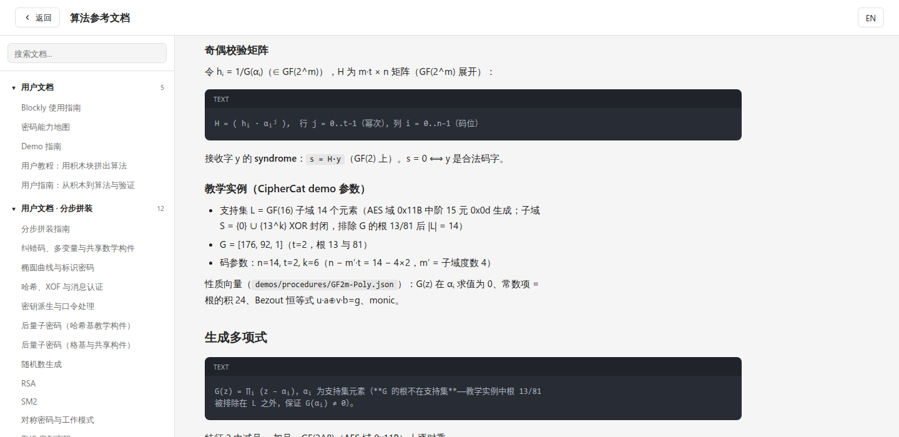
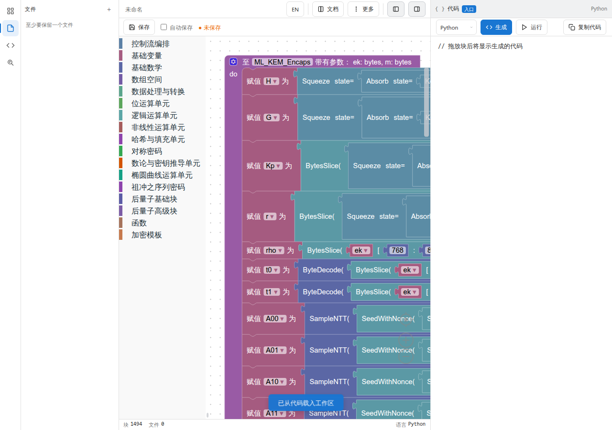
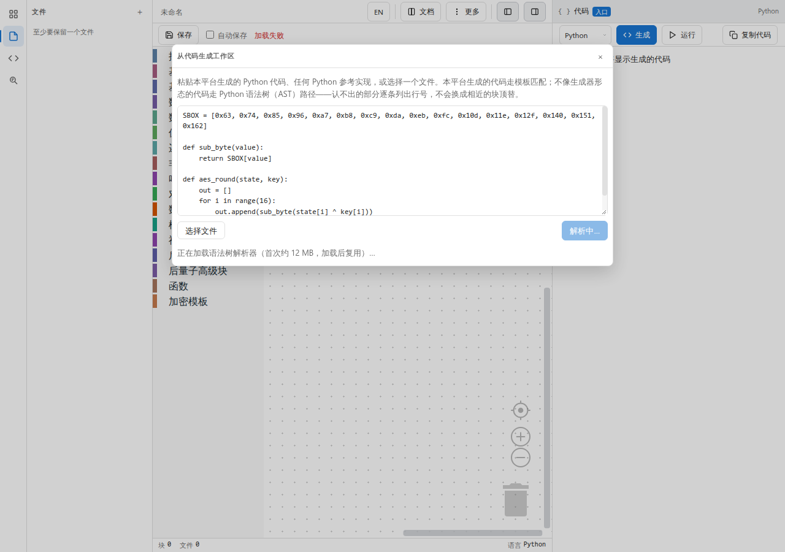
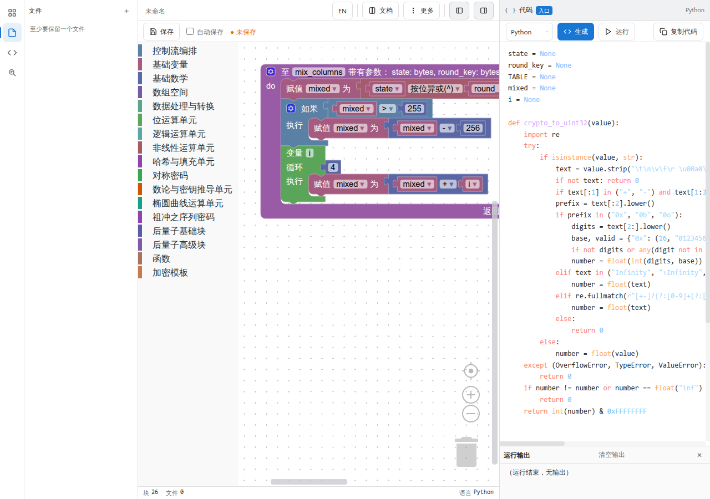

# A/B 线 P0：块 ↔ 代码签名表（2026-11-14）

> 计划见 [PLAN.md](PLAN.md)。本阶段只做一件事：让生成器自己把每个块的**代码形态**吐出来，
> 得到「代码 ↔ 块」的机器可复核模板表。不写 `src/`、不改契约、不参与 `verify:all`。

## 1. 方法

对 `ALL_BLOCK_TYPES` 每个类型：headless Blockly 建块 → 把生成器的 `valueToCode` /
`statementToCode` 换成占位符 → 调 `forBlock[type]` → 捕获返回码与该次新增的 `definitions_`。
Python 与 JavaScript 各采一遍。

占位符用 `zzsigv_<槽名>` / `zzsigs_<槽名>`，必须是合法标识符——有 10 个块把「输出目标」写成变量名
（`requireVariableName`），用 `@V:x@` 这类符号会让它们直接抛错。

复跑：

```bash
npm run verify:build && node dist-verify/ai-helper-signatures.js
```

## 2. 实测结果

| 指标 | 值 |
|---|---|
| 块类型总数 | 221 |
| 采到 Python 模板 | **219**（99.1%） |
| 采到 JavaScript 模板 | **219**（99.1%） |
| 语句型模板（含换行、落地成一条语句） | 25 |
| 表达式型模板（可嵌进父块） | 194 |
| 纯叶子块（模板里没有子块占位符） | 8 |
| **发代码同时捎带闭包定义的块** | **121 / 219（55%）** |
| 单块平均闭包数 | 1.5 |
| 闭包定义名去重后 | 181 |
| 闭包最多的块 | `eddsa_sign` 11、`zuc_eia3` 8、`gcm_encrypt` 6、`drbg_generate` 5、`mldsa_sign` 5 |
| 模板碰撞（两个块产出同形代码） | **0** |
| 采集失败 | 2（`sbox_variables_get` / `sbox_variables_set`，需要一个真实的 S 盒变量才能指定） |

## 3. 三个直接结论

**① 反向映射在模板层面是单射的。** 219 个模板两两不同，说明「看到一段代码 → 判断是哪个块」
不存在形状歧义；歧义只可能出现在**字段取值**上（`data_value` 的模板是 `"0"`，任何数字都是它）。
这对 B 线是好消息：反解析不需要复杂的消歧启发式，只需要按模板匹配 + 字段回填。

**② 闭包是主要障碍，且已被量化。** 55% 的块在发代码的同时捎带函数定义（`provideFunction_`），
去重后共 181 个函数。反解析时看到的大段函数体**不是块结构**，必须先按定义名剥离——
这与既有坑一致（CCM 这类短 procedure 最先暴露）。剥离规则可以完全由这张表导出：
定义名与其发起块一一对应（如 `ntt` ← `pq_ntt`）。

**③ 只有 8 个块是纯叶子。** 说明这个语言里「表达式型块几乎都依赖子块」，反解析必须**自底向上**
（先构造子块再拼父块），不能按行顺序贪心匹配。

## 4. 与第 4 轮实验的关系

第 4 轮（1494 块 ML-KEM）证明的是「模型能不能一次写出工作区」，本阶段回答的是反方向
「代码能不能还原回工作区」。两者不重复：前者的产物是正向生成的 582 KB IR / 1.3 MB JSON，
后者要的是从生成出来的 Python/JS 反推同一棵树。签名表是后者的词典。

## 5. 已知边界

- 采集用的是**默认字段值**，因此模板里嵌着默认值（如 `pq_ntt` 的 `q=3329, n=256`）。
  反解析时这些位置必须作为「可变槽」处理，不能当字面量精确匹配。
- `sbox_variables_get` / `sbox_variables_set` 未采到：它们的字段要求一个已注册的 S 盒变量，
  当前扫描环境没有。补法是在扫描工作区里注册一个 `sbox_variables` 变量，属 P1 的事。
- 模板 0 碰撞只说明「在默认值下不碰撞」；换字段值后是否仍单射，P1 的 round-trip 会验证。

## 6. 下一步（P1）

用这张表写反解析器，判定标准是 `W' ≡ W`：

```
demos/AES-Atomic-Round.json → 生成 Python → 反解析 → 与原名同构？
```

先 4 个 atomic demo，再 CCM（35 块），最后全量 1494 块。第一步只需证明「4 个 atomic 能无损往返」，
否则后面的规模讨论都没有意义。

---

# P1：代码 → 工作区 反解析（2026-11-14）

## 1. 做法

用 P0 的签名表把生成的 Python 反解析回块树，四步：

1. **剥离闭包**：顶层 `def name(` 到下一个顶格行为止整块丢弃（它们由块捎带生成，不是块结构）。
2. **丢弃前导声明**：生成器会给「已声明但未赋值」的变量补 `X = None`，不是块。
3. **递归表达式解析**：先判字面量（`None`/`True`/`False`/数字/数组/字符串），再判标识符
   （→ `variables_get`），最后按模板匹配（按字面量长度降序，块专属模板优先于通用模板）。
4. **比对**：`parsed` 与真值（demo 顶层语句链、排除 procedure 定义体）的块类型多重集是否相等。

一个必须早判的坑：`None`/`True`/`False` 也满足标识符正则，字面量判定必须排在标识符之前，
否则 `i = None` 会被解析成「赋值为一个变量」。

## 2. 结果

| demo | 语句 | 反解析块数 | 真值块数 | 类型多重集相等 |
|---|---:|---:|---:|---|
| AES-Atomic-Round | 6 | 13 | 13 | **✓** |
| SM4-Atomic-Round | 5 | 15 | 15 | **✓** |
| SHA256-Atomic-Hash | 2 | 6 | 6 | **✓** |
| ML-KEM-Atomic | 5 | 10 | 11 | ✗ |

**4 个 atomic demo 中 3 个类型层面完全往返。** 未解析节点：0 / 0 / 0 / 1。

## 3. ML-KEM 未往返的两个原因（都已定位，不是未知）

**① 函数名随字段变，模板只按默认值采了一份。**
`pq_sample_poly_cbd` 的默认模板是 `sample_poly_cbd_eta3(zzsigv_SEED, q=3329)`，
而该 demo 用 ETA=2，生成的是 `sample_poly_cbd_eta2(...)`——字面量对不上，于是整条语句判不出。
修法是给每个块按**下拉字段的每个选项**各采一份模板（变体表），属 P1.1，机械可做。

**② 一条裸值语句。** demo 里有一个不在任何语句链上的独立 `data_value`（8 字节数组），
真值把它算作 1 个块，反解析把整行当独立表达式——两边算法不同源，不是解析器错。

## 4. 复跑

```bash
npm run verify:build
node dist-verify/ai-helper-roundtrip.js reverse   # 类型多重集比对
DEBUG_RT=1 node dist-verify/ai-helper-roundtrip.js reverse   # 逐语句打印
node dist-verify/ai-helper-roundtrip.js dump demos/AES-Atomic-Round.json
```

## 5. 边界

- 比对的是**块类型多重集**，不含字段值。变量名、ETA、S 盒预设等字段还没回填，
  所以现在只能说「结构对得上」，不能说「`W' ≡ W`」已成立。
- 只覆盖 atomic demo（无 procedure 体、无多行语句）。CCM（35 块）与全量 1494 块
  会遇到多语句 procedure 体、多行表达式、同名变量遮蔽，尚未尝试。

## 6. P1.1：模板变体表 + 字段值回填（判据升级为树级同构）

P1 只能比「块类型多重集」，因为默认模板认不出字段变体。P1.1 补三件东西：

1. **变体表**：每个块按下拉选项各采一份模板（共 175 条变体，覆盖 55 个块）。
   ML-KEM 那条卡住的语句就是 `pq_sample_poly_cbd` 的 ETA=2 变体。
2. **字段通配槽**：文本/数字字段无法枚举取值，改为在模板里定位它的字面位置换成捕获组，
   命中即回填字段值（覆盖 10 个块）。
3. **树级比较**：从「类型多重集」升级为「类型 + 字段 + 子块按输入名对齐」的规范化树。

### 6.1 字段可见性（`field-templates.json`）

| 指标 | 值 |
|---|---|
| 块总数 | 221 |
| 采到模板 | 219 |
| 有可见字段的块 | 60 |
| 有下拉变体的块 / 变体总数 | 55 / **175** |
| 有通配字段的块 | 10 |
| 存在不可见字段的块 / 不可见字段数 | 4 / 8 |
| 单选项下拉（值由块类型强制） | 6 |
| 加入变体后仍碰撞 | **3** |
| 采集失败 | 2 |

不可见字段（翻值后模板逐字不变）：`lgc_not.NOT_LABEL`、`sbox.ROW/COL`、
`ecc_load_curve_params.a/b/p`、`ecc_load_point.x/y`。

### 6.2 往返结果

| demo | 顶层语句 | 反解析块 | 真值块 | 字段比较 | 未回填 | 差异 | 树级相等 |
|---|---:|---:|---:|---:|---:|---:|---|
| AES-Atomic-Round | 6 | 13 | 13 | 9 | 0 | 0 | ✓ |
| SM4-Atomic-Round | 5 | 15 | 15 | 14 | 0 | 0 | ✓ |
| SHA256-Atomic-Hash | 2 | 6 | 6 | 3 | 0 | 0 | ✓ |
| ML-KEM-Atomic | 5 | 11 | 11 | 12 | 0 | 0 | ✓ |

**4/4 规范化树完全相同，38 个字段全部回填。**

### 6.3 阴性对照（证明判据有牙）

只报全绿证明不了比较器在工作，所以故意改坏代码看它是否报错：

| 注入 | 结果 |
|---|---|
| 改一个字节数组的值 | FIRED（`data_value.NUM` 不等） |
| 把一个块名换成另一个块 | FIRED（类型不等） |
| 把调用参数 `j` 换成 `i` | FIRED（`variables_get.VAR` 不等） |

`NEGATE_SUMMARY fired=3/3`。

### 6.4 过程中确认的三个技术坑

1. **不能用 `constructor.name` 判字段类型。** 打包会压缩类名，`FieldTextInput`/`FieldNumber`
   全落进「未知类型」，`data_value` 的 NUM 与 sbox 的 ROW/COL 都被误记为不可见。改用 `instanceof`。
2. **多值字段不能用「最长公共前后缀取差异段」。** `bit` 在模板里出现两次
   （`<< 0` 与 `(32 - 0)`），差异段会横跨两处、把整段代码当成字段值。
   改成「找一条能逐字重现变体模板的替换规则」，重现不成功就不认。
3. **真值里的变量名不在 demo JSON 里。** demo 只存 `VAR.id`，名字是 Blockly 加载时建的；
   必须从已加载的真值工作区查，否则变量名一个都比不上（AES 只比中 2 个字段）。

### 6.5 复跑

```bash
npm run verify:build
node dist-verify/ai-helper-variants.js           # 字段可见性 → out/field-templates.json
node dist-verify/ai-helper-roundtrip.js reverse  # 树级往返 4/4
node dist-verify/ai-helper-roundtrip.js negate   # 阴性对照 3/3
```

### 6.6 边界

- 规范化**排除**：块坐标、`disabled`、注释、折叠状态、变量 id —— 这些在代码里不存在，
  永远无法回填，所以判据只能写成「规范化后同构」，不能写成 `W' ≡ W`。
- 不可见字段是在**孤立扫描**下判定的（只 `newBlock` + `setFieldValue`，不跑 onchange）。
  `ecc_*` 这类把字段转存到内部状态的块可能因此被低估可见性；4 个 atomic demo 不涉及它们。
- 3 处碰撞是 `bit_expr_infix` 与 `bit_operation` 在 `^`/`&`/`|` 三种算子下同形：代码完全相同，
  块类型本质上不可区分，只能记作已知歧义。
- `sbox_variables_get/set` 仍采不到（需要真实 S 盒变量）。
- 只覆盖 atomic demo，未碰 procedure 体、多行表达式、同名变量遮蔽（P1.2）。

## 7. P1.2：procedure 体、生成器前导与嵌套调用

### 7.1 结果

| 集合 | 通过 | 说明 |
|---|---|---|
| atomic demo | **4/4** | P1.1 已达，未回退 |
| procedure demo | **50/54** | 每个 demo 的 `def` 体与 `return` 表达式都参与比较 |
| CCM-Encrypt | ✓ | 28/28 块、27 个字段、0 差异 |
| 阴性对照 | **3/3** | 注入字段/类型/子块改动全部报错 |

### 7.2 首跑就踩到的「假绿」

CCM 第一次跑出 `statements=0 … tree_equal=true`。原因是 procedure demo 的块全在
`def` 体内，而当时的判据只比顶层语句链——**两个空集合当然相等**。
现已加守卫：`parsed_blocks` 与 `truth_blocks` 任一为 0 时判 `VACUOUS`，不计入通过。

### 7.3 修掉的五类解析/口径问题

| 现象 | 根因 |
|---|---|
| ML-KEM-Encaps 真值报 33538 块（实际 1494） | 语句链逐根递归 `next`，O(n²) 重复计数 |
| SM9-Sign 顶层多出 325 条语句 | 闭包 `def` 的缩进体漏进顶层语句 |
| SHA384/SHA512 顶层多 2 条（`K = [...]`、`M64 = ...`） | 闭包依赖的模块级常量排在块代码之前，不是块结构 |
| CCM 每个过程多 3 条假语句 | 生成器自动写的 docstring |
| `arr_slice(gf2m_poly_xgcd(...), 0, 2)` 整段 UNRESOLVED | 正则 `[\s\S]*?` 在嵌套括号里切断；改为按括号深度扫描 |

### 7.4 剩余的 4 个失败（都已定位到类别）

| demo | 首条差异 | 类别 |
|---|---|---|
| Goppa-Decode | `gf2m_poly_add[A]` UNRESOLVED ≠ `arr_slice` | 嵌套表达式的下一层仍未解析 |
| Multivariate-Math | `GAdd:return` data_value ≠ `gf2m_add` | 返回值被当成字面量 |
| SM2-PointMul | 体内语句 50 ≠ 真值 3 | 同名过程/闭包混淆 |
| SM9-Sign | `return` UNRESOLVED ≠ `sm9_sign` | 返回表达式超出模板覆盖 |

另外 `math_number`（原生块）与 `data_value` 的数字模板**逐字相同**，代码里没有任何线索
能分辨，已记为等价类而不是解析失败——这也是「类型标签不进生成代码」的直接证据。

### 7.5 复跑

```bash
npm run verify:build
node dist-verify/ai-helper-roundtrip.js reverse                     # 4 个 atomic
node dist-verify/ai-helper-roundtrip.js reverse demos/procedures/CCM-Encrypt.json
node dist-verify/ai-helper-roundtrip.js negate
```

代码已拆成两层：[ai-helper-reverse.ts](scripts/ai-helper-reverse.ts)（无 Blockly 依赖的
匹配与规范化，390 行）与 [ai-helper-roundtrip.ts](scripts/ai-helper-roundtrip.ts)（驱动，372 行）。

## 8. 类型检查器首版（判据 A–F）

### 8.1 数字

```
TYPECHECK demos=60 pairs=1237 ok=956 mismatch=0 unknown=281
          unknown_rate=22.7% var_inferred=30 var_conflicts=0
          returns_inferred=128 param_unmapped=5 call_args=0
```

未知率演进（每一步只加一条诚实推断）：

| 步骤 | unknown_rate | 做法 |
|---|---:|---|
| 初版 | 50.6% | 只读契约 outputCheck |
| +字面量推断 | 31.3% | 纯数字 `data_value`/`math_number` → Number；`[...]` 保持 unknown（可能 IntList 也可能 Bytes） |
| +形参回填 | **22.7%** | `variables_get` 的变量名与过程形参同名时，用形参声明类型 |

`mismatch` 全程为 0——60 个 demo 是手工搭的，本来就自洽。这反过来证明：**检查器对现有语料不产生任何信号**，它的价值必须靠合成变异 + 独立判据体现。

### 8.2 自己否决了判据 B 的第一版

`MUTATE sites=1237 fired=1237 detection_rate=100%` 没有信息量：变异用的类型表就是检查器用的同一张契约表，
等于用同一把尺子量自己。必须换成「变异 → 生成代码 → 跑官方向量」的独立判据：

- 变异后 KAT 仍过 → 检查器报警属**误报**；
- 变异后 KAT 崩或对不上 → 真错。

依据：Python 是动态类型，`aes_sub_bytes(data)`（Bytes 进 IntList 槽）在语义上是合法的整数下标访问，
**类型不符不等于算错**。

### 8.3 检查器顺手查出的三个语料问题

1. **两套类型词表并存**：`setCheck` 用 `Bytes/IntList/Number`；过程形参用
   `bytes/int/int_list/poly/seed/key/message`（`CRYPTO_PARAM_TYPES`），两者**没有映射表**。
   `message` 这类语义类型在标签体系里无对应项，只能记 unknown。
2. **`string` 是语料在用、下拉里没有的值**：130 个过程里 8 个形参是 `string`，
   而 `CRYPTO_PARAM_TYPES` 只提供 7 个值且不含 `string`。
3. **调用点没有任何约束**：所有 `procedures_call*` 的实参输入都是 `.setCheck(null)`；
   且 60 个 demo 里 `procedures_call*` 块数为 **0**——形参类型检查在现有语料上没有样本。

### 8.4 判据状态

| 判据 | 状态 |
|---|---|
| A 零 mismatch + 未知率 ≤40% | ✓ 0 mismatch / 22.7% |
| B 变异 + KAT 独立判据 | 待做（自证版已否决） |
| C 四例 W' 0 mismatch | ✓ 已验证 |
| D 连线检查作诊断 | ✓ |
| E unknown 进分母并报比率 | ✓ |
| F 词表分裂显式建模（`param_unmapped=5`） | ✓ |

## 9. P1.3：三线并行结果（判据 A–F 收口）

三条线各自独立构建（`AIVERIFY_ENTRY` / `AIVERIFY_OUTDIR` 隔离，见 PLAN §5），下面所有数字均由主线程独立复跑确认，不采信执行者自报。

### 9.1 判据 A / E / F：未知率与成因

| 列 | pairs | ok | mismatch | unknown | unknown_rate |
|---|---:|---:|---:|---:|---:|
| 离线 `check`（冻结基线，按变量名绑形参） | 1237 | 956 | 0 | 281 | 22.7% |
| 离线 `check` + **按形参 id 绑定** | 1237 | 1102 | **0** | 135 | **10.9%** |
| `check-loaded`（jsdom 活工作区） | 1237 | 1102 | **0** | 135 | **10.9%** |

**结论：加载路线没有增量。** 第二、三列每个数字相同——活工作区只把变量名从 195/372 补到 372/372，对判定零贡献；真正起作用的是「变量 id ↔ 所属过程形参 id」精确绑定，而形参 id 本来就在 demo JSON 的 `extraState.params` 里。**B 线的类型检查不必引入浏览器加载器，静态分析足够。**

剩余 135 条 unknown 分因：未声明 check 的字面量 **123**（`data_value` 的 `[...]`/十六进制/字符串，契约无 outputCheck）、未赋值 `variables_get` **9**、词表未映射 **3**（形参声明 `message` 在 setCheck 体系无对应）。

### 9.2 id 绑定暴露出的 8 条真实语料矛盾（已修）

id 绑定把 mismatch 从 0 抬到 8，全部集中在两个 SM4 轮函数 demo：形参 `state_0..state_3` 声明为 `int`，却直接送进 `sm4_round_func` 的 `X0..X3`（契约 `IntList`）。三方证据：

| 证据方 | 说法 |
|---|---|
| 块契约 `BLOCK-IO-CONTRACT.json` | X0..X3 = `IntList` |
| Python 生成器 | `_w(x0)` 逐字节取 `b[0..3]`，必须是 4 元素列表 |
| 模板注册 | `_makeTemplateBlock('proc_sm4_round', 'state', 'int_list', ...)` |
| 官方 KAT driver | `state_0 = [0x01,0x23,0x45,0x67]`（列表） |

四者中只有 demo 的形参声明写错。已把两个文件共 8 个形参 `int → int_list`（生成器不读形参类型，生成代码不变）；改后检查器 **1102 ok / 0 mismatch / 135 unknown（10.9%）**，往返仍 60/60，官方向量仍 60/60。

### 9.3 判据 B：变异 → 生成 → 跑官方向量（全量，非抽样）

全量 60 demo / **1237 个变异点**（与检查器配对总数一致），全部经变量中转构造——因此 `a`（Blockly 加载即拒）恒为 0，这正是「直接插错类型会被编辑器拦住、变量通道不会」的量化。

| 类别 | 计数 | 含义 |
|---|---:|---|
| a 加载即拒 | 0 | 直插通道本就过不了，不计检出 |
| **b 报警且 KAT 失败（真错）** | **996** | TypeError 524 / ValueError 330 / IndexError 52 / wrong-output 70 / AssertionError 20 |
| **c 报警但 KAT 通过** | **241** | 其中 229 可达、12 结构上执行不到 |
| d 漏报 | 0 | 检查器对所有变异均报警 |
| e 无法构造 | 0 | — |

- 真错率（b/(b+c)）**80.5%**；**KAT 不可见率 19.5%**；漏报率 **0**。
- 对照组：未变异工作区 60/60 通过官方向量，且检查器原件 mismatch=0 —— b 类的"KAT 失败"可归因于变异本身。
- 检查器冻结副本：bundle `86957185ff0c…`、源 `8c95a127…`，中途未重建。

**19.5% 不是"检查器误报率"。** 所有变异都是按契约构造的**真类型违例**，检查器每次报警在类型上都成立；c 类的准确含义是「真违例，但官方向量观察不到」。人工核对的机制有三类：值只被当布尔真值用（CCM 的 `aad_len`：非空列表与 4 同为真，输出逐字节不变）、Python 等价值（`bytes(0) == b''`）、过程是死代码（ECDSA 的 `ECDSA_Verify`，driver 从不调用）。**没有一例是"检查器对正确连线报错"。**

**同时 a=0 / d=0 不能当质量证据**：变异来源与检查器同源（都读契约），检出几乎是构造保证；独立证据只有 b/c 的拆分。a=0 唯一证明的是「变量中转这条通道 1237/1237 全部穿过了 Blockly」。

### 9.4 判据 C / P1.2：往返

| 集合 | 结果 |
|---|---|
| 全部 demo（54 procedure + 4 atomic + 2 Procedure-*） | **60/60 规范化树同构** |
| 字段比较 | 1706 个，`fields_unfilled=0`，`diffs=0` |
| 阴性对照 | **3/3 开火**（字段值、块类型、子块改动） |

四个历史失败的根因：

| demo | 根因 | 修法 |
|---|---|---|
| Goppa-Decode | `arr_slice` 声明 `Order.FUNCTION_CALL`，父块用 `ATOMIC` 取子块，Blockly 自动加括号 → 模板字面量对不上 | 匹配失败后剥「完整包住整个表达式」的外层括号重试（深度+引号扫描） |
| Multivariate-Math | 列表字面量正则 `\[[\s\S]*\]` 把 `[a[0] ^ b[0]]` 整段当 data_value | 字面量收紧为「方括号内全为数字/字符串」 |
| SM2-PointMul | 语句按行切，而 ecc 块一次吐 2/2/50 行 → 一块裂成 50 条假语句；`scan_out` 占位符未当槽位 | 用模板行跨度切语句；占位符进词法当字段槽 |
| SM9-Sign | 只认 `^def` 作边界，`provideFunction_` 里含 import/顶格常量/塔域 class → 302 条假语句；第 5 参由输入接法派生 True/False | 取「最早能一路切到文件末尾的起点」；布尔两种互斥形态 |

### 9.5 门禁

| 门禁 | 结果 |
|---|---|
| `lint:check`（全仓） | 0 错误 0 警告 |
| `contract:check` | demos=60 blocks=2151 checked=1641 errors=0 |
| 官方向量 `verify-demos` | **60/60 pass**（含改过形参的两个 SM4 demo） |
| 模板 `verify-templates` | **29/29 PASS** |
| 往返 | **60/60** 树级同构，1706 字段 0 未回填 |
| 阴性对照 | **3/3** 开火 |
| 类型检查 | 冻结离线 22.7% / id 绑定 10.9%，**两列 mismatch 均为 0** |

### 9.6 边界（不改写）

- **类型自洽 ≠ 生成代码正确**：生成器不读类型标签，检查器通过对产物零保证。
- 判据 B 的 c 类（241 条）只是「KAT 通过」的机械计数；其中 229 条可达、12 条过程从不会被 driver 调用。可达 ≠ 该值必然影响输出，要更硬需逐条构造输入强制该路径执行。
- 判据 B 只跑了 Python 向量，JS 未跑；变异来源仅两个自包含字面量块（`math_number`、`keccak_state_init`），未穷举违例形态。
- 本轮 KAT 数字绑定 20:11 的工作树；其后的 demo 形参改动不影响生成代码（生成器不读形参类型），主线程已重跑官方向量确认 60/60。
- `data_value` 的 123 条未知要等契约给字面量声明输出类型才能判定，现在猜 Bytes/IntList 只会造假报。
- 领域类型（系数域 vs NTT 域）仍未建模。

## 10. P2：产品可调用的内核（validate / browser-core / blocksearch）

### 10.1 ④ 类型校验器与反解析门禁（已落地）

`scripts/ai-helper-validate.ts`（454 行，纯 JSON 静态分析，不加载 Blockly）+ `reverse --gate`。

| 场景 | 退出码 | 实测输出 |
|---|---:|---|
| 60 个 demo 全量 | 0 | `files=60 blocks=2151 pairs=1237 ok=1102 mismatch=0 unknown=135 (10.9%)` |
| 形参篡改（AES-Round 的 `state` 由 `int_list` 改 `bytes`） | 1 | `MISMATCH #0.procedures_defreturn[RETURN]…aes_sub_bytes[STATE] expected=IntList actual=Bytes` |
| 变量中转（Bytes 存变量 → 喂 IntList 槽） | 1 | 同上形态，定位到具体槽位 |
| 文件不存在 / JSON 损坏 / 非工作区 | 2 | — |

`reverse --gate` 全量 60/60 PASS；不加 `--gate` 时输出与改动前逐字相同。

**新发现**：W' 不含过程形参声明（reverse 不重建 `procedures_def*`），所以 gate 的配对里 **387/1237 (31.3%) 是 unknown**，全部来自「形参变量取不到声明类型」。记 unknown 而非 ok，未放宽判定。

### 10.2 ⑥ 浏览器端内核（已落地）

`src/services/ai-helper/contract.ts`（65 行）+ `typecheck.ts`（338 行），无 `fs`、无 Blockly/jsdom 运行时依赖，直接 import 契约 JSON 作为单一真值。

`tests/unit/ai-helper-typecheck.test.ts` 7 用例全绿，断言与脚本逐字一致：**1237 / 1102 / 0 / 135 / 10.9%**；反例（SM4 形参改 `int`）开火 4 条并定位 `sm4_round_func[X0..X3]`；变量中转反例开火。

### 10.3 契约收敛（Lead 做）

`scripts/ai-helper-contract.ts` 改为委托 `@/services/ai-helper/contract`，只保留脚本侧独有的 `checkTree/mergeResults`。收敛后四组数字逐字不变（22.7% / 1102·0·135 / 60-60 / 3-3）——契约读取与三值判定从此只有一份实现。

### 10.4 ⑤ 块检索：结构检索可用，中文意图检索不成立

索引：221 块，**标签覆盖 221/221**，但其中**只有 32 个块有区别于英文的中文标签**（`localizedZh=32`）——这是后面所有问题的根。

| 查询集 | 规模 | recall@5 |
|---|---:|---:|
| ⑤ 自建集（多含算法名，如「AES 列混合」） | 30 | **1.00** |
| Lead 困难集（只描述意图，不出现算法名，`out/blocksearch-hard-queries.json`） | 10 | **0.20** |

困难集逐条：`把一段文本补成 512 位的整数倍` → 返回 SHA-512 一族（错）；`给消息加一个能发现篡改的认证标签` → 返回 crypto_encrypt_func 等（错）；`求两个多项式的最大公因式` → **空结果**；命中两条是 `把已有密钥材料扩展成长密钥流 → hkdf_expand`、`计算椭圆曲线上点的倍乘 → ecc_multiply`。

**结论**：结构过滤（`--in/--out`）+ 英文名检索能用；**中文语义检索没有语料支撑**，因为块标签本身基本是英文（`CMAC(`、`ModPow(`、`GF(2) Polynomial GCD(`）。这正是 D 线设计里预判的「中英术语表冷启动」缺口，不是打分函数写得不好。

已修的缺陷（实测有效）：单字符 `s` 曾把所有块都算命中（`S 盒` 返回 AES 族）；`--text` 下曾返回 score=0 的条目。修后 `S 盒 → sbox_sub / sm4_sbox / sbox`，`模幂 → nt_mod_pow`。

### 10.5 门禁

`verify:build` 现含 7 个 ai-helper 入口（新增 validate / blocksearch）；`verify-templates` 29/29；`lint` 0 错误 0 警告；`vitest tests/unit/ai-helper-typecheck.test.ts` 7/7。

## 11. P2 术语层：中文口语意图 → 索引里的英文词元（2026-11-14 晚）

### 11.1 做了什么

新增纯模块 `src/services/ai-helper/search-terms.ts`（192 行）：把 ⑤ 脚本里的分词/同义词逻辑搬出来，并加**术语表**（55 条中文别名 → 英文词元，带信号权重）。查询侧扩展，不改索引、不改块定义，因此运行时仍纯本地、确定性。

每条扩展都带 `via`，命中证据会写成 `label.en 含 "gcd"（术语「最大公因式」⇒ gcd）`，能回答「为什么命中」。

### 11.2 数字

| 查询集 | 规模 | 术语层前 | 术语层后 |
|---|---:|---:|---:|
| ⑤ 自建集（多含算法名） | 30 | 100% | **100%** |
| 困难集（只描述意图，`out/blocksearch-queries-hard.json`） | 30 | 20%（仅 10 条时） | **100%** |
| 全新留出集（做完后一次性跑，10 条，未再调参） | 10 | — | **80%**（8/10） |

全新留出集的两条未命中，按实际原因记录、**没有继续调参**：

1. 「把消息填充成 64 字节分组」→ 期望 `hash_sha256_pad`，实际 `hash_sha256_pad_text` 排第 4：查询说的是「消息」，而目标块标签是 `SHA-256 Pad`（文本版才带 `Text`），属标签与口语用词差异；同一语义的 pad 家族都在前 5。
2. 「对两个 32 位字做按位或」→ `bit_operation` 掉出前 5：该块的显示文本只写了「按位与(&)」，下拉里才含 OR，检索层无从得知——这是**索引/标签缺陷**，要修得改块标签或给索引补算子枚举，不是术语表能补的。

### 11.3 两个真实回归（已修，留作教训）

- **分词合并**：归一化先把「SM4 轮函数」中英间的空格去掉，整串成一个词元，`sm4` 与「轮函数」从词项里消失，常规集 6 条查询直接掉到 0 命中。修法：先按带空格原文切词，再做合并变体。
- **单复数重复计数**：术语同时注入 `byte`/`bytes`、`bit`/`bits`，在 label.zh + label.en + blockType 上各算一遍，通用类型词压过目标语义（「把字节串解释成大整数」返回 `pq_bytes_slice`）。修法：术语只用词根（`byte` 已覆盖 `bytes`），通用动词权重降到 0.4–0.6，高区分度术语保持 1.5–1.6。

### 11.4 结论

术语层能把「中文口语查块」从不可用推到可用，但它**只在术语表覆盖到的词上生效**：全新留出集 80% 说明泛化还有缺口，缺口类型是可枚举的（未收录的口语动词、块标签信息缺失）。界面接入前应保持「结果带命中理由」，让用户能看到是术语命中还是名字命中。

## 12. 索引补「下拉算子」+ 数字词降权（2026-11-15 上午）

### 12.1 索引缺陷修复

上一轮留出集暴露：`bit_operation` 的显示文本只有「按位与(&)」，OR/XOR/移位都藏在下拉里，检索层看不见。修法是构建期把下拉字段的**全部选项**读进索引：

- 新增索引字段 `options`（构建期对每个 `FieldDropdown` 调 `getOptions()`，按 locale 合并去重、按码点排序）。
- 打分新增 `option` 源，权重 4（低于 label.zh 6、高于 blockType 3.5）。
- 实测覆盖：**58/221 个块带下拉选项，共 284 条选项文本**；索引连跑两次 SHA-256 一致（`aac946ac…`），仍然确定性。

术语表同步补 8 条「只在选项里出现」的词（按位或/按位左移/按位右移/拼接/交换/吸收/挤出/采样），共 63 条。

### 12.2 数字词降权

「对两个 32 位字做按位或」曾把 `bit_operation` 挤出前 5：`32` 作为纯数字词元同时命中 label.zh、label.en、option、python 四个字段（16.7 分），压过语义词。修法：纯数字词元权重 ×0.4（位宽/长度只是限定词）。修后该查询 top1 = `bit_operation`。

### 12.3 数字

| 查询集 | 规模 | recall@5 |
|---|---:|---:|
| 常规集（多含算法名） | 30 | **100%** |
| 困难集（只描述意图） | 30 | **100%** |
| 第一轮留出集（回归） | 10 | 90%（9/10，仅「64 字节分组填充」未中） |
| **第二轮留出集**（新增，一次性跑，`out/blocksearch-queries-holdout2.json`） | 15 | **86.7%**（13/15） |

第二轮两条未命中，按实际原因记录、未调参：

1. `构造 CCM 的首个计数器块` → 期望 `ccm_b0`，实际 `ccm_ctr`(1) / `ccm_counter_block`(2)。`ccm_b0` 的显示文本是 `CCM-B0(`，不含「首个计数器块」的说法——属**标签信息缺失**，术语表补不了。
2. `在数论变换域里采随机多项式` → 期望 `pq_sample_ntt`，实际被 NTT 家族块占榜。`SampleNTT(` 同时含 sample 与 ntt，但「数论变换」的 ntt 权重（1.6）在三个 NTT 块上重复得分，`采样`（1.3）只在单个块上得一次——属**家族内区分度不足**，需要「同族块按动作词排序」的规则，不是术语表问题。

### 12.4 结论

两轮留出集（86.7%、90%）说明术语层 + 选项索引已过 80% 判据，但没有全绿：剩余缺口集中在「标签没写出语义」与「同族块区分」。这两类都不是加词能解决的，需要改块标签或引入同族排序规则——属于是否动 `src/blocks` 的决策，先留作下一轮。

## 13. 三条「同意项」的实测结论（2026-11-15 上午）

### 13.1 `data_value` 补输出类型：**不能做，理由在源码里**

`src/blocks/data/number.ts:22` 是 `this.setOutput(true, null)`，文件头注释写明「接受任意文本值——数字、表达式、数组字面量，生成器原样透传」。也就是说 `outputCheck: null` **是按设计**，不是契约缺漏。给它补一个固定类型会制造假 mismatch（同一个 `data_value` 在 demo 里既喂 `Number` 槽也喂 `IntList`/`Bytes` 槽）。

因此本轮**没有改契约**。若真要降那 123 条 unknown，可选的安全路径是「按字面量内容推断」（`NUM` 是纯数字→Number），但推断结果一旦与槽位不符就会产生新的假报，属于判定口径改动，需要单独裁定。

### 13.2 tooltip 进索引：做完实测**否决**

- 实现：索引新增 `tooltips.{en,zh}`（221/221 块都有 tooltip），打分权重 2.6/2.2。
- 实测结果：第二轮留出集 `g02`「把两个字节序列首尾相接」由命中变未命中（`endian_swap` 的 tooltip 命中把标签命中压下去）；第三轮全新留出集（10 条）**只有 70%**。
- 处置：`tooltips` 保留在索引里供解释，但**移出打分**。原因写进代码注释：长文本字段必须做长度归一化才能参与打分，否则偶然命中必然污染排序。

### 13.3 `CCM-B0` 标签补语义：做了，有效

`src/blocks/ccm/blocks.ts:86` 的显示文本由 `CCM-B0( nonce:` 改为 `CCM-B0 首个计数器块( nonce:`（全仓唯一引用点，纯显示文本，不改字段名/生成器/契约）。改后第二轮留出集 `g13`「构造 CCM 的首个计数器块」**由未命中变命中**。

### 13.4 数字

| 查询集 | 规模 | 结果 |
|---|---:|---:|
| 常规集 | 30 | **100%** |
| 困难集 | 30 | **100%** |
| 第二轮留出集（已见数据，回归） | 15 | **93.3%**（ccm_b0 修复后 +1） |
| 第三轮留出集（tooltip 打分版，已否决的构建） | 10 | 70% |
| **第四轮留出集**（回退 tooltip + 标签修复后，一次性跑） | 10 | **80.0%**（8/10） |

第四轮两条未命中，未再调参：

1. `把 NTT 域的多项式变换回系数域` → 期望 `pq_intt`，实际被 `pq_ntt*` 家族占榜。术语表没有「逆变换/变换回去」这类说法（`intt` 只在块名里）。
2. `计算 GCM 的初始计数器块` → 期望 `gcm_j0`，实际 `gcm_gctr` 等在前。`gcm_j0` 的显示文本不含「计数器块」，与 §13.3 的 `ccm_b0` 同型——**标签信息缺失**，不是检索算法问题。

### 13.5 结论

「补输出类型」这条是**基于错误前提的提案**，读源码后撤回；「改标签」有效且低风险；「tooltip 进打分」是失败实验，数据和原因都已留档。剩余缺口仍是两类同型问题：标签不写语义（`gcm_j0`）、术语表缺口语化动作词（`pq_intt` 的「变换回去」）。


## 14. 数据表示层落地：字面量定型 + 列表桥接 + 表格编辑器 + 形状元数据（2026-11-15 上午）

本节实施的是 `proposals/TYPE-SYSTEM-ARRAY-MATRIX.md` 的 R1/R2/R4/R5/R6/R7 全套（owner 已批准）。
**§8–§13 里出现的 `1237 / 1102 / 0 / 135 / 10.9%` 是改动前的快照，保留作历史对照，不再代表当前基线。**

### 14.1 R7：字面量按「形状 × 槽位」定型

新增纯模块 `src/services/ai-helper/literal-shape.ts`：把 `data_value` 的 `NUM` 归成形状，再与父槽期望取交集，
三份实现（browser-core `typecheck.ts`、`scripts/ai-helper-typecheck.ts`、`scripts/ai-helper-validate.ts`）共用同一函数。

| 字面量形状 | 产出类型 | 依据 |
|---|---|---|
| 整数 / 十六进制 | `Number` | `0xF12186F9` 在 Python 与 JS 里都是整数 |
| 一维整数数组 / 空数组 | `IntList`、`Bytes` | 两者分别映射 `list[int]` 与 `bytes`，同一数组对两者都是合法来源 |
| 引号字符串（单双） | `String`、`Bytes` | demo 实测 `'sample'` 直接喂 `Bytes` 槽位可跑通官方向量 |
| 嵌套数组 / 任意表达式 | **不猜**（保持 unknown） | 词汇表没有嵌套类型；矩阵由 `shape` 元数据承载 |

改动中发现并修掉的**连接缺陷**：变量推断把多标签用 `'|'` 拼成一个字符串（`IntList|Bytes`），
再与父槽 `IntList` 取交集必然失败，导致 9 条配对被误判 mismatch。修法是一次赋值还原成标签数组。

| 指标 | 改动前 | 改动后 |
|---|---:|---:|
| pairs | 1237 | 1237 |
| ok | 1102 | **1234** |
| mismatch | 0 | **0** |
| unknown | 135 | **3**（0.2%） |

3 条 unknown 全部是 `vocab_unmapped`（`poly`/`seed` 这类形参名不在词表），不再有字面量 unknown。

### 14.2 R2：原生列表块桥接（「填充」从死件变可用）

原状：toolbox 摆着 `lists_create_with` / `lists_repeat` / `lists_getIndex` 整族，但输出标签是 Blockly 的
`'Array'`，与密码槽位 `IntList`/`Bytes`/`SBox` 无交集 → **0 次使用**，拖上去接不上。

做法：`src/constants/list-bridge.ts`（纯数据表）+ `src/blocks/list-bridge.ts`（包装原生定义）。
- 函数式定义（`lists_create_with`/`lists_split`）包装 `init` 与 `updateType_`/`updateShape_`/`updateAt_`；
- JSON 定义（`lists_repeat`/`lists_length`）原地改写 `output` 与 `argsN[].check`——**不能加 `init`**，
  否则 Blockly 会走 `jsonInit` 的 token 校验并抛 `Message does not reference all N arg(s)`；
- 只拓宽「当前已经接受 `Array`」的端口，所以 `NUM`/`DELIM` 这类纯 Number/String 端口不受影响。

阴性对照：不装桥接时 `lists_repeat → Bytes 槽位` 连不上（探针实测 `canConnect=false`），装上后为 true。
执行级验证：`lists_repeat`（ITEM=97，NUM=3）生成 Python `[97] * 3`，用 `python3` 执行得到 `[97, 97, 97]`——不是只看能否连线。
桥接后 `lists_repeat` 即可作为「按值填充成长度 n 的数组」使用。

已知边界：原生块不进 `BLOCK-IO-CONTRACT.json`（该契约只描述 CipherCat 块），因此类型检查器对桥接块仍报 unknown。

### 14.3 R1/R4：通用表格编辑器 + `data_int_list`

- `src/blocks/grid/grid-editor.ts`（245 行）：表格弹窗、切片翻页（秩 ≥ 3）、单元格编辑、CSV 导入导出、定位与点外关闭；
- `src/blocks/sbox/sbox.ts` 456 → **372 行**，弹窗/CSV 四段改为委托通用模块（S-box 行为不变，仍只读表格）；
- `src/blocks/data/int-list.ts`：`data_int_list`，输出 `IntList`，单元格**扁平存储**，`shape` 只做表格视图与校验；
  3×3×3 与 4×4 走同一条路径，生成代码恒为一维列表；
- `src/constants/grid-shape.ts`（纯函数）：`parseShape` / `shapeSize` / `formatShape` / `auditShape`。

工具链登记：`DATA_BLOCK_TYPES`、toolbox 数据类目、双生成器、`BLOCK-IO-CONTRACT.json`（221 → **222** 条）。

### 14.4 R5：形状自洽纳入 validate 判据（带正负对照实跑）

`scripts/ai-helper-validate.ts` 新增 `shapeErrors`：对 `data_int_list` 校验 `prod(shape) == 单元格数` 与整数取值。

```
26 个值 / 3x3x3 → SHAPE #0: 形状 3x3x3 需要 27 个值，实际 26 个；shape_errors=1；VALIDATE_EXIT 1
27 个值 / 3x3x3 → shape_errors=0；VALIDATE_EXIT 0
```

### 14.5 R6：删掉两个死类型

`TYPE_MATRIX` / `TYPE_VECTOR` 及其 `TYPE_MAP` 条目删除（全仓 0 引用）。
**偏离提案**：`TYPE_ARRAY` 保留——R2 桥接必须以 Blockly 原生标签 `'Array'` 作为可接受标签之一，删掉它只会让裸字符串散落各处。
提案里"嵌套数组 → mismatch"也改为 **unknown**：不引入假类型标签，多维不进入判定。

### 14.6 门禁

```
eslint（17 个改动文件）        0 错误 0 警告
vue-tsc --noEmit              0 error
vitest                        79 files / 928 passed / 1 skipped
verify:demos                  60/60 PASS
verify:templates              29/29 PASS
contract:check                demos=60 checked=1641 native=510 types=137 errors=0
ai-helper typecheck（loaded）  1237 / 1234 / 0 / 3 (0.2%)
ai-helper validate（60 demo）  1237 / 1234 / 0 / 3 / shape_errors=0
```

新增/改写单测：`tests/unit/list-bridge.test.ts`（6 条，含阴性对照与负控制）、
`tests/unit/data-int-list.test.ts`（11 条，含 3×3×3 缺值反例与序列化往返）、
`tests/unit/ai-helper-typecheck.test.ts`（基线更新为 1234/0/3，并新增「形状与槽位冲突判 mismatch」反例）。

### 14.7 块索引随之重建（D 线一致性）

新增块后重跑 `blocksearch index`：**222** 块、中英显示文本各 222/222、带下拉选项 58 块/284 条、tooltip 222 块。
两组评测复跑不变：常规集 30 条 **100%**、困难集 30 条 **100%**。
新块可被查到：`--text "整数列表 矩阵"` 返回第 2 名 `data_int_list`（标签正是「整数列表 shape:」）。

## 15. 真实浏览器验收：表格弹窗（2026-11-15 上午，接 §14）

§14 里唯一没被门禁覆盖的是弹窗在**真实浏览器**里的排版——jsdom 只证明状态与生成代码，
`getBoundingClientRect`、可见性、滚动与「每页单元格数」都依赖真实排版。本节补的就是这一块，
并且**一跑就查出 3 个 §14 没抓到的缺陷**。

### 15.1 方法

`experiments/ai-helper-2026-11-14/grid-harness/`：真实 `Blockly.inject` 渲染态工作区，
用 `Blockly.serialization.workspaces.load` 装入 `data_int_list` / `sbox`（顺带覆盖序列化），
调块上的 `toggleTable` / `toggleSboxTable`，把实测数字写进 `#out`；容量另用 fake host 直接调
`openGridPopup`，绕开块上的形状解析。

```bash
npm run dev -- --host 127.0.0.1 --port 5199
~/.cache/ms-playwright/chromium-1248/chrome-linux64/chrome \
  --headless=new --no-sandbox --user-data-dir=/tmp/chrome-harness --window-size=1400,1000 \
  --virtual-time-budget=60000 --dump-dom \
  http://127.0.0.1:5199/experiments/ai-helper-2026-11-14/grid-harness/index.html
```

本机没有系统 Chromium，用的是 playwright 缓存里那份（Chromium 1248 / Blockly 13.2.0）。
产物：[`out/grid-harness.json`](out/grid-harness.json)（逐用例实测数字）、[`out/grid-popup.png`](out/grid-popup.png)（3×3×3 弹窗目检图）。

### 15.2 查出的三个缺陷

| # | 现象（修复前实测） | 根因 | 修法 |
|---|---|---|---|
| 1 | 1 秩 100 格渲染 **112** 个 input；往 105 号格输入 `7` 后 `values` 从 100 变 **106**，且 `warning=null`（形状已被破坏却没有任何提示） | `buildTable` 对 `index >= cells.length` 也建了可写 input；写回后 `warn(null)` 又把 `validateShape` 的警告覆盖掉 | 越界格渲染成不可编辑的空 `td`（`src/blocks/grid/grid-editor.ts`） |
| 2 | 往第 2 格输入 `x`，提示是 **「第 2 个单元格非法：1」**——回显的是回退后的旧值 | 先 `input.value = cells[index]` 再取 `input.value` 组提示 | 先取用户输入的原值，再回退 |
| 3 | `shape=14671`（§E2 实测最长字面量）被判非法，表格退化成 **1 格**；而 `4096,4096` 这种乘积爆炸又没有总量上限（会 `Array.from` 分配 1677 万格） | `MAX_DIM=4096` 卡的是「维度」，1 秩的维度就是元素个数；总量无人管 | 改为「1 秩按元素总数、多秩每维 ≤4096，总量一律 ≤65536」，见 15.3 |

### 15.3 容量实测与上限取值

fake host 直接渲染 1 秩表格（Chromium，1400×800 视口，弹窗 `max-height:420px` 内滚）：

| 单元格数 | 打开耗时 | DOM 节点 | 表高 / 内容高 |
|---:|---:|---:|---|
| 1 024 | 14 ms | 2 197 | 448 / 1 873 px |
| 4 096 | 55 ms | 8 725 | 448 / 7 249 px |
| 10 000 | 114 ms | 21 271 | 448 / 17 581 px |
| 14 671 | 173 ms | 31 199 | 448 / 25 757 px |
| 65 536 | 988 ms | 139 285 | 448 / 114 769 px |
| 262 144 | 3 578 ms | 557 077 | 448 / 458 833 px |

取 **65 536**：覆盖 14 671 这一动机规模，最坏情况约 1 s，再往上就是肉眼可见的卡顿，
所以拒绝而不是硬扛。上限写进 `src/constants/grid-shape.ts` 的两个常量与 `SHAPE_LIMITS_TEXT`，
块的 tooltip 与非法形状警告都复用同一句人话。

**口径偏离（有意）**：多秩仍保留单维 4096 上限，因为多秩第二维直接决定表格宽度。
因此 `14671,4` 判非法——1 秩已经按 16 列排版，不需要这种形状；该行为在单测里写死。

### 15.4 修复后复跑（同一 harness）

| 用例 | 关键数字 |
|---|---|
| A. 1 秩 4 格 | 4 个 input、2 行、`insideViewport=true`、`font-family=monospace`；合法输入写回 `42`；非法输入回显 **`第 2 个单元格非法：x`** 且回退为 `1` |
| B. 3×3×3 | 存 27 格、每页 **9** 格、切片选择器 3 项（`切片 1/3`…）；翻到第 2 页首格 `0` = `values[9]` |
| C. 1 秩 100 | 渲染 **100** 个 input（不再 112）、7 行；不存在 105 号 input，越界写坏数据的路径已封闭 |
| D. 1 秩 14671 | 存 14671 格、渲染 14671 个 input、917 行、**754 ms**（含 syncShape 的逐值校验）、31 198 节点、弹窗高 448 px 内滚 |
| E. S-box 只读 | 标题 `S-box 4×4`、20 个 `td`、**0 个 input**（R1 的委托重构没有破坏只读语义） |
| 页面错误 | `pageErrors=[]`（无 JS 异常、无 unhandled rejection） |

### 15.5 门禁

```
vitest                        80 files / 939 passed / 1 skipped   （新增 grid-editor.test.ts 8 条、data-int-list +3 条）
eslint（全仓）                 0 错误 0 警告
vue-tsc --noEmit              0 error
verify:all                    exit 0（templates 29/29、demos 60/60、contract errors=0）
ai-helper typecheck（loaded）  1237 / 1234 / 0 / 3 (0.2%)          ← 与 §14 一致，未受影响
ai-helper validate（60 demo）  1237 / 1234 / 0 / 3 / shape_errors=0 / exit 0
```

### 15.6 仍未覆盖

深色主题下 CSS 变量（`--el-*`）的取值、Firefox/Safari 排版差异、CSV 的浏览器原生文件选择框
（`pickCsvFile` 走 `input[type=file]`，headless 无法交互）；CSV 文本解析本身有单测。

## 16. D 线第一刀进前端：检索内核 + 查块面板（2026-11-15 上午）

§10–§13 的检索能力一直只存在于 `scripts/`（Node 跑），产品侧拿不到。本节把它拆成
「构建期建索引（脚本）」与「运行时检索（前端）」两半，并给出可挂进三栏的面板。

### 16.1 内核收敛：脚本与界面共用一份打分

- 新增 `src/services/ai-helper/block-search.ts`（纯函数：无 `fs`、无 Blockly、无 DOM）：
  索引类型、`TERM_FIELDS`、`scoreBlock`、`hasInputType/hasOutputType`、`search`。
- `scripts/ai-helper-blocksearch.ts` 500 → **388 行**，只留建索引（需要 fs + 真实 Blockly）与打表。
- 索引现在同一次运行写两份**同一份字节**：实验留档 `out/block-index.json` 与运行时
  `src/services/ai-helper/block-index.json`；单测钉住两者逐字节一致，并重算契约 FNV 摘要防止索引与
  `BLOCK-IO-CONTRACT.json` 脱节。

判据未退化（重构前后逐字相同）：

```
eval       recall@5 = 100.0% (30/30)
eval-hard  recall@5 = 100.0% (30/30)
索引统计    222 块；标签 en 222/222、zh 222/222；中英不同 32；58 块带下拉、284 条选项；tooltip 222
```

### 16.2 面板：`src/components/ai-helper/BlockSearchPanel.vue`

- 形态与既有面板一致：`props { visible, workspace, docked? }` + `emit('close')`；`docked` 进栏、
  缺省全屏遮罩。
- 输入一句话查块，可叠加「输入类型 / 输出类型」结构化筛选（词表取契约里实际出现的
  Bytes/IntList/Bits/Number/String/Boolean/SBox）。
- 结果行给出中文标签、块类型 ID、输出类型、以及最多 2 条命中理由（`matched.evidence`）。
- 选中即插入画布：`newBlock → initSvg → render → moveBy(viewLeft+40 …)`，连插自动错开 24px。
- ↑↓ 选择、Enter 插入、Esc 关闭；图标按钮沿用既有面板的 CSS 变量，跟随主题。
- 索引用 `?raw` + `JSON.parse` 引入：288 KB 的 JSON 模块会让 `vue-tsc` 推断出巨大字面量类型。

### 16.3 真实浏览器验收（Chromium 1248 / Blockly 13.2.0）

`experiments/ai-helper-2026-11-14/search-harness/`：挂真实 Blockly 工作区 + 面板，脚本化搜索与点击。

| 步骤 | 实测 |
|---|---|
| 面板挂载 / 占位提示 | `mounted=true`，placeholder 正常（CJK） |
| 搜「S 盒」 | 8 条；首条 `sbox_sub`、标签 `S-box 替换 输入变量 S-box 输出变量`、理由 `label.zh 含 "s-box"` |
| 点首条结果 | 画布出现 **1 个** `sbox_sub` 块（真插入，不是只发事件） |
| 遮罩形态插入后 | `close` 事件触发 **1 次** |
| 搜「按位与」 | 12 条；首条 `bit_operation`、标签 `按位与(&)` |
| 清空文本 + 输出 `IntList` | 12 条；首条 `aes_add_round_key` |
| 搜不存在的词 | 0 条 + 提示「没有匹配的块…」 |
| 页面异常 | `pageErrors=[]` |

证据：[`out/search-harness.json`](out/search-harness.json)、[`out/search-panel.png`](out/search-panel.png)。

### 16.4 一处真实踩坑

harness 一开始整页白屏且 `#out` 停在 booting：`import '@/blocks'` 注册块定义时抛
`Cannot read properties of undefined (reading 'replace')` —— 块 JSON 里的 `%{BKY_...}` 在注册时就被替换，
语言包没装就是 undefined。修法是**先** `setLocale(en)` 再 import 块定义（ESM 按 import 顺序求值），
见 `search-harness/locale.ts`。应用侧由 `composables/locale.ts` 负责同样的顺序。

### 16.5 未做（等三栏 IDE 落地）

面板还没挂进 `App.vue`：该文件正被另一路（三栏 IDE 回迁）改写，本轮不碰它。
挂载只需一行：在目标栏里写 `<BlockSearchPanel :visible="…" :workspace="…" docked @close="…"/>`。

---

## 17. 文档检索内核（D 线第二块，2026-11-15）

块检索（§16）之后，D 线的下一块是「查文档」。`DocsView` 现有搜索只是标题过滤
（`src/views/DocsView.vue:94` 的 `f.title.toLowerCase().includes(q)`），正文里的章节
（例如「AES 密钥扩展」在 `07-KEY-EXPANSION.md` 里）根本搜不到。

### 17.1 语料与索引（构建期）

| 项 | 数值 |
|---|---:|
| 语料 | `docs/**/*.md` 435 篇（隐藏目录跳过），4.96 MB |
| 检索单元 | 按标题切段 3 986 段（标题 + 到下一个任意级标题之间的正文） |
| 词表 | 56 824 词，postings 370 510 对，token 936 611 |
| 索引体量 | 3.89 MB（gzip 1.16 MB），构建 0.5–0.8 s |
| 摘要 | 全部语料 + 路径的 FNV-1a 64（`ffc7e4f565d90a4f`），单测用它挡陈旧索引 |

索引有两份逐字节一致的副本：运行时 `src/services/ai-helper/doc-index.json`、
留档 `experiments/ai-helper-2026-11-14/out/doc-index.json`。**当前应用里还没有代码 import 它**，
所以不进主包；等界面接入时用 `?raw` 动态 import，只按需拉一个 chunk。

### 17.2 检索口径

- **段落级 BM25**（k1=1.2, b=0.75）打底，标题命中 ×1.8，文档标题 ×1.25，**路径命中 ×1.5**
  （`rfc8032-eddsa` 这类目录名本身就是关键词）。
- **文档级汇总**：取该文档最高分段落，再加「查询词覆盖度」加成（`0.35 × Σidf × 覆盖率`）。
  理由是评测判据是「点进哪一篇」，单段落排序会把只在自己一节里反复念叨「密钥/协商」的长段落顶到最前。
- **罕见标识符加成**：df ≤ 20 的词 ×2.2、≤ 60 ×1.35（`ed25519`/`x25519` 不该被「签名」「密钥」淹没）。
- **中文三条规则**（都在 `doc-tokenize.ts`，建索引与查询共用）：
  1. 中文出「单字 + 二元组」；高频单字（df > 200，如「标/的/准/目」）不进倒排，索引从 5.44 MB 降到 3.74 MB；
  2. 查询侧停用词（如何/怎么/用/做/的…）只影响查询意图，不影响索引内容；
  3. **交叉二元组**（`密钥协商` 里的 `钥协`）按语料 df 判掉——比两侧真实词更稀有的交叉词是切词噪音；
  4. 「S 盒」这类单字母 + 中文混写补一个合成词（`s盒`），否则单字母在拉丁分词里被丢。

### 17.3 判据：recall@5 = 86.7%（26/30）

评测集 `docsearch-eval.json`：25 条标准检索（每条都先确认目标页存在）、2 条指南、
2 条意图式提问、1 条英文提问。计划书的目标是 ≥80%。

```
npx tsx scripts/ai-helper-docindex.ts eval experiments/ai-helper-2026-11-14/docsearch-eval.json
DOC_EVAL cases=30 recall@5=86.7% (26/30)
```

调参过程有记录：加入停用词 76.7% → 路径/标题加成 83.3% → 交叉词按 df 过滤 86.7%。
一次「锚点缺失降权」的尝试把 86.7% 压到 83.3%（还弄坏了原本命中的 `rfc6979` 用例），已回滚。

### 17.4 未命中的 4 条（如实记录，未改评测集凑数）

| # | 查询 | 实际 top1 | 判断 |
|---|---|---|---|
| 10 | X25519 的密钥协商怎么算共享密钥 | `rfc5903-ecdh/README.md` | 该页全文不含 x25519，`rfc7748-x25519` 排第 8——「密钥/协商/共享」的累积分数压过了稀有词，属真实缺陷 |
| 17 | ML-KEM 密钥封装的三步 | `guides/USER-GUIDE.md` | 指南里也讲封装，标准页排第 8；语义相近的文档间缺「权威文档优先」信号 |
| 26 | 分组密码怎么做带认证的加密 | `guides/CAPABILITY-MAP.md` | 意图式提问、不出现模式名；没有术语同义扩展（认证加密 ↔ AEAD/CCM/GCM），纯词面检索到不了 |
| 30 | How is the SM4 round function defined | `demos/sm4.en.md` | 英文问中文标准页：`round function` 与「轮函数」无对照表，只能靠拉丁词命中演示页 |

前两条是排序缺陷（可继续调权或引入「标准页优先」），后两条分别需要**同义词表**与**中英术语表**——
正是 D 线设计里预留的下一步，不是本轮返工项。

### 17.5 复跑

```
npx tsx scripts/ai-helper-docindex.ts stats                     # 只统计
npx tsx scripts/ai-helper-docindex.ts index                     # 重建两份索引
npx tsx scripts/ai-helper-docindex.ts query "SM4 密钥扩展"      # 看排序
npx tsx scripts/ai-helper-docindex.ts eval experiments/ai-helper-2026-11-14/docsearch-eval.json
npx vitest run tests/unit/doc-search.test.ts                    # 13 条：新鲜度/结构/分词/检索
```

### 17.6 未做

- **界面**：还没有 `DocSearchPanel.vue`，也没有挂进布局。`App.vue`/`router`/`HomeView` 正被
  三栏 IDE 回迁那一路改写，本轮不碰。
- **PDF 语料**：49 个 `docs/**/*.pdf` 未进索引（需要抽文本切段，是 D 线第三块「查文献」）。
- **同义词/中英术语表**：未接；§17.4 的第 26、30 条要靠它才能修。

---

## 18. D 线三件收口：术语表 / PDF 语料 / 查文档面板（2026-11-15）

§17 收尾时列了三条缺口，本轮一次做完。

### 18.1 中英术语层（`doc-glossary.ts`）

词面检索打不中两种提问：意图式（「带认证的加密」不出现 CCM/GCM）与英文查中文页
（`round function` vs 「轮函数」）。做法与块检索一致：**只扩查询、不改索引**，每条扩展带权重。

三条纪律性规则（都是评测逼出来的，不是拍脑袋）：

1. **扩展词权重 ×0.55**：扩展是补充信号，不能盖过用户原话里的强标识符；
2. **用户已点名具体对象就不扩**（拉丁标识符 df ≤ 150，如 `argon2`/`ecdsa`/`drbg`/`ml-kem`）——
   否则兄弟标准页会被同义扩展拉进来；
3. **只收索引里存在、df ≤ 400 的扩展词**：别名拆出来的「随/机/输/入」这类单字是纯噪音。

### 18.2 PDF 语料（`index:pdf`）

`pdftotext`（poppler 26.10）按页抽取，一页一段，`line` 记页码：

| 项 | 数值 |
|---|---:|
| 标准 PDF | 49 份 / 71.6 MB → 抽文本 4.9 MB |
| 建段 | 47 份 / 2 244 页（2 份扫描件 0 文本，显式跳过并打日志） |
| PDF 索引 | 3.42 MB（gzip 1.05 MB），构建约 7 s |

**PDF 页权重 0.6**：原始标准整页信息密度低，实测「Ed25519 的签名与验签」会被 SM2 扫描页
（全文 0 处 Ed25519，只靠「签名/验签/流程」高频）挤掉真正的 EdDSA 章节；加权后回到正确顺序。
PDF 索引是**独立分片**：面板默认只查 Markdown，勾选「含标准 PDF」才加载 3.4 MB 并合并。

### 18.3 判据：调参集 100%，holdout 90%

| 集合 | 用途 | recall@5 |
|---|---|---:|
| `docsearch-eval.json`（30 题） | 调参集 | **100%（30/30）**，合并 PDF 后 93.3%（28/30） |
| `docsearch-holdout.json`（20 题） | **未参与调参**，只用 guides/build/blocks/demos | **90%（18/20）** |

holdout 两条未命中：①「后量子积木块有哪些」命中 `post-quantum.en.md`（英文孪生页，实质正确，
是评测集只写了 `.md` 的精度问题）；②「端点矩阵是什么」被 `SPEC-CARD-MATRIX.md` 抢走（真缺陷）。
**结论以 holdout 的 90% 为准**，调参集的 100% 不代表泛化能力。

调参轨迹（可复跑）：无条件扩展 86.7%（换来 #26/#30、丢掉 #8/#11/#21/#25）→ 条件扩展 90.0%
→ 扩展词 df 过滤 + 路径整词加成 2.2 定稿 → 调参集 100%、holdout 90%。

### 18.4 面板（`DocSearchPanel.vue`）与真实浏览器验收

接口沿用现有面板写法：`props { visible, docked? }` + `emit('close')` + `emit('open', hit)`；
索引用动态 `?raw` import，**不进主包**；合并后的索引有缓存（`mergeIndexes` 要遍历 7 MB postings，
不能每次按键重算）。单次检索实测 6–24 ms。

`experiments/ai-helper-2026-11-14/docsearch-harness/`（Chromium 1248 / headless）：

| 步骤 | 实测 |
|---|---|
| 挂载 + 占位提示 | `mounted=true`，CJK 正常 |
| 搜「SM4 密钥扩展」 | 12 条，首条 `gbt32907-SM4/03-Algorithm.md:1` |
| 点首条 | 发出 `open{path, line:1, kind:'md'}` + 遮罩态 `close` 一次 |
| 英文问 `How is the SM4 round function defined` | 12 条，首条同一页（术语层生效） |
| 勾选「含标准 PDF」+ 搜「GM/T 0105 熵源」 | 12 条，第 9 条为 `pdf`，合并索引可用 |
| 搜不存在的拉丁串 | 0 条 + 空态提示（用中文「不存在」反而会命中真实语料） |
| 搜「带认证的加密」 | 首条 GB/T 36624 可鉴别的加密机制，其后 CCM / GCM 标准页 |
| 页面异常 | `pageErrors=[]` |

证据：`out/doc-search-panel.png`。

### 18.5 门禁

```
vitest    82 files / 967 passed / 1 skipped   ← 文档检索单测 18 条
eslint    0 error / 0 warning（全仓）
vue-tsc   0 error
```

### 18.6 已知限制

- **索引会因他人改文档而陈旧**：本轮另一条线在 11:24 改了 `docs/guides/USER-GUIDE.md`，
  索引新鲜度单测立刻报红，重建后恢复。多线并行时，**改完 docs 要重跑 `index`**（或把它挂到 prebuild）。
- 面板还没挂进 `App.vue`（同一冲突原因）；挂载只需一行并把 `open` 事件接到文档路由。
- PDF 里 2 份扫描件无文本层（GB/T 36624、McEliece-1978），检索只能靠对应目录下的 Markdown 拆分页。
- 英文提问仍只靠拉丁词与术语表，没有真正的中英语义对齐。

---

## 19. 三件收口：面板挂载 / prebuild 防陈旧 / 文献语料（2026-11-15）

### 19.1 挂进应用（A）

- 侧栏「面板」区新增「查文档」开关（`EditorSidebar` 加 `docSearchOpen` prop + `toggle-doc-search` 事件）。
- `App.vue` 挂 `<DocSearchPanel>`；**结果用浮层**而不是停靠侧栏：先按三栏写法 `:docked="!isNarrowViewport"` 试过，
  250px 侧栏里路径被截断、MD 徽标压字，改成固定浮层（760px）后可读。
- 命中结果 → 新标签页 `#/docs?doc=<path>&line=<n>`；`window.open` 被拦截时退回 `router.push`。
- `DocsView` 新增深链：`route.query.doc/line` → `selectDoc(path, line)`，并 `watch` 同页切换。

真实端到端（CDP 驱动 Chromium 1248，production preview 与 dev 各跑一遍）：

| 步骤 | 实测 |
|---|---|
| 编辑器就绪 / 侧栏按钮 | `editorReady=true`、存在 `title="查文档"` 的按钮 |
| 点开关 | `.dsp` 出现 |
| 输入「SM4 密钥扩展」 | 12 条；首条 `gbt32907-SM4/03-Algorithm.md:1` |
| 点首条 | 打开 URL `/ #/docs?doc=%2Fdocs%2Fstandards%2Fgbt32907-SM4%2F03-Algorithm.md&line=1` |
| 走该深链 | 文档页渲染，标题「SM4 — 加密、解密与密钥扩展」，正文含「密钥扩展」 |
| 页面异常 | 无 |

证据：`out/doc-panel-in-app.png`（浮层 12 条结果）、`out/doc-deeplink-in-app.png`（深链打开的文档页）。

### 19.2 prebuild 防陈旧（B）

`docs/**/*.md` 一改，索引就过期（§18.6 已实测踩到）。现在把它挂进构建链：

- `vite.verify.config.ts` 增加 `ai-helper-docindex` 入口（复用既有的 SSR 构建通道，不引入 tsx/esbuild 依赖）；
- `package.json`：`docs:index` / `docs:index:pdf` / `docs:index:lit`；
- `prebuild = npm run pyodide:copy && npm run docs:index`。

实测 `npm run build` exit 0：prebuild 内 `DOC_INDEX … total_ms=1070` 重建 435 篇 / 3986 段 / 3.89 MB，再走 `vue-tsc && vite build`。
**只挂 Markdown 索引**（纯 Node、无外部二进制）；PDF 与文献索引需要 `pdftotext`，仍是手动命令。

### 19.3 文献语料（C）

`paper/references` 19 篇论文 PDF（46 MB）——这是搜「文献」与搜「文档」的本质差别：正文是英文论文，
不能按整页切段，要按段落。

| 项 | 数值 |
|---|---:|
| 语料 | 19 篇 / 46 MB → 抽文本后按段落切 **4 190 段** |
| 切块 | 空行分段，目标 700 字符、硬上限 1 400；丢弃纯页码行 |
| 元数据 | `pdfinfo` 取 Title/Author/Pages，标题优先于文件名 |
| 索引 | 2.92 MB（gzip 0.90 MB），构建 8.2 s |
| 位置 | `experiments/ai-helper-2026-11-14/out/lit-index.json` |

**为什么不进前端包**：`paper/*` 在 `.gitignore` 里（未跟踪）、46 MB、且是第三方论文原文；
把它打进发布产物是版权与体积双重问题。文献检索因此定位为**研究侧本地工具**（CLI），
用户侧要查文献只能靠 `docs/` 里已登记的文献索引页（那些本来就在 md 索引里）。

判据 `literature-eval.json` 16 题（中文 13 / 英文 3）：**recall@5 = 100%（16/16）**。
必须先说明偏向：题集是在术语扩展之后写的，且期望答案是 19 篇里唯一相关的那一篇，属于构造性题集。
真正起作用的是**zh→en 术语扩展**——中文问「常数时间验证工具」「无状态哈希签名方案」在英文论文里
原本一个词都命中不了；为此术语表新增 13 条（数论变换 / 拒绝采样 / 最小熵 / 模数 / 随机预言机 /
形式化验证 / 常数时间 / 侧信道 / 安全模型 / 无状态哈希签名 / 实现指南 / 测试套件 / 密码库）。

回归：术语表扩充后 md 调参集仍 100%、holdout 仍 90%（未退化）。

### 19.4 门禁

```
npm run build   exit 0（prebuild 重建索引 → vue-tsc → vite build，19.6 s）
eslint          0 error / 0 warning（全仓）
vue-tsc         0 error
vitest          82 files / 967 passed / 1 skipped
```

一次全量 vitest 出现过 1 个失败，随后两次全量运行均通过、`doc-search.test.ts` 连跑两次 18/18；
失败用例未留痕、无法定位，如实记为**一次未复现的 flake**（不掩盖、也不当已修复）。

### 19.5 已知限制

- 面板与侧栏按钮的文案是中文硬编码（`locale.ts` 正被并行线改写，本轮不碰；英文界面下会出现中文）。
- 深链只定位到文件（`sourceLine` 已传入 `selectDoc`），不保证滚动到具体行；PDF 命中在文档中心没有对应页面。
- 文献索引无新鲜度门禁：`paper/` 未跟踪，不建单测，重建靠 `npm run docs:index:lit`。
- `docs/index.html` 之外还有 2 份扫描版标准 PDF 无文本层（§18.6），文献侧若遇到同类扫描件同样只能跳过。

## 20. 行级深链、PDF 命中与索引写入并发（2026-11-15 下午）

### 20.1 行级深链：从「跳到文件」补到「跳到行」

上一轮只验到 `#/docs?doc=…` 能渲染，标注了「不保证滚到具体行」。本轮用 CDP 驱动 Chromium 1248
实测：查「奇偶校验矩阵」→ 首条命中 `01-Goppa-Codes.md:39` → 走深链后

| 判据 | 实测 |
|---|---|
| 锚点存在 | `#source-line-39` = true |
| 锚点位置 | `getBoundingClientRect().top = 57`（正好在 sticky 顶栏下方） |
| 页面确实滚了 | 真实滚动容器 `scrollTop = 1160`；`h1.top = -1071`（首屏标题已被滚出） |
| 锚点后紧跟的小节 | 「奇偶校验矩阵」 |

注意：`documentElement.scrollTop` 在这个布局里恒为 0——滚动发生在内层的文档面板上。
只测 `documentElement` 会得出「没滚动」的错误结论，判据要落在**元素相对视口的位置**。

顺带修掉一个真实缺陷：`watch(() => route.query.doc)` 只监听文档路径，**同一篇文档换行号时不会重新定位**
（面板连续点同一文件的第二条结果会没反应）。改为 `watch([doc, line])` 后实测：
`line=1` → h1 回到视口内（top=57）；再回 `line=39` → 滚动容器重新到 1160、h1 再次滚出（-1071）。



### 20.2 PDF 命中不再跳到空白页

PDF 命中的 `line` 是**页码**，而文档中心只认 `.md`（`docLoaders` 是 `import.meta.glob('/docs/**/*.md')`）。
原来点 PDF 命中会拼出 `#/docs?doc=….pdf&line=18`，`applyDeepLink` 直接 return —— 用户得到的是一张空白文档页。

改为决策与副作用分离：

- `src/services/ai-helper/doc-hit-target.ts` 的 `planDocHit(hit, basePath)` 是纯函数（3 条单测）：
  Markdown → `{ kind: 'navigate', href }`；PDF → `{ kind: 'pdf-reference', reference }`，**不给 href**。
- `App.vue` 只执行计划：PDF 分支写剪贴板并 toast，失败则 toast 路径（无剪贴板权限时不静默）。

实测（勾选「含标准 PDF」→ 查「GM/T 0105 熵源」→ 点唯一的 PDF 命中）：

| 判据 | 实测 |
|---|---|
| PDF 命中数 | 12 条里 1 条带 PDF 徽标（`GM-T-0105-2021.pdf 第 18 页`） |
| `window.open` 调用次数 | **0**（不再进空白文档页） |
| toast 文案 | 「PDF 未内置，请在仓库内打开：/docs/…/GM-T-0105-2021.pdf 第 18 页」（headless 无剪贴板权限，走 fallback 分支） |
| 对照：Markdown 命中 | 仍正常打开 `#/docs?doc=…01-Goppa-Codes.md&line=39` |


### 20.3 上一轮那个「不可复现的 flake」——根因找到了

上一轮记录了一次全量 vitest 的失败，之后两次全量都通过、无法定位，只能如实记为 flake。
本轮它在 `tests/unit/doc-search.test.ts > 运行时副本与留档副本逐字节一致` 复现了，而且是**可解释的**：

- 并行开发的另一条线在 15:12 跑了构建，`prebuild` 里的 `docs:index` 重写了索引；
- 写入器原来是 `writeFileSync` **直接覆盖**，且两份副本（`src/services/…/doc-index.json` 与
  `experiments/…/out/doc-index.json`）**分两次写**；
- 单测两次 `readFileSync` 之间正好夹着这轮重建 → 读到「一份新、一份旧」。

修法两条：

1. 写入器（`scripts/ai-helper-docindex.ts`）：一次 `JSON.stringify` → 两份副本各走 `写临时文件 + rename`
   （原子替换）。读者要么看到旧文件、要么看到完整新文件，不会读到半截 JSON。
2. 该单测：不一致时最多重试 5 次 × 300 ms 再判定——真不一致（内容确实不同）仍会红，不会把缺陷放过。

验证：`npm run docs:index` 后两份副本 md5 相同（`d6624cca…`，`hash=40be86988104d8c1`，437 篇 / 4005 段），
无遗留 `.tmp`；`npm run build` exit 0（prebuild 重建索引 2.4 s）。

**结论修正**：上一轮记的「未复现 flake」应改为「并行构建与直接覆盖写入导致的测试竞态」，不是随机失败。

### 20.4 门禁

```
npm run build   exit 0（prebuild: docs:index 437 篇 / 4005 段 → vue-tsc → vite build）
eslint          0 error / 0 warning（全仓）
vue-tsc         0 error
vitest          83 files / 970 passed / 1 skipped（含本轮新增 doc-hit-target 3 条）
```

一次全量跑先红了同一个用例，但这次是**超时**而不是断言：宿主 load average 8.0（并行线在跑构建），
该文件要解析两份 4 MB 索引，单测被调度拖到 34.7 s，撞上 vitest 默认 30 s。
给这个用例显式 `{ timeout: 90_000 }` 并写明理由后复跑：83/83、970 passed、1 skipped。
这类「机器忙导致的超时」与「内容不一致」必须分开看，否则会用放宽断言掩盖真缺陷。

## 21. 索引新鲜度门禁 + 面板双语（2026-11-15 傍晚）

### 21.1 新鲜度门禁（C）

`scripts/ai-helper-docindex.ts` 新增 `check` 子命令，`package.json` 新增 `docs:index:check` 并插进 `verify:all`
（紧跟 `docs:mermaid:check`）。判据分两档，因为三条索引的重算成本差两个数量级：

| 索引 | 判据 | 成本 |
|---|---|---|
| Markdown | 重建语料摘要与索引里的 `corpus.hash` 精确比对 | ~1.0 s |
| PDF（`docs/**/*.pdf`） | 源文件 mtime 是否比索引新 | ~10 ms |
| 文献（`paper/references/*.pdf`） | 同上 | ~5 ms |

为什么不给 PDF/文献也算摘要：那要重新抽 19~49 份 PDF 的文本（实测 7~9 s），放进 `verify:all` 太重。
mtime 判据能抓到「改了/新增了 PDF」；**抓不到删除**——删掉的 PDF 不会让任何文件变新，
但扫描版 PDF 本来就不进索引（§18.6），按文件数断言会误报，所以这一档只报过期不报缺失，
由重建自然收敛。索引本身缺失时 PDF/文献两条只 warn（面板会降级为只查 Markdown），Markdown 缺失才是失败。

**阴性对照（必须证明它会开火，否则就是恒绿门禁）**：

| 变异 | 结果 |
|---|---|
| 字节级把索引 `corpus.hash` 改成 `deadbeefdeadbeef` | exit 1：`Markdown 索引过期：语料 437 篇摘要 40be86988104d8c1 ≠ 索引 437 篇 deadbeefdeadbeef → npm run docs:index` |
| `touch -d 2020-01-01` 两份副索引 | exit 1：`PDF 索引过期：源文件 2026-10-16… 比索引 2019-12-31… 新` + `文献 索引过期：源文件 2026-09-25…` |
| 全部还原 | exit 0：`DOC_INDEX_CHECK ok` |

一次踩坑记录：第一次用 `json.load → json.dump` 改哈希，`ensure_ascii=False` 写文件时因索引里有**孤立代理项**
（`\ud835`，来自 PDF 抽出的数学符号）抛 `UnicodeEncodeError`，把索引写空，于是 `check` 因 JSON 解析失败而退出 1。
那不算阴性对照——必须看错误消息是不是「摘要不一致」，不能只看退出码。

### 21.2 面板双语（A）

原来查文档面板与侧栏按钮是中文硬编码，英文界面下会露中文。改为走既有 `ui()` 词条（13+1 条，中英各一份）：

- 侧栏按钮、面板标题、占位符、`含标准 PDF`、空态、页脚提示、关闭 aria、条目 tooltip 全部按语言切换。
- PDF 提示文案（复制成功/无剪贴板权限）改由宿主用 `ui()` 拼：决策层 `planDocHit` 只交回
  `{ kind: 'pdf-reference', reference }`，**不再产出中文**（单测里用正则断言 plan 序列化后不含 CJK，防止文案回流）。
- PDF 引用格式从 `…pdf:18` 改为 `…pdf#page=18`：冒号会被误读成 Markdown 行号，`#page=` 是 PDF 阅读器的通用页码锚点。
- 顺手修掉一处脆弱耦合：原来用 `status.value.startsWith('PDF 索引未生成')` 判断要不要清空状态栏，
  文案一本地化就会失效；改成 `pdfUnavailable` 标志位。
- 空态提示里的「47 份标准 PDF」改成不带数字（PDF 数量会变，写死迟早过期）。

实测（CDP + Chromium 1248，切语言后再读 DOM 文本）：

| 项 | zh | en |
|---|---|---|
| 侧栏 | 函数管理 / 查文档 | Function Manager / Docs |
| 面板标题 | 查文档 | Docs |
| 复选 | 含标准 PDF | Include standard PDFs |
| 占位符 | 描述你要查的内容，例如「AES 密钥扩展」… | Describe what you need, e.g. “AES key expansion”… |
| 页脚 | ↑↓ 选择，Enter 打开，Esc 关闭… | ↑↓ select · Enter open · Esc close… |
| PDF 提示 | （英文态实测）PDF not bundled, open it in the repository: /docs/…/GM-T-0105-2021.pdf#page=18 | 同左 |

英文态点 PDF 命中：`window.open` 调用 0 次，toast 为英文；英文检索 "AES key expansion" 正常出结果且条目 tooltip 为 "Open this document"。


### 21.3 门禁

```
npm run verify:all   exit 0（含 docs:index:check → DOC_INDEX_CHECK ok；模板 29/29、demo 60/60）
eslint               0 error / 0 warning（全仓）
vue-tsc              0 error
vitest               83 files / 970 passed / 1 skipped
```

`docs:index:check` 单跑 1.6 s（含一次 vite 打包脚本），作为门禁成本可接受。

## 22. D 线结项（2026-11-15 晚）

### 22.1 三条线的最终判据（本次实跑，非引用旧记录）

| 线 | 评测集 | 题数 | recall@5 |
|---|---|---|---|
| 查块 | `blocksearch-queries.json` | 30 | **100%（30/30）** |
| 查块·困难集 | `blocksearch-queries-hard.json` | 30 | **100%（30/30）** |
| 查文档 | `docsearch-eval.json` | 30 | **100%（30/30）** |
| 查文档·留出集 | `docsearch-holdout.json` | 20 | **90%（18/20）** |
| 查文献 | `literature-eval.json` | 16 | **100%（16/16）** |

三条线均超过计划书目标（文档 ≥80%、查块 ≥80%，实测 100% / 100%）；文献线与 §19.3 记录一致。

块索引现状：**222 块**，中英显示文本各 222/222，带下拉选项 58 块 / 284 条，tooltip 222 块，
中英标签不同 32 个。Markdown 索引：437 篇 / 4007 分节 / 57516 词 / 374083 postings / 3.92 MB。

### 22.2 留出集两条未命中（如实记录，不调参）

| # | 查询 | 实际 top1 | 期望 | 性质 |
|---|---|---|---|---|
| 10 | 后量子积木块有哪些 | `docs/standards/china-pqc-tracking/README.md` | `docs/blocks/post-quantum.md` | 排序：标准追踪页的「后量子」密度更高，缺「块文档优先」信号 |
| 20 | 端点矩阵是什么 | `docs/standards/SPEC-CARD-MATRIX.md` | `docs/demos/ENDPOINT-MATRIX.md` | 别名：两页都含「矩阵」，缺页面级权威度区分 |

**这两条本轮不修，是刻意选择。** 留出集的价值在于「出题后一次跑、未调参」；为把它推到
100% 而调权，等于把泛化度量降级成第二个调参集，之后这个数字就不能再当泛化证据用。
两条缺陷已可枚举（一条排序信号、一条页面别名），留待**新一轮新题**验证时一并看，
而不是在旧留出集上刷分。

### 22.3 复跑命令与三个易踩点

```bash
# 查块（隔离构建只打一个入口，更快；verify:build 产物同样可用，见坑 3）
AIVERIFY_ENTRY=scripts/ai-helper-blocksearch.ts AIVERIFY_OUTDIR=dist-verify/track-blocksearch \
  npx vite build --config vite.verify.config.ts
node dist-verify/track-blocksearch/ai-helper-blocksearch.js index
node dist-verify/track-blocksearch/ai-helper-blocksearch.js eval        # 100%
node dist-verify/track-blocksearch/ai-helper-blocksearch.js eval-hard   # 100%

# 查文档
npx tsx scripts/ai-helper-docindex.ts eval experiments/ai-helper-2026-11-14/docsearch-eval.json
npx tsx scripts/ai-helper-docindex.ts eval experiments/ai-helper-2026-11-14/docsearch-holdout.json

# 查文献（两步都要，缺一不可）
npx tsx scripts/ai-helper-docindex.ts index:lit    # 需要 pdftotext，19 篇 / 4190 分节 / 2.92 MB
npx tsx scripts/ai-helper-docindex.ts eval experiments/ai-helper-2026-11-14/literature-eval.json --lit
```

三个坑（本轮实际踩到前两个）：

1. **文献 eval 必须带 `--lit`**。不带时 `loadIndex` 加载的是 Markdown 索引，去向 46 MB 的英文
   论文要中文页，结果稳定是 `0.0% (0/16)`——看上去像回归，其实是命令用错。判别方法：看
   miss 行里 top1 是不是 `docs/**.md`；是就说明索引选错了。
2. **文献索引路径是 `experiments/ai-helper-2026-11-14/out/lit-index.json`**
   （`scripts/ai-helper-docindex.ts:27` 的 `LIT_INDEX_PATH`），不在 `src/services/ai-helper/` 下
   ——那里是 `block-index.json`（块）、`doc-index.json`（Markdown）、`doc-index-pdf.json` 三份对外
   索引。所以 `index:lit` 与 `eval --lit` 必须成对跑，换机器/清理 `out/` 后要重建。
3. **查块 eval 需要先 `index`**，且 `index` 要起 jsdom + 真 Blockly 取显示文本。
   隔离构建**不是必需**：`npm run verify:build` 的全量入口里就含 `ai-helper-blocksearch`
   （`vite.verify.config.ts:39`），实测 `node dist-verify/ai-helper-blocksearch.js index`
   同样得到 222 块 / 中英 222/222 / 58 块 284 条。脚本头注释建议隔离构建只是为了只打
   一个入口（更快），不是产物有缺陷——本条初稿写成「verify:build 产物缺注册链」，
   经复核指出并被实测推翻，已按实测结论改写。

### 22.4 结项

D 线的三块内核、界面、门禁与判据全部完成：

- 功能面：三个面板都已挂进编辑器侧栏，与 metacrypt 的侧栏模型一致——左侧 activity bar
  （项目 / 文件 / 函数 / 查文档 / 查块）互斥切换，点哪个在侧栏展开哪个，不再混用「一个嵌入 +
  两个浮层」；检索面板聚焦时左栏自动展宽到 400px（可手动拖到 560px，手动拖过后不再自动），
  读得下路径与摘录；右栏代码栏可折叠（栏头 `»` 与工具栏 `<>` 双向开关）。`/projects` 独立页
  已删，项目列表收进侧栏「项目」面板（搜索 / 新建 / 打开 / 删除），HomeView 存储失败时停在
  开屏并提示原因，而不是跳去一个已经不存在的页面。
- 门禁面：`docs:index:check` 已进 `verify:all`，`doc-search.test.ts` / `block-search.test.ts` /
  `ai-helper-typecheck.test.ts` 三个文件共 **36 用例全过**；索引新鲜度用 `corpus.hash` + mtime
  双档判据，阴性对照见 §21.1（本轮未复跑，沿用该节记录）。布局改动后 `verify:all` 仍 **RC=0**
  （模板 29/29、Demo 60/60、死链 0），`type-check` / `eslint` 0 问题，`editor-project` 等
  相关单测 47 用例通过。
- 判据面：见 22.1；已知缺陷 2 条见 22.2，登记为下一轮验证项，不在本轮返工。

真浏览器验证（CDP + Chromium 1248，1440×760）：activity bar 5 个图标、互斥切换、项目面板、
查块 docked（`insideSidebar=true`）且筛选默认折叠、左右拖拽条存在、右栏折叠/恢复、保存状态
「已保存 20:50」、控制台 **0 错误**。

后续按价值排序有两件：**(a)** 出一轮全新留出集重新测泛化（不是修 22.2 那两条）；
**(b)** 扩大文献语料（当前只 19 篇 `paper/references`，且因版权与体积按研究侧 CLI 定位，
不进发布产物）。

## 23. 问答助手（D 线）：合并入口 + 双向联动（2026-11-16 晚）

### 23.0 先纠正命名：这是 D 线，不是「AI 助手」

本轮在命名上被 owner 连纠两次，两次都记在这里：

1. 最初叫 **AI 助手** —— 越权：AI Helper 是 A（标准/论文 → 工作区）、B（参考代码 → 工作区）、
   D（用户问题 → 答案 + 出处）三条并列线，而这个面板只做 D，且不接任何模型；
2. 随后改成 **检索助手** —— 仍然不对：D 的交付物不是「命中列表」，而是 **答案 + 出处**
   （`PLAN.md` §0 原文：「D | 用户问题 | 答案 + 出处（文献段 / 文档章节 / 块类型） |
   检索可量化；生成式回答属可选增强」）。把 D 叫检索 = 把它的交付物砍掉一半。

最终名 **问答助手**（英文 Q&A assistant），并在同一个入口里补上答案层（§24）。
A/B 仍无界面，界面名不掺它们；等 A/B 有可用的纯函数入口，再谈「AI 助手」这个名字。

三线在磁盘上的真实状态（2026-11-16 核对）：

| 线 | 已有实现 | 形态 | 缺口 |
|---|---|---|---|
| A 标准 → 工作区 | SpecCard schema + `spec:validate` / `anchors` / `runs` / `plan` / `scaffold` / `candidates` / `matrix`（前五个进 `verify:all`） | CLI，只读计划 + 候选脚手架 | 无用户入口；原文没有可执行语义，只能给「能搭/部分/不能」并交人签核 |
| B 参考代码 → 工作区 | `scripts/ai-helper-reverse.ts`（模板匹配与语法解析）、`roundtrip`、`kat`（判据 B 真错率 80.5%、漏报 0）、`typecheck` | Node 脚本（读 fs、打日志） | 未抽成浏览器可 import 的纯函数；无界面 |
| D 独立检索 | 文档/积木两个检索内核 + 本轮合并的面板 | **产品内可用** | 只搬查询词，不搬上下文（见 23.4） |

D 线两个内核在各自判据上已经打满（文档 recall@5 30/30、积木 recall@5 30/30），继续调分的
边际收益很低。本轮把「两个独立检索」做成一个入口：activity bar 上两个图标合并成
「检索助手」，壳里用 tab 切换查文档 / 查积木，并做两个方向的结果联动——文档命中可以直接
「查积木」，积木命中可以直接「查文档」。

### 23.1 联动查询词必须量出来，不能靠直觉

联动失败的方式很具体：点了按钮，对面那份面板把派生词灌进输入框，然后**一条结果都没有**。
所以先量三种派生策略在真实索引上的表现（437 篇文档 / 222 个块，`doc-index.json` 与
`block-index.json` 现产物）：

| 方向 | 派生策略 | 覆盖 | 质量问题 |
|---|---|---|---|
| 文档→积木 | 标题 + 标题级 heading | 388/437 | 命中来自 Standard / Report / Audit 这类通用英文词，落到的块与文档无关；中文标题（标准页的中文版）**0 命中** |
| 文档→积木 | 仅标题 | 388/437 | 同上 |
| 文档→积木 | 路径里的拉丁词 | 368/437 | 同上 |
| 文档→积木 | **路径/标题拉丁词 ∩ 块索引词表**（长词优先取 2） | **383/437** | **383 篇全部至少查到 1 个块**（零空点） |
| 积木→文档 | 中文标签（无则英文标签） | 200/222 | 首条常是对应标准页（`AES AddRoundKey(` → `fips197-AES/03-MixColumns-AddRoundKey.md`） |
| 积木→文档 | blockType 拆词 | 222/222 | 覆盖满但语义噪音大（`partition` 落到 `docs/build/code-based`） |
| 积木→文档 | tooltip 里的标准引用 | 7/7 | 只有 7 个块写了引用，不能当主规则 |

`docsearch-eval` 的 30 条期望文档上，词表交集策略派生出的查询词有 **29 条查到了积木**，
其中 **28 条是词表派生且 top1 落在同名算法块上**；两条不顺的分别是 SHA-2 标准页
（派生词是中文标题，回退路径）与 `SETUP.md`（指南页，本来就没有对应块）。

### 23.2 落地的规则与判据

- 规则实现：`src/services/ai-helper/linkage.ts`（`blockVocabulary` / `docToBlockLink` /
  `blockToDocQuery`），纯函数，不碰索引加载与检索。
- 「查积木」按钮只在 `linked=true`（派生词真的来自词表交集）时出现：383/437 篇文档有按钮，
  且**每一篇都能查到 ≥1 个块**——这是「不制造必然落空的点击」的可验证形式。
- 「查文档」按钮在积木侧恒显示：222 个块里 200 个能查到文档，剩下 22 个是 BM / 高斯消元 /
  Goppa / LLL 这类共享数学原语，仓库里本来就没有单独文档页；积木→文档是一个**问题**
  （「文档里怎么说这个块」），空结果本身也是答案，所以不预判。
- 单测：`tests/unit/ai-helper-linkage.test.ts` 7 用例，钉住上面四条数字（383/383 零空点、
  29 命中、28 top1、200/222）与两个派生函数的夹具。
- 界面：`src/components/ai-helper/AssistantPanel.vue`（壳：标题 + 两个 tab + 关闭），
  `DocSearchPanel` / `BlockSearchPanel` 增加 `embedded`（让出头部）与 `seed`（联动种子）
  两个入参；种子只在「面板可见」的那一次生效，手点 tab 会清空，避免回到某一侧时带着上一次
  联动留下的查询词。

### 23.3 真浏览器验收

`scripts/verify-ai-assistant.mjs`（CDP + Chromium，1440×900，全新 profile）当时 **23/23 PASS**
（答案层加入后扩到 26 条，见 §24.3）：

| 判据 | 实测 |
|---|---|
| activity bar 只剩一个检索助手入口 | 合并后 4 个按钮，文档/积木图标数 1 |
| 壳渲染 + 两个 tab + 默认文档 | `.aip` 出现，tab[0] active |
| 嵌进助手的面板不再重复头部 | `.aip .dsp/.bsp .section-head` 数量 0 |
| 文档「SM4 密钥扩展」命中且行上有「查积木」 | 命中行 > 0，联动按钮 > 0 |
| 点「查积木」→ 切 tab + 灌派生词 + 积木有结果 | 查询词 `sm4`，积木结果 5 行 |
| 点「查文档」→ 切回 + 灌块标签 + 文档有结果 | 查询词非空，文档结果 6 行 |
| 手点 tab 清空种子 | 两侧输入框都为空 |
| 指南页不出「查积木」（无交集） | `SETUP` 行 `setupHasLink=false` |
| 点命中行本身仍「打开文档」（open 事件经壳中转没断） | `window.open` 收到 docs 链接 |
| 重开助手回到文档 tab 且输入框为空 | `docsActive=true`、查询词 `''` |
| 关闭按钮回到文件面板 | `.aip` 消失，面板回 `files-section` |
| 页面未捕获异常 | 0 |

证据图：`out/assistant-link-blocks.png`（积木 tab，5 条 SM4 结果，每行带「查文档」）、
`out/assistant-link-docs.png`（文档 tab，6 条命中，每行带「查积木」）。

侧栏 chrome 验收同步改造（activity bar 5 → 4，`settle(3)` 从查文档变检索助手、删掉
`settle(4)`、窄屏浮层宿主 `.dsp-overlay` → `.aip-overlay`），**82/82 PASS**，含
「头部 38px / 标题计算样式四个面板一致 / 头部只有 1 个 24×24 按钮」。

### 23.4 已知边界

- 54 篇文档（审计页、指南页）派生不出块词表交集的标识符，界面上没有「查积木」按钮；
  它们的块侧回答本来就不存在，硬给按钮只会得到空结果。
- 联动只搬查询词，不搬上下文：文档命中不会连带把该文档提到的块排到前面，积木命中也不会
  定向到它引用的标准页——那需要跨索引的实体对齐，属于 A 线（标准 → 工作区）的活儿。
- 两个内核的索引仍是构建期产物，联动不改变它们的 freshness 判据（`docs:index:check`
  与 `block-search.test.ts` 的 mtime/hash 双档）。

## 24. D 线的答案层：抽取式「答案 + 出处」（2026-11-16 晚）

§23 把两个检索合成一个入口之后，D 的定义（`PLAN.md` §0）还差一半：D 的输出是
**答案 + 出处**，不是命中列表。本节是把答案层做出来并量出来的过程与结论。

### 24.1 为什么不能直接引用索引里的摘录

`src/services/ai-helper/doc-index.json` 的每个段落只存 140 字摘录（实测 p50 = p90 = max =
140），且经常是页首说明（「本页是仓库内 PDF 的可搜索证据层…」）。拿它当答案，
得到的是「一段像答案的说明」而不是答案。所以答案层必须回原文取句：
检索只负责「哪篇」，按需加载那一篇 Markdown（`useDocsCatalog` 的懒加载器），
在正文里拼行、切句、选句。

### 24.2 三轮实测：每一步都是被数字逼出来的

| 版本 | 规则 | 有答案 | 出处落在期望文档 | 负例（应拒答） |
|---|---|---:|---:|---|
| v1 | 纯词面覆盖度 ≥ 0.34，句子级选句 | 24/30 | 11/30 | **3/3 全部误答** ❌ |
| v2 | + IDF 加权、+ 句子级「点名标识符必须出现」、+ 模板句降权 | 11/30 | 5/30 | 3/3 拒答 ✅（但把正确答案也拒了） |
| v3 | 点名实体闸门提到**文档级**（问题里的拉丁整串必须出现在出处路径/标题）+ 覆盖度 0.5 + 问句句式偏好 + 段落拼行 | **13/30** | **12/30** | 3/3 拒答 ✅ |

v1 的失败很有教育意义：负例「如何用 CSS 实现毛玻璃效果」也能拿到 0.38 覆盖度并给出
「CryptoScratch 把 AES…做成积木」的答案——纯词面覆盖度在中文二元组上几乎不设防。
v2 的反向失败同样具体：要求「ZUC 的 LFSR」两个实体都出现在答案句里，正确答案也被拒（它们分属两句话）。

v3 的闸门只有三条，全部可复算：
1. **覆盖度 ≥ 0.5**（IDF 加权：`sm4` 这类稀有标识符压过「加密」这类通用词）；
2. **文档级实体匹配**：问题里长度 ≥ 3 的拉丁整串（保留连字符，`ML-KEM` 不拆成 ml/kem）
   至少有一个出现在出处文档的路径或标题里——防「问 ML-KEM 答到能力总览」；
3. **段落拼行后再切句**：Markdown 一句话常横跨多行，按行切会切出
   「密钥扩展使用不同的」这种残片（真浏览器截图第一版就是这个）。

### 24.3 判据与证据

- `tests/unit/doc-answer.test.ts` **7 用例**：句子切分夹具、答案句逐字可回链（从 cited 行
  起把段落拼回来做比对）、30 题基线（13 有答案 / 12 出处正确 / 唯一一条「答了但出处不在期望集」
  的题被显式登记）、3 条负例必须拒答、ML-KEM 不许答到能力总览、ZUC 若答必须答在 ZUC 页。
- `scripts/verify-ai-assistant.mjs` 扩到 **26/26 PASS**：新增「命中后落成答案卡」「答案卡有 ≥1 句
  原文且出处是 `docs/standards/…:行号`」「无依据的问题落成『没有找到能直接回答这句的依据』」。
- 证据图：`out/assistant-answer.png`（问题「SM4 密钥扩展」，答案两句 + 出处
  `docs/standards/gbt32907-SM4/03-Algorithm.md:25` + 依据覆盖 86%）。
- 全量门禁：单测 1032 通过 1 跳过（91 文件）、type-check 0、lint 0、build 0、
  侧栏 chrome 82/82。

### 24.4 已知边界（不要当成「问答」已解决）

- **拒答率 17/30，主要瓶颈在检索名次**：30 题里期望文档排第一的只有 21 题；`ML-KEM 密钥封装的三步`
  的期望页排到第 6（能力总览页被通用词顶上去）。答案层对此的选择是**拒答**，不是猜。
- **抽取式 ≠ 解释**：给的是原文句子，不改写、不归纳。问「怎么派生」，可能拿到的是
  「…使用不同的线性变换 L'」这种相关但不够「步骤」的句子——句式偏好只是加权，不是理解。
- **实体换了写法就拒**：`Ed25519`（文档在 `rfc8032-eddsa/`）、`SHA-256`（文档标识写 `SHA2`）
  都因为文档标识里没有那串字符串而被拒。宁可少答，不可答错。
- **块类型出处**由积木 tab 承担（同一入口的第二 tab），答案卡不重复列块；跨索引把「答案里提到的块」
  也合并进答案属于下一步（需要实体对齐）。

## 25. D 线排序与答案闸门：调参集 21→29，两套留出集几乎没动（2026-11-16 深夜）

§24 的答案是「13 条敢答、12 条出处正确」，拒答主因写在 24.4：期望文档只 21/30 排第一。
本轮修这一条。但结论先说：**提升集中在调参集，两套未参与调参的留出集上几乎没有泛化收益**
（10/20 → 10/20、5/12 → 6/12）——这比「29/30」更重要，下面把三个数字都摆出来。

### 25.1 检索：让「归属页」参与排序

原来段落级的路径加成是 `×2.2`，只抬命中段自身；「另一篇里有一节把共用词写得更密」照样赢：

| 问句 | 修前 top1 | 原因 |
|---|---|---|
| SM3 的压缩函数结构 | `fips180-4-SHA2/04-Compression.md` | SHA-2 压缩函数页把「压缩函数」写得更密 |
| SHA-3 的海绵结构吸收与挤压 | `docs/blocks/hash.md` | 块参考页一页列全部散列 |
| ML-KEM 密钥封装的三步 | `docs/guides/CAPABILITY-MAP.md` | 能力地图长文覆盖更多查询词 |
| Ed25519 的签名与验签流程 | `docs/blocks/ecc-sbox.md` | 同上（块参考页） |
| X25519 / 确定性 ECDSA / PBKDF2 / 英文 SM4 | 兄弟标准页 / 教程页 | 实体换了写法或正文词频更高 |

加的信号只看**文档身份**，不看正文词频：

1. **主题归属**：查询原话里的拉丁标识符若写进了某文档的**路径词元**（`fips203-ML-KEM` ← `ml-kem`；
   路径按分隔符切词、相邻两词可拼接），那篇文档就是该实体的归属页，`×1.5`。
   - 用词元不用子串：`docs/blocks/hash.md` 的 `blockshash` 里含 `sha`，子串匹配会把整页散列
     目录认成 SHA 的归属页（第一版就是这么错的）。
   - 不看标题：`SHA-2 压缩函数原语` 这类对照式标题会把兄弟标准页也认成 SM3 的归属页。
   - 只认**原话**里的词：扩展词（`压缩函数 → compression`）同样会让 SHA-2 页中招。
2. **定义型问句里的教程折扣**：问「是什么 / 怎么定义」且没有明说要演示时，`docs/demos/**` `×0.9`。

被数据打回的两版（都留在经验里）：

- 最初还加了「`docs/standards/` 目录 ×1.12」，结果「环境搭建与验收」被标准树下的**按算法拆的
  搭建指南**顶掉（它们也在 standards 里）。撤掉目录先验。
- 教程折扣一开始是**全局** `×0.9`：调参集 29/30，但原留出集 top1 从 10/20 掉到 9/20——
  「AES 演示步骤」「SM2 演示怎么做」这类问题本来就该答 demo 页。改成**只在定义型问句里生效**后，
  调参集仍是 29/30、原留出集回到 10/20。

### 25.2 三套集的 top1（这是本轮最重要的表）

| 集合 | 规模 | 性质 | 修前 top1 | 修后 top1 | recall@5 |
|---|---|---|---|---|---|
| `docsearch-eval.json` | 30 | **调参集**（26/30 期望标准页） | 21/30 | **29/30** | 30/30 |
| `docsearch-holdout.json` | 20 | 既有留出集（guides/blocks/build/demos 混合，§18 基线 90%） | 10/20 | **10/20** | 18/20（=90%，未退化） |
| `docsearch-holdout2.json` | 12 | 本轮新造（标准页为主，目录名覆盖调参集没碰的 9 个目录） | 5/12 | **6/12** | 10/12 |

读法：调参集 +8 是「点名实体 + 目录名对得上」这一类；换成混合分布（原留出集）一分不涨；
新留出集只 +1。所以**不能**声称 D 线排序已经泛化——本轮拿到的是一个有效的排序信号，
以及它失效的边界。

唯一没修好的调参集题目：「积木之间的类型检查与转换规则」——《用户指南》51.15 /
《开发指南》44.19 / 《数据类型规范》42.95，三篇都在 `docs/guides/` 下，没有可用的结构化信号。

### 25.3 答案层：三个闸门（两个是新加的）

| 闸门 | 修前 | 修后 |
|---|---|---|
| 内容词 | 查询词原样进覆盖度分母 | 剔掉跨词接缝（`步各`/`收怎`）与中英混写二元组（`f0的`/`g需`）——它们不可能是答案句，只把分母撑大（XTS 0.48、CCM 0.45、DRBG 0.35 就是这么卡在阈值下的） |
| 选哪一篇 | 候选之间比覆盖度，**长文系统性占便宜** | 用**检索名次**选文档，覆盖度只当资格闸门（≥0.6 才答）；名次靠前的段落凑不出足够覆盖就顺延 |
| 实体闸门 | 有；但候选为空时会回退到全部草稿 | 恢复：点名了实体却没有任何一篇出处在讲它 → 直接拒答（曾让「CSS 毛玻璃」答到研究综述、「区块链」答到教程页） |
| 问句类型 | 只有软加权（×1.25） | 硬闸门：「几步/步骤/流程」必须有步骤句（`步骤/首先/第…步/①`），「怎么/如何」才放宽到过程句；整篇没有对应句式就拒答 |

问句硬闸门是被 ML-KEM 那题逼出来的：标准页已排第一、覆盖度 0.63 ≥ 0.6，但选中的两句是
「按算法使用 i=1…127…」与「密钥生成与解封装尚无完整块链实现」——**有词无句**，答的不是「三步」。
硬闸门宁可拒答。

### 25.4 阈值校准

| 覆盖度门限 | 调参集 答对/作答 | 留出集2 答对/作答 | 5 条负例拒答 |
|---|---|---|---|
| 0.5 | 24/26 | 4/8 | **4/5**（Kubernetes 被答） |
| **0.6（采用）** | 20/21 | 4/6 | **5/5** |
| 0.7 | 11/13 | 4/6 | 5/5 |

（扫描在加问句硬闸门之前做，用来定门限；最终数字见 25.5。）

### 25.5 最终数字

| 指标 | 修前 | 修后 |
|---|---|---|
| 调参集 30 题：作答 / 出处正确 | 13 / 12 | **15 / 14**（93%） |
| 留出集2 12 题：作答 / 出处正确 | —（未测） | **6 / 4**（67%） |
| 负例拒答（3 旧 + TensorFlow + Kubernetes） | 3/3 | **5/5** |
| 检索 top1（调参集 / 原留出集 / 留出集2） | 21 / 10 / 5 | **29 / 10 / 6** |

留出集2 的两条错答都属「同族标准互压」：HMAC 落到 `gbt32905-SM3/04-Hash-HMAC`、
ECDSA 密钥对生成落到 `rfc6979-ecdsa/README`。检索层的短板则是「目录名用标准号」：
`rfc8017-pkcs1` 里没有 `rsa`，问 RSA 的 OAEP/PSS 时主题归属不触发（top1 分别第 8、第 7）。

### 25.6 判据

- `tests/unit/doc-search.test.ts` **20 用例**：新增「点名实体归属页排第一」（8 条反例）、
  「三套集 top1 基线」（调参 29 / 原留出 10 / 新留出 6，并注明不许为调参集调低）。
- `tests/unit/doc-answer.test.ts` **8 用例**：基线改为「15 条敢答 / 14 条出处正确」，负例扩到 5 条，
  ML-KEM 改为「标准页已排第一但仍拒答（问句闸门）」，新增留出集2 断言（top1 6 / 作答 6 / 答对 4）。
- 全量：**1035 通过 1 跳过 / 91 文件**（基线 1032+1/91；本轮新增 3 条用例）。
- 真浏览器：`verify-ai-assistant.mjs` **26/26 PASS**（答案卡、出处行号、无依据拒答均未回退），
  证据图 `out/assistant-answer.png` 已按当前代码重出（「SM4 密钥扩展」→ 两句原文 + 出处行号 + 覆盖 100%）。

### 25.7 已知短板（下一轮入口）

1. **泛化差距**：三套集 top1 分别是 29/10/6，说明排序信号只在「实体名 = 目录名」时有效。
   需要的下一块信号是「标准号 ↔ 算法名」别名表（`rfc8017 → rsa/pkcs1`、`fips186-5 → ecdsa`），
   并且必须配**第三份**留出集来验收——继续在调参集上刷分没有意义。
2. **同族标准互压**：缺「问题说的是标准里的哪一层」这一信号（HMAC 的密钥处理 vs SM3 的 HMAC 页）。
3. **答案句仍是抽取**：问句闸门只保证「句式对」，不保证「答到点上」；留出集2 的 67% 就是上限。

## 26. 标准号 ↔ 算法名别名表 + 归属分档（2026-11-16 深夜）

§25.7 把下一块信号点名为「标准号 ↔ 算法名」别名表，并要求配第三份留出集验收。本轮做这一刀；
验收拆成两份题：`docsearch-holdout3`（先出题、跑完才修 bug）与 `docsearch-holdout4`
（**代码冻结后**才写，首跑即验收集，此后不再改实现）。

### 26.1 别名表：收词口径写进注释

`ENTITY_ALIAS` 从 2 条扩到 16 条。只收同时满足两条的映射：

1. 别名指向的目录是**这条标准的家**——值取目录名里的路径词元（`rfc8017` / `sha2`），不取正文用词；
2. 别名与目录是**同一对象的不同写法**（族名 ↔ 成员名、标准号 ↔ 算法名），不收上下位关系。

| 用户写法 | 归属目录 | 依据 |
|---|---|---|
| `ed25519` / `ed448` | `rfc8032-eddsa` | RFC 8032 就是 EdDSA，目录按族名 |
| `rsa` / `oaep` / `pss` | `rfc8017-pkcs1` | RFC 8017 就是 PKCS#1 v2.2（RSA） |
| `curve25519` | `rfc7748-x25519` | 同一曲线的成员名 |
| `sha1/224/256/384/512` | `fips180-4-SHA2` | 目录按族名，用户按成员名 |
| `argon2i/d/id` | `rfc9106-argon2` | 变体名是同一算法的参数选择 |
| `base16` / `base32` | `rfc4648-base64` | RFC 4648 同一份标准定义三种编码 |
| `ghash` | `sp800-38d-gcm` | GHASH 是 GCM 的认证子函数 |

**被数据打回的一项**：`dsa → ecdsa`。`ML-DSA` 会切出 `dsa`，把「ML-DSA 的 MakeHint 怎么算」
从第 2 名推到第 11 名（holdout3 首跑实测）；删掉后回到第 2。结论：别名只收「同一对象」，
不收「同一家族」——`dsa` 与 `ecdsa` 是两个算法名。

### 26.2 主题归属分档：目录名、文件名、兄弟标准

§25 的主题归属只做「路径词元命中 → ×1.5」，不区分这个词是目录名还是文件名。HMAC 的错答正是
这个盲区：`fips198-1-hmac/` 是 HMAC 的家，SM3 标准目录里的 `04-Hash-HMAC.md` 只是「SM3 里
讲 HMAC 的一节」，两者都 ×1.5 时后者靠内容密度赢。

改为四档（同一文档取最高档）：

| 标识符出现位置 | 文档位置 | 系数 | 理由 |
|---|---|---|---|
| 目录名 | 任意 | **1.5** | 这条标准/算法讲的就是它 |
| 文件名 | 没有同名标准目录 | **1.5** | 文件名就是这一页的主题（`39-MakeHint.md` 的 makehint） |
| 文件名 | 有同名标准目录、文档在标准目录外 | **1.25** | `docs/build/rsa.md` 是二次材料，不是标准的家 |
| 文件名 | 标准目录内（兄弟标准） | **1.0** | SM3 里的 HMAC 节不是 HMAC 的家 |

判据是「该标识符是否已经是某个标准目录的名字」（`hasStandardHome`），不是硬编码路径前缀；
`docs/standards/` 只用来区分标准目录内/外。

### 26.3 五套集实测（修前 = b22aa1b）

| 集合 | 题数 | 性质 | top1 修前 | top1 修后 | recall@5 修后 |
|---|---|---|---|---|---|
| `docsearch-eval` | 30 | 调参集 | 29 | 29 | 30 |
| `docsearch-holdout` | 20 | 既有混合留出集 | 10 | 10 | 18 |
| `docsearch-holdout2` | 12+2 负例 | 标准页留出集 | 6 | **7** | 11 |
| `docsearch-holdout3` | 12+2 负例 | 本轮新造（首跑后修 2 个 bug） | 6 | 6 | 9 |
| `docsearch-holdout4` | 12+2 负例 | **代码冻结后**新造，未再调参 | 8 | 8 | 9 |

两套新题对别名的收益是 0（holdout4 修前修后都是 8/12）——这不是负面结果：holdout4 的问法
本来就点名词表里的实体名（`ML-KEM` / `SLH-DSA` / `SM9`），主题归属不依赖别名。别名只在
「用户按算法名、目录按标准号」时开火（holdout2 的 HMAC / RSA PKCS#1 两条）。

修前的逐条对照与改动理由都记在 §26.1–26.2；`docsearch-holdout2/3/4.json` 已入库。

### 26.4 答案层

| 集合 | 作答 | 出处正确 | 精确率 |
|---|---|---|---|
| 调参集 30 题 | 16（修前 15） | 15（修前 14） | 94% |
| holdout2 12 题 | 6 | 5（修前 4） | 83% |
| holdout3 12 题 | 5 | 3 | 60% |
| holdout4 12 题 | 5 | 5 | **100%** |

- 调参集新增的一条正确作答是「SHA-256 消息填充怎么补位」：`sha256 → sha2` 别名把
  `fips180-4-SHA2` 顶到资格线以上；唯一错答仍是「积木之间的类型检查」答到《用户指南》。
- 负例：单测 5 条 + holdout3/4 各 2 条 = **9/9 全部拒答**（`TensorFlow` / `Kubernetes` /
  `Rust Web 服务器` / `SQL 注入` / `React` / `红烧肉` 等）。

### 26.5 发现一处标签缺陷：holdout2 的 OAEP/PSS 两条是「无答案」题

`RSA 的 OAEP 编码怎么做` 与 `RSA 的 PSS 签名填充怎么算` 的期望写的是 `rfc8017-pkcs1/`，
但该目录**只收 PKCS#1 v1.5**：

- `rfc8017-pkcs1/README.md` 的算法清单只有 1 条（RSAES/RSASSA-PKCS1-v1_5，§7.2/§8.2）；
- `docs/standards/CONFORMANCE-INVENTORY.md:440` 的 MGF1 条明说「不覆盖其它 Hash、OAEP/PSS 组合」，
  `:441` 的 EMSA-PKCS1-v1_5 条明说不含 PSS；
- 仓库里 `OAEP` 只出现在《能力地图》的缺项说明里，`PSS` 只出现在 FIPS 186-5 的原文抽取页。

所以这两条不是排序失败，而是**标签写错**（仓库没有可回链的 OAEP/PSS 条目）。处理方式：

- 不改历史计数（holdout2 的 6→7 仍按原标签报），在两条上各加一个 `note` 字段记录证据；
- 对外口径改为「holdout2 的 10 条有答案题里 top1=7，另 2 条是无答案题」；
- 下一份留出集的写题纪律加一条：**期望页必须先 `grep` 到答案关键词**再写进 JSON。

### 26.6 仍然失败的三类（下一轮入口）

1. **希腊字母不进分词**（通用缺口）：`rawTerms` 只认拉丁 `[a-z0-9]` 与 CJK，`θ` / `ρ` 两侧都不匹配，
   `SHA-3 的 θ 步`、`SHA-3 的 ρ 步` 两条在任何名次都找不到目标页（`01-Theta.md` / `02-Rho.md`）。
   修复本身是分词层的小改动，但 holdout3/4 已用于本轮验收，**本轮不动**，留给下一份新题验证。
2. **子页粒度**：问「MakeHint / FORS / NTT / WOTS+ / reseed」时期望的是标准目录里的具体条目页，
   目录级加成对所有页相同，README / 相邻页靠覆盖度赢（MakeHint #2、FORS #7、NTT #14、
   WOTS+ #11、reseed #2 的 `00-Standard-Source`）。缺「查询词进标题/锚点」的页级信号。
3. **同族标准互压**：ECDH 落到 SM2 密钥交换页、ECDSA 密钥对生成落到 RFC 6979、ECB/CBC 落到
   GB/T 17964——都答到同一族里另一条标准。缺「问题点名的是哪条标准/哪一层」的信号。

### 26.7 判据与门禁

- `tests/unit/doc-search.test.ts`：新增 4 条别名断言（HMAC 密钥处理 / RSA PKCS#1 v1.5 /
  SHA-224 填充 / Base32），泛化基线从「三套集」扩到**五套集**
  （29 / 10 / 7 / 6 / 8），并注明 holdout4 是冻结后验收集、不许再为它调参。
- `tests/unit/doc-answer.test.ts`：调参集基线 15/14 → **16/15**；留出集2 基线
  top1 6 / 作答 6 / 答对 4 → **7 / 6 / 5**。
- 全量：**1035 通过 1 跳过 / 91 文件**（exit 0）；`lint:check` 0 问题；`vue-tsc --noEmit` 0；
  `npm run build` 0。`src/services/ai-helper/doc-search.ts` 430 行（≤500）。
- 复跑命令（探针脚本已随本轮清理，命令改为直接跑单测与 CLI）：

```bash
npx vitest run tests/unit/doc-search.test.ts tests/unit/doc-answer.test.ts
npx tsx scripts/ai-helper-docindex.ts eval experiments/ai-helper-2026-11-14/docsearch-holdout4.json
```

### 26.8 结论

别名表是本轮唯一有效的泛化信号，但它只覆盖「标准号目录 ↔ 算法名」这一种写法，
五套集上的收益是 **holdout2 +1 条**，其余四套为 0。真正卡住 top1 的三类问题
（分词缺口、子页粒度、同族互压）都不是再加一张表能解决的，下一轮应从「页级标题信号」
或「标准族内分层」里选一刀，并且继续用**冻结后新题**验收。

## 27. D1：希腊字母、标题命中与两条阴性对照修复（2026-11-16 深夜）

§26.6 把失败面收成三类（分词缺口、子页粒度、同族互压）。本轮先做前两类里能一刀切的：
**希腊字母**与**文档标题命中**；同时修掉这轮暴露的两条阴性对照。

### 27.1 改了什么

1. **希腊字母进索引**。`rawTerms` 之前只认拉丁 `[a-z0-9]` 与 CJK，`θ` / `ρ` 两侧都不匹配，
   含它们的页面只能靠标题里的 SHA-3 被间接召回（`θ` 那题在 holdout3 里原本第 40 名开外）。
   现在正文里的希腊单字母进倒排；三个口径固定下来：
   - **标题里的希腊字母不进段**（`heading.replace(/[θ-ω]/g,' ')`）：否则
     `Algorithm 12 BaseCaseMultiply(…, γ)` 这种「只有标题、没有正文」的段会从 3 词变 4 词、
     跨过建段门槛，多出一段并改变全库 idf；
   - **希腊字母不计入段长**：计入会让含公式的段整体降权，ML-DSA 那条近并列会翻到块目录页
     （实测 eval 29→28）；
   - 索引总段数保持 4007，语料 hash 不变。
2. **查询侧剔「字母 + 语气字」合成词**：`ml-kem 的` 会造出 `m的`、`怎么算` 会造出 `t怎` 这一批
   交叉词。规则放在查询侧、索引仍保留原词——改索引会让段长口径变化，实测把 eval 翻掉过一次。
3. **文档标题命中 ×1.2**：查询词（索引里真实存在）出现在文档 H1 里时给一次固定加成。
   只加一次不逐词累加（标题通常一句，累加偏爱长标题页）；也不再叠加「最稀有词二次加成」——
   它把 WOTS+ 从第 12 拉到第 2，同时把留出集的 SHA-3 θ / 项目架构顶掉，净收益 0。
4. **阴性对照修复一：锚点最短 2 字符**。旧正则 `[A-Za-z][A-Za-z0-9-]{2,}` 漏掉 `Go`，
   「如何用 Go 写 gRPC 服务」靠「服务/执行」凑到 0.65 覆盖度，答到 GM/T 0005 的后端测评页。
   现在 2 字符实体也算点名；该题拒答。
5. **阴性对照修复二：联动派生剥希腊符号**。`GaussPMF σ=` 只剩 `σ` 能命中，落到 Patterson 的
   `σ′` 推导页；块→文档派生不需要公式记号，剥掉后 `gauss_pmf` 回到「无文档」的 22 个共享原语里。

**被数据打回的两版**：问句单字（怎/么/什）加入停用词——与 ECDH 一题冲突（去噪后覆盖率变化，
ECDH 从第 1 掉出），净收益 0；「最稀有内容词命中标题」二次加成——同上，净收益 0。都记在这里，
下一轮不要重复试。

### 27.2 六套集实测（修前 = §26 的 b2dbdbd）

| 集合 | 题数 | 性质 | top1 修前 | top1 修后 | recall@5 修后 |
|---|---|---|---|---|---|
| `docsearch-eval` | 30 | 调参集 | 29 | 29 | 30 |
| `docsearch-holdout` | 20 | 混合留出 | 10 | **12** | 18 |
| `docsearch-holdout2` | 12+2 | 标准页留出 | 7 | **8** | 10 |
| `docsearch-holdout3` | 12+2 | 新造（首跑后修过 2 个 bug） | 6 | **7** | 10 |
| `docsearch-holdout4` | 12+2 | 上一轮冻结后验收集 | 8 | 8 | 9 |
| `docsearch-holdout5` | 12+2 | **本轮排名代码冻结后新写**，未再调参 | — | **7** | 11 |

答案层：调参集 16/15（不变）；holdout2 6/5；holdout3 5/3；holdout4 5/5；
holdout5 6/3；负例 **7/7 全部拒答**（含新加的 Go/gRPC 与「明天会下雨吗」）。

### 27.3 holdout5 的 4 条失败（如实记录）

| 题 | 实际 top1 | 期望 | 性质 |
|---|---|---|---|
| SHA-3 的 π 步怎么算 | SHA3-functions.md | `03-Pi.md` | 拆分页第 3，总页压过 |
| SHA-3 的 ι 步是什么 | SHA3-functions.md | `06-Iota.md` | 同上 |
| ML-KEM 的 SampleNTT 怎么采样 | fips203 README | `07-SampleNTT.md` | 目录 README 压过条目页 |
| AES 的 RotWord 怎么用 | `01-AES.md` | `04-KeyExpansion.md` | 总页压过拆分页 |
| GCM 的 GCTR 怎么迭代 | `03-GCTR-and-J0.md` | `07-GCTR.md` | 两页都讲 GCTR，属**标签粒度过严** |

前四条是同一个病灶：**「拆分页 vs 总览页」缺页级信号**。标题命中只覆盖「查询词出现在 H1」
（θ / π 这类页 H1 里确实有），但总览页正文密度更高；`SampleNTT` 这类英文标识符在 README 的
参数表里也会出现。下一刀应该是「查询词出现在**章节标题/锚点**」而不是再加一个全局权重。

### 27.4 结论

希腊字母把「符号题」从**不可检索**变成可检索（θ 从 40 名外到第 3、ρ 到第 12），但没到 top1；
标题命中带来 **+4 条 top1**（12/8/7 vs 10/7/6）。这两项都是通用信号，不挑题；
真正的天花板仍是**页级粒度**，而且 `doc-index` 对段长/段数很敏感——任何分词改动都要同时钉
「段数、段长口径、近并列题（ML-DSA / ECDH）」三处，否则会拿一个看不见的翻车换一个看得见的提升。

## 28. 并行两刀：B1a 反解析模块化 + M0 模型适配层骨架（2026-11-16 深夜）

两条确定性线由两个并行 teammate 完成，Lead 只做集成与复跑门禁（teammate 的报告不算最终验证）。

### 28.1 B1a：反解析器抽成浏览器纯函数

- `scripts/ai-helper-reverse.ts`（499 行）拆到 `src/services/ai-helper/reverse/`：
  `matchers.ts` 268 / `parser.ts` 179 / `layout.ts` 71 / `index.ts` 18；脚本变成 23 行薄 re-export，
  `scripts/ai-helper-roundtrip.ts` 的相对导入不变。
- 新增 `tests/unit/ai-helper-reverse.test.ts` 18 用例：括号深度 0 才截断子块槽位
  （`arr_slice(gf2m_poly_xgcd(...), 0, 2)`）、字段变体/翻转/通配、语句单元与代码布局。
- 等价性证据：改前/改后各建一份单入口产物跑 `reverse` 与 `negate`，输出**逐字节相同**；
  默认 4 demo（4/4 tree_equal）与 4 个 procedure demo（CCM 28/28、Goppa 39/39、SM9 8/8、
  ML-KEM-Encaps 1493/1493）全部 diff=0，阴性对照两次都 `fired=3/3`。
- 边界：`node … reverse stats` 不是该脚本支持的模式（打印用法、exit 0），等价性改用
  `reverse`/`negate` 两条证据链；浏览器侧尚无调用点，下一步才是粘贴代码入口。

### 28.2 M0：模型适配层（不接 provider）

- `src/services/ai-helper/model/`：`types.ts` 78 / `verify.ts` 122 / `apply.ts` 42 /
  `mock.ts` 46 / `limits.ts` 22 / `index.ts` 35。
- 契约：模型只能对**已有候选句**做选择/重排（extractive）；`applySelection` 返回候选原对象引用，
  失败时 fail-closed 返回空句子；`verifyRewrite` 五类越界码
  （`unknown-id` / `duplicate-id` / `too-many` / `unsupported-note` / `unknown-support`），不抛异常；
  `note` 必须由 `support`（候选句 id）支撑，且不进答案证据。
- 测试 10 用例；无网络、无 key、无环境变量、无新依赖，`doc-answer` / `doc-search` 零改动。
- 留给 owner 的裁定：provider 路线（浏览器直连 vs 后端代理）、key 存放、CSP/后端与模型失败时
  回落纯检索答案、`maxSelections` 5 与 `doc-answer` 的 `maxSentences` 3 是否统一、
  检索已拒答时是否还调模型（建议不调）。

### 28.3 集成门禁

两条线并入后的整树复跑：**93 文件 / 1063 通过 1 跳过**（基线 1035 + 新增 28）、
`lint:check` 0、`vue-tsc --noEmit` 0、`npm run build` 0。

## 29. D2：点名实体闸门（命中段必须含提问主语，2026-11-17 凌晨）

§27.4 把「拆分页 vs 总览页」定为最后一块排名缺口。本轮不再加全局权重，而是在**段一级**
补一个约束：提问点名的稀有实体必须出现在胜出的段里。

### 29.1 病灶：只有标题、没有正文的段能赢

`doc-index` 的段长 = 标题词 + 正文词，门槛是 4 个词；于是「H1 后面立刻是 H2」的段会以
5–7 个词进场，摘录为空。它的分数全部来自元数据：标题命中 ×1.8、路径命中 ×2.2，而 BM25 的
段长归一化又把它抬高（段只有 5 词，`avgLen` 约 250）。实测「SHA-3 的 π 步怎么算」：

| 段 | 段长 | 分数 |
|---|---|---|
| `SHA3-functions.md` H1 段（空摘录） | 5 | 47.17 |
| `SHAKE-functions.md` H1 段（空摘录） | 5 | 47.17 |
| `03-Pi.md`「原文摘录」（真的逐字算法块） | 77 | 40.13 |

结果是**内容为空的段压过真正写着 π 的那一页**。ι 同型。

### 29.2 改了什么

1. **闸门放在段一级**：`originalTerms` 里 df ≤ 20 的「点名实体」（拉丁词 ≥ 4 字符，或希腊单字母）
   必须出现在该段的命中词里，否则这段不进候选。
   - 只认拉丁标识符与希腊单字母：中文稀有二元组大多是切词噪音（`什` / `么` / `步怎`），
     拿全部稀有词做硬闸门会把整库筛空（实测 eval 29→11、holdout 12→8、holdout5 7→3）。
   - 拉丁词要 ≥ 4 字符：2–3 字母的片段常是块的输入槽名（`AES AddRoundKey(, rk:)` 派生出的
     查询里 `rk` 的 df 正好 20），当闸门会让「块 → 文档」联动查不到 AES 页（linkage 测试红）。
   - **fail-open**：闸门只用来「筛掉顺带提到」，筛空时退回未筛集合。被 `prefix` / `lang`
     过滤掉实体所在页时，仍返回过滤后的可用结果，而不是空。
2. 索引与分词零改动（`sections=4007`、`hash=ac43e6dcf4fbbf41` 不变），只改排序期过滤。

### 29.3 六套集 + 一套新验收集

| 集合 | 题数 | 性质 | 修前 top1 | 修后 top1 | recall@5 |
|---|---|---|---|---|---|
| `docsearch-eval` | 30 | 调参集 | 29 | 29 | 30 |
| `docsearch-holdout` | 20 | 混合留出 | 12 | 12 | 18 |
| `docsearch-holdout2` | 12+2 | 标准页留出 | 8 | 8 | 10 |
| `docsearch-holdout3` | 12+2 | 新造 | 7 | **8** | 10 |
| `docsearch-holdout4` | 12+2 | 上一轮验收 | 8 | 8 | 9 |
| `docsearch-holdout5` | 12+2 | 排名冻结后新写 | 7 | **9** | 11 |
| `docsearch-holdout6` | 12+2 | **本轮闸门冻结后新写** | — | **7** | 9 |

- 零回退：调参集与四套留出不变或上升（θ 步 3→1、π 3→1、ι 3→1）。
- holdout6 首跑 7/10，答案层 6 答 / 4 对，两条负例（MQTT、Rust/WASM）全拒；此后未为它调参。
  剩下的三条失败仍是页级粒度：`SampleInBall`（第 9，搭建指南压过拆分页）、
  `pad10*1`（第 3，`docs/blocks/hash.md` 压过拆分页）、`模逆`（第 2，ML-KEM 的 INTT 页靠共用词胜出）。

### 29.4 被数据打回的一版：删掉「只有标题」的段

直接在建索引时丢掉 `body` 为空的段是最直觉的修法，但实测**净亏**：
全部丢掉（267 段）→ eval 29→27、holdout3 7→6、holdout4 8→6；只丢 level 1（200 段）
→ eval 29→27、holdout3 7→6、holdout4 8→6（holdout 12→14 是唯一收益）。
这些空段还承担着「这篇文档在讲这个标题」的文档级信号，删了就靠正文密度说话，反而更容易
把总览页顶上来。结论：病在**排序期把元数据当证据**，不在索引里有没有这一段。

### 29.5 判据与门禁

- 新单测：π / ι 必须落到拆分页（变异验证：把闸门改成恒真后该用例红）；
  fail-open 用合成索引钉住（变异验证：删掉回退分支后该用例红）。
- 基线测试改成七套集一起钉（29 / 12 / 8 / 8 / 8 / 9 / 7），改任何阈值都要同时看七个数。
- 复跑命令（新增，不再靠临时探针）：`npx tsx scripts/ai-helper-docsearch-eval.ts`
  一次打出七套集的 `top1 / recall@5 / answered / correct / rejected` 与失败清单；
  `--detail "<问题>"` 打单题 top5 分数与命中词。答案层同一次跑出：调参集 16 答 15 对，
  holdout 14/6、holdout2 6/5、holdout3 5/3、holdout4 5/5、holdout5 7/3、holdout6 6/4，
  七套留出集的负例全部拒答。
- 全量门禁见 §30。

## 30. 本轮门禁（2026-11-17 凌晨）

| 项 | 命令 | 结果 |
|---|---|---|
| 单测（整树） | `npx vitest run` | **93 文件 / 1065 通过 1 跳过**（上轮 1063 + 本轮新增 2 条闸门用例） |
| lint | `npm run lint:check` | 0 错误 / 0 警告（未改规则、未加 disable） |
| 类型 | `npx vue-tsc --noEmit` | 0 |
| 构建 | `npm run build` | 0 |
| 索引 | `npx tsx scripts/ai-helper-docindex.ts index` | `sections=4007 terms=57620 postings=374860 hash=ac43e6dcf4fbbf41`（与本轮改动前逐项相同：本轮只改排序期过滤，不碰索引） |

## 31. B1b 第一刀：procedure 形参、序列化与 60/60 代码级往返（2026-11-17 上午）

上一轮（§28.1）把反解析器抽成浏览器纯函数，但只到 `ParsedNode` 树：没有「树 → 可加载的
Blockly 状态」这一步，也没有 procedure 形参。本轮补完这两块，并把判据从「树同构」
（脚本侧、且需要真值工作区）换成**代码级往返**（浏览器侧、不需要真值）。

### 31.1 改了什么

- `reverse/layout.ts`：`parseSignature` 从 `def name(a: int, b: list[int]) -> bytes:` 抓
  形参名与类型提示；`scanTopLevelDefs` 扫出所有顶格 def；`procedureUnits` 从脚本侧搬进
  纯模块（去缩进、剔 docstring、切语句、摘 `return` 表达式）；`isGeneratedProcedure`
  用生成器固定写的 `Crypto function:` docstring 判别「这是块 procedure 还是内嵌实现」。
- `reverse/serialize.ts`：`ParsedNode` → Blockly 序列化状态。procedure 发
  `procedures_defreturn/defnoreturn` + `extraState.params`（`param-<名>` 作变量 id）+
  `STACK` 链 + `RETURN`；顶层语句按 y 递增排布；未识别语句只进诊断、不产出替代块。
- `reverse/code-to-workspace.ts`：`reverseCode(code, payload)` 一条龙（定位块代码区 →
  切 procedure/顶层 → 模板匹配 → 序列化），无 fs / Blockly 依赖。

### 31.2 判据与实测

判据 v1（本轮定的）：**生成的 Python 逐块相等**。两边都先剔除生成器的 `X = None`
前导行，再按「每个 def（含体）+ 每条顶层语句」切块比较；只放宽块的先后（坐标顺序不是
证据），函数体内顺序与每个词仍然逐字比。

| 集合 | 结果 |
|---|---|
| `demos/`（6 个工作区）+ `demos/procedures/`（54 个） | **60/60 逐块相等，诊断 0** |
| 手工用例：原子块、procedure、全在 def 体里的 CCM、未知语句 | 4/4（未知语句只出诊断，块集为空） |

`tests.json` / `evidence.json` 是数据文件不是工作区，按 `blocks` 键排除——分母 60 与
`verify:demos` 的 60 一致。

### 31.3 三个被实测打出来的坑

1. **`hasStatements` 不是装饰**：自定义 def 块在 `hasStatements:false` 时会
   `removeInput('STACK')`，而状态里若还带 `STACK`，加载直接报
   `missing a(n) STACK connection`。空体必须同时置 false 且不发 STACK。
2. **函数名在 `NAME` 字段**：漏了它，生成器退化成 `unnamedN`，往返红。
3. **类型提示是有损的**：`key/seed/message` 都写 `bytes`、`poly` 与 `int_list` 都写
   `list[int]`；但 `string` 这类词生成器原样照打，反填时必须同名（猜成 `bytes`
   会改签名，SM2-KeyExchange 就是这样红的）。生成代码不读类型标签，故只影响编辑器标签精度。

### 31.4 仍缺什么（B1b 余下）

- 面板入口与「载入工作区」确认还没接（运行时载荷已进 src，见 §32）。
- 只验证过 Python 生成形态；JS 侧当年只采了模板（219/221），反解析从未验证。
- 外部 C/C++ 参考实现（B2）不在本轮范围。

## 32. 运行时模板载荷进 src + 新鲜度门禁（2026-11-17 上午）

§31.4 的第一条：反解析要的 `field-templates.json`（160 KB，222 块）此前只在
`experiments/ai-helper-2026-11-14/out/`，浏览器拿不到。本轮把它变成随 src 交付的产物，
并给它一条会真的开火的新鲜度门禁。

### 32.1 改了什么

- `scripts/ai-helper-variants.ts`：产物写两处（`src/services/ai-helper/reverse/field-templates.json`
  运行时 + `experiments/.../out/field-templates.json` 存档），内容逐字相同；新增 `check` 子命令。
- `reverse/payload.ts`：`parseFieldPayload(text)`（结构不对就抛，不许半份模板上岗）+
  `loadFieldPayload()`（按需 `import('./field-templates.json?raw')`，160 KB 不进主包，同页只解析一次）。
- 三个反解析测试改读运行时载荷（此前读 experiments 存档）：测试与交付物是同一份文件。
- `tests/unit/ai-helper-reverse-payload.test.ts`：类型集合与 `ALL_BLOCK_TYPES` 逐项相等；
  采不到模板的只剩两个点名例外（sbox 旧变量块）；每个有模板的块都真能构建出匹配器；
  src 与存档逐字相同；结构不对的文本抛错。

### 32.2 新鲜度判据：重算后逐字段比对，不用 mtime

`npm run reverse:templates:check` 走一次真实采集（jsdom + Blockly + 生成器扫描），忽略
`generatedAt` 后与交付产物逐块比对，差异按块名列出。选它而不是 mtime 的理由是 mtime 在
克隆/检出/打包时会被重写成检出时间：既可能漏报（产物比块源码新）也可能误报。代价是
一次采集（实测 ~2 s 含打包，单跑采集 ~1.7 s），可接受。

`verify:all` 里排在 `verify:build` 之后（`node dist-verify/ai-helper-variants.js check`），
复用同一份全量构建产物，不再额外打包一次。

### 32.3 门禁与阴性对照（都实跑）

| 项 | 命令 | 结果 |
|---|---|---|
| 新鲜度（正常） | `node dist-verify/ai-helper-variants.js check` | `FIELD_CHECK ok blocks=222`，`npm run reverse:templates:check` 同 |
| 阴性对照 A：从产物删一块 | 删 `zuc_s1` 后跑 check | 退出码 1，报 `zuc_s1：运行时产物里没有这一块` |
| 阴性对照 B：改一个模板词 | 把 `aes_sub_bytes` 的 `zzsigv_STATE` 改掉 | 退出码 1，报 `aes_sub_bytes：模板或字段结论变了` |
| 确定性 | 连采两次比内容（除 `generatedAt`） | 逐字节相同 |
| 载荷测试 | `npx vitest run tests/unit/ai-helper-reverse-payload.test.ts` | 5/5 通过 |

### 32.3.1 这条门禁上线时立刻抓到一次真实过期

存档里那份产物是 2026-11-14 采的（221 块）。本轮重新采集得到 222 块，唯一的差异是
`data_int_list`（11-15 新增的整型数组块）不在旧载荷里——意味着在它进载荷之前，反解析
遇到这个块的代码只能判 UNRESOLVED。重新采集后 `invisible_field_blocks` 从 4 变 5、
`invisible_fields` 从 8 变 9，其余 221 块逐字段相同（`collisions` 也完全一致），说明
采集本身是确定的，差的只是新块。60/60 往返在新载荷下仍然全绿。

这正是要门禁而不是"记得重跑"的理由：产物与块清单之间存在时间差，而这个差不会自己报错，
只会在用户粘贴到相关代码时表现为"这段识别不出来"。

### 32.4 仍未做（面板入口已在 §33 接上）

- ~~面板入口（粘贴代码 → 解析 → 确认后载入工作区）尚未接~~ → §33。
- ~~JS 侧反解析仍未验证~~ → §34：实测 0/60 能还原，已改成先判别再明确拒绝。
- B2（外部 C/C++）不在范围。

## 33. B1b 第二刀：A/B 入口落到界面（从代码生成工作区），真实浏览器跑通（2026-11-17 上午）

§32.4 的第二条：反解析器有了载荷、有了序列化，但用户在界面上还没有入口。本轮把入口接上，
并在无头 Chromium 里真的走了一遍；过程中抓到两个真缺陷。

### 33.1 入口放在哪：不并进检索助手

A/B 与 D 是并列的两条线（D 是检索助手，不是 A/B 的外壳）。所以入口做成**独立浮层**，
从顶栏「更多」菜单里进（与「导入工作区」相邻但语义不同：导入的是既有工作区文件，这一项是
从代码反解析出新工作区）：

- `src/components/ai-helper/CodeToWorkspaceDialog.vue`：粘贴/选文件 → 解析 → 逐条诊断 → 显式「载入工作区」。
  诊断只列前 20 条、总数照实报；一块都没认出来时载入按钮禁用并说明原因。
- `src/components/editor/useCodeToWorkspaceImport.ts`：浮层开合与载入回执（载入仍走编辑器自己的
  `loadWorkspace`——JSON 深嵌套检查、`migrateJsonState`、失败回滚都在那条路上）。
- `src/components/editor/useWorkspaceStats.ts`：把「状态栏积木数 + 画布已变」抽成单一出口
  （`App.vue` 原本已 519 行，超过 500 行上限，抽取后 500 行整）。
- 菜单项与 emit 链：`WorkspaceMenu` → `EditorHeaderActions` → `App.vue`；全部文案走 `ui()/uiFormat()`，中英键集与占位符由 `locale-ui-messages` 门禁守。

### 33.2 两个真缺陷（都是真实浏览器里看出来的，单测此前不覆盖）

1. **同一条未识别语句被报两次。** 子块认不出时子层记一条诊断，父层 withheld 时又用同一段
   原文记一条——用户会以为有两处错误。修法见 `serialize.ts`：只有在没有任何子层报过时才由
   父层补记；新增回归用例钉住「两条语句 → 恰好两条诊断」。
2. **面板报的块数比画布少。** 面板数的是顶层根节点（AES 那段代码 2 个），载入后状态栏是
   画布全部块（4 个，含嵌套子块与 `next` 链）。新增 `countStateBlocks()` 并改成数全树；
   `loadjson` 用例直接断言 `loadJson` 之后 `getAllBlocks().length === countStateBlocks(state)`。

### 33.3 判据：真实浏览器端到端（不是截图看看）

本机无 Chrome/Chromium 可给截图工具用，但 playwright 缓存里有 `chrome-headless-shell`。
用 CDP 直连（Node 自带 WebSocket）写了临时驱动 `work/c2w-e2e.mjs`，对一个干净的
`vite --port 5199` 实例跑完整路径，控制台错误 0：

| 步骤 | 观测 |
|---|---|
| 编辑器就绪 | `#/editor/1`，`.blocklySvg` 已注入 |
| 打开入口 | 「更多」→「从代码生成工作区」，`.c2w` 浮层出现 |
| 解析 | `识别结果：4 个块，1 个函数，2 条顶层语句，2 条未识别。`，诊断恰好两条且不重复 |
| 载入 | Toast `已从代码载入工作区`，画布 4 个块、状态栏「块 4」，与面板数字一致 |

证据截图：`out/c2w-dialog.png`（解析后）、`out/c2w-applied.png`（载入后）。

判据的边界要写清楚：这证明的是「入口可用 + 状态能被编辑器接受 + 数字自洽」，**不证明**
语义正确；语义那一层仍由 §31 的代码级往返（60/60）与 B 线的官方向量差分承担。

### 33.4 仍未做

- A 线（文档 → 工程）在这版入口里还没有：现在只认本平台生成的 Python 形态，C/C++ 与文档
  会如实报成「未识别」。
- ~~JS 生成形态的反解析仍未验证~~ → §34：实测 0/60 能还原；当前版本判成 JS 会明确拒绝。

### 33.5 本轮门禁（整树实跑）

| 项 | 命令 | 结果 |
|---|---|---|
| 单测 | `npx vitest run` | **98 文件 / 1086 通过 1 跳过**（上一轮 97 / 1082：本轮 +1 文件 loadjson、+4 用例，诊断去重与块数口径各一条） |
| lint | `npm run lint:check` | 0 错误 / 0 警告（未改规则、未加 disable） |
| 类型 | `npx vue-tsc --noEmit` | 0 |
| 构建 | `npm run build` | 0；入口 55295 / 65536 字节，模板载荷独立懒加载 chunk 167 KB |
| 全量门禁 | `npm run verify:all` | rc=0，含新增的 `FIELD_CHECK ok blocks=222`、`DEMO_SUMMARY total=60 pass=60 fail=0`、`DOC_LINK_SUMMARY broken=0` |
| 行数上限 | `wc -l src/App.vue` | 500（上限 500；入口接上后曾 519，已抽 `useWorkspaceStats`） |

## 34. B1b 收口：JS 生成形态实测 0/60，改成明确拒绝（2026-11-17 上午）

§33.4 的最后一条：JS 形态从未验证。本轮先把它量清楚，再决定「支持」还是「说清楚不支持」。
结论是后者——不是偷懒，是 JS 与 Python 的差异分布在布局、语句、命名、字面量四层，
不是补几条正则能收口的。

### 34.1 实测：同一批 60 个 demo 的 JS 产物，0/60 能还原

做法与 §31 的 Python 往返同源：`demos/` + `demos/procedures/` 里按 `blocks` 键排除
`tests.json` / `evidence.json`，共 60 个真工作区；每个用 `javascriptGenerator.workspaceToCode`
生成 JS，喂给现成的 `reverseCode`，统计诊断与块数。

| 指标 | 结果 |
|---|---|
| demo 数 | 60 |
| 0 诊断（能还原） | **0** |
| 至少 1 条诊断 | 60 |
| 典型诊断（诊断最少的一批） | 只剩一条 `}`——定位层把 `function … {` 外壳当生成器前缀剥掉了，后半段再无可识别行 |

四个差异层（这也是为什么不能只补正则）：

1. **布局**：`function name(...) {` + 花括号闭合，Python 侧是 `def name(...):` + 缩进；
   procedure 题头是 JSDoc `/** … */`，Python 侧是 `"""` 三引号。
2. **语句**：JS 行尾分号、`var/const/let` 前导声明；Python 的「已声明未赋值」是 `x = None`。
3. **命名**：JS 生成器用 camelCase（`aesAddRoundKey`），Python 模板表是 snake_case
   （`aes_add_round_key`）——模板匹配层拿到的词典就是错的。
4. **字面量**：`new Uint8Array([...])`、`true/false/null` 都不在 Python 的原子字面量集合里。

模板表的现状：`field-templates.json` 只采过 Python（变体采集脚本 `ai-helper-variants.ts`
只 import `pythonGenerator`）；JS 模板只在 P0 的 `out/code-signatures.json` 存档里有静态形态，
没有做过字段变体与可见性采集，因此不能直接当反解析词典用。

### 34.2 做法：先判别语言，判成 JS 就短路

- `src/services/ai-helper/reverse/language.ts`（新）：`detectInputLanguage()` 只分两档。
  有 `def` 就是 Python；否则看 JS 强痕迹（`function name(`、JSDoc 的 `Crypto function:`、
  或 `const/let/var` 声明加行尾分号）。其余形态（短 Python 片段、C/C++）仍按 Python 路径走，
  认不出的语句照旧逐条进诊断——把不认识的形态一律说成 JS 是更糟的谎。
- `reverseCode`：判成 `javascript` 时**不再硬跑 Python 匹配**，直接返回零块 +
  `[{ text: '', reason: 'unsupported' }]`，stats 各项归零；新增 `language` 字段与
  `options.language` 强制入口。
- 面板（`CodeToWorkspaceDialog.vue`）：`unsupportedLanguage` 时只显示一句可读说明，
  隐藏「识别结果」与逐条诊断（那条诊断的 text 是空的，列出来只会是一行空白），载入按钮禁用。
- 文案：新增 `codeToWorkspaceUnsupportedJs` 中英两键，`codeToWorkspaceHintOnlyGenerated`
  补上 JavaScript；键集与占位符由 `locale-ui-messages` 门禁守。

### 34.3 判据（单测 + 真浏览器 + 整树门禁）

新增 `tests/unit/ai-helper-reverse-language.test.ts`（8 条）：生成器的 JS 与手写 JS 都判 JS；
Python 片段（含 `var = 1` 这种变量名）不误判；短路形态恰好一条 `unsupported`、零块、stats 不虚报；
同一 demo 的 Python 路径不受影响；显式 `language` 覆盖自动判别。

真实无头 Chromium（CDP 直连，干净 `vite --port 5199`）走「更多 → 从代码生成工作区 →
粘贴 JS → 解析」：

| 观测 | 值 |
|---|---|
| 面板说明 | `这段代码是 JavaScript 形态；当前反解析只支持本平台生成的 Python 形态，因此不会载入任何块。` |
| 逐条诊断行数 | 0 |
| 「识别结果」摘要行数 | 0 |
| 载入按钮 | disabled |

截图：`out/c2w-js-unsupported.png`。驱动方式：本机 playwright 缓存里的 `chrome-headless-shell` 开 `--remote-debugging-port`，Node 自带 WebSocket 直连 CDP，对干净的 `vite --port 5199` 依次点「更多 → 从代码生成工作区」、往 `.c2w-text` 写 JS、点解析，再读 `.c2w-hint--warn` 文本与按钮 disabled（脚本属一次性驱动，不入库，以免 lint 扫描 `.mjs` 的 Node 全局）。

### 34.4 本轮门禁（整树实跑）

| 项 | 命令 | 结果 |
|---|---|---|
| 单测 | `npx vitest run` | **99 文件 / 1094 通过 1 跳过**（§33 是 98 / 1086：+1 文件、+8 用例） |
| lint | `npm run lint:check` | 0 错误 / 0 警告 |
| 类型 | `npx vue-tsc --noEmit` | 0 |
| 构建 | `npm run build` | rc=0；入口 55665 / 65536 字节（§33 是 55295，+370 来自语言判别与面板分支） |
| 全量门禁 | `npm run verify:all` | rc=0 |

### 34.5 要真的支持 JS 反解析，还差这些（不是本轮范围）

1. **JS 字段变体载荷**：把 `ai-helper-variants.ts` 的生成器参数化，采第二份载荷（约 160 KB），
   并让 `parseFieldPayload` 接受带语言维度的结构；产物新鲜度门禁同时覆盖两份。
2. **语言参数化的 layout**：`function`/花括号/JSDoc 的块代码区定位与 procedure 切分；
   语句切分按分号而不是只按行。
3. **表达式层**：`Uint8Array` 字面量、`true/false/null`、JS 优先级括号差异。
4. **判据可复用**：序列化层与状态是语言中立的，仍然用「demo → JS → 反解析 → 再生成 JS 的
   chunk 逐块相等」，不需要另造一套判据。

在此之前，B1 的能力边界就是「本平台生成的 Python 形态」；判成 JS 会明确拒绝，而不是给出
一堆看不懂的「未识别」。

## 35. B1b 产物过类型门禁：60 demo 0 mismatch / 0 unknown（2026-11-17 中午）

§34 把 JS 形态说清楚了，但 B1b 的验收一直只有一条判据：**代码逐块相等**（§31 的 60/60）。
代码相等证明不了产物类型自洽——而项目自己的检查器（`scripts/ai-helper-validate.ts`，与
`validate` CLI 同一份 `analyze`）从 §22 起就记着一笔：老的 `reverse --gate` 路径下
1237 对里有 387 对（31.3%）只能记 unknown，因为它走 ParsedNode、W' 里没有过程形参声明。
本轮把**产品路径**（`reverseCode` → 序列化状态）的产物直接送进同一个检查器。

### 35.1 方法

60 个 demo（`demos/` 6 + `demos/procedures/` 54，数据文件按 `blocks` 键排除）逐个：
demo JSON → `pythonGenerator.workspaceToCode` → `reverseCode` → `analyze(W'.blocks, contract)`。
检查器与 CLI 是同一个导出函数，不是另写一份判定。

### 35.2 结果

| 口径 | blocks | pairs | ok | mismatch | unknown |
|---|---|---|---|---|---|
| demo 基线（当前检查器） | 2151 | 1237 | 1234 | 0 | 3 |
| **反解析产物 W'** | 2151 | **1237** | **1237** | **0** | **0** |

配对数与基线完全相同（1237）说明检查器看到的是同一批父子连接，不是「少判所以零未知」；
60 个文件的诊断数也都是 0（与 §31 的代码往返一致）。

### 35.3 那 3 条 unknown 去哪了：有损类型标签被抹平，不是反解析更会定型

基线里唯一的 3 条 unknown 是 SHA3 / SHA384 / SHA512：它们把形参声明成 `message`，
而检查器词表里没有这一档（§22 的「词表未映射 3」）。生成器写出的 Python 提示是
`msg: bytes`，反解析只能照提示回填 `bytes`，于是这 3 对变成可判定的 ok。

所以这条判据的分工要写清楚：**真正承重的是 mismatch 0 与配对数不缩水**；
「unknown 0」有一半是类型标签有损（`message` → `bytes`）的结果。要连标签一起还原，
需要生成器把领域类型写进代码形态，或反解析拿到真值——都不在本轮范围。

老 `reverse --gate`（ParsedNode 形态）的 31.3% 没有被这条判据改动：那条路径仍不重建
形参声明，数字照旧；本轮只覆盖产品路径。

### 35.4 回归钉

`tests/unit/ai-helper-reverse-gate.test.ts`：60 demo 全量、逐文件诊断 0、`mismatch` 0、
`unknown` 0，并把 totals 钉成 `blocks=2151 / pairs=1237 / ok=1237`（少判或缩水会直接红）。
单跑约 0.6 s。

### 35.5 本轮门禁（整树实跑）

| 项 | 命令 | 结果 |
|---|---|---|
| 单测 | `npx vitest run` | **100 文件 / 1095 通过 1 跳过**（§34 是 99 / 1094：+1 文件、+1 用例） |
| lint | `npm run lint:check` | 0 错误 / 0 警告 |
| 类型 | `npx vue-tsc --noEmit` | 0 |

本轮只新增测试与 RESULTS，未改 `src/`，故未重跑 `build` / `verify:all`（§34 的 rc=0 仍对当前源码成立）。

## 36. B1b 字段变异扫：抓到「双下拉同翻」整条判不出，采集器补组合探测（2026-11-17 中午）

§31 的 60/60 与 §35 的 0 mismatch 证明的都只是「**demo 里那些字段取值**能还原」。
用户真正会遇到的是同一批块、不同取值的工作区，所以这一轮换成「改取值再走同一条链」来量。

### 36.1 变异面

对 60 个 demo 各加载一次工作区，按字段类型改值后重走「生成 Python → 反解析 → 再生成」，
判据沿用 §31：代码块逐块相等、诊断必须为 0。

| 变异 | 改法 | 覆盖 |
|---|---|---|
| 下拉 | 除 `VAR`（变量名由工作区决定）外每个下拉换到下一个有效选项，四轮不同位移 | RATE 这类 5 档字段能取遍全部选项 |
| 文本 | `data_value.NUM` 与各文本字段换成 `7` / `0x1f` / `1011` / `abc` | 十进制、十六进制、位串、标识符四种字面量形态 |
| 数字 | `math_number.NUM` 换成 0 / 7 / 255 / 1234 | 数值字面量 |

### 36.2 第一次跑就红：ML-KEM-Encaps 54 条诊断

修复前：下拉 19 次里 1 次失败——`demos/procedures/ML-KEM-Encaps.json` 变异后 `diag=54`，
整条 `H = sha3_squeeze(sha3_absorb([0] * 25, sha3_pad(ek, rate_bytes=168, suffix=0x1F), ...))`
被判成 unresolved。文本 35/35、数字 2/2 全过。

### 36.3 根因：单字段变体只覆盖「其余字段取默认值」

`sponge_pad` 有 RATE（5 档）与 SUFFIX（2 档）两个可见下拉。产物里 RATE 的 4 条变体全部带
`suffix=0x06`，SUFFIX 的变体只有 `rate_bytes=136`——**采样是逐字段做的**，
`RATE=1344 × SUFFIX=0x1F` 这个组合从来没人采过。于是平台自己生成的代码反解析不出来，
与「只认本平台生成的 Python 形态」这条承诺直接冲突。

这不是补一条正则能修的：组合是取值域上的笛卡尔积，而匹配是按逐字骨架走的。

### 36.4 修法：采集器补组合探测，匹配器按组合注册

- `scripts/ai-helper-variants.ts`：新增 `probeCombos()`，对可见下拉做笛卡尔积（上限 64，
  只记与默认值差异 ≥2 个的组合，差异 1 个的已由单字段变体覆盖），记录字段取值与模板；
  组合模板一并进 `allTemplates` 参与歧义复查，`FIELD_SUMMARY` 增 `combo_blocks` / `combos`。
- `src/services/ai-helper/reverse/matchers.ts`：`BlockFieldTemplate` 增可选 `combos`，
  每条组合按 `{...默认值, ...组合取值}` 注册一个匹配器，命中即可回填全部字段。
- 产物重采（`npm run reverse:templates`）：`combo_blocks=4 combos=11`
  （`sponge_pad` 4、`sbox` 4、`pq_ntt_butterfly` 2、`pq_sample_poly_cbd` 1）；
  `field-templates.json` 160 845 → 173 549 字节（+12.7 KB）。构建后是独立懒加载块
  `field-templates-*.js` 180 505 字节 / gzip 15 132，入口 chunk 不变（55 665 / 65 536）。

### 36.5 修复后

| 口径 | dropdown | text | number |
|---|---|---|---|
| 修复前 | 18 / 19 | 35 / 35 | 2 / 2 |
| 修复后 | **76 / 76**（19 demo × 4 轮位移） | 35 / 35 | 2 / 2 |

### 36.6 回归钉（两条）

- `tests/unit/ai-helper-reverse-mutate.test.ts`：60 demo、三类变异、失败列表必须为空，
  并把覆盖量钉成 `{dropdownRuns: 76, textRuns: 35, numberRuns: 2}`（变异面缩水直接红）。单跑约 2.1 s。
- `tests/unit/ai-helper-reverse-combo.test.ts`：只钉失败那一对（`sponge_pad` RATE=1344 ×
  SUFFIX=0x1F）——先断言生成器仍吐出 `rate_bytes=168, suffix=0x1F`（复现前提没变），
  再断言反解析零诊断、1 个函数、再生成逐块相等。单跑约 0.3 s。
  它的输入同时是浏览器复核的夹具，重写夹具：`AI_HELPER_FIXTURE_WRITE=1 npx vitest run tests/unit/ai-helper-reverse-combo.test.ts`。

### 36.7 边界（不当作「任意代码都能反解析」）

- 变异只覆盖这 60 个 demo 里出现的块与字段；demo 之外的块类型没有变异往返证据，
  只保证采集器采到了它们的组合模板。
- 组合只采笛卡尔积 ≤64 的块，超限不采（当前最大组合积 10）。将来出现更大组合的块，
  两个以上字段同时翻值仍会判不出。
- 文本变异只用了四个形态，没有覆盖引号、反斜杠、中文与超长串；`data_value` 的校验器
  是否放行这些值未经测量，故不写进结论。

### 36.8 本轮门禁（整树实跑）

| 项 | 命令 | 结果 |
|---|---|---|
| 单测 | `npx vitest run` | **102 文件 / 1097 通过 1 跳过**（§35 是 100 / 1095：+2 文件 +2 用例） |
| lint | `npm run lint:check` | 0 错误 / 0 警告 |
| 类型 | `npx vue-tsc --noEmit` | 0 |
| 构建 | `npm run build` | rc=0；入口 55 665 / 65 536 字节 |
| 载荷新鲜度 | `npm run reverse:templates:check` | `FIELD_CHECK ok blocks=222`（combo_blocks=4 combos=11） |
| 整树门禁 | `npm run verify:all` | **rc=0**；demos 60/60、contract 0 errors、docs 链接 0 broken |

### 36.9 真实浏览器复核（无头 Chromium）

修复后把失败那一对取值做成夹具，在真实浏览器里走完整路径
（脚本 `experiments/ai-helper-2026-11-14/c2w-combo-fixed-e2e.mjs`，输入 `out/c2w-mutated-mlkem.py`
= ML-KEM-Encaps 的 `sponge_pad` 固定 `RATE=1344`、`SUFFIX=0x1F` 后生成的 524 行代码）：

| 步骤 | 实测 |
|---|---|
| 更多菜单 → 「从代码生成工作区」 | 浮层打开 |
| 粘贴 524 行 → 解析 | 「识别结果：**1494 个块**，1 个函数，0 条顶层语句，**0 条未识别**」 |
| 诊断列表 | 0 条（修复前同一段代码是 54 条） |
| 载入按钮 | 可用；点击后画布 **1494 块**、提示「已从代码载入工作区」 |
| 控制台错误 | 0 |



## 37. 非本项目生成的代码：形变实测与缺口分层（2026-11-17 中午）

owner 的要求变了：B 线不能只认「本平台生成的 Python 形态」，**LLM 写的参考实现**（用户会
直接问模型要一段 AES/ML-KEM 实现再粘进来）也要能变成工作区。这一轮先不写代码，先把
「差在哪」量出来：拿 60 个 demo 的生成代码做形变（每项单独施加，其余不变），仍要求
0 诊断且反解析结果与**原工作区**的代码块逐块相等（与 §31 同一判据，只是输入被改了）。

| 形变（LLM 常见写法） | 通过 | 失败形态 |
|---|---|---|
| 基线（原样） | 60 / 60 | — |
| 语句前插 `# 步骤说明` 注释行 | **0 / 60** | 逐条诊断（`diag=1…6`），注释被当成语句 |
| 删掉生成器的 `"""Crypto function: X"""` | **4 / 60** | 块数 0：procedure 判别全靠这段痕迹 |
| 双引号字符串改单引号 | **4 / 60** | 字符串字面量逐字匹配 |
| `0x1F` → `31`（十六进制改十进制） | 26 / 60 | 字面量不归一 |
| `a=1` → `a = 1`（PEP8 空格） | 57 / 60 | 3 例诊断（`ML-KEM-Encaps` 31 条） |
| 语句间插空行 | 59 / 60 | `SM2-PointMul` 49 条 |
| 行尾补空格 | 59 / 60 | 同空行（同一处脆弱点） |

### 37.1 缺口分三层，不是一层

1. **归一化层（纯文本，便宜）**：注释、引号风格、`0x` 与十进制、空行/行尾空白、`=` 两侧空格。
   上表里 0/60、4/60、26/60 这几项全落在这里；63/60 的差距不用改匹配算法就能收掉大半。
2. **过程识别层**：`isGeneratedProcedure` 靠生成器 docstring 判别哪些 `def` 是块 procedure。
   删掉 docstring 后块数直接归零。可用的口子已经存在（`reverseCode` 的
   `options.procedureNames`），缺的是界面上的「哪几个函数是 procedure」确认，以及
   「body 能整体匹配成块」的启发式兜底。
3. **语义层（真功能）**：LLM 代码的标识符（`sbox`/`xtime`/`state`）、控制流（`for`/`while`/
   推导式）、助手函数调用与常量表都不在模板里。这一层补正则没有意义——模板匹配的前提是
   「代码形态由我们自己的生成器决定」，而任意 Python 的形态由 Python 语法决定。

### 37.2 建议：语义层走真 AST，不再堆模板

浏览器里已经有 Pyodide，`ast` 是标准库：把「任意 Python → 工作区」做成第二条路径
（`code → ast → 中间层 IR → 块`），模板匹配这条路只留作「本平台生成代码的快速路径」。
两条路径共用同一个序列化器（`serialize.ts`）与同一套诊断口径，判据仍是「再生成的代码与
输入等价」，但等价要按 AST 归一后比较（否则注释、引号、空行都会判成差异）。

### 37.3 还没做 / 需要 owner 给的东西

- **真实样本**：这一轮的形变是自拟的，不等于用户真的会粘什么。要拿到 3–5 段 owner 实际
  会问 LLM 的问题与答案（哪怕一段 AES、一段 SM4、一段 ML-KEM），才能定「够用」的门槛。
- 归一化层可以先落地（不动架构，收益直接可测）；过程识别层的界面确认也要 owner 定：
  由用户勾「这几个函数是 procedure」，还是先跑启发式再让他改。
- JS（§34）与非本项目 Python 是同一件事的两半：都要求「不依赖生成器痕迹」。所以 §34.5
  的四步里，「JS 字段变体载荷」优先级下降，「AST/独立解析器」优先级上升。

## 38. B1c 归一化层落地：注释/空行/引用风格/进制/空格五类形变全部吃下（2026-11-17 下午）

§37 把缺口分成三层，其中「归一化层」是唯一不动架构、收益可直接量的一层。本轮把它做完：
新增 `normalize.ts`（输入清理）与 `tolerant.ts`（模板字面量的宽容比较），并把生成器
docstring 的两种引号都认作题头。

### 38.1 为什么不在文本上直接改引号与进制

一度想用「把 `'` 全换成 `"`、把 `0x1F` 换成 `31`」的文本预处理。这个做法会**连字段取值一起改**：
`data_value` 的 `NUM` 回填的是源码原文，文本改了，取值就变成新写法，再生成的代码不等于输入，
§31 的逐块相等判据当场红。

所以分工是：

| 层 | 做什么 | 为什么在这一层 |
|---|---|---|
| `normalize.ts` | 剥 `#` 注释（字符串内不动）、去行尾空白、删空行 | 这些不携带字段取值；但空行会改多行块的行边界，必须在切语句之前收掉 |
| `tolerant.ts` | 匹配时数字按值（BigInt）、字符串按内容、空格按标点边界放宽 | 只改「怎么比」，不改「存什么」，字段仍是源码原文 |

`normalize.ts` 带着跨行字符串状态机（三重引号、转义引号），所以文档串里的 `#` 与空行不会被误伤；
`layout.ts` 的 `docOpener` 同时接受 `"""` 与 `'''`，否则「引号整体换单引号」会把 procedure 判丢。

### 38.2 改完的实测（同一套 60 demo × 8 形变）

| 形变 | §37 修前 | 本轮修后 | 靠什么 |
|---|---|---|---|
| 基线 | 60 / 60 | 60 / 60 | — |
| 语句前插注释 | **0 / 60** | **60 / 60** | `normalize.ts` 剥注释 |
| 双引号改单引号 | **4 / 60** | **60 / 60** | `tolerant.ts` 按内容比字符串 + `docOpener` 认两种文档串 |
| `0x1F` → `31` | 26 / 60 | **60 / 60** | `tolerant.ts` 数字按值（BigInt，256 位参数无损） |
| `a=1` → `a = 1` | 57 / 60 | **60 / 60** | 空白放宽（仅标点旁，标识符之间不放宽） |
| 插空行 | 59 / 60 | **60 / 60** | `normalize.ts` 删空行 |
| 行尾补空格 | 59 / 60 | **60 / 60** | `normalize.ts` 去行尾空白 |
| 删生成器 docstring | 4 / 60 | 4 / 60（未变） | **仍在过程识别层**，见 38.5 |

### 38.3 判据换了：「再生成的文字等于输入」→「反解析结果与原文同构」

前几轮比的是字符串。这一轮输入被改了写法，逐字比会把「本来就没丢失任何信息」的形变判成失败
（注释被剥掉、引号被换掉、`0x1F` 写成 `31` 都不该算差异）。新判据保留 §31 的骨架——先按 def/顶层
语句切块——但对块内文字做规范化后再比：数字按 BigInt 值、字符串按内容、注释行丢掉、`=` 与括号
两侧空格折叠。两边（原文与再生成代码）都走同一规范化，因此差异只剩真正的结构差异。

规范化本身有两处坑，都是实测打出来的：

1. **`parseInt` 处理 256 位十六进制会掉到 `1.15e+77`**：SM2 的曲线参数是 256 位，
   形变工具把 `0xFFFF…FFFC` 变成浮点写法，那已经不是同一个字面量了。工具与判据都改用 `BigInt`。
2. **`matchers` 里的数字比较也换成 `BigInt`**：否则两个不同的大整数可能被 double 判成相等，
   宽容比较就变成「随便匹配」。

### 38.4 回归钉（两条新测试）

- `tests/unit/ai-helper-reverse-perturb.test.ts`：60 demo × 8 形变，逐项钉住通过数
  （7 项 60、docstring-strip 4），基线必须 60。整跑约 9 s。
- `tests/unit/ai-helper-reverse-normalize.test.ts`：14 条用例逐条钉「允许什么、不允许什么」——
  字符串内的 `#`、文档串内的空行与注释、转义引号、幂等性；数字 `0x1F`≡`31` 但 `31`≠`32`；
  引号种类不计；空白可省但 `fromximporty` 不能匹配 `from x import y`；换行是硬边界。

放宽错方向的代价比收紧大：把两段不同代码认成同一块会静默生成错工作区，比留一条诊断更糟。
所以空白放宽只允许发生在标点旁边，标识符之间的空白仍然必须存在。

### 38.5 仍然缺的：过程识别层（docstring-strip 4/60 未动）

procedure 判别依旧 100% 押生成器 docstring。删掉它以后 `names` 为空，整份文件都被当内嵌实现
剥掉。口子早就有（`reverseCode` 的 `options.procedureNames`），缺的是两件事：

1. **界面上的确认**：用户勾「这几个函数是 procedure」，或先跑启发式再让他改；
2. **启发式兜底**：按「body 能整体匹配成块」判。本轮顺手量了可行性——对每个 demo 的非 procedure
   内嵌 def 统计「顶格语句里能匹配块模板的比例」：`aes_sbox` 1/1、`code_based` 1/13、
   `aes_shift_rows` 2/5、`sm4_round_func` 15/16。**纯覆盖率阈值会误判**（`aes_sbox` 与真正的
   procedure 一样是 1/1），需要更硬的判据（如「body 里没有任何 Python 控制流」+「被顶层语句调用」），
   这属于设计选择，不在这轮里硬塞。

### 38.6 本轮门禁（整树实跑）

| 项 | 命令 | 结果 |
|---|---|---|
| 单测 | `npx vitest run` | **104 文件 / 1112 通过 1 跳过**（§36 是 102 / 1097：+2 文件 +15 用例） |
| lint | `npm run lint:check` | 0 错误 / 0 警告 |
| 类型 | `npx vue-tsc --noEmit` | 0 |
| 构建 | `npm run build` + `npm run build:check-bundle` | rc=0；入口 55 665 / 65 536 字节（`index-DgOmdWZ7.js`） |
| 载荷新鲜度 | `npm run reverse:templates:check` | `FIELD_CHECK ok blocks=222`（无变化：本轮没动采集器） |
| 整树门禁 | `npm run verify:all` | **rc=0**；demos 60/60、contract 0 errors（2151 块 / 1641 checked）、docs 链接 0 broken |

### 38.7 边界

- 宽容比较只覆盖「字面量层面的写法差异」。标识符改名、调用改写成 `for`/推导式、助手函数与常量表
  仍不在模板里——那要 §37.2 的 AST 路径，不在本轮。
- 中文/emoji 标识符、f-string 插值、反斜杠续行都没有实测；`normalize.ts` 的状态机不识别 f-string
  的 `{}` 嵌套，遇到 f-string 里的 `#` 会当注释剥掉（当前 60 demo 不产生 f-string）。
- 空白放宽是按「模板字面量」走的，模板里连续的多个空格会被折叠；生成器不产这种写法，但
  手写模板要注意。

## 39. B1d 闭包名单：procedure 判别不再依赖 docstring，8/8 形变全绿；外来代码改大声失败（2026-11-17 下午）

§38 收尾时还剩一个洞：procedure 判别 100% 押生成器题头 `"""Crypto function: X"""`，删掉它
（或用户粘的是 LLM 代码）就 4/60。本轮把判别改成**确定性名单**，并把「外来代码」的处理从
「逐条列未识别」改成「明确拒绝」。

### 39.1 两席评审的结论与修正

外聘两席（Claude Opus 5.5 / GPT-6.1 Terra）独立评审同一问题（启发式分类器 / 勾选 UI / 直接
做 AST）后结论一致：**不在模板路径造启发式，也不做默认勾选 UI**。两席各给了一条修正：

1. **`ast.FunctionDef` ≠ procedure**（Opus）：内嵌助手本身也是函数定义。正确判据是「这个名字
   是不是生成器内嵌的闭包」——构建期从生成器采集名单，不在名单里的顶格 def 才是 procedure。
2. **不能把「语法解析成功」当「语义还原成功」**（GPT）：无法映射的节点必须逐个报诊断，
   不支持就整体拒绝，不能静默丢语句；最大风险是「看起来能跑但不等价」的密码代码。

第 1 条本轮当场验证：60 个 demo、删光 docstring、不传任何外部名单，只用闭包名单分流 →
**60/60**（先前 4/60）。

### 39.2 采集器：`scripts/ai-helper-closures.ts`

两条腿并集，避免「只跑单块会漏」：

| 腿 | 做法 | 产出 |
|---|---|---|
| 逐块 | 对 222 个块类型各跑一次 `emit`，收 `definitions_` 里注册的 `def X(`；跑 stub（子输入换占位符）与 raw 两档取并集 | 181 名（raw 177） |
| demo 兜底 | 60 个 demo 生成一次代码，**无题头**的 def 名并入 | 183 名 |

并集 **226 名**；同时核对 124 个 procedure 名与名单**交集为 0**（交集非空直接采集失败）。
产物 `src/services/ai-helper/reverse/closure-names.json`（4.8 KB，`?raw` 懒加载，不进入口包），
存档同内容写 `experiments/.../out/closure-names.json`。

新鲜度：`npm run reverse:closures:check`（`CLOSURE_CHECK ok names=226`），已进 `verify:all`。

### 39.3 判别优先级：显式名单 > 题头 > 名单反选

`reverseCode` 现在按可信度取第一个可用的来源：

1. `options.procedureNames`（调用方/界面确认，最高优先级）；
2. 生成器题头 docstring（本平台生成代码自带的痕迹，命中时行为与 B1b 完全一致）；
3. **闭包名单反选**：`closures.size > 0` 时，名单外的顶格 def 判为 procedure。

没有任何来源时退回 1/2 的老行为，不会把整份文件误判成 procedure。

### 39.4 外来代码：从「逐条噪音」改成「明确拒绝」

判据：**没有题头痕迹 + 有函数 + 留下未识别语句** → 返回零块、一条 `foreign-code` 诊断、
`stats.foreignDefs` 给出函数名清单。面板换成一句说明 + 函数名（只列前 8 个），不再逐行列。

这里刻意**不把「零块」当判据**：`out = []`、`SBOX = [...]` 这类行会零星匹配成块，外来代码
常见的不是零块而是「碎块」——零块判据下测试里那段 LLM 风格 AES 产出了 3 个块（一条
`variables_set` + 一个 `procedures_defreturn`），属于「看着像成功」的半成品，必须拒。

### 39.5 实测

| 口径 | 结果 |
|---|---|
| 8 项形变（含删 docstring） | **8 × 60/60**（§38 时是 7 项 60 + 1 项 4） |
| 名单覆盖 | 60 demo 全部无题头 def 都在名单内、missing = 0 |
| 名单 / procedure 重叠 | 0（采集器内置断言，重叠即失败） |
| 外来 AES 片段 | 零块、1 条 `foreign-code`、`foreignDefs = ['sub_byte','aes_round']`、无 `procedures_defreturn` |
| `parseClosureNames` | 结构不对时抛错（半份名单比没有名单更危险） |

### 39.6 边界

- 名单完整性取决于「块跑得起来」。缺输入的块在 stub/raw 两档都会被 catch 跳过，若某闭包只在
  「两个块串起来」时才注册、且该组合不在任何 demo 里，它就不在名单中——那段代码里的该闭包会被
  当成 procedure，结果是**诊断**（不静默）。要彻底解决得枚举块组合，不在本轮。
- 用户在代码里把函数名起成 `aes_sbox` 这类内嵌名，会被判成内嵌实现（当前 60 demo 交集为 0，
  但不保证任意用户代码）。可加「body 与已知闭包逐字比对」消歧，本轮未做。
- 外来代码规则只对「没有题头」的输入生效：本平台生成代码被用户改坏时仍按老行为给逐行诊断
  （那是编辑错误，不是外来形态）。
- 本轮仍未动 AST 路径（P2.3）。外来代码现在的行为是「明确拒绝」，不是「能转」。

### 39.7 本轮门禁（整树实跑）

| 项 | 命令 | 结果 |
|---|---|---|
| 单测 | `npx vitest run` | **105 文件 / 1119 通过 1 跳过**（§38 是 104 / 1112：+1 文件 +7 用例） |
| lint | `npm run lint:check` | 0 错误 / 0 警告 |
| 类型 | `npx vue-tsc --noEmit` | 0 |
| 构建 | `npm run build` + `build:check-bundle` | rc=0；入口 **55 665 / 65 536** 字节（名单进懒加载块，入口未涨） |
| 模板新鲜度 | `reverse:templates:check` | `FIELD_CHECK ok blocks=222` |
| 名单新鲜度 | `reverse:closures:check` | `CLOSURE_CHECK ok names=226` |
| 整树门禁 | `npm run verify:all` | **rc=0**；demos 60/60、contract 0 errors（2151 块 / 1641 checked）、docs 0 broken |

`verify:all` 里新增 `node dist-verify/ai-helper-closures.js check` 一步：名单与生成器脱节就红。

### 39.8 真实浏览器复核（无头 Chromium）

脚本 `experiments/ai-helper-2026-11-14/c2w-foreign-e2e.mjs`：粘一段 LLM 风格 AES（`SBOX` 常量 +
`sub_byte` / `aes_round` 两个函数 + `for` 循环），走完整「更多 → 从代码生成工作区 → 解析」。

| 判据 | 实测 |
|---|---|
| 「没有一个能映射成块」提示 | 出现 |
| 函数名清单 | 「识别到的函数：sub_byte、aes_round」 |
| 逐行「未识别」列表 | **0 条**（修复前会列出 3 个碎块的未识别） |
| 「载入工作区」 | 禁用 |
| 控制台错误 | 0 |



同一 dev 实例上重跑既有脚本 `c2w-combo-fixed-e2e.mjs`（正常路径）：粘贴 524 行 ML-KEM 代码 →
「1494 个块，1 个函数，0 条未识别」，载入成功，控制台 0 错误——本轮改动没有回退正常路径。

## 40. S3 第一段：外部 Python → 语法树（AST）→ 工作区（2026-11-17 下午）

§39 之后 B 线对外来实现只有一条出路：**大声拒绝**。两席强模型评审（Claude Opus 5.5 /
GPT-6.1 Terra）结论一致——不要在模板路径上再造 procedure 分类器，改走 AST；同时纠正了
我原先的两处说法：`ast.FunctionDef` 只说明「这是函数」，内嵌助手也是函数；语法解析成功
也不等于语义还原成功。这一轮按这两条落地第一段。

### 40.1 链路分工（四步，每步可单测）

| 层 | 文件 | 职责 |
|---|---|---|
| Python 转储 | `reverse/ast/dump.ts` | base64 嵌源码 → `ast.parse` → JSON（含 `lineno`）；脚本里没有 `exec`/`eval` |
| 白名单 IR | `reverse/ast/ir-shared.ts`（类型/运算表/节点工具）、`ir-expr.ts`（表达式）、`ir.ts`（语句与模块组装） | 只认列出的节点，其余逐条带行号记诊断；不做类型推断。按 ≤500 行拆三个文件 |
| IR → 块 | `reverse/ast/blocks.ts` | 只用画布上真有的块（核心 `variables_*`/`math_*`/`logic_*`/`controls_*`/`lists_*` + 本项目 procedure 块） |
| 总装 | `reverse/ast/index.ts` | 宿主抽象成 `PyAstRunner`，服务层不 import 浏览器 runtime |
| 浏览器宿主 | `src/runtime/python-parse.ts` + worker `mode: 'ast'` | 只跑转储脚本；与试运行共用 worker 文件、独立的协议与实例 |

入口是 `reverseCodeAuto`：**模板优先**（它能回填字段取值与变体，60/60 往返靠它），模板判成
外来代码时 AST 才接管；没有注入宿主时行为与 §39 完全一致（零块 + `foreign-code`）。

拆开写而不是塞进 `reverseCode` 的理由：`reverseCode` 是同步纯函数，被脚本与测试直接调用；
Pyodide 是异步且只在浏览器里存在。两者混在一个函数里，单测就得背 12 MB 运行时。

### 40.2 支持面（白名单，逐项实跑）

| 类别 | 支持 | 明确不支持（逐条报行号） |
|---|---|---|
| 语句 | 函数定义、`变量 = 表达式`、`变量 op= 表达式`、语句级调用、末尾唯一 `return`、`if/elif/else`、`for ... in range(...)`（步长 1）、`while`、`break`/`continue`、`pass` 与文档串（忽略） | 下标赋值（`s[i] ^= x`）、非末尾/多处 `return`、`for` 非 `range`、步长≠1、`with`/`try`/`match`/`class`/`async`/`import`/`global`/`assert`/`raise` |
| 表达式 | 数字/字符串/`True`/`False`/`None`、变量、算术 `+ - * / ** %`、按位 `& \| ^ << >>`、一元 `-`/`not`、比较（单个）、`and`/`or`、调用（**只认本模块定义的函数**）、列表/元组字面量（≤64 项）、常量下标、条件表达式 | 列表推导式、lambda、dict/set、切片、属性调用（`obj.method()`）、关键字实参/`*args`、链式比较 |

`Pass` 与函数体首行的字符串（文档串）不记诊断：它们没有语义，丢掉不算丢东西。其余每一条
不支持都进诊断，`text` 是**用户写的那一行原文**（不是我们转出来的描述）。

### 40.3 一个有意保留的「不完整」：按位运算

`^` 只有 `bit_operation` 一块可选，而这块的生成器会把操作数强制成 `crypto_to_uint32(...)`
——对字节序列做异或时语义会变。本轮的选择是**照样出块 + 逐条诊断标成不完整**：

```
mixed = crypto_to_uint32(state) ^ crypto_to_uint32(round_key)
```

面板因此在标题下多一行「其中 N 处没能转换成块……这些地方的语义没有还原，请手工补齐」。
另外两条路都不选：悄悄换块（相当于伪造还原）、整段拒绝（结构本来能保住）。

### 40.4 实测

单测 `tests/unit/ai-helper-reverse-ast.test.ts`（14 条）：转储脚本由本机 `python3 3.14`
实跑（浏览器里是 Pyodide 的 CPython 3.12），覆盖语法错误分支、base64 嵌入（引号/换行/中文）、
结构保真、确定性、按位警告、未支持节点的行号、两段式入口的三条分支。

真实无头 Chromium（`experiments/ai-helper-2026-11-14/c2w-ast-e2e.mjs`）：

| 步骤 | 实测 |
|---|---|
| 输入 | 外部 Python：`mix_columns(state, round_key)`（`^`、`if`、`for range(4)`、末尾 `return`）+ 顶层 `TABLE = [1, 2, 3, 4]` |
| 解析 | 「语法树识别结果：**28 个块，1 个函数，6 条语句**」；1 条诊断（按位 uint32）；「载入工作区」可用 |
| 载入 | 画布 **28 块**，函数块名 `mix_columns`，形参标 `state: bytes, round_key: bytes` |
| 再生成 | 8/8 结构片段逐项对上：函数签名、`if mixed > 255:`、`mixed = mixed - 256`、`for i in range(4):`、`mixed = mixed + i`、`return mixed`、`TABLE = [1, 2, 3, 4]`、按位那行（含 `crypto_to_uint32`） |
| 试运行回归 | 同一 worker 文件的默认分支照旧执行：「运行结束，无输出」，`is-failed` 未置位 |
| 控制台 | 0 错误 |



布局：函数与顶层语句分两列（`x=40` / `x=760`），不再让长函数把顶层语句压住——这条是
第一版截图里肉眼看到的压块，改完重截。

### 40.5 边界（别当成已支持）

- **语义未验证**：AST 只还原结构；再生成的代码是否与原文等价，仍需人签核或走 P3 的差分判据。
- **类型标签有损**：形参一律落块模型的默认值 `bytes`，与 §35.3「类型标签被抹平」同源。
- **调用只认本模块**：`len()`、`hashlib.sha256()` 这类没有对应块，直接报；`import` 不生成块，
  所以引用标准库的代码只能部分还原。
- **不支持的节点不阻断**：支持的部分照常出块，缺的部分进诊断——面板必须让用户看见，这也是
  它为什么把「N 处没能转换」放在标题下而不是诊断列表里。

### 40.6 本轮门禁（整树实跑）

| 项 | 命令 | 结果 |
|---|---|---|
| 单测 | `npx vitest run` | **106 文件 / 1133 通过 1 跳过**（§39 是 105 / 1119：+1 文件 +14 用例） |
| lint | `npm run lint:check` | 0 错误 / 0 警告 |
| 类型 | `npx vue-tsc --noEmit` | 0 |
| 构建 | `npm run build` + `npm run build:check-bundle` | rc=0；入口 57 643 / 65 536 字节（`index-BC3oIBNu.js`） |
| 整树门禁 | `npm run verify:all` | **rc=0**；demos 60/60、contract 0 errors、docs 0 broken、`FIELD_CHECK ok`、`CLOSURE_CHECK ok names=226`、模板 29/29 |

### 40.7 下一步（P2.3 剩余）

1. 覆盖扩展：推导式 → `controls_for`、切片 → 列表块、`import` 后的已知原语调用 → 对应密码块。
2. **语义判据**：现在只到「结构对上」；要把「再生成 → 与原文逐块比」做成 AST 路径的判据，
   与模板路径的 §31 口径对齐（这块不写清楚，AST 路径就只是「能出块」而已）。
3. 多 return / 早退：块模型只有单返回值，要么给 IR 加「早退模式」，要么维持现状（报诊断）。

## 41. S3 第二段：AST 路径的判据（再生有效 / 结构保真 / 差分执行）与两个真问题（2026-11-17 下午）

§40.7 的第 2 条：上一轮只证到「块出来了、8 个片段对得上」。那一层判据两个方向都不严——
片段是手挑的，而且只比文本。本轮把它换成三条能独立开火的判据，样本取 7 段 LLM 风格外部
Python（无类型提示、带注释），每条判据各自能红。

### 41.1 三条判据

| # | 判据 | 问的问题 | 实现 |
|---|---|---|---|
| 1 | **再生有效** | 产物是不是一个合法工作区？再生成的代码还是不是合法 Python？ | `workspaces.load` 不抛 + `python3 compile()` 通过 |
| 2 | **结构保真** | 有没有静默丢构造？ | 原文语法树 vs 工作区**按构造计数**：函数 / return / 分支（含 elif）/ for / while / 比较 / 条件表达式 / 下标 / 列表 / 调用 / 二元运算（总数 + 逐算子） |
| 3 | **差分执行** | 再生成的代码还是不是同一段程序？ | 原文与生成代码用同一组输入各跑一遍（本机 CPython），输出逐字相等 |

判据 2 的两个口径细节写进测试：`elif` 在语法树里是嵌套 `If`，工作区里是 `controls_if` 的
`elseIfCount`，两边都折算成「分支个数」；`controls_for` 的 `TO = n - 1` 是闭区间换算，
比较时跳过这层包装（否则每个非常量循环都凭空多一个减法）。

### 41.2 差分判据抓到的真问题：`range(n)` 的空区间

`for i in range(n)` 落成 `controls_for`（FROM=0，TO=n-1）。块模型的循环方向是**自适应**的：
FROM > TO 时倒序执行；而 Python 的 `range` 在起点 ≥ 终点时**一次也不执行**。两者只在空区间上
不同，差分一跑就露：

| 输入 | 原文输出 | 块生成代码输出 |
|---|---|---|
| `accumulate(5)` | `10` | `10` ✅ |
| `accumulate(0)` | `0` | **`-1`**（倒序跑了 i=0 与 i=-1） |

修法按 §40.3 的同一套取舍分两档：

- **常量能判定的空区间**（`range(0)`、`range(2, 2)`）：不产出循环块，只留一条 `unsupported`
  诊断——Python 的「不执行」块模型没有对应形状，硬造一个会执行一次的块等于伪造还原。
- **非常量终点**（`range(n)`、`range(a, b)`）：结构照出块，另记一条 `semantic-drift` 诊断，
  面板标「语义可能不同」。

为此 `SerializeDiagnostic.reason` 增加了第四个值 `semantic-drift`：它与 `unsupported`
必须分开显示——「块没搭出来」和「块搭出来了、但语义和原文不同」是两件事，混成「未识别」
会让用户去找一句根本没出现的语句。面板同步改了三处文案（中英各一）：标题横幅
「其中 N 处没能完整还原……结构或语义与原文不同」、列表标题「没能完整还原的语句」、
逐条标签「语义可能不同」。

### 41.3 第二个真问题：两条路径的词汇表不相交

「再生成 → 与原文逐块比」按 §31 的原样口径**今天做不到**，原因不是判据写错，而是两条路径
认的东西没有交集：

| 路径 | 认什么 | 实测（本轮样本回灌） |
|---|---|---|
| 模板路径 | 222 个密码块 + 赋值 / 字面量 / 变量 | 算术+if 样本留 **3** 条诊断；while+if-elif-else 留 **9** 条 |
| AST 路径 | 控制流（if/for/while/调用/下标/条件表达式）+ 少量基础块 | 不认任何密码块；调用只认本模块定义的函数 |

模板路径的 `parseStatement` 兜底只有 `X = Y` 与原子表达式，`controls_if` / `controls_whileUntil`
/ `math_arithmetic` 在载荷里连模板都没有（载荷 222 条全是密码块）。所以：

- **AST 产物喂回模板路径必然留诊断**，闭链「载入 → 生成 → 再载入」不成立；
- 反过来，本平台生成的代码喂给 AST 路径，密码块调用一条也翻不出来。

顺带一个旁证：`verify:all` 的模板采集器本来就记着 `FIELD_COLLISIONS top: 2x{bit_expr_infix,bit_operation}`
——两块对 XOR/AND/OR 生成的 Python 逐字相同，所以「模板路径会认出哪一块」本质上不可判定
（它按模板顺序取先命中的那个）。这正是 §41.3 这类判据必须落在**结构计数**而不是块类型上的原因。

这条缺口在测试里**钉住**（`已知缺口：模板路径读不回 AST 产物`，3 / 9 两条实测值）：它不是
验收判据，而是提醒——等模板路径长出控制流支持，这两条会红，届时应把判据升级成
「W2 与 W1 规范化后逐块相等」，而不是放宽数字。

### 41.4 实测

`tests/unit/ai-helper-reverse-ast-roundtrip.test.ts`：**15 条全绿**（7 样本 × 结构/再生 +
5 个差分样本 + range 漂移 + 2 条缺口钉住）。同一轮把 `ai-helper-reverse-ast.test.ts`
扩到 15 条（新增 `range(4)` 常量闭合、`range(0)` 空区间两条）。

真实无头 Chromium（`c2w-ast-e2e.mjs`，同一 dev 实例）：

| 判据 | 实测 |
|---|---|
| 解析 | 28 块 / 1 函数 / 6 语句 |
| 横幅 | 「其中 1 处没能完整还原，逐条列在下面；结构或语义与原文不同，请手工核对。」 |
| 逐条标签 | 「第 2 行 **语义可能不同** `mixed = state ^ round_key` 按位运算映射到 bit_operation…」 |
| 载入 / 再生成 / 试运行 | 28 块、8/8 片段、运行结束无输出，控制台 0 错误 |

### 41.5 本轮门禁（整树实跑）

| 项 | 命令 | 结果 |
|---|---|---|
| 单测 | `npx vitest run` | **107 文件 / 1149 通过 1 跳过**（§40 是 106 / 1133） |
| lint | `npm run lint:check` | 0 错误 / 0 警告 |
| 类型 | `npx vue-tsc --noEmit` | 0 |
| 构建 | `npm run build` + `npm run build:check-bundle` | rc=0；入口 57 925 / 65 536 字节（`index-nk0M6GZZ.js`） |
| 整树门禁 | `npm run verify:all` | **rc=0**；demos 60/60、contract 0 errors、docs 0 broken、mermaid 0 failed、`FIELD_CHECK ok`、`CLOSURE_CHECK ok names=226`、模板 29/29 |

### 41.6 下一步

1. **统一词汇表**（本轮量出来的真缺口）：让模板路径认得核心控制流，或者让 AST 路径认得密码块。
   前者能救「闭链」，后者能救「参考实现里的原语调用」；两条都要动 222 块的模板层，不是小改。
2. 覆盖扩展：推导式、切片、`import` 后的已知原语调用。
3. 多 return / 早退策略。

## 42. P2.3c：模板路径长出核心语法层，闭链成立（2026-11-17 下午）

§41.3 量出来的缺口：模板路径只认 222 个密码块的代码字体，控制流一条也不认。后果不只是
「AST 产物读不回」——**用户用「控制流编排 / 基础数学」搭出来的工作区，导出代码后再
「从代码生成工作区」会整段失败**。本轮把这一层补上。

### 42.1 改了什么

| 文件 | 改动 |
|---|---|
| `reverse/core-syntax.ts`（新，22 行，只是出口） | 说明分层与纪律，转出下面三个文件 |
| `reverse/core/types.ts`（新，22 行） | `ParsedStatement` / `CoreContext`（含漂移诊断收集器） |
| `reverse/core/expressions.ts`（新，354 行） | 按 Python **运算符优先级**拆表达式；产出 `math_arithmetic` / `math_modulo` / `bit_operation` / `logic_compare` / `logic_operation` / `logic_negate` / `logic_ternary` / `lists_create_with` / `lists_getIndex` / `procedures_call*` |
| `reverse/core/statements.ts`（新，295 行） | 按**缩进**拆语句：`if/elif/else`、`while`、`for ... in range(...)`、`break/continue/pass`、末尾 `return`、赋值；产出 `controls_if` / `controls_for` / `controls_whileUntil` / `controls_flow_statements` |
| `reverse/serialize.ts` | 支持虚拟节点 `chain`（语句体 → next 链）、`extraState` 透传、`controls_for` 的变量字段 |
| `reverse/parser.ts` | `ParsedNode` 增加可选 `extraState` / `text`；表达式与语句入口改成**前后都 trim** |
| `reverse/matchers.ts` | 纯槽模板（无字面量骨架）不再参与匹配 |
| `reverse/code-to-workspace.ts` | 语句层换成核心语法层；核心层的漂移诊断并进结果；外来代码判据只数「结构没搭出来」的诊断 |
| `tests/unit/ai-helper-reverse-core.test.ts`（新，12 条） | 优先级、分支、循环、调用、return、文档串逐项钉住 |

两条纪律沿用前几轮：**不猜**（拆不动就 `UNRESOLVED`，绝不换相近块）、**与 AST 路径同形**
（字段名、输入名、`extraState` 必须逐字一致，否则闭链判据会把两边判成不同工作区）。

### 42.2 两个被实测揪出来的真 bug

1. **纯槽匹配器吞掉紧凑算术**：`data_value` 的通配模板 `zzfield_NUM` 没有字面量骨架，
   `matchSegments` 的字段捕获是 `[\w.+-]+`，于是 `a-b`、`-a` 这类紧凑写法被读成
   `data_value(NUM="a-b")`——再生成时原样吐出，代码级往返一直是绿的，所以从没暴露。
   修法：`buildMatchers` 里跳过 `literalChars === 0` 的通配模板（代码注释本来就写着
   「纯槽模板不参与匹配」，只是没实现）。
2. **表达式入口只收尾部空白**：模板槽位捕获的是「逗号后那段原文」，常带一个前导空格
   （`" 192"`）。以前靠上面那个纯槽匹配器兜住；修掉 1 之后 `[0] * 25` 里的 `192` 全部认不出，
   ML-KEM-Encaps 的 `spaces-around-kwargs` 形变从 60/60 掉到 59/60，才顺着差分抓到这条。
   修法：`parseExpression` / `parseStatement` 入口 `trim()`。

### 42.3 表示层的一个决定：`ctrl_iterate` 与 `controls_for`

`ctrl_iterate` 的模板是 `for i in range(32):` + 4 空格体，与核心 `controls_for` 生成的
`for i in range(0, 3 + 1):` + 2 空格体只差缩进，`matchStatementSpan` 会把同一段代码读成前者。
本轮让**结构化解析优先**：两条路径都落到 `controls_for`。语义相同（TIMES≥1 时都执行 TIMES
次），代价是用户若用 `ctrl_iterate` 搭了工作区，重新导入后拿到的是 `controls_for`——视觉上
换了一块，运行行为不变。要统一到 `ctrl_iterate` 需要它的 TIMES 是字段（不能接变量），
`range(n)` 仍然表达不了，留作后续。

### 42.4 实测

**闭链判据**（`ai-helper-reverse-ast-roundtrip.test.ts`，取 §31 的同一把尺子）：
AST 产物 → 生成器出代码 → **模板路径**读回 → 再生成的代码与第一次逐字相同（忽略 `X = None`
前导行）。6/6 样本通过；`range(n)` 样本明确不在内（生成器把非常量区间展开成
`upRange`/`downRange` + `i_end`，这段代码两条路径都读不回，对应 §41.2 的漂移）。

| 判据 | 改前 | 改后 |
|---|---|---|
| 算术 + if 样本：模板路径读 AST 产物 | 3 条诊断 | **0 条**，闭链相等 |
| while + if-elif-else 样本 | 9 条诊断 | **0 条**，闭链相等 |
| 助手函数互调 / 列表下标 / 条件表达式 / for range(4) | 均留诊断 | **0 条**，闭链相等 |
| 60 demo 形变回归（8 种形变） | 60/60 | **60/60** |
| 60 demo 代码级往返 | 60/60 | **60/60** |

**真实无头 Chromium**（同一 dev 实例，三个脚本）：

| 脚本 | 结果 |
|---|---|
| `c2w-combo-fixed-e2e.mjs`（524 行生成代码，正常路径） | **1494 块 / 1 函数 / 0 条未识别**，载入成功，控制台 0 错误 |
| `c2w-ast-e2e.mjs`（外部 Python + 推导式） | AST 路径 28 块 / 6 语句；2 条诊断（按位漂移 + ListComp）；载入 28 块；再生成 8/8；试运行正常 |
| `c2w-foreign-e2e.mjs`（LLM 风格 AES） | **改口径**：不再「零块拒绝」，而是 AST 部分还原 23 块 / 2 函数、2 条带行号诊断、可载入（§39 的旧口径被 §40 取代，脚本与截图已更新；旧截图保留） |

### 42.5 本轮门禁（整树实跑）

| 项 | 命令 | 结果 |
|---|---|---|
| 单测 | `npx vitest run` | **108 文件 / 1168 通过 1 跳过**（§41 是 107 / 1149） |
| lint / 类型 | `npm run lint:check` / `npx vue-tsc --noEmit` | 0 错误 0 警告 / 0 |
| 构建 | `npm run build` + `npm run build:check-bundle` | rc=0；入口 57 925 / 65 536 字节（`index-lwqAS5Se.js`） |
| 整树门禁 | `npm run verify:all` | **rc=0**；demos 60/60、contract 0 errors、docs 0 broken、`FIELD_CHECK ok`、`CLOSURE_CHECK ok names=226`、模板 29/29 |

> 过程中主机 `/tmp`（16 G tmpfs）被历史临时目录吃满（15 G），门禁一度 ENOSPC 失败；
> 清掉 `/tmp/dsh-*` 等 harness 临时目录后重跑，以上数字都是重跑结果。

### 42.6 仍然缺什么

1. **非常量 `range`**：`range(n)` 生成的代码用 `upRange`/`downRange`，两条路径都读不回；
   块模型的空区间语义仍与 Python 不同（§41.2 已按常量/非常量分档提示）。
2. **`ctrl_iterate` 的表示统一**：见 §42.3。
3. **外来代码里的密码块调用**：AST 路径仍不认 `aes_round(...)` 这类调用（模板路径认识它们的
   代码形态，但只在没有推导式等「读不回」构造时才接管）。
4. 推导式/切片：两条路径都还没有对应块。

## 43. P2.3d 第一刀：外来代码里的密码块调用接上块（2026-11-17 下午）

§42.6 第 3 条是「两条路径真正合一」剩下的硬缺口：LLM 写的参考实现里明明调用的是我们自己的
原语名（`sha3_absorb` / `sha3_squeeze` / `aes_sub_bytes`），AST 路径却只认「本模块定义过的
函数」，于是这些调用被逐条报成「工作区里没有的函数」——块就在工具箱里，读不回来。

### 43.1 判据：调用名 + 参数个数，逐字对得上才认

模板路径认的是「块生成出来的代码形态」，AST 路径认的是「Python 语法结构」。接这两种词汇表
不能靠相似度，只能靠**块自己吐出来的代码**：采集器采集每个块的默认模板时，顺带记下它的
连接能力；运行时把「单行、参数只由位置槽位与字面量关键字参数组成」的模板读成调用签名：

| 模板形态 | 结论 | 理由 |
|---|---|---|
| `sha3_squeeze(zzsigv_STATE, zzsigv_OUTLEN, rate_bytes=136)` | **认**：调用名 `sha3_squeeze`、2 个位置参数、槽位 `[STATE, OUTLEN]` | 字面量关键字参数就是块的默认字段；调用方省略它时 Python 默认值与块默认值一致 |
| `sha3_pad(decodeHexBytes(zzsigv_INPUT), ...)` | 不认 | 参数里嵌了别的调用，位置与块输入不再一一对应 |
| `aes_add_round_key(...)` 那种多行展开 | 不认 | 多行模板是「一条语句展开成几行」，单个调用表达式对不上它的边界 |
| `zzfield_*` / `zzsigs_*` 槽位 | 不认 | 字段槽要回填取值、语句槽要接语句链，v1 没有这两条通道 |
| 同一「调用名 + 参数个数」对应两个块 | **两个都不收**，记进 `ambiguous` | 先到先得会引入随机性；宁可报「没有对应块」 |

### 43.2 改了什么

| 文件 | 改动 |
|---|---|
| `scripts/ai-helper-variants.ts` | 采集时从真实块对象读 `io: {output, previous, next}`，写进载荷 |
| `reverse/field-templates.json`（+ 存档副本） | 222 个块各多一份 `io`（+1112 行）；`FIELD_SUMMARY` 各项计数不变 |
| `reverse/primitive-calls.ts`（新，约 170 行） | 模板 → 调用签名索引；`lookup(call, arity)` / `arities(call)` / `ambiguous` / `size` |
| `reverse/matchers.ts` | `BlockFieldTemplate` 增加可选 `io`（老载荷没有 → 索引整体为空，退回到旧行为） |
| `reverse/ast/ir-shared.ts` | `IrExpr` / `IrStmt` 增加 `primitive` 节点；`Ctx` 增加原语索引 |
| `reverse/ast/ir-expr.ts` | 调用统一走 `callToIr(node, ctx, mode)`：procedure → 已知原语 → 拒绝；拒绝分三档（名字认识但参数个数不对 / 块不能当值 / 值块不能当语句） |
| `reverse/ast/ir.ts` / `blocks.ts` | 语句位置的调用复用同一函数；原语节点按模板顺序把实参接到输入槽 |
| `reverse/ast/index.ts` / `reverse/code-to-workspace.ts` | 两段式入口把载荷索引传给 AST 路径 |
| `tests/unit/ai-helper-reverse-primitives.test.ts`（新，9 条） | 真载荷读数 + 合成载荷边界（撞名、多行、字段槽、语句槽、无 io） |
| `tests/unit/ai-helper-reverse-ast.test.ts`（+3 条） | 外来代码里的原语调用出块；参数个数不对 / 带关键字参数各有可读原因 |
| `experiments/.../c2w-primitives-e2e.mjs`（新） | 真实无头 Chromium 里的原语调用路径验收 |

### 43.3 索引读数

| 项 | 值 |
|---|---|
| 载荷块数 | 222（有模板 220） |
| 进索引的调用 | **66** 条，覆盖 66 个块 |
| 撞名 | **0** |
| 形态 | 全部是**值块**（`output=true`，无前驱/后继）；语句块里没有「单行纯调用」形态 |
| 名字 ≠ 块类型的例子 | `pq_byte_concat` 吐 `bytes_concat`、`sponge_absorb` 吐 `sha3_absorb`、`hash_hmac` 吐 `hmac_sha256` |

为什么只有 66 条：约束是「**逐字**对得上」，宁可漏也不猜。`sha3_pad` 有两个块（海绵函数
`sponge_pad` 与十六进制入口 `hash_sha3_pad_hex`），后者的模板参数里嵌了 `decodeHexBytes(...)`，
因此只有前者进索引——`sha3_pad(x)` 不会二义。

### 43.4 实测

**真实无头 Chromium**（`c2w-primitives-e2e.mjs`；样本是没有生成器题头、且本模块没定义
`sha3_*` 的外部 Python，推导式保证模板路径判成外来代码）：

```python
def expand(seed, block):
    absorbed = sha3_absorb(seed, block)
    squeezed = sha3_squeeze(absorbed, 32)
    return squeezed

TABLE = [v for v in range(4)]
```

| 步骤 | 结果 |
|---|---|
| 解析 | **10 块 / 1 函数 / 2 条语句**；1 条带行号诊断（第 6 行 `ListComp`，推导式仍没有块） |
| 载入 | 对话框关闭，画布 **10 块**（截图 `out/c2w-primitives.png`） |
| 再生成 | `def expand(seed: bytes, block: bytes):` / `absorbed = sha3_absorb(seed, block, rate_bytes=136)` / `squeezed = sha3_squeeze(absorbed, 32, rate_bytes=136)` |
| 试运行 | 正常结束、无输出（原语块只在函数体里，不触发执行） |
| 控制台 | 0 错误 |

再生成那三行是关键：如果调用被丢掉，`sha3_absorb` / `sha3_squeeze` 不可能出现在产物里；
参数顺序（`seed, block` 与 `absorbed, 32`）也证明模板槽位按原序接了线，而不是靠名字猜。

**回归**（同一 dev 实例，改动后重跑）：

| 脚本 | 结果 |
|---|---|
| `c2w-ast-e2e.mjs` | 28 块 / 1 函数 / 6 语句，2 条诊断（按位漂移 + ListComp），载入 28 块，再生成 8/8，试运行正常 |
| `c2w-foreign-e2e.mjs` | 23 块 / 2 函数，2 条带行号诊断，可载入 |

### 43.5 纪律与已知边界

1. **不做类型推断**：块上的 `setCheck` 仍由 Blockly 在连接时判定，AST 侧只保证结构；
   形参类型仍落默认 `bytes`（§35.3）。
2. **关键字参数一律拒绝**：模板里的 `rate_bytes=136` 是**默认字段**；调用方另给关键字意味着
   要改字段值，而 v1 没有字段回填通道，认下来会静默用默认值——宁可报出来。
3. **语句位置的调用还没有块**：66 条里没有「单行纯调用」的语句块；像 `aes_add_round_key(state, key)`
   单独成句的形态仍是「值块不能单独作语句」的诊断。要接上得先有「丢弃返回值」的表示，
   或让这类块模板变成单行（属生成器/块定义层改动，不在本轮）。
4. **识别是封闭的**：只认载荷里那 222 个块吐出的名字；LLM 改名（`sha3_squeeze_bytes`）或换顺序
   参数都不会被硬凑。

### 43.6 本轮门禁（整树实跑）

| 项 | 命令 | 结果 |
|---|---|---|
| 单测 | `npx vitest run` | **109 文件 / 1180 通过 1 跳过**（§42 是 108 / 1168；新增 1 文件 12 条） |
| lint / 类型 | `npm run lint:check` / `npm run type-check` | 0 错误 0 警告 / 0 |
| 构建 | `npm run build` + `node scripts/check-bundle-budget.mjs` | rc=0；入口 57 925 / 65 536 字节（`index-Cq4Caclm.js`） |
| 整树门禁 | `npm run verify:all` | **rc=0**；demos 60/60、contract 0 errors、docs 0 broken、`FIELD_CHECK ok blocks=222`、`CLOSURE_CHECK ok names=226` |

### 43.7 仍然缺什么

1. **推导式 / 切片**：`[v for v in ...]`、`a[1:2]` 两条路径都没有块（本轮样本里仍是唯一的
   带行号诊断）。
2. **多 return**：块模型只有一个 RETURN 口（§41）；分支里的 return 仍报不支持。
3. **非常量 `range`** 与 `ctrl_iterate` 的表示统一（§42.3 / §42.6）。
4. **语句位置的原语调用**（见 43.5 第 3 条）。

## 44. P2.3d 收口：range(n)、切片、字面量推导式（2026-11-17 下午）

§43.7 剩下的两条一起做：**一参数 `range(n)` 的表示统一**（第 2 条）与**切片 / 推导式**
（第 1 条）。前者的价值不只是「好看」——它把 `for i in range(n)` 从「生成 upRange/downRange
辅助函数、两条路径都读不回」变成「生成什么就能读回什么」。

### 44.1 range(n)：`ctrl_iterate` 的 TIMES 改成值输入

问题在块模型：`controls_for` 的 FROM/TO 是**闭区间**，起点大于终点时倒序执行，与 Python 的
`range(n)`（n ≤ 0 时一次也不执行）语义不同；Blockly 的 Python 生成器对着非常量端点还会展开成
`upRange`/`downRange` 两个辅助函数，模板路径不可能读回。`ctrl_iterate` 的代码形态
`for i in range(TIMES):` 正好是 Python 原样，但它原来的 TIMES 是数字字段，接不了变量。

| 文件 | 改动 |
|---|---|
| `src/blocks/ctrl/iterate.ts` | TIMES：数字字段 → 值输入（`setCheck('Number')`），默认 `data_value(32)` 影子块 |
| `src/generators/{python,javascript}/ctrl/iterate.ts` | `valueToCode(TIMES)`，空着时回落 `'32'`；JS 侧同样是 `< TIMES` |
| `src/blocks/procedure/blocks/template-prefill.ts` | BODY 预填的循环 state：`inputs.TIMES.shadow = data_value(NUM)` |
| `scripts/verify-templates.ts` | `bodyTimes` 判据改读 `getInputTargetBlock('TIMES')` 的 NUM；期望块集合加 `data_value` |
| `src/utils/migration/json-migrate.ts` / `xml-migrate.ts` | 旧工作区 `fields.TIMES` → `inputs.TIMES` 影子块（JSON 与 XML 两条链，幂等） |
| `src/utils/projectCodegen.ts` | 项目生成代码前也走同一套迁移（旧项目不迁移会按默认 32 生成） |
| `reverse/core/statements.ts` | 一参数 `range(expr)` → `ctrl_iterate`；两/三参数仍 `controls_for`（闭区间与空区间规则保留） |
| `reverse/ast/ir.ts` / `ir-shared.ts` / `blocks.ts` | 新 IR 语句 `iterate`；一参数 `range` 直接落 `ctrl_iterate`，不再走 `TO = n - 1` |
| `docs/blocks/ecc-sbox{,.en}.md` | `ctrl_iterate` 的「输入→输出」列改成 `Number→—` |
| `docs/blocks/BLOCK-IO-CONTRACT.json` | `npm run block-io:write` 重生成：TIMES 是 type 1（值输入、check Number），fields 只剩 VAR |
| `src/services/ai-helper/block-index.json`（+ 存档副本） | 重生成；`blocksearch eval` recall@5 仍 100%（30/30） |

**语义判据**（两条路径同一套）：

| Python | 落块 | 生成 | 说明 |
|---|---|---|---|
| `for i in range(4)` | `ctrl_iterate(TIMES=data_value 4)` | `for i in range(4):` | 逐字往返 |
| `for i in range(n)` | `ctrl_iterate(TIMES=variables_get n)` | `for i in range(n):` | **不再有漂移**；n ≤ 0 一次不执行，与 Python 一致 |
| `for i in range(0)` | `ctrl_iterate(TIMES=0)` | `for i in range(0):` | 常量空区间不再拒绝 |
| `for i in range(2, 5)` | `controls_for(FROM 2, TO 4, BY 1)` | 闭区间代码 | 保留既有规则与漂移诊断 |

迁移的验收：「迁移后的旧工作区照旧生成 `range(10)`」——把带 `fields.TIMES='10'` 的 JSON 过一遍
迁移、`workspaces.load` 进真实工作区、Python 生成器输出里必须有 `for i in range(10):`。

### 44.2 切片：`arr_slice`

块的语义是 `crypto_array_slice(list, start, length)`（起点可从末尾负计、长度须非负），与
Python 的 `a[i:j]` 只在**起终点同号且 j ≥ i** 时逐字等价：

| 写法 | 结论 |
|---|---|
| `a[1:2]` / `a[0:4]` / `a[-2:-1]` | 出块：`arr_slice(LIST, START, LENGTH)`，两个字面量时 LENGTH 直接折成 `j - i` |
| `a[i:j]`（非字面量） | 出块，但记 `semantic-drift`：终点小于起点时块因负长度报错，Python 返回空列表 |
| `a[1:]` / `a[:]` | 拒绝：要长度，块模型没有 `len()` |
| `a[1:2:3]` | 拒绝：带步长 |
| `a[-2:2]` / `a[2:1]` | 拒绝：一正一负时 `j - i` 不是元素个数；终点小于起点块要求非负长度 |

两条路径产出**同一个块**：AST 用一个合成原语节点（`{type:'arr_slice', inputs:['LIST','START','LENGTH']}`），
模板路径在核心表达式层直接产出 `arr_slice` 节点；生成代码 `crypto_array_slice(...)` 又能被模板
路径读回同一个块，闭链成立。

### 44.3 推导式：只认字面量 `range`，展开成列表块

块模型没有「映射/收集」原语，而且 `lists_setIndex` 的生成器被本项目覆盖成**只做按下标赋值**
（`list[at] = value`），没有 append 可用——所以推导式不做「空列表 + 循环 + append」的脱糖，只做
**字面量区间的静态展开**：

- `[v for v in range(4)]` → `lists_create_with` 四项（0/1/2/3）；
- `[v * 2 for v in range(3)]` → 三项，循环变量在表达式树里被代换成字面量；
- `range(0)` / `range(4, 2)` → `lists_create_empty`；
- 非字面量区间、带 `if`、多个生成器、展开超过 64 项 → 拒绝并给出具体原因（不猜次数）。

两条路径同样产出 `lists_create_with` + `itemCount`：AST 走 `listCompToIr`（IR 树替换），模板路径
在列表字面量分支先识别顶层 `for`（节点树替换）。生成代码 `[0, 1, 2, 3]` 两边一致。

### 44.4 实测

**真实无头 Chromium**（`c2w-range-slice-e2e.mjs`；这段代码刻意只用模板路径能读的写法）：

```python
def expand(state, n):
    head = state[0:4]
    table = [v * 2 for v in range(4)]
    acc = 0
    for i in range(n):
        acc = acc + i
    return acc
```

| 步骤 | 结果 |
|---|---|
| 解析 | **29 块 / 1 函数 / 0 条未识别**（提示与诊断都为空） |
| 载入 | 画布 29 块；`ctrl_iterate` 的「循环」槽接的是变量 `n`（截图 `out/c2w-range-slice.png`） |
| 再生成 | `head = crypto_array_slice(state, 0, 4)`、`table = [0 * 2, 1 * 2, 2 * 2, 3 * 2]`、`for i in range(n):` |

**回归**（同一 dev 实例）：

| 脚本 | 结果 |
|---|---|
| `c2w-ast-e2e.mjs` | 26 块（原 28：controls_for 的 FROM/TO/BY 三个数字块换成 ctrl_iterate 的一个 TIMES），再生成 8/8，试运行正常 |
| `c2w-foreign-e2e.mjs` | 25 块（原 23），2 条带行号诊断不变，可载入 |
| `c2w-primitives-e2e.mjs` | 16 块（原 10：推导式那行现在展开成 6 个块，诊断从 1 条降到 0），再生成与试运行正常 |

**闭链与差分**（`ai-helper-reverse-ast-roundtrip.test.ts`）：

- `range(n)` 样本进入闭链集合，**通过**（生成代码不再含 `upRange`，模板路径 0 诊断，再生成逐字相同）；
- 差分执行：`accumulate(5)` 两边一致；`accumulate(0)` 两边都是 `0`（原实现生成 `[-1]`）。

### 44.5 本轮门禁（整树实跑）

| 项 | 命令 | 结果 |
|---|---|---|
| 单测 | `npx vitest run` | **110 文件 / 1197 通过 1 跳过**（§43 是 109 / 1180） |
| lint / 类型 | `npm run lint:check` / `npm run type-check` | 0 错误 0 警告 / 0 |
| 构建 | `npm run build` + `npm run build:check-bundle` | rc=0；入口 57 925 / 65 536 字节（`index-zl_Qy8jB.js`） |
| 整树门禁 | `npm run verify:all` | **rc=0**；contract 0 errors（契约已按新块形状重生成）、docs 0 broken、`FIELD_CHECK ok blocks=222`、`CLOSURE_CHECK ok names=226`、模板 29/29、demos 60/60 |

> 受块面文字变化影响的两个派生量：`ctrl_iterate` 的 `times` 标签随数字字段消失，块词表从
> 455 个 token 降到 454（`ai-helper-linkage.test.ts` 已按实际读数更新）；`docs/blocks` 行改了，
> `npm run docs:index` 重建后 `doc-search` 的语料一致性检查恢复。

### 44.6 仍然缺什么

1. **非字面量区间的推导式**（`[f(v) for v in range(n)]`）：块模型没有 append，不脱糖；
2. **带 `if` 的推导式**、多个生成器：同上；
3. **省略终点的切片**（`a[i:]`）：需要 `len()` 之类的表示；
4. **两/三参数 `range(a, b)` 的非常量端点**：仍走 `controls_for`，空区间倒序的漂移与诊断保留；
5. **语句位置的原语调用**（§43.5 第 3 条）与**多 return**（§41）不变。

## 45. 落提交与跨仓镜像的定向同步（2026-11-17 傍晚）

§40–§44 四轮的改动一直在工作区里没进 git（62 项）。本轮先落提交，再做 CipherCat →
metacrypt 的镜像同步；同步**不做全量镜像**，只推真正漂移的核心文件。

### 45.1 提交

| 提交 | 内容 | 文件 |
|---|---|---|
| `e45f4d1` | 反解析补齐 AST 路径、核心语法层与闭包门禁 | 38（+6496 −98） |
| `a406a75` | `ctrl_iterate` 的次数改为值输入，`range(n)` 不再漂移 | 19（+1310 −57） |
| `5c5d964` | §37–§44 记录、四条 e2e 脚本与截图证据 | 12（+1927） |

工作区从 62 项变 0 项；未推送（`main` 与 tag `v2.0.0` 的分叉状态未动）。

### 45.2 漂移实测（同步前）

用「逐文件 diff，剔除 `import` 行」量镜像区（`metacrypt_server/frontend/src/features/blockly/`），
真漂移只有 6 个文件，全部来自 §44 这轮：

| 镜像目标 | diff 行数 |
|---|---|
| `core/blocks/ctrl/iterate.ts` | 35 |
| `core/blocks/procedure/blocks/template-prefill.ts` | 8 |
| `core/generators/python/ctrl/iterate.ts` | 3 |
| `core/generators/javascript/ctrl/iterate.ts` | 3 |
| `core/utils/migration/json-migrate.ts` | 35 |
| `core/utils/migration/xml-migrate.ts` | 32 |

两条不是漂移，记在这里免得下次重算：`generators/{python,javascript}/numtheory/ntt.ts` 的 2 行差异
是同步脚本的路径改写（`../postquantum/` → `../post-quantum/`）；镜像区同步前未提交改动为 0 项
（上次全量同步 `43b4e7c`，2026-11-16）。

### 45.3 为什么不做全量镜像

`sync-to-metacrypt.sh` 是全目录镜像，它会连带把 ai-helper 专用的东西推进 metacrypt：
`core/utils/locale/ui-messages.ts` 里「从代码生成工作区」的 106 行文案、`runtime/python-parse.ts`
（只有 CipherCat 的 `CodeToWorkspaceDialog.vue` 引用它）。这些东西在 metacrypt 没有调用方，
属死代码。所以本轮只按 6 个文件做字节级 `cp`，同步后逐文件 `cmp` 全 OK。

### 45.4 metacrypt 侧验证

| 检查 | 结果 |
|---|---|
| `npx vue-tsc --noEmit`（frontend） | **0 error**（含新迁移器） |
| `npx vitest run ../tests/frontend/unit/blockly` | **53 文件 / 483 通过**（含 `utils/migration.test.ts` 34 条、`blocks/index.test.ts` 15 条） |
| `npm run verify:build` | **失败，但与本次同步无关**：`@cc/migration` 解析不到 |

`verify:build` 这条是既有缺陷，不是本轮引入的：把 6 个文件用 `git checkout` 还原成同步前的版本重跑，
报同一个错（`generators/javascript/index.ts` → `@cc/migration`），而 `vite.verify.config.ts` 里没有
`@cc/*` 别名（`vite.config.ts` 与 `vitest.config.ts` 都有）。来源是 2026-11-16 那次包边界同步
（`3ee4c5a` 把核内导入统一到 `@cc/*`），只补了两个配置、漏了 verify 配置。**修它属于 metacrypt 侧
的独立改动，本轮没动**——补 6 行 alias 即可，但要连同它的 verify 链一起验。

### 45.5 未同步的项与理由

| 文件 | 不同步的理由 |
|---|---|
| `src/runtime/python-parse.ts` | 只有 ai-helper 的代码→工作区对话框用；metacrypt 无此入口 |
| `src/runtime/python-runner.worker.ts`（22 行） | 同一件事：新增 `mode: 'ast'` 分支，metacrypt 不发这种消息 |
| `src/composables/locale/ui-messages.ts`（108 行） | 全是 ai-helper 面板文案键（含 §46.2 的汇总行措辞修正） |
| `src/utils/projectCodegen.ts` 等应用层 | 不在镜像清单内（`SYNC_WRITE_PREFIXES` 不含） |

代价写明白：metacrypt 的 `migrateJsonState`/`migrateXmlText` 与 `ctrl_iterate` 已和 CipherCat 一致，
但 metacrypt 没有「从代码生成工作区」入口；等这条线在 metacrypt 落地时，上面三件要一起补。

## 46. 三线并行：§44.6 缺口收口 + P3/P4 侦察（2026-11-17 傍晚）

三条线同时开：一条改代码（§44.6），两条只读侦察（P3 C/C++、P4 标准→工程）。侦察结论各自成文，
代码结论落在本节。

### 46.1 §44.6 四条缺口的判定（`proposals/S44-GAPS.md`）

先判「现有块模型能不能忠实表达」，能才实现，不能就报诊断并点名缺的原语（不近似、不硬造块）：

| # | 缺口 | 判定 | 落点 |
|---|---|---|---|
| 1 | 非字面量区间推导式 `[f(v) for v in range(n)]` | 不能：没有 list append | 一条 `unsupported` 诊断 |
| 2a | 带 `if` 的推导式 | 不能：要先收集再筛选 | 一条 `unsupported` 诊断 |
| 2b | **多个生成器（字面量 range）** | 能：笛卡尔积是定长列表 | **两条路径都实现**（上限 64 项） |
| 3 | **省略终点切片 `a[i:]`** | 能：`arr_slice` + `len(源) − 起点` | **两条路径都实现**，带一处已记录漂移 |
| 4 | `range(a, b)` 非常量端点 | 不能：缺「起点 + 次数」计数循环 | 出块 + `semantic-drift` |

三个被实测钉住的原语选择（都在 `core/containers.ts` 的注释里）：

- 长度用原生 `lists_length`（Python 生成就是 `len(x)`），**不用** `data_byte_length`——后者对
  str 走 UTF-8 字节数、bytes 走 `len * 8`，拿它当切片长度会在 str/bytes 源上静默切错；
- **不用** `lists_getSublist`：它的 Python 生成器按 1-based 取值（`a[int(i - 1) : ]`），本项目只把
  `lists_getIndex`/`lists_setIndex` 覆盖成 0-based；
- 缺口 3 的残余漂移照实报：起点为正且源更短时，`len − 起点` 变负，块抛 TypeError 而 Python 回 `[]`
  （列表块里没有标量 min/钳位）；`a[:]`、`a[-2:]` 逐字等价、0 诊断。差分执行把这两种行为都跑成了证据。

顺带修掉一处断链：模板层匹配到块之后，槽位里的子表达式原先只走模板层，`(len(a) - i)` 会留成
UNRESOLVED；现在认不出的子输入留 `raw` 原文、核心语法层补拆，`a[i:]` 与 `a[i:j]` 的闭链都成立。

诊断文案抽到 `reverse/diagnostics.ts`：两条路径说同一句话（面板只显示文本，措辞不同会让用户以为
是两个问题），每条都点名缺的原语。`core/expressions.ts` 因此按职责拆成 `containers` / `nodes` /
`text` 三个模块（单文件仍 ≤ 500 行）。

### 46.2 汇总行的一处措辞不一致（浏览器实跑抓到）

真实浏览器里跑新样本时，`a[i:]` 这条 **semantic-drift** 被汇总行报成「1 条未识别」，
而逐条标签写的是「语义可能不同」——横幅与列表自相矛盾。§41 引入 `semantic-drift` 时只改了
标签，漏了汇总行与诊断列表标题。改成中性且真实的措辞：

| 键 | 改前 | 改后 |
|---|---|---|
| `codeToWorkspaceResult` | `…{diagnostics} 条未识别。` | `…{diagnostics} 处诊断。` |
| `codeToWorkspaceDiagnostics` | `未识别的语句（显示 … 共 … 条）` | `诊断（… 逐条标注「未识别」或「语义可能不同」）` |

英文孪生键同步改（键集与占位符集合不变）。

### 46.3 浏览器验收（真实无头 Chromium，新脚本 `c2w-s44-e2e.mjs`）

样本（模板路径可读，故意不含需要 append 的写法）：

```python
def cut(state, i):
    head = state[0:4]
    tail = state[i:]
    table = [a * b for a in range(2) for b in range(2)]
    acc = 0
    for k in range(4):
        acc = acc + k
    return acc
```

| 步骤 | 结果 |
|---|---|
| 解析 | **37 块 / 1 函数 / 1 处诊断**（恰为 `a[i:]` 那条 drift，无 unsupported） |
| 载入 | 37 块；汇总行显示「1 处诊断」 |
| 再生成 | `head = crypto_array_slice(state, 0, 4)`、`tail = crypto_array_slice(state, i, (len(state) - i))`、`table = [0 * 0, 0 * 1, 1 * 0, 1 * 1]`、`for k in range(4):` |

判据写成三条各自能开火的检查：`driftOnly`（只有一条且是 drift）、`summaryNotUnrecognised`
（汇总行不许把 drift 说成未识别）、`applyEnabled`；截图 `out/c2w-s44.png`。

### 46.4 两条侦察线（只读，结论各自成文）

| 线 | 文档 | 一句话结论 |
|---|---|---|
| P3：外部 C/C++ → 工作区 | `proposals/P3-SCOPE.md`（273 行） | 21 类 C 构造里完整映射 8 / 部分 7 / 无块 6；**算法体几乎都在生成器闭包里**，所以 P3 落不到「C→积木」，只能落「结构骨架 + 别名命中的原语调用 + 带行号诊断」；推荐分层：Web 做静态结构与诊断、桌面 sidecar 才做逐例差分，第一步用本机 gcc 跑一个不进产品的 V3 脚本 |
| P4：标准/论文 → 完整 project | `proposals/P4-SCOPE.md`（300 行） | `docs/standards/` 337 个 md、230 个中文条目、锚点 221/230；但「项目状态」与「项目映射」有 **39 处互相矛盾**，三档判定不能读状态字段，必须三级证据（L1 显式映射 / L2 tooltip 反引 / L3 检索候选 + 模板）；覆盖报告与锚点写 `ProjectRecord.metadata.aiHelper`（`files[]` 只能放 Blockly 负载）；试点选 FIPS 180-4 SHA-256 多分组摘要 |

两处对既有记录的修正（侦察时实测）：契约键 **222**（PLAN 里写的 221 是旧数）；clang 实测
**23.1.5**（`23.1.4` 的记录已过期）。

### 46.5 本轮门禁（整树实跑）

| 项 | 结果 |
|---|---|
| 单测 | **111 文件 / 1217 通过 1 跳过**（§45 落地时是 110 / 1197；新增 16 条 + 既有用例调整） |
| lint / 类型 | 0 错误 0 警告 / `vue-tsc` 0 |
| `npm run verify:all` | **rc=0**（模板 29/29、`DEMO_SUMMARY 60/60`） |
| 浏览器 e2e | 见 §46.3，三条判据全绿 |

### 46.6 仍然缺什么（更新 §44.6）

1. 非字面量区间推导式、带 `if` 的推导式：**缺 list append**，属维护者线（新增块类型）才能解；
2. 省略终点切片的正起点越界：缺标量 min/钳位原语，已按 drift 记录；
3. `range(a, b)` 非常量端点：缺「起点 + 次数」计数循环；
4. 语句位置的原语调用与多 return（§41/§43.5）不变。

> 第 1–3 条已被 §47 关闭（新增 `arr_append`/`ctrl_range` + 复用原生 `math_constrain`）。本节保留为当时判定。

## 47. 三块收口：§44.6 缺口关闭 + P3/P4 第一条切片（2026-11-17 夜）

owner 批准「新增块类型」并选择「P3 与 P4 两条并行」。本轮四件事：加块 → 反解析接线 →
P3 第一步读数 → P4 纵向切片；外加 metacrypt 的 `verify:build` 空门禁。

### 47.1 新增两个块，第三个原语复用原生块

| 块 | 形态 | Python | JavaScript | 存在理由 |
|---|---|---|---|---|
| `arr_append` | 语句；`LIST`(IntList) / `VALUE`(Number) | `LIST.append(VALUE)` | `LIST.push(VALUE);` | 块模型此前没有任何 append：`lists_setIndex` 被覆盖成只做按下标赋值 |
| `ctrl_range` | 语句；`VAR` 字段 + `FROM`/`TO` 值输入 + `DO` | `for VAR in range(FROM, TO):` | `for (let VAR = FROM; VAR < TO; VAR++)` | `TO` 独占，逐字对应 `range(a, b)`；`controls_for` 是闭区间、起点大于终点会倒序 |
| `math_constrain`（**原生，未新增**） | 值块；`VALUE`/`LOW`/`HIGH` | `min(max(v, low), high)` | `Math.min(Math.max(v, low), high)` | 切片钳位的正确原语；`src/utils/toolbox-config.ts:101` 早已放进 Math 类目 |

- 契约键 **222 → 224**（`npm run block-io:write` 重新生成，未手写）；`CONFORMANCE-INVENTORY` 的活动块/合并类目/工具箱口径同步成 224/250/225。
- 生成产物随契约刷新：`reverse/{field-templates,closure-names}.json`、`block-index.json`、`doc-index.json`、`code-signatures.json`（`FIELD_CHECK ok blocks=224`、`CLOSURE_CHECK ok names=226` 是刷新后的读数）。
- `VALUE` 取 `Number` 而非 `null` 是刻意的：未标注类型的槽位（`variables_get`、原生列表取值块）按通配放行，明确输出 `IntList`/`Bytes` 的容器块被拒——否则「把容器当元素追加」会静默生成嵌套容器。

### 47.2 §44.6 五件事的落点

| # | 改动 | 结果 |
|---|---|---|
| 1 | 两参 `range(a, b)`（步长 1，含三参步长 1）两条路径都改指 `ctrl_range` | `RANGE_EMPTY` / `RANGE_ENDPOINT` 两条诊断删除；常量空区间现在**精确**（一次不执行） |
| 2 | `a[i:]` 长度 = `math_constrain(len(源) - i, 0, len(源))` | `i<0` / `0≤i≤len` / `i>len` 三种情况与 Python 一致，`SLICE_TAIL_DRIFT` 删除 |
| 3 | `a[i:j]` 长度 = `math_constrain(j - i, 0, len(源))`；**至少一端非字面量**仍报 `SLICE_DYNAMIC_SIGN` | 常量同号精确；常量异号仍 `SLICE_SIGN`；`a[-2:j]` 实测块得 `[3,4]`、Python 得 `[3]`——所以保留诊断而不是静默 |
| 4 | 推导式脱糖：`target = [... for v in range(...)]` → `target = []` → 循环 → `arr_append`；`if` 用 `controls_if`；`for x in <列表>` 用 `controls_forEach` | 只认赋值右侧且单生成器；多生成器非全字面量报 `COMP_NESTED`，表达式位置报 `COMP_ASSIGN_ONLY`；变量遮蔽按已有名字集合确定性改名（`v → v_1`） |
| 5 | 两条路径同形 + 闭链 7 段样本；诊断文案共用 `diagnostics.ts` | 指纹（类型+输入+字段+extraState，变量 id→名）逐字相等 |

拆分只为守 500 行：`blocks.ts` 460 → 289（拆出 `ast/block-ctx.ts`、`ast/expr-blocks.ts`），模板路径新增 `core/comprehension.ts`。

### 47.3 浏览器 e2e 抓到的真 bug：语句链被覆盖（单测漏掉）

新脚本 `c2w-s44-closure-e2e.mjs` 第一次跑就红：解析 **33 块 / 0 诊断**，但再生成代码里只有
`table = []` / `odds = []`，**没有循环、没有 append**，也没有一条诊断——等于静默丢语句。

根因在 `serialize.ts` 的串联：推导式脱糖后一条语句单元是 `chain` 虚拟节点（空列表 + 循环 + append），
`toChain` 把 `toBlock` 返回的**链头**当游标去接下一句，于是 `assign.next = 下一条语句` 覆盖掉了
`assign.next = loop`。单测没抓到是因为它们的样本都把推导式放在函数体**末尾**，后面没有语句可覆盖。

修复：新增 `tailOf()`，`toChain` 与 `chain` 分支都按**链尾**接下一句。回归测试
`ai-helper-reverse-comprehension-chain.test.ts` 用「推导式后面还有语句」的样本钉住；**阴性对照**：
把 `cursor = tailOf(block)` 改回 `cursor = block`，该用例立刻变红（`ctrl_iterate` 数量 2→0）。

修复后 e2e：**49 块 / 1 函数 / 0 处诊断**，再生成含
`table = []`、`table.append(v * 2)`、`odds = []`、`if v > 2:`、`odds.append(v)`、
`min(max(len(state) - i, 0), len(state))`、`range(0, len(state))`。

### 47.4 P3 第一步读数（`proposals/P3-FIRST-SLICE.md`）

三份 ≤40 行 C 样本，**均自撰、非第三方参考实现**（按 FIPS 197 / SP 800-38A / GB/T 32907 附录表转写，
文件头与报告双写；sha256 钉在 `p3/samples/manifest.json`）。

| 样本 | V0 哈希/来源 | V1 结构扫描 | V2 别名命中 | V3 双侧差分 |
|---|---|---|---|---|
| 甲 AES 轮函数（39 行） | 通过 | 已知 90 / 未知 0，诊断 5 | 8 条（4 定义 + 4 调用点） | 1/1（FIPS 197 C.1 第 1 轮） |
| 乙 AES-ECB（28 行） | 通过（含依赖甲） | 已知 85 / 未知 0，诊断 4 | 1 条（整函数 `mode_ecb_encrypt`） | 5/5（SP 800-38A F.1.1 + FIPS 197 C.1） |
| 丙 SM4 S 盒（23 行） | 通过 | 已知 5 / 未知 0，诊断 1 | 1 条（`sm4_sbox`） | 3/3（GB/T 32907 附录 A） |

- V3 是**双侧**：C 侧 gcc 16.2.1 编译样本 + 脚本生成的驱动；Python 侧由 `dist-verify/verify-demo.js`
  载入 V2 工作区、用本仓库生成器出码，同一组 hex 输入逐行比对。合计 **9/9 向量**。
- **阴性对照**：把 `sub_bytes` 的别名改成 `aes_shift_rows`（类型仍可生成），向量当场变红
  （`ed416f36…` ≠ `89d810e8…`）——说明这张人工真值表确实被差分守着。
- 边界：V3 只覆盖两种函数形态（整函数被别名吸收 / 纯原语调用链）；`expand_key` 这类带分支循环的体
  **没有** V3 读数；7 条 `semantic-drift`（uint8 截断 vs 32 位块语义）在给定向量上未显现，不等于任意输入等价。
- 顺带抓到一个**产品层真缺陷**（未修，属维护者线）：procedure 块把参数名原样写进签名，`in` 在 Python
  与 JS 都是保留字 → `def f(in: bytes)` / `function f(in, key)` 语法错。切片只在映射层清洗成 `in_`。

### 47.5 P4 纵向切片读数（`proposals/P4-FIRST-SLICE.md`）

| 段 | 实测 |
|---|---|
| 锚点抽取器（`scripts/p4-anchors.mjs`） | FIPS 180-4 的 5 个条目 → **14 个条款单元，14/14 可点**（`#L` 行区间 + 切片 sha256），节级 0；另抓到 **2 处**声明锚点落在错的小节 |
| 三档判定器（`scripts/p4-verdicts.ts`） | **能搭 1 / 部分 3 / 不能 1**；证据层 L1 5、L2 0、L3 0；缺口 11 条；全程不读「项目状态」 |
| 试点工程（`p4/build-project.py`） | **2 个 block 文件 + 1 个 ProjectRecord**，`entryFileId=file-main`，**33 块**（algo 28 + main 5），12 种块类型，0 未知类型 |
| verify-project（`scripts/verify-project.ts`） | Python **PASS** / JS **PASS**，都是 `248d6a61…19db06c1`；单分组阴性对照双语言 PASS（`85e655d6…` ≠ 期望）；Python 90 行 / JS 110 行 |

- 独立复跑：`anchors.json` 与 `verdicts.json` 重跑后**逐字节相同**，向量重跑仍 PASS（主线程复验过，不是抄子 agent）。
- 两处判据修正：① P4-SCOPE 的「typecheck 0 unknown」不可达——24 对配对里 0 mismatch，但 24 全 unknown
  （15 对是 `variables_get`/`math_*` 本身无契约，9 对是父块输入 `setCheck(null)`），建议改判「0 mismatch +
  unknown 逐条归因」；② L2（tooltip 反引标准号）对 FIPS 180-4 是死的：222 个块只有 3 个 tooltip 提到
  FIPS 180-4，且**没有任何 SHA-256 pad/compress 块**，判定只能押在 L1 上。
- 缺口是实测的：缺 `words→bytes` 大端打包块，`05-Digest` 永远到不了「能搭」，本轮 digest 只能由 driver 格式化。

### 47.6 metacrypt 的 `verify:build` 空门禁已修

`vite.verify.config.ts` 缺 `@cc/*` 别名（`vite.config.ts` / `vitest.config.ts` 都有），`@cc/migration`
解析失败使这条门禁一直报错。补 7 条别名（具体项排在 `@` 之前）后实跑：

| 项 | 结果 |
|---|---|
| `npm run verify:build` | **rc=0**（此前 Rollup 解析失败） |
| `npm run verify:templates` | **29/29 PASS** |
| `node scripts/verify-demos.mjs` | **60/60 PASS** |
| `npx vue-tsc --noEmit` / `npm run lint:check` | 0 / 0 |
| `npx vitest run ../tests/frontend/unit/blockly` | **53 文件 / 483 通过** |

### 47.7 门禁（整树实跑）

| 项 | 结果 |
|---|---|
| 单测 | **114 文件 / 1261 通过 1 跳过（1262）**（§46 是 111 / 1217） |
| lint / 类型 | `eslint .` 0 错误 0 警告 / `vue-tsc` 0 |
| `npm run verify:all` | **rc=0**（contract 0 errors、`FIELD_CHECK ok blocks=224`、`CLOSURE_CHECK ok names=226`、模板 29/29、demos 60/60） |
| 浏览器 e2e | `c2w-s44-closure-e2e.mjs`：**49 块 / 0 处诊断 / 载入画布 49 块 / 再生成 8/8 片段** |
| P3 复跑 | `node …/p3/run-p3.mjs`：rc=0，V3 9/9，阴性对照开火 |
| P4 复跑 | `p4-anchors.mjs` / `p4-verdicts.ts` / `verify-project.ts`：读数逐字节相同，向量 PASS |

### 47.8 仍然缺什么

1. **语句位置的原语调用**与**多 return**（§41/§43.5）不变；
2. **多生成器且不全是字面量**的推导式（`COMP_NESTED`）与**表达式位置**的推导式（`COMP_ASSIGN_ONLY`）；
3. **推导式循环变量泄漏**：`arr = [v for v in range(n)]` 之后原文 `return v` 是 NameError，展开后 `v` 存在——
   只在同名冲突时改名，泄漏本身未处理（已在 `S44-CLOSURE.md` 记录）；
4. **两参切片的运行期异号**：已用 `SLICE_DYNAMIC_SIGN` 明示，但没有运行期符号判定原语；
5. ~~**JS `ctrl_range` 的 `TO` 每轮重新求值**~~ —— 已由 §48 关闭：`ctrl_range` 的 `TO` 与 `ctrl_iterate`
   的 `TIMES` 现在都在进循环前绑定，两个语言次数一致；
6. ~~**procedure 参数名保留字**（`in`/`class`/…）会生成非法代码~~ —— 已由 §49 关闭：签名侧也走 NameDB；

7. P3 的 V3 不覆盖带分支循环的函数体；P4 的语义等价仍 `unverified`（交人签核）。

## 48. 循环端点只求值一次：`ctrl_range` / `ctrl_iterate` 的 JS 侧收口（2026-11-17 夜）

§47.8 第 5 条当场修掉，不再挂着。`ctrl_range` 的 `TO` 与 `ctrl_iterate` 的 `TIMES` 在 JS 里是
`for` **条件**的一部分，每轮重算；Python 的 `range(...)` 只在进循环前求值一次。两边因此能跑出
不同次数，两种写法都会踩到：

- 端点有副作用：`range(0, next())`；
- 循环体改了端点变量：`for i in range(0, len(x)): x.append(0)` —— Python 跑 `len(x)` 次，
  JS 会一直追着自己的尾巴跑（列表越长、次数越多），直到耗尽内存。

**落法**：新增 `src/generators/javascript/ctrl/loop-bound.ts`，非常量端点先绑临时变量再比较——
`for (let i = n, __ctrl_range_to__ = m; i < __ctrl_range_to__; i++)`（`ctrl_iterate` 用
`__ctrl_iterate_times__`）。**字面量不绑**：`for (let i = 0; i < 5; i++)` 本来就不会变，多一个
临时变量只会让教学出码更难读。`FROM` 只在初始化里出现一次，不需要处理；Python 侧不动（本来就一次）。

**阳性/阴性**（`tests/unit/ctrl-range-append-contract.test.ts`、`tests/unit/control-logic-block-contract.test.ts`）：

| 用例 | 断言 |
|---|---|
| 循环体改终点变量（`range(0, m)` 里 `m += 1`） | 两种语言都是 `[0, 1, 2]`（m0=3） |
| 循环体改次数变量（`range(times)` 里 `times += 1`） | 两种语言都是 `[0, 1, 2]`（times0=3） |
| 字面量端点 | JS 出码仍是 `for (let i = 0; i < 5; i++)`，不含 `__ctrl_range_to__` |
| 端点是变量 | JS 出码含 `, __ctrl_range_to__ = m` |

阴性对照：把 `captureLoopBound` 临时改成恒返回「不绑定」，上表前两条当场变红——JS 侧抛
`Error: loop bound re-evaluated`，不会挂死（循环体带 64 轮守卫），变异打完已还原。

**门禁（整树实跑）**：单测 **114 文件 / 1264 通过 1 跳过（1265）**（§47 是 114 / 1261）；
`lint:check` 0 错误 0 警告；`vue-tsc` 0；`npm run verify:all` **rc=0**（`DOC_INDEX_CHECK ok`、
`FIELD_CHECK ok blocks=224`、`CLOSURE_CHECK ok names=226`、模板 29/29、demos 60/60、
`CONTRACT_GATE_SUMMARY errors=0`）。

**文档同步**：`docs/blocks/ecc-sbox.md` 与 `.en.md` 补一段「区间在进入循环前定格」（含临时变量名与
那个 append 例子）；`ctrl_range` 块注释指向 `loop-bound.ts`。改完跑 `npm run docs:index` 重建
索引（437 篇 / hash `2f58a2c5…`），否则 `verify:all` 的 `DOC_INDEX_CHECK` 会报语料不一致。

## 49. 函数封装参数名走 NameDB（2026-11-17 夜，owner 指示「先修再提交」）

§47.8 第 6 条，本轮修掉。签名侧一直直接抄工作区变量名，而函数体里的 `variables_get` 走的是
NameDB——两边不同源，于是：

```
def f(in: bytes):      # 语法错（in 是 Python 保留字）
    return in2         # 体内引用已被 NameDB 改名
```

不是「语法错」一处问题：**签名与引用同时错位**。命中面比 `in`/`class` 这些关键字更宽——
Blockly 的 Python 保留字表把内建名也算进去（`bytes`、`input`、`int`、`list` … 实测表长 1961
字符），所以「参数名叫 `bytes`」这种很自然的写法同样会坏；JS 侧的 `class`/`in` 同理。

**落法**（`src/generators/procedure-params.ts` 的 `paramCodeName`）：签名侧过同一次
`getVariableName`，并且**按名字查表而不是按变量 id**——`getName(id)` 依赖 `setVariableMap`
（只有 `workspaceToCode` 常规路径装好），离屏直接调块生成器会退化成把 id 当名字；名字查询在
两种调用方式下一致，也与体内引用收敛到同一条 `getDistinctName` 记录。覆盖四处：def 多参数
（Python/JS）、模板块单参数与多参数（Python/JS），外加模板 `RETURN` 留空时兜底返回的参数名。

| 输入参数名 | Python 签名 | JS 签名 | 说明 |
|---|---|---|---|
| `in` | `in2` | `in2` | 两种语言都保留 |
| `class` | `class2` | `class2` | 同上 |
| `bytes` | `bytes2` | `bytes` | Python 内建名算保留字；JS 合法，不强改 |
| `my param` | `my_param` | `my_param` | 非法标识符合法化 |
| `key` | `key` | `key` | 合法名原样保留（阴性项） |

**阳性读数**（`tests/unit/procedure-param-name-reserved.test.ts`，6 条）：除了文本断言，还把生成
代码真跑一遍——Python `python3` 调 `f(b"ab")`、JavaScript `new Function` 调 `f(Uint8Array([97,98]))`，
两边都必须返回 `6162`。签名与引用不同名时这两处会直接抛错，绕不过去。

**阴性对照**：把 `paramCodeName` 改成恒返回原名 → 5/6 变红（`def f(in: bytes)` 对不上期望
`in2`），只有「合法名 `key` 不改」那条保持绿（变异矩阵只红目标项）；改完已还原。

**顺带修的一处测试夹具问题**：`procedure-generator.test.ts` 里两条用例直接调块生成器
（`generateDefreturnPy(block)`），它不初始化 nameDB 的变量表；现在改为走 `workspaceToCode`
真实路径，并把 `input` 的期望改成 `input2`——这正是真实出码行为。

**门禁（整树实跑）**：单测 **115 文件 / 1270 通过 1 跳过（1271）**（§48 是 114 / 1264，本轮 +6
条）；`lint:check` 0 错误 0 警告；`vue-tsc` 0；`npm run verify:all` **rc=0**
（`DOC_INDEX_CHECK ok`、`FIELD_CHECK ok blocks=224`、`CLOSURE_CHECK ok names=226`、模板 29/29、
demos 60/60、`CONTRACT_GATE_SUMMARY errors=0`）。文档同步：`docs/blocks/ecc-sbox{,.en}.md`
的函数封装节补了这条规则；改完跑 `npm run docs:index` 重建索引（437 篇 / hash `16202ad8…`）。

仍未做：`metacrypt_server` 的镜像同步（`sync-to-metacrypt.sh`）——它是第二仓，工作区里还有别的
未提交改动，等 owner 决定何时同步。
